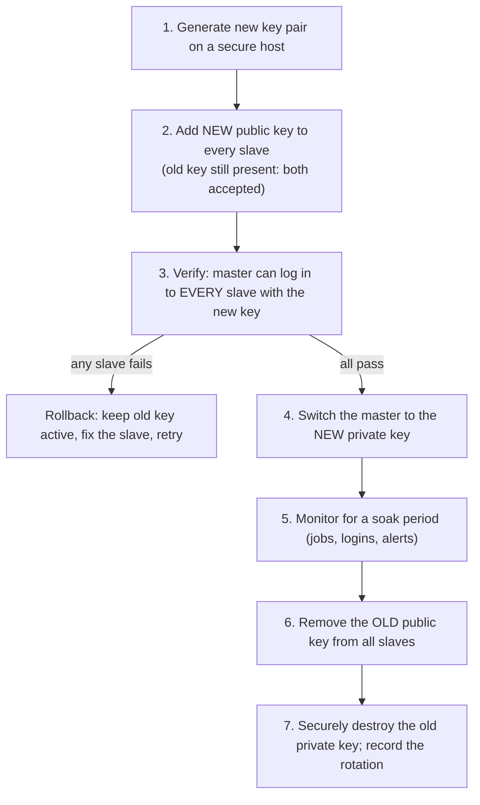

# HLD — Systems & Ops Logic

[← Back to System Design](../README.md)

## Zero-downtime SSH key rotation in a master–slave architecture

**Setup:** a master connects to many slaves over SSH. The master holds the **private** key; each slave holds the matching **public** key in `authorized_keys`. Rotate the key pair **without ever losing access** to any slave.

### The dual-key overlap procedure

### Points to cover in an answer
- **Why overlap:** removing the old key before every slave accepts the new one causes lockouts; the overlap window makes the change reversible.
- **Verification** is per slave (not "most slaves"); automate it and **block** the cutover until 100 % pass.
- **Rollback safety:** until step 6, switching the master back to the old private key restores access. After step 6, rollback requires re-adding the old public key through another path (console/out-of-band access), so keep a break-glass account.
- **Slaves that are offline or newly added** during rotation: retry queue; new slaves must be provisioned with both keys during the window.
- **Automation & audit:** configuration management (Ansible/Chef), idempotent playbooks, logging who/when, short overlap window, alerting on logins using the old key after cutover.
- **Blast radius:** rotate in batches/canaries, not all at once, for large fleets; consider short-lived **SSH certificates** (a CA signs keys with a TTL) to remove rotation work entirely.
- **Key hygiene:** passphrase/HSM/agent storage for the private key, least-privilege accounts, restrict by source IP/`command=`.

## Checklist
- [ ] Draw the 7-step flow from memory
- [ ] Explain rollback at each step and the point of no return
- [ ] Mention SSH certificates as the long-term fix
