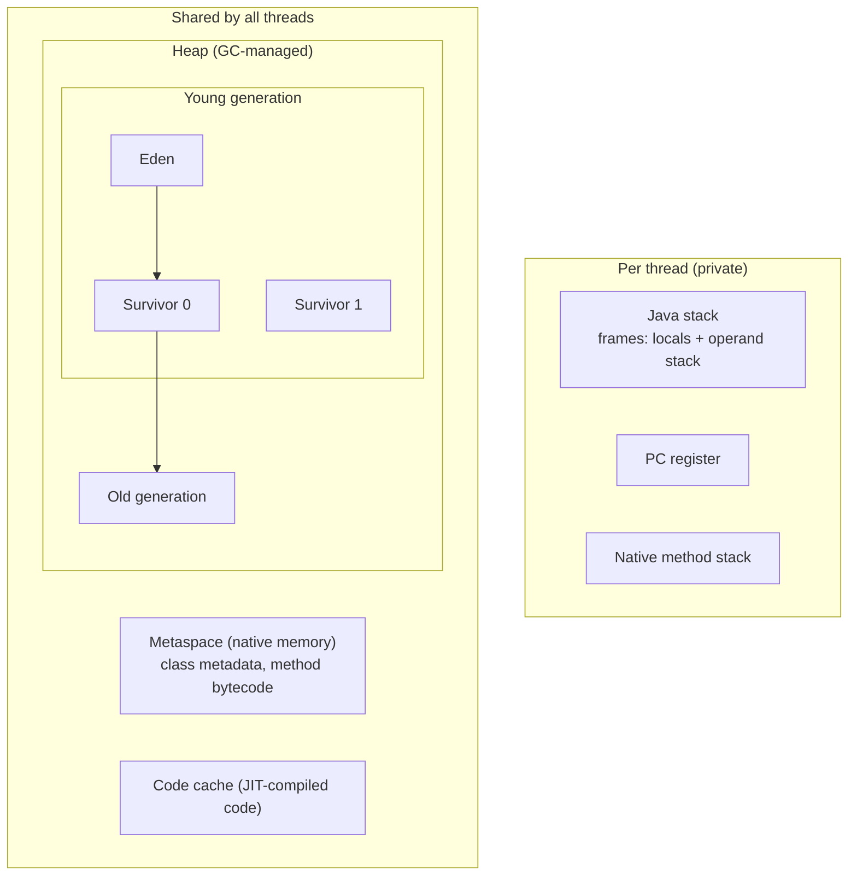
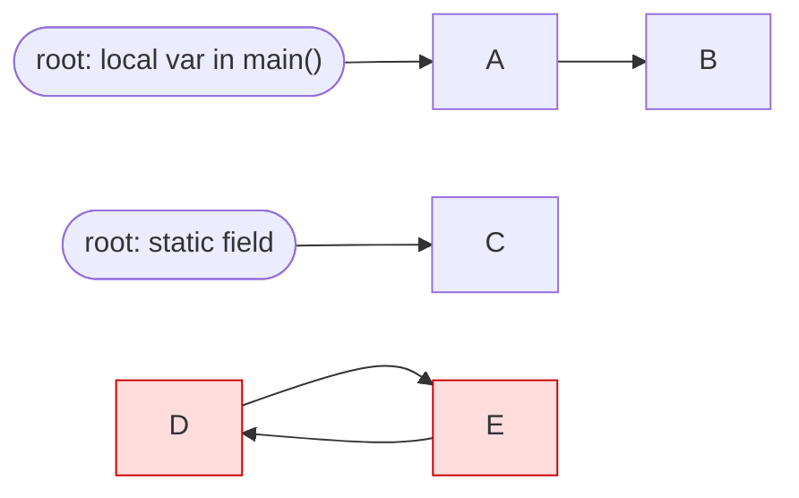

# Memory Model: Stack, Heap, References & GC Basics

> **Level:** SDE-II / SDE-III · **Area:** Java · **Next:** [Primitives, wrappers & equality](02-primitives-wrappers-equality.md)

## TL;DR

- **Stack** (one per thread): method frames holding *primitives* and *references*. Fast, automatic, LIFO.
- **Heap** (shared): every object and array. Cleaned by the **garbage collector** when no *GC root* can reach an object.
- A variable of class type holds a **reference**, not the object. Java is **always pass-by-value** — for objects, the *value passed is the reference*.
- "No pointers" does not mean "no leaks": anything still reachable (static maps, listeners, `ThreadLocal`s) is never collected.

## The analogy: your desk and the warehouse

- Your **desk** (stack frame) holds small sticky notes: numbers (`int x = 5`) and *address slips* ("the box is in warehouse aisle 7").
- The **warehouse** (heap) holds the actual boxes (objects), shared by everyone in the company (threads).
- When you finish a task (method returns) your desk is wiped instantly — but the boxes remain.
- A **janitor** (GC) periodically throws away boxes that **no address slip anywhere** points to.

Copying a slip doesn't copy the box: two slips can point to the same box. That is the entire pass-by-value story.

## 1. JVM runtime data areas



| Area | Holds | Failure |
|---|---|---|
| Java stack | frames per method call: local variables, operand stack, return address | `StackOverflowError` (usually unbounded recursion; size via `-Xss`) |
| Heap | all objects and arrays; String pool | `OutOfMemoryError: Java heap space` (`-Xmx`) |
| Metaspace | class metadata (replaced PermGen in Java 8; native memory, unbounded by default) | `OutOfMemoryError: Metaspace` (class-loader leaks, e.g. redeploys) |
| Native/direct | `ByteBuffer.allocateDirect`, thread stacks, JNI | `OutOfMemoryError: Direct buffer memory` / `unable to create native thread` |

## 2. What lives where?

```java
void demo() {
    int x = 5;                       // stack: the value 5
    String s = "hi";                 // stack: reference -> String object (pooled, heap)
    List<Integer> list = new ArrayList<>();   // stack: reference -> ArrayList object on heap
    list.add(42);                    // heap: Integer 42 (cached) inside the ArrayList's array
}
```

- **Instance fields** live *inside their object* on the heap, even `int` fields.
- **Static fields** live with the class (in Metaspace/heap mirror) and are GC roots as long as the class is loaded.
- **Local variables** captured by a lambda are *copied*, which is why they must be effectively final.

## 3. Java is always pass-by-value

```java
// Run: PassByValue.java
public class PassByValue {
    static class Box { int v; Box(int v) { this.v = v; } }

    static void inc(int x)           { x++; }                       // changes the copy only
    static void mutate(Box b)        { b.v = 99; }                  // follows the reference copy -> changes the shared object
    static void reassign(Box b)      { b = new Box(-1); }           // repoints the local copy only
    static void swap(Box a, Box b)   { Box t = a; a = b; b = t; }   // swaps local copies only

    public static void main(String[] args) {
        int n = 5;       inc(n);          System.out.println("n = " + n);            // 5

        Box box = new Box(1);
        mutate(box);                       System.out.println("after mutate   = " + box.v);   // 99
        reassign(box);                     System.out.println("after reassign = " + box.v);   // 99

        Box p = new Box(1), q = new Box(2);
        swap(p, q);                        System.out.println("after swap = " + p.v + "," + q.v); // 1,2
    }
}
```

```text
n = 5
after mutate   = 99
after reassign = 99
after swap = 1,2
```

> [!NOTE]
> "Pass-by-reference" would mean the callee could repoint the *caller's variable*. Java can't. It passes a **copy of the reference**; both copies point to the same object, so *mutating* is visible, *reassigning* is not.

## 4. Object layout (advanced)

Every HotSpot object has a **header** then fields, padded to an **8-byte boundary**:

| Part | Size (64-bit, compressed class pointers — default) |
|---|---|
| Mark word (identity hash, lock state, GC age) | 8 B |
| Class pointer | 4 B |
| Fields (`int` 4 B, `long`/`double` 8 B, reference 4 B with compressed oops, `boolean`/`byte` 1 B …) | varies |
| Padding | to a multiple of 8 B |

So `new Object()` ≈ 16 B and `new Integer(1)` ≈ 16 B vs a 4 B `int`. An `ArrayList<Integer>` with a million entries costs ~4 MB for references **plus ~16 MB** for the `Integer` objects. That's why primitive streams and libraries like fastutil/Eclipse Collections exist. (Recent JDKs offer *compact object headers* that shrink the header to 8 B.)

Tool: **JOL** (`org.openjdk.jol`) prints exact layouts.

## 5. How objects die: reachability and GC roots

An object is garbage if it is **not reachable** from any **GC root**: live thread stacks (locals), static fields, JNI references, active monitors, etc. There is no reference counting, so **cycles are collected** fine.



`D` and `E` reference each other but nothing from a root reaches them → both are eligible for collection.

**Generational hypothesis:** most objects die young. New objects are allocated in **Eden** (very fast: pointer bump inside a per-thread **TLAB**). A *minor GC* copies survivors to a survivor space; objects surviving enough cycles are **promoted** to the old generation; a *major/mixed GC* cleans that. (Collector details — G1, ZGC, Shenandoah — come in the JVM section.)

**Escape analysis (advanced):** if the JIT proves an object never escapes a method, it may skip heap allocation entirely (*scalar replacement*) — so "every `new` allocates on the heap" is the *semantic* model, not always the physical one.

## 6. Memory leaks in a garbage-collected language

A "leak" in Java means **unintentionally reachable** objects:

| Cause | Example | Fix |
|---|---|---|
| Unbounded static cache | `static Map<K,V> CACHE` that never evicts | bounded cache (LRU/Caffeine), `WeakHashMap`, `SoftReference` |
| Listeners/callbacks never deregistered | `bus.register(this)` without `unregister` | lifecycle hooks / weak listeners |
| `ThreadLocal` in thread pools | value stays as long as the pooled thread lives | `remove()` in `finally` |
| Mutable key "ghost" entries | see [equals & hashCode](../02-collections/02-equals-hashcode.md) | immutable keys |
| Unclosed resources | streams, connections, `Closeable`s | try-with-resources |
| Inner class holding outer | non-static inner class / lambda captures `this` | `static` nested classes; avoid capturing |
| Class-loader leaks | static refs into app classes on redeploy → Metaspace OOM | clean shutdown hooks |

### Reference strengths

| Type | Collected when | Typical use |
|---|---|---|
| Strong (`Object o = …`) | never while reachable | normal |
| `SoftReference` | only under memory pressure | memory-sensitive caches |
| `WeakReference` | at next GC if only weakly reachable | `WeakHashMap`, canonicalising maps |
| `PhantomReference` | after finalisation, for cleanup actions | `Cleaner` (replaces `finalize()`, which is deprecated for removal) |

## 7. Stack depth, concretely

```java
// Run: StackDepth.java
public class StackDepth {
    static int depth = 0;
    static void recurse() { depth++; recurse(); }

    public static void main(String[] args) {
        try { recurse(); }
        catch (StackOverflowError e) {
            System.out.println("StackOverflowError caught; depth > 1000? " + (depth > 1000));
        }
    }
}
```

```text
StackOverflowError caught; depth > 1000? true
```

(The exact depth depends on `-Xss`, frame size and JIT — typically 10,000–25,000 with the default 1 MB.) Fix by iteration, an explicit `Deque`, or tail-restructuring; Java does **not** do tail-call elimination.

## 8. Interview Q&A

<details>
<summary><b>Q1.</b> Is Java pass-by-value or pass-by-reference?</summary>

Always pass-by-value. For object parameters the value being copied is the *reference*, so the callee can mutate the shared object but cannot repoint the caller's variable (the `swap` method doesn't work).
</details>

<details>
<summary><b>Q2.</b> Where are objects, local variables, static variables and string literals stored?</summary>

Objects & arrays: heap. Primitive locals and references: stack frame. Static variables: class metadata area/heap mirror (alive as long as the class). String literals: String pool, which is on the heap since Java 7. Instance primitives: inside their object on the heap.
</details>

<details>
<summary><b>Q3.</b> Explain young and old generation, and minor vs major GC.</summary>

New objects start in Eden. Minor GC copies live objects from Eden+one survivor to the other survivor (stop-the-world, fast because only live objects are touched). After a tenuring threshold, objects are promoted to the old gen, which is collected less often by major/mixed GCs. This exploits "most objects die young".
</details>

<details>
<summary><b>Q4.</b> Can Java have memory leaks?</summary>

Yes: objects that are reachable but no longer needed — static collections that grow forever, unremoved listeners, `ThreadLocal`s in pools, unclosed resources, mutable hash keys. GC only reclaims *unreachable* objects.
</details>

<details>
<summary><b>Q5.</b> What's the difference between <code>StackOverflowError</code> and <code>OutOfMemoryError</code>?</summary>

SOE: a thread's stack is exhausted (deep/infinite recursion). OOM: a memory region (heap, metaspace, direct memory, native threads) cannot satisfy an allocation. SOE is per-thread; OOM is process/region-wide. Both are `Error`s — don't try to "handle" them except for logging/cleanup.
</details>

<details>
<summary><b>Q6.</b> Do cyclic references prevent GC?</summary>

No. HotSpot uses reachability from GC roots (tracing), not reference counting.
</details>

<details>
<summary><b>Q7.</b> How would you diagnose a memory leak in production?</summary>

Watch heap after GC trending upward (JMX/metrics), take a heap dump (`jcmd <pid> GC.heap_dump` or `-XX:+HeapDumpOnOutOfMemoryError`), open in Eclipse MAT / VisualVM, check the *dominator tree* and *path to GC roots* of the biggest retained sets; confirm with JFR allocation profiling.
</details>

<details>
<summary><b>Q8.</b> What is a TLAB?</summary>

A Thread-Local Allocation Buffer — a slice of Eden reserved per thread so allocation is a lock-free pointer bump. A thread requests a new TLAB when its current one is exhausted.
</details>

## 9. Predict the output

<details>
<summary><b>P1.</b> What does this print?</summary>

```java
static void change(StringBuilder sb, String s) { sb.append("!"); s = s + "!"; }
StringBuilder sb = new StringBuilder("a"); String s = "a";
change(sb, s);
System.out.println(sb + " " + s);
```

**`a! a`** — the `StringBuilder` is mutated via the shared reference; `String` is immutable and `s = s + "!"` only rebinds the local copy.
</details>

<details>
<summary><b>P2.</b> Is the <code>Object</code> created here eligible for GC when the method returns?</summary>

```java
List<Object> keep = new ArrayList<>();
void f() { Object o = new Object(); keep.add(o); }
```

**No.** `keep` is reachable (a field of a live object), and it references `o`.
</details>

---
[↑ Back to Java Basics index](README.md)
