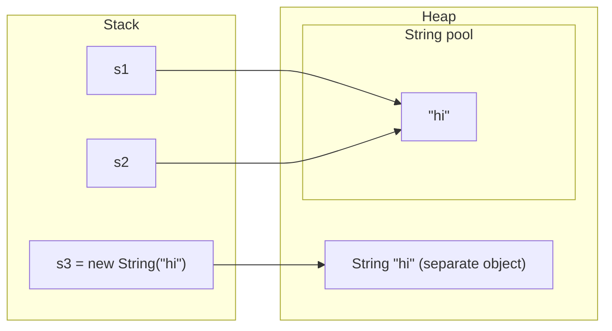

# Strings: Immutability, the Pool & Performance

> **Level:** SDE-II / SDE-III · **Area:** Java · **Prev:** [Primitives & wrappers](02-primitives-wrappers-equality.md) · **Next:** [OOP & polymorphism](04-oop-polymorphism.md)

## TL;DR

- `String` is **immutable**: every "modification" returns a **new** object. That makes it thread-safe, cacheable (the **String pool**), safe as a `HashMap` key (hash computed once), and secure as a parameter (can't be changed after validation).
- String **literals** (and compile-time constants) are **interned** in the pool: same literal → same object. `new String("x")` always creates a **new** object.
- Never compare with `==`; use `equals`.
- Use `StringBuilder` for loops; plain `+` is fine for one-off expressions.

## The analogy: a laminated ID card

You can't edit a laminated card. To "change" a name you print a **new card** and throw away the old one. Because nobody can alter it behind your back, you can hand the same card to a hundred people (share it, cache it) without worry. The pool is the **card drawer**: ask for the card "Alice" twice and you get the same card.

## 1. Pool vs heap



- The pool is a hash table of strings kept **on the heap** (moved from PermGen in Java 7; so pooled strings *are* garbage-collectable).
- `intern()` returns the pooled instance, adding the string if absent.

```java
// Run: StringPoolDemo.java
public class StringPoolDemo {
    static final String CONST = "hel";               // compile-time constant

    public static void main(String[] args) {
        String a = "hello";
        String b = "hello";
        String c = new String("hello");
        String d = "hel" + "lo";                     // folded by javac to "hello"
        String e = CONST + "lo";                     // CONST is a constant variable -> folded
        String part = "hel";
        String f = part + "lo";                      // not constant -> built at runtime

        System.out.println("a == b          : " + (a == b));            // true
        System.out.println("a == c          : " + (a == c));            // false
        System.out.println("a.equals(c)     : " + a.equals(c));         // true
        System.out.println("a == d          : " + (a == d));            // true  (constant folding)
        System.out.println("a == e          : " + (a == e));            // true
        System.out.println("a == f          : " + (a == f));            // false (runtime concat -> new object)
        System.out.println("a == f.intern() : " + (a == f.intern()));   // true
    }
}
```

Output:

```text
a == b          : true
a == c          : false
a.equals(c)     : true
a == d          : true
a == e          : true
a == f          : false
a == f.intern() : true
```

**"How many objects does `new String("hello")` create?"** — Up to **two**: the pooled literal `"hello"` (if not already present) and the new heap `String`.

## 2. Why is `String` immutable? (be able to give four reasons)

1. **Security** — class names, file paths, URLs, DB credentials passed to APIs can't be mutated after validation (no TOCTOU).
2. **Pooling** — sharing instances is only safe if no one can modify them.
3. **Hash caching** — `hashCode()` is computed once and stored in a field (`hash`), so strings are fast `HashMap` keys and the key never changes.
4. **Thread safety** — freely shareable without synchronisation.

(Also: class loading depends on string names; simplicity.)

## 3. Concatenation and `StringBuilder`

```java
String s = "";
for (int i = 0; i < 100_000; i++) s += i;     // O(n²): copies the growing string every iteration

StringBuilder sb = new StringBuilder();
for (int i = 0; i < 100_000; i++) sb.append(i); // amortised O(n)
String result = sb.toString();
```

| Class | Mutable | Thread-safe | Use |
|---|---|---|---|
| `String` | no | yes (immutable) | default |
| `StringBuilder` | yes | **no** | building strings in one thread (99 % of cases) |
| `StringBuffer` | yes | yes (synchronised) | legacy; rarely needed |

- Since Java 9 `javac` compiles `a + b + c` to an **`invokedynamic`** call to `StringConcatFactory` (no hidden `StringBuilder` chain). A single expression is already optimal. **Concatenating inside a loop is still quadratic.**
- Since Java 9, strings use **compact strings**: a `byte[]` with Latin-1 (1 B/char) when all chars fit, UTF-16 (2 B/char) otherwise.

## 4. Useful API & gotchas

```java
// Run: StringApiDemo.java
import java.util.*;

public class StringApiDemo {
    public static void main(String[] args) {
        // split drops trailing empty strings (unless limit is negative); arg is a REGEX
        System.out.println(Arrays.toString("a,b,,".split(",")));        // [a, b]
        System.out.println(Arrays.toString("a,b,,".split(",", -1)));    // [a, b, , ]
        System.out.println(Arrays.toString("a.b".split(".")));          // []   '.' is a regex wildcard!
        System.out.println(Arrays.toString("a.b".split("\\.")));        // [a, b]

        // Java 11+ helpers
        System.out.println("  hi  ".trim().length() + " vs " + "  hi  ".strip().length()); // trim only strips <= U+0020
        System.out.println("   ".isBlank() + " " + "".isEmpty());        // true true
        System.out.println("ab".repeat(3));                              // ababab
        System.out.println(String.join("-", List.of("x", "y", "z")));    // x-y-z

        // Text block (Java 15): indentation stripped relative to closing delimiter
        String json = """
            {
              "name": "Ada",
              "lang": "Java"
            }
            """;
        System.out.print(json);

        // equals ordering: avoid NPE by calling on the constant
        String input = null;
        System.out.println("yes".equals(input));                         // false (no NPE)

        // substring copies (since 7u6) — it no longer retains the parent's char[]
        String big = "x".repeat(1_000_000);
        String tiny = big.substring(0, 3);                               // independent 3-char string
        System.out.println(tiny);

        // chars / code points: char is a UTF-16 unit, not a "character"
        String emoji = "😀";
        System.out.println(emoji.length() + " " + emoji.codePointCount(0, emoji.length()));  // 2 1
    }
}
```

Output:

```text
[a, b]
[a, b, , ]
[]
[a, b]
4 vs 2
true true
ababab
x-y-z
{
  "name": "Ada",
  "lang": "Java"
}
false
xxx
2 1
```

> [!NOTE]
> `trim()` removes only characters ≤ `U+0020` (ASCII space, tab, newline…); `strip()` (Java 11) removes all Unicode whitespace (`Character.isWhitespace`). The sample string `"  hi  "` ends with an EM SPACE (U+2003): `trim()` stops at it and returns `"hi  "` (length 4), while `strip()` removes it and returns `"hi"` (length 2). Prefer `strip()`.

### Passwords

Store secrets in `char[]` (and zero it after use), not `String`: strings are immutable, pooled and may sit in memory/heap dumps until GC.

## 5. `hashCode()` of a `String`

`s.hashCode() = s[0]·31ⁿ⁻¹ + s[1]·31ⁿ⁻² + … + s[n−1]`, cached after first computation (an empty-string/zero-hash edge case is handled with a `hashIsZero` flag). Collisions are legal: `"Aa".hashCode() == "BB".hashCode()` (2112). See [equals & hashCode](../02-collections/02-equals-hashcode.md).

## 6. Interview Q&A

<details>
<summary><b>Q1.</b> What's the difference between <code>==</code> and <code>equals()</code> for strings?</summary>

`==` compares references; `equals` compares characters. Literals are interned so `"a" == "a"` is true, but strings built at runtime (`new String`, concatenation of non-constants, `substring`, `StringBuilder.toString`, input from users) are different objects. Always use `equals` (or `equalsIgnoreCase`).
</details>

<details>
<summary><b>Q2.</b> Why is <code>String</code> immutable?</summary>

Security (validated values can't change), safe sharing via the pool, cached hash code for use as a map key, and inherent thread safety.
</details>

<details>
<summary><b>Q3.</b> <code>String</code> vs <code>StringBuilder</code> vs <code>StringBuffer</code>?</summary>

Immutable vs mutable-unsynchronised vs mutable-synchronised. Use `StringBuilder` for local string building; `StringBuffer` is legacy and its locking is nearly never what you want.
</details>

<details>
<summary><b>Q4.</b> What does <code>intern()</code> do? Should you use it?</summary>

Returns the canonical pooled instance. Rarely worth it: it can save memory when you have millions of duplicate strings, but the pool lookup costs CPU and a bounded-size cache you manage yourself (or the G1 `-XX:+UseStringDeduplication` option) is usually better.
</details>

<details>
<summary><b>Q5.</b> Where is the String pool located?</summary>

On the heap since Java 7 (previously PermGen), so interned strings can be garbage collected when unreachable. Its size is tunable (`-XX:StringTableSize`).
</details>

<details>
<summary><b>Q6.</b> Why is <code>s += x</code> in a loop slow, and what's the complexity?</summary>

Each iteration allocates a new string and copies all previous characters: O(n²) total. `StringBuilder.append` is amortised O(1) per character.
</details>

<details>
<summary><b>Q7.</b> Is <code>String</code> a good <code>HashMap</code> key?</summary>

Yes: immutable, `hashCode` cached after the first call, well-distributed, `equals` first compares length/bytes. Its only quirk is predictable collisions (hash flooding), mitigated by tree bins.
</details>

<details>
<summary><b>Q8.</b> How would you reverse a string, and what about Unicode surrogate pairs?</summary>

`new StringBuilder(s).reverse().toString()` — `StringBuilder.reverse()` correctly treats surrogate pairs as a unit, whereas manually swapping `char`s would break emoji/supplementary characters.
</details>

## 7. Predict the output

<details>
<summary><b>P1.</b></summary>

```java
String s1 = "java";
String s2 = new String("java");
String s3 = s2.intern();
System.out.println((s1 == s2) + " " + (s1 == s3));
```

**`false true`**
</details>

<details>
<summary><b>P2.</b></summary>

```java
String s = "a";
s.concat("b");
s.toUpperCase();
System.out.println(s);
```

**`a`** — the return values are discarded; `String` methods never mutate.
</details>

<details>
<summary><b>P3.</b></summary>

```java
final String x = "ab";
String y = "a";
System.out.println((x == "a" + "b") + " " + (x == y + "b"));
```

**`true false`** — `"a" + "b"` is a constant expression (pooled); `y + "b"` involves a non-final variable so it is computed at runtime into a new object.
</details>

<details>
<summary><b>P4.</b></summary>

```java
System.out.println(1 + 2 + "3" + 4 + 5);
```

**`3345`** — evaluated left to right: `1+2=3`, then `"3"` forces concatenation: `"33"`, `"334"`, `"3345"`.
</details>

---
[↑ Back to Java Basics index](README.md)
