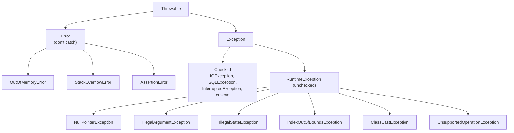

# Exceptions: Checked vs Unchecked, `finally`, try-with-resources

> **Level:** SDE-II / SDE-III · **Area:** Java · **Prev:** [OOP & polymorphism](04-oop-polymorphism.md) · **Next:** [Generics](06-generics.md)

## TL;DR

- Hierarchy: `Throwable` → **`Error`** (JVM problems, don't catch) and **`Exception`** → **`RuntimeException`** (*unchecked*, programmer bugs) / everything else (*checked*, recoverable conditions the caller must handle).
- **Checked** = compiler forces `catch` or `throws`. **Unchecked** = it doesn't.
- `finally` always runs (except `System.exit`/JVM death) — and a `return`/`throw` inside it **overrides** the try's outcome.
- Use **try-with-resources** for anything `AutoCloseable`; it closes in reverse order and records secondary failures as **suppressed** exceptions.
- Preserve the **cause** when wrapping: `throw new XException("msg", e)`.

## The analogy: a hospital triage desk

- **`Error`** — the building is on fire (`OutOfMemoryError`): you don't treat it at the desk.
- **Checked exception** — a *known, foreseeable* problem the process *requires* you to plan for ("patient has no insurance" → `IOException`, `SQLException`): the form won't be accepted until you say what you'll do.
- **Unchecked exception** — a *mistake in how the form was filled* (`NullPointerException`, `IllegalArgumentException`): fix the bug rather than building a procedure around it.



## 1. Checked vs unchecked — how to choose

| | Checked | Unchecked |
|---|---|---|
| Compiler enforces handling | yes | no |
| Meaning | **Recoverable**, caller can reasonably do something (retry, fallback, ask the user) | **Bug / precondition violated** (null, bad argument, illegal state) |
| Examples | `IOException`, `SQLException`, `TimeoutException` | `NPE`, `IAE`, `ISE`, `ArithmeticException` |
| Downsides | pollutes signatures, breaks lambdas, tempts empty `catch` | can propagate unnoticed |

Modern practice (Spring, most libraries): **prefer unchecked exceptions** for application/domain errors, and translate low-level checked ones at layer boundaries (Spring's `DataAccessException` hierarchy replaces `SQLException`). Use checked exceptions only when callers can genuinely recover.

## 2. `finally`, `return` and swallowed exceptions

```java
// Run: FinallyTraps.java
public class FinallyTraps {
    static int normal() {
        try { return 1; }
        finally { System.out.println("finally runs before the method actually returns"); }
    }

    static int copyIsReturned() {
        int x = 1;
        try { return x; }          // the value 1 is evaluated and saved...
        finally { x = 99; }        // ...so changing x here has no effect
    }

    @SuppressWarnings("finally")
    static int swallow() {
        try { throw new RuntimeException("boom"); }
        finally { return 2; }      // BAD: discards the exception completely
    }

    public static void main(String[] args) {
        System.out.println(normal());          // prints the finally message, then 1
        System.out.println(copyIsReturned());  // 1
        System.out.println(swallow());         // 2  (exception vanished)
    }
}
```

```text
finally runs before the method actually returns
1
1
2
```

Rules: never `return`/`throw`/`break` out of `finally`. `finally` is skipped only if the JVM exits (`System.exit`, crash), the thread is killed, or it loops forever in the `try`.

## 3. try-with-resources and suppressed exceptions

```java
// Run: TryWithResources.java
public class TryWithResources {
    static class Res implements AutoCloseable {
        final String name;
        Res(String name) { this.name = name; System.out.println("open  " + name); }
        @Override public void close() {
            System.out.println("close " + name);
            throw new IllegalStateException("close-failed-" + name);
        }
    }

    public static void main(String[] args) {
        try (Res a = new Res("A"); Res b = new Res("B")) {
            System.out.println("body");
            throw new RuntimeException("body-failed");
        } catch (Exception e) {
            System.out.println("caught: " + e.getMessage());
            for (Throwable s : e.getSuppressed()) System.out.println("  suppressed: " + s.getMessage());
        }
    }
}
```

```text
open  A
open  B
body
close B
close A
caught: body-failed
  suppressed: close-failed-B
  suppressed: close-failed-A
```

- Resources close in **reverse** order of declaration, **before** `catch`/`finally` run.
- The **primary** exception (from the body) is the one propagated; exceptions from `close()` are attached via `addSuppressed` — in the old `try/finally` style, the `close()` exception would have **replaced** the real one and hidden the root cause.
- Java 9+: you can use an effectively-final variable: `try (conn) { … }`.

## 4. Writing good exception code

```java
// Wrap with the cause; use specific types; keep context
public class OrderNotFoundException extends RuntimeException {
    private final long orderId;
    public OrderNotFoundException(long orderId, Throwable cause) {
        super("Order " + orderId + " not found", cause);
        this.orderId = orderId;
    }
    public long orderId() { return orderId; }
}
```

| Do | Don't |
|---|---|
| Catch the **most specific** type you can handle | `catch (Exception e) {}` (empty) or `catch (Throwable t)` |
| **Log or rethrow**, not both (duplicated stack traces) | log-and-throw at every layer |
| Preserve the **cause** (`new X(msg, cause)`) | `throw new X(e.getMessage())` — loses the stack trace |
| Fail fast with `IllegalArgumentException` / `Objects.requireNonNull(x, "x")` | return `null`/magic codes for errors |
| Restore the interrupt flag: `Thread.currentThread().interrupt()` after catching `InterruptedException` | swallow `InterruptedException` |
| Use `Optional` / result types for *expected* "not found" | use exceptions for ordinary control flow |

**Overriding rule:** an overriding method cannot declare **new or broader checked** exceptions than the method it overrides (it can declare fewer, narrower, or any unchecked).

**Multi-catch:** `catch (IOException | SQLException e)` (alternatives can't be subclasses of each other; `e` is implicitly final).

**Catch order:** specific before general; the compiler rejects an unreachable `catch (IOException)` after `catch (Exception)`.

**Precise rethrow (Java 7):** `catch (Exception e) { log(e); throw e; }` — the compiler knows `e` can only be the checked exceptions the `try` body actually throws, so the method needn't declare `throws Exception`.

### Performance note (advanced)

Constructing a `Throwable` calls `fillInStackTrace()`, which walks the stack — **expensive** (microseconds, scales with depth). Throwing/catching itself is cheap-ish when the JIT can inline. For high-frequency control-flow exceptions (rare, but e.g. parsers) a custom exception may disable the trace:

```java
class FastException extends RuntimeException {
    FastException(String m) { super(m, null, false, false); }  // enableSuppression=false, writableStackTrace=false
}
```

### Exceptions and lambdas / streams

Functional interfaces (`Function`, `Runnable`) don't declare checked exceptions, so this doesn't compile:

```java
paths.stream().map(p -> Files.readString(p));   // error: unreported IOException
```

Fix with a helper that wraps checked → unchecked (`UncheckedIOException` exists for I/O), or a `try/catch` inside the lambda. Don't use "sneaky throw" tricks in production.

## 5. Common built-in exceptions — when to throw which

| Exception | Throw when |
|---|---|
| `IllegalArgumentException` | an argument value is invalid |
| `NullPointerException` | a required argument is null (`Objects.requireNonNull`) |
| `IllegalStateException` | the object is in the wrong state for this call |
| `UnsupportedOperationException` | an optional operation isn't supported (immutable collections) |
| `IndexOutOfBoundsException` | index outside `[0, size)` |
| `ConcurrentModificationException` | structural change during iteration (detect only) |
| `NoSuchElementException` | `Optional.get()` on empty, iterator exhausted |
| `ArithmeticException` | integer divide by zero, `*Exact` overflow |
| `ClassCastException` | invalid downcast / heap pollution |

## 6. Interview Q&A

<details>
<summary><b>Q1.</b> Checked vs unchecked exceptions — and which do you prefer?</summary>

Checked extend `Exception` (not `RuntimeException`) and must be declared/handled; unchecked extend `RuntimeException` and don't. Use checked for recoverable external conditions the caller can act on; use unchecked for bugs and domain/validation failures. Most modern frameworks go unchecked to avoid signature pollution and enable lambdas.
</details>

<details>
<summary><b>Q2.</b> Does <code>finally</code> always execute? What if <code>try</code> has a <code>return</code>?</summary>

Yes, except when the JVM halts. With `return` in `try`, the return value is computed first, then `finally` runs, then the method returns the *saved* value — unless `finally` itself returns/throws, which overrides it.
</details>

<details>
<summary><b>Q3.</b> What are suppressed exceptions?</summary>

Secondary exceptions that occur while handling a primary one — most commonly thrown by `close()` in try-with-resources. They're attached to the primary via `Throwable.addSuppressed` and read with `getSuppressed()`, so the root cause isn't hidden.
</details>

<details>
<summary><b>Q4.</b> What's the difference between <code>throw</code> and <code>throws</code>? <code>final</code>, <code>finally</code>, <code>finalize</code>?</summary>

`throw` raises an exception instance; `throws` declares checked exceptions a method may propagate. `final` = non-reassignable/non-overridable/non-extendable; `finally` = always-run block; `finalize()` = deprecated-for-removal pre-GC hook (use `Cleaner`/try-with-resources).
</details>

<details>
<summary><b>Q5.</b> Why shouldn't you catch <code>Exception</code>/<code>Throwable</code> broadly?</summary>

You'd hide bugs, swallow `InterruptedException`, and (with `Throwable`) catch `OutOfMemoryError`/`StackOverflowError`, leaving the program in an undefined state. Catch narrowly at the level that can actually handle it; use one top-level handler (e.g. Spring `@ControllerAdvice`) for the rest.
</details>

<details>
<summary><b>Q6.</b> What happens if both <code>try</code> and <code>finally</code> throw?</summary>

The exception from `finally` propagates; the one from `try` is lost (unless you used try-with-resources, which keeps it and suppresses the secondary one).
</details>

<details>
<summary><b>Q7.</b> How do you handle checked exceptions inside a stream lambda?</summary>

Catch inside the lambda and wrap (`UncheckedIOException`/custom runtime), or write a small functional interface that throws and a wrapper that converts. Alternatively avoid streams for that block.
</details>

<details>
<summary><b>Q8.</b> Why is creating exceptions expensive and how do you mitigate?</summary>

`fillInStackTrace()` captures the whole call stack. Avoid exceptions for normal control flow; reuse preallocated exceptions or disable the stack trace (`writableStackTrace=false`) for hot paths; log stack traces once.
</details>

## 7. Predict the output

<details>
<summary><b>P1.</b></summary>

```java
static String f() {
    StringBuilder sb = new StringBuilder("a");
    try { return sb.append("b").toString(); }
    finally { sb.append("c"); }
}
System.out.println(f());
```

**`ab`** — the returned `String` was already produced; later changes to `sb` don't affect it.
</details>

<details>
<summary><b>P2.</b></summary>

```java
static StringBuilder g() {
    StringBuilder sb = new StringBuilder("a");
    try { return sb.append("b"); }
    finally { sb.append("c"); }
}
System.out.println(g());
```

**`abc`** — the *reference* is returned, and `finally` mutates the same object.
</details>

<details>
<summary><b>P3.</b></summary>

```java
try { throw new Exception("x"); }
catch (Exception e) { System.out.println("catch"); throw new RuntimeException("y"); }
finally { System.out.println("finally"); }
```

Prints **`catch`**, then **`finally`**, then the `RuntimeException: y` propagates (the original `x` was handled).
</details>

---
[↑ Back to Java Basics index](README.md)
