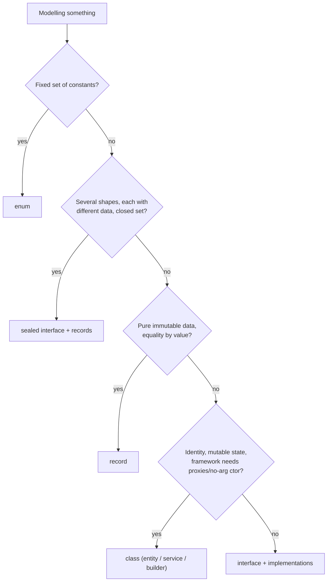

# Choosing the Right Tool: Records vs Classes, Streams vs Loops, Collections, `Optional` vs Exceptions

> **Level:** SDE-II / SDE-III · **Area:** Java · **Prev:** [Modern Java](08-modern-java.md) · **Next:** [Concurrency](../03-concurrency/README.md)

## TL;DR — the 10-line cheat sheet

| Situation | Reach for |
|---|---|
| Immutable data carrier / DTO / map key / tuple | **`record`** |
| Fixed, known set of constants (maybe with behaviour) | **`enum`** |
| Closed set of *alternatives with different data* | **`sealed interface` + `record`s** + pattern `switch` |
| Object with identity, mutable state, lifecycle (JPA entity, service, cache) | plain **`class`** |
| Capability that unrelated types share | **`interface`** |
| Transform / filter / group / aggregate a collection | **stream** |
| Early exit, several mutable variables, checked exceptions, index maths | **`for` loop** |
| One-line collection change | **collection method** (`removeIf`, `replaceAll`, `computeIfAbsent`, `merge`, `List.sort`) |
| "Might not exist" return value | **`Optional<T>`** (return type only) |
| Expected business failure the caller must branch on | **`Result` (sealed)** or checked/domain exception |
| Programming error / violated precondition | **unchecked exception** |
| Many blocking calls at once | **virtual threads** or `CompletableFuture` on an I/O executor |
| CPU-bound parallel work | `ForkJoinPool` / (carefully) `parallelStream` |

Everything below explains *why*.

## The analogy: a toolbox, not a trophy shelf

New language features aren't badges to collect. Each one is a tool with a **job**: a `record` is a *label maker* (fast, uniform labels), a `stream` is a *conveyor belt* (great for assembly lines, silly for tightening one screw), `Optional` is a *"may be empty" box* you hand back from a function. Using the wrong tool isn't "wrong Java" — it's just more code to read.

## 1. Data modelling: `record` vs `class` vs `enum` vs `sealed`



| | `record` | `class` | `enum` |
|---|---|---|---|
| Equality | by all components (generated) | by identity unless you override | by identity (singleton constants) |
| Mutability | shallowly immutable | up to you | constants immutable (fields can be) |
| Inheritance | can't extend, is `final`; can implement | full | can implement; can't extend |
| JPA entity | ❌ | ✅ | `@Enumerated` field ✅ |
| Jackson/Spring DTO | ✅ (best choice) | ✅ with boilerplate/Lombok | ✅ |
| `HashMap` key | ✅ ideal | only if you wrote `equals`/`hashCode` | ✅ (use `EnumMap`) |

**Records vs Lombok:** for new DTO/value classes, a record replaces `@Value`/`@Data` with zero dependencies. Keep Lombok for mutable entities/builders if your codebase already uses it.

**Rule of thumb:** *"Does it have identity that outlives its fields?"* — a `User` row with an id → class/entity. *"Is it just its fields?"* — `Money(amount, currency)`, `Point`, `ApiError(code, message)` → record.

## 2. Streams vs loops vs collection methods

```java
// 1. Prefer a collection method when one exists — shorter than any stream
list.removeIf(x -> x < 0);
map.merge(word, 1, Integer::sum);
list.sort(Comparator.comparing(Person::name));
map.computeIfAbsent(k, kk -> new ArrayList<>()).add(v);

// 2. Streams shine for pipelines: filter → transform → aggregate
Map<String, Double> avgByDept = emps.stream()
    .filter(Emp::active)
    .collect(Collectors.groupingBy(Emp::dept, Collectors.averagingInt(Emp::salary)));

// 3. Loops shine for early exit, side effects, several accumulators, checked exceptions
for (Path p : paths) {
    if (!Files.exists(p)) throw new FileNotFoundException(p.toString());   // checked + early exit
    total += Files.size(p);
}
```

Decision guide:

| Use a stream when… | Use a loop when… |
|---|---|
| It reads as a pipeline (`filter` → `map` → `collect`) | You need `break`/`continue`/early `return` with logic |
| You group, partition, count, join, sum | You update **more than one** variable per element |
| No checked exceptions inside the lambda | Lambda would throw checked exceptions |
| Operations are side-effect free | You mostly just want side effects → a plain `for` is clearer than `stream().forEach` |
| Primitive aggregation: `IntStream.range`, `mapToInt(...).sum()` | Index arithmetic (`i`, `i-1`, two pointers), arrays/DP |

Smells: a stream chain longer than ~5 stages · nested streams-in-streams · a lambda that spans 10+ lines (extract a method) · `collect(Collectors.toList())` just to loop again · `stream().forEach(...)` for a single side effect · `parallelStream()` "to make it faster" (see [streams note](07-lambdas-streams-optional.md#4-parallel-streams--when-not-to-use-them)). Readability beats cleverness.

## 3. Which collection (the defaults)

| Need | Default | Switch only if… |
|---|---|---|
| Ordered list | `ArrayList` | you only ever add/remove at the ends → `ArrayDeque` |
| Lookup by key | `HashMap` | order matters → `LinkedHashMap`; sorted/range → `TreeMap`; threads → `ConcurrentHashMap`; enum keys → `EnumMap` |
| Uniqueness | `HashSet` | keep order → `LinkedHashSet`; sorted → `TreeSet` |
| Stack / queue | `ArrayDeque` | priority order → `PriorityQueue`; thread hand-off → `BlockingQueue` |
| Fixed small constants | `List.of`, `Set.of`, `Map.of` | you need to mutate → copy into a mutable collection |

API design with collections:

- **Accept** the most general type that works (`Collection<? extends T>` / `Iterable<T>`); **return** `List`/`Set`/`Map` interfaces, never concrete classes.
- Return **empty collections, never `null`**. Return **unmodifiable** snapshots (`List.copyOf`) rather than your internal mutable list.
- Full decision tree: [Collections overview](../02-collections/01-framework-overview.md#pick-the-right-one-decision-tree).

## 4. "Might be missing" and "might fail" — four different problems

| Question | Tool | Example |
|---|---|---|
| A lookup may legitimately find nothing | `Optional<T>` return | `Optional<User> findById(long id)` |
| A *collection* result may be empty | empty collection | `List<Order> findOrders(...)` |
| Caller **violated a precondition** (bug) | unchecked exception | `IllegalArgumentException`, `Objects.requireNonNull` |
| An **expected failure** the caller should branch on (validation failed, payment declined, remote service says no) | **`Result` type** *or* a domain exception | see below |
| Infrastructure failed (I/O, timeout, DB down) | wrap into an unchecked domain exception at your boundary | `ExternalServiceException` — see [Async error handling](../03-concurrency/03-async-error-handling-http.md) |

### A `Result` type with sealed + records (no library needed)

```java
// Run: ResultDemo.java
import java.util.*;

public class ResultDemo {
    sealed interface Result<T> permits Ok, Err { }
    record Ok<T>(T value) implements Result<T> { }
    record Err<T>(String code, String message) implements Result<T> { }

    static Result<Integer> parseAge(String raw) {
        try {
            int age = Integer.parseInt(raw.trim());
            return age < 0 || age > 150 ? new Err<>("OUT_OF_RANGE", "age " + age) : new Ok<>(age);
        } catch (NumberFormatException e) {
            return new Err<>("NOT_A_NUMBER", "'" + raw + "'");
        }
    }

    public static void main(String[] args) {
        for (String raw : List.of("42", " 7 ", "abc", "200")) {
            String line = switch (parseAge(raw)) {                     // exhaustive: no default needed
                case Ok<Integer>(var age)               -> "valid age " + age;
                case Err<Integer>(var code, var msg)    -> "rejected [" + code + "]: " + msg;
            };
            System.out.println(line);
        }
    }
}
```

```text
valid age 42
valid age 7
rejected [NOT_A_NUMBER]: 'abc'
rejected [OUT_OF_RANGE]: age 200
```

**When `Result` beats exceptions:** expected, frequent outcomes (validation, business rules) and when you want the compiler to force every caller to handle failure. **When exceptions win:** unexpected/infrastructure failures that should unwind several layers to one handler (and frameworks like Spring map them centrally). Don't mix: pick one convention per layer.

### `Optional` — the short version

Use it **only as a return type**. Never as a field, a parameter, or inside a collection; never `Optional.get()` without a check (prefer `orElseThrow()`); prefer `orElseGet` over `orElse` for anything non-trivial. Details: [Optional](07-lambdas-streams-optional.md#5-optional).

## 5. Concurrency: which async tool?

| Problem | Tool | Why |
|---|---|---|
| Protect a shared counter/flag | `AtomicInteger` / `LongAdder` / `volatile` | no lock, no thread |
| Protect a multi-step invariant | `synchronized` / `ReentrantLock` | mutual exclusion |
| Run a few background tasks, simple | `ExecutorService` (bounded pool) | reuse threads, back-pressure |
| Compose async steps (call A then B, A+B in parallel, fallbacks) | `CompletableFuture` | non-blocking pipeline + error handling |
| **Thousands of concurrent blocking calls** (HTTP, JDBC) | **virtual threads** (`newVirtualThreadPerTaskExecutor`) | write simple blocking code, scale like async |
| CPU-heavy divide-and-conquer | `ForkJoinPool` / `parallelStream` (rare) | uses all cores |
| Run later / periodically | `ScheduledExecutorService` | built-in scheduling |
| Hand work between threads | `BlockingQueue` | back-pressure built in |

Details start at the [Concurrency index](../03-concurrency/README.md).

## 6. What to adopt first (priority by payoff)

**Use daily (high payoff, low risk):** `record` for DTOs · `var` where the type is obvious · switch *expressions* · text blocks · `List.of/Map.of` · `Stream.toList()` · `Optional` as a return type · `instanceof` patterns · try-with-resources · `HttpClient` (Java 11).

**Use deliberately (big payoff in the right spot):** `sealed` + pattern `switch` for domain alternatives · virtual threads for I/O-heavy services (Java 21) · `CompletableFuture` for fan-out/fan-in · `Collectors.groupingBy`/`teeing`.

**Know it exists:** sequenced collections (`getFirst`, `reversed`) · structured concurrency & scoped values (preview in 21) · stream gatherers · `_` unnamed variables.

**Avoid:** raw types · `Vector`/`Stack`/`Hashtable` · `parallelStream` by default · `Optional` fields · catching `Exception` broadly · `finalize()`.

## 7. Interview Q&A

<details>
<summary><b>Q1.</b> When would you not use a record?</summary>

When you need mutable state, inheritance, JPA/Hibernate entity semantics (no-arg constructor, proxying, dirty checking), or identity-based equality. Also when a component is a mutable type you can't defensively copy.
</details>

<details>
<summary><b>Q2.</b> Streams or a for loop — how do you decide?</summary>

Streams for declarative filter/map/group/aggregate pipelines without side effects or checked exceptions; loops for early exit, multiple accumulators, index arithmetic, or when it's simply clearer. Prefer a collection method (`removeIf`, `merge`) if one fits exactly.
</details>

<details>
<summary><b>Q3.</b> Optional vs exception vs null vs a result type?</summary>

`Optional` for "absence is normal" lookups; exceptions for violated preconditions and infrastructure failures; empty collections instead of null; a sealed `Result` when failure is an expected outcome callers must branch on.
</details>

<details>
<summary><b>Q4.</b> Why return <code>List</code> rather than <code>ArrayList</code> from a method?</summary>

Programming to the interface keeps the implementation swappable and avoids exposing mutating/ArrayList-specific API. Pair it with returning an unmodifiable or copied list to protect internal state.
</details>

<details>
<summary><b>Q5.</b> You must call 500 external services concurrently. Options?</summary>

Virtual threads with a semaphore to cap concurrency; or `CompletableFuture` with a bounded I/O executor and timeouts; or reactive. Virtual threads give the simplest code (plain blocking calls and try/catch); CF gives explicit composition. Always add timeouts and limit concurrency toward each downstream.
</details>

---
[↑ Back to Java Basics index](README.md)
