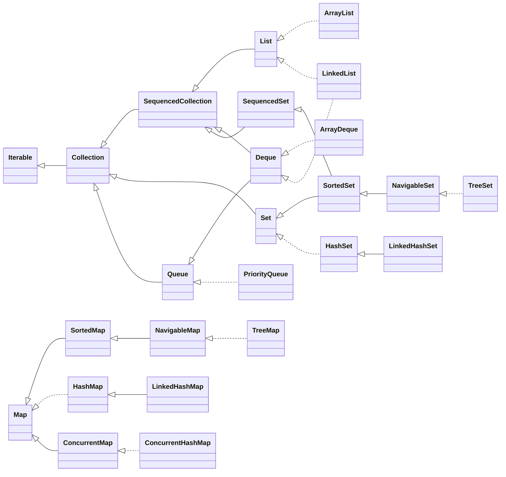
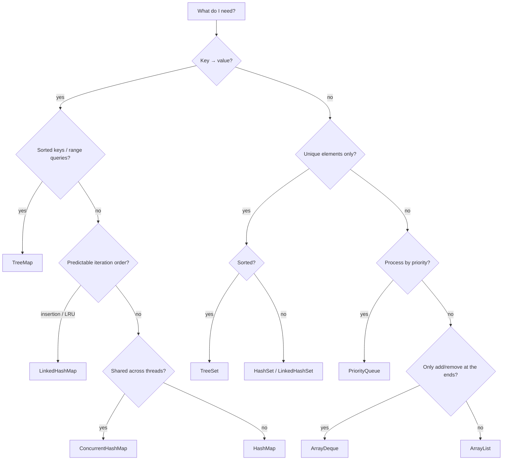

# Collections Framework — Map of the Territory

> **Level:** SDE-II / SDE-III · **Area:** Java · **Next:** [equals & hashCode](02-equals-hashcode.md)

## TL;DR

Java has two hierarchies: **`Collection`** (a bag of single elements — `List`, `Set`, `Queue`/`Deque`) and **`Map`** (key → value; *not* a `Collection`). Choosing the right implementation is mostly three questions: *Do I need order? Do I need sorting/range queries? Do I need thread safety?*

## The analogy: kitchen containers

| Need | Container | Java |
|---|---|---|
| Numbered shelf, grab item #5 instantly | Spice rack | `ArrayList` |
| Queue at the checkout / stack of plates | Plate stack, ticket line | `ArrayDeque` |
| "Is this already in the pantry?" | Pantry checklist | `HashSet` |
| Label → item lookup | Labelled jars | `HashMap` |
| Always alphabetical | Dictionary | `TreeMap` / `TreeSet` |
| Most urgent first | ER triage | `PriorityQueue` |

## 0. Why `List<String> names = new ArrayList<>()` — left side vs right side

`List` is an **interface**, not an abstract class. Java puts an abstract helper class (`AbstractList`) between the interface and `ArrayList` to share boilerplate, but you only write the two ends:

```java
List<String> names = new ArrayList<>();   // LEFT  = contract (what it can do)
                                          // RIGHT = implementation (how it does it)
```

This is the rule **"program to an interface, not an implementation."** Three reasons:

1. **Swap in one line.** If you later need `CopyOnWriteArrayList` (thread-safe reads) or `LinkedList`, you change only the right side. The rest of the file still compiles.
2. **Methods accept more.** `void printNames(List<String> names)` accepts `ArrayList`, `List.of(...)`, `Arrays.asList(...)` and anything else that implements `List`. A parameter typed `ArrayList<String>` rejects them for no reason.
3. **No lock-in.** Declaring `List` lets you use only `List` methods, so you can't accidentally depend on an `ArrayList`-only method like `trimToSize()`.

> **When is the concrete class on the left?** When you need a method the interface doesn't have. Example: `ArrayDeque` for stack-only operations, or `NavigableMap`/`TreeMap` for `floorKey()` and `ceilingKey()`.

### The same pattern across Java

```text
Left (contract)                Right (implementation)
List<T>            =  new ArrayList<>()  /  new LinkedList<>()  /  new CopyOnWriteArrayList<>()
Set<T>             =  new HashSet<>()    /  new LinkedHashSet<>() /  new TreeSet<>()
Queue<T> / Deque<T>=  new ArrayDeque<>() /  new PriorityQueue<>()
Map<K,V>           =  new HashMap<>()    /  new LinkedHashMap<>() /  new TreeMap<>()  /  new ConcurrentHashMap<>()
Lock               =  new ReentrantLock()
ExecutorService    =  Executors.newFixedThreadPool(4)   (a factory returns a ThreadPoolExecutor)
BlockingQueue<T>   =  new LinkedBlockingQueue<>()
InputStream (abstract class!) = new FileInputStream(...) / new BufferedInputStream(...)
```

The left side can be an **interface** (`List`, `Lock`) or an **abstract class** (`InputStream`). The rule is the same: **keep the left as general as the code needs, and the right as specific as it must be.**

In Spring the right side is often not a `new` at all: `private final PaymentService payments;` is declared as the interface, and Spring injects the implementation. See the [IoC note](../06-spring-boot/01-ioc-di-and-auto-configuration.md).

---

## 1. The hierarchy



> `SequencedCollection` / `SequencedSet` / `SequencedMap` arrived in **Java 21**: uniform `getFirst()`, `getLast()`, `addFirst()`, `reversed()`, … on anything with a defined encounter order (`List`, `Deque`, `LinkedHashSet`, `LinkedHashMap`, `TreeSet`…). Before Java 21, getting the last element of a `List` was `list.get(list.size()-1)`; of a `LinkedHashSet`, a loop.

## 2. Implementations and complexity

| Class | Structure | `get`/contains | add | remove | Order | `null` | Notes |
|---|---|---|---|---|---|---|---|
| `ArrayList` | resizable array | O(1) index · O(n) search | O(1) amortised end · O(n) middle | O(n) | insertion | yes | Default `List`; grows ×1.5 |
| `LinkedList` | doubly linked list | O(n) | O(1) at ends / at iterator | O(1) at iterator | insertion | yes | Almost never the right choice: poor cache locality, 24+ B overhead per node |
| `ArrayDeque` | circular array | O(1) ends | O(1) amortised | O(1) ends | insertion | **no** | Best `Stack` **and** `Queue` |
| `PriorityQueue` | binary min-heap | O(1) peek | O(log n) | O(log n) poll · O(n) remove(x) | **heap order** (not sorted when iterated!) | no | `Comparator.reverseOrder()` → max-heap |
| `HashSet` | hash table (`HashMap`) | O(1) | O(1) | O(1) | none | one | |
| `LinkedHashSet` | hash table + linked list | O(1) | O(1) | O(1) | insertion | one | |
| `TreeSet` | red-black tree | O(log n) | O(log n) | O(log n) | sorted | no* | `floor`, `ceiling`, `subSet`… |
| `HashMap` | buckets + trees | O(1) | O(1) | O(1) | none | 1 key | See [internals](03-hashmap-internals.md) |
| `LinkedHashMap` | hash table + linked list | O(1) | O(1) | O(1) | insertion or **access** | 1 key | LRU cache basis |
| `TreeMap` | red-black tree | O(log n) | O(log n) | O(log n) | sorted by key | no* | Range queries |
| `ConcurrentHashMap` | CAS + per-bin locks | O(1) | O(1) | O(1) | none | **no** | See [concurrent](05-concurrent-collections.md) |

\* with a custom `Comparator` that tolerates `null`, a `TreeMap`/`TreeSet` can hold `null`; natural ordering cannot.

### Pick-the-right-one decision tree



## 3. Things the table doesn't tell you

### 3.1 Growth

- `ArrayList`: backing array allocated lazily (default capacity 10 on first add), then grows by **~1.5×** (`oldCap + oldCap >> 1`). Use `new ArrayList<>(n)` or `ensureCapacity` for bulk loads.
- `ArrayDeque`/`HashMap` use power-of-two capacities and double.
- `PriorityQueue` grows 2× while small, then 1.5×.

### 3.2 Iteration

- `PriorityQueue.toString()` / iteration is **heap order**, not sorted. To get sorted output, `poll()` repeatedly.
- `HashMap`/`HashSet` order is unspecified and can change after resize.
- `Map.of(...)` / `Set.of(...)` iteration order is deliberately **randomised per JVM run** so you cannot depend on it.

### 3.3 Immutable vs unmodifiable vs fixed-size

```java
// Run: ImmutabilityDemo.java
import java.util.*;

public class ImmutabilityDemo {
    public static void main(String[] args) {
        List<String> base = new ArrayList<>(List.of("a", "b"));

        List<String> view  = Collections.unmodifiableList(base);  // read-only VIEW of base
        List<String> copy  = List.copyOf(base);                   // truly immutable snapshot
        List<String> fixed = Arrays.asList("x", "y");             // fixed-size, write-through to array

        base.add("c");
        System.out.println("view  = " + view);    // [a, b, c]  <- sees later changes!
        System.out.println("copy  = " + copy);    // [a, b]
        fixed.set(0, "X");                        // allowed
        System.out.println("fixed = " + fixed);   // [X, y]

        for (Runnable r : List.<Runnable>of(
                () -> view.add("z"),              // UnsupportedOperationException
                () -> fixed.add("z"),             // UnsupportedOperationException (size is fixed)
                () -> List.of("a", null),         // NullPointerException (List.of rejects nulls)
                () -> Map.of("k", 1, "k", 2))) {  // IllegalArgumentException (duplicate key)
            try { r.run(); }
            catch (RuntimeException e) { System.out.println(e.getClass().getSimpleName()); }
        }
    }
}
```

Output:

```text
view  = [a, b, c]
copy  = [a, b]
fixed = [X, y]
UnsupportedOperationException
UnsupportedOperationException
NullPointerException
IllegalArgumentException
```

| Factory | Mutable? | Nulls | Notes |
|---|---|---|---|
| `new ArrayList<>(...)` | yes | yes | |
| `Arrays.asList(arr)` | `set` only | yes | Write-through to the array; **`Arrays.asList(int[])` gives `List<int[]>` of size 1** |
| `Collections.unmodifiableList(l)` | no (but **view**) | yes | Changes to `l` show through |
| `List.of(...)`, `Set.of`, `Map.of` | no | **no** | Truly immutable, space-optimised |
| `List.copyOf(c)` / `stream.toList()` | no | `copyOf` no / `toList` yes | `toList()` (Java 16) allows nulls, `copyOf` doesn't |

### 3.4 Fail-fast vs weakly consistent iterators

- `ArrayList`, `HashMap`, … : **fail-fast** — `ConcurrentModificationException` on detected structural change (best effort).
- `ConcurrentHashMap`, `CopyOnWriteArrayList` : never throw CME; iterate a snapshot or a weakly-consistent view.
- Safe removal while iterating: `Iterator.remove()` or `collection.removeIf(predicate)`.

### 3.5 `Comparable` vs `Comparator`

```java
record Person(String name, int age) {}
List<Person> ps = new ArrayList<>(List.of(new Person("Bo", 30), new Person("Al", 30), new Person("Cy", 25)));

ps.sort(Comparator.comparingInt(Person::age)            // primary: age ascending
        .thenComparing(Person::name,                    // tie-break: name descending
                       Comparator.reverseOrder()));
// [Cy(25), Bo(30), Al(30)]
```

> [!WARNING]
> **Never** write `(a, b) -> a.x - b.x`. Subtraction overflows for large/negative values and gives wrong order. Use `Integer.compare(a.x, b.x)` or `Comparator.comparingInt`.

## 4. Legacy classes to avoid

| Legacy | Why avoid | Use instead |
|---|---|---|
| `Vector`, `Stack` | every method synchronised; `Stack` extends `Vector` (exposes random access, bad design) | `ArrayList`, `ArrayDeque` |
| `Hashtable` | whole-table lock, no nulls | `ConcurrentHashMap` / `HashMap` |
| `Enumeration` | old iterator | `Iterator` |
| `Collections.synchronizedList` | coarse lock; must manually lock while iterating | `CopyOnWriteArrayList` or `ConcurrentLinkedQueue` depending on use |

## 5. Interview Q&A

<details>
<summary><b>Q1.</b> <code>ArrayList</code> vs <code>LinkedList</code> — which and why?</summary>

`ArrayList` almost always. Random access is O(1) vs O(n); iteration is faster thanks to contiguous memory (CPU cache); less memory per element. `LinkedList` wins only on insert/delete *at a known iterator position* in huge lists, and even then benchmarks often favour `ArrayList`/`ArrayDeque`. For a queue/stack use `ArrayDeque`.
</details>

<details>
<summary><b>Q2.</b> Why prefer <code>ArrayDeque</code> over <code>Stack</code>?</summary>

`Stack` extends `Vector` (synchronised, indexable — breaking LIFO encapsulation). `ArrayDeque` is faster, unsynchronised and offers both `push/pop` and `offer/poll`. It rejects `null` so `poll()==null` unambiguously means "empty".
</details>

<details>
<summary><b>Q3.</b> How do you build a max-heap with <code>PriorityQueue</code>? What's the complexity of building from n elements?</summary>

`new PriorityQueue<>(Comparator.reverseOrder())`. Calling `new PriorityQueue<>(collection)` heapifies in **O(n)**; adding n elements one by one is O(n log n).
</details>

<details>
<summary><b>Q4.</b> Difference between <code>Collections.unmodifiableList</code> and <code>List.copyOf</code>?</summary>

`unmodifiableList` is a read-only *view*: mutations to the backing list are visible through it. `copyOf` creates an independent immutable snapshot.
</details>

<details>
<summary><b>Q5.</b> How do you safely remove elements while iterating?</summary>

`Iterator.remove()`, `removeIf(...)`, or iterate over a copy. Calling `list.remove(...)` inside an enhanced `for` triggers `ConcurrentModificationException` (except by luck when removing the second-to-last element, because `hasNext()` returns `false`).
</details>

<details>
<summary><b>Q6.</b> What's special about <code>LinkedHashMap</code> and <code>TreeMap</code> relative to <code>HashMap</code>?</summary>

`LinkedHashMap` adds a doubly linked list through entries → predictable iteration (insertion or access order) and an LRU hook. `TreeMap` keeps keys sorted in a red-black tree → `O(log n)` operations and navigation (`floorKey`, `subMap`, …). See [Ordered maps](04-ordered-maps-lru.md).
</details>

<details>
<summary><b>Q7.</b> What does Java 21's <code>SequencedCollection</code> add?</summary>

A common API for collections with a defined order: `getFirst/getLast`, `addFirst/addLast`, `removeFirst/removeLast`, and `reversed()` (a *view*). `list.reversed()` replaces `Collections.reverse` copies for read-only use.
</details>

<details>
<summary><b>Q8.</b> Why does <code>Map.of()</code> reject nulls and have a random iteration order?</summary>

Rejecting nulls keeps lookups unambiguous and allows compact immutable implementations. Randomised order (a per-run salt) stops code from accidentally relying on an unspecified order.
</details>

---
[↑ Back to Collections index](README.md)
