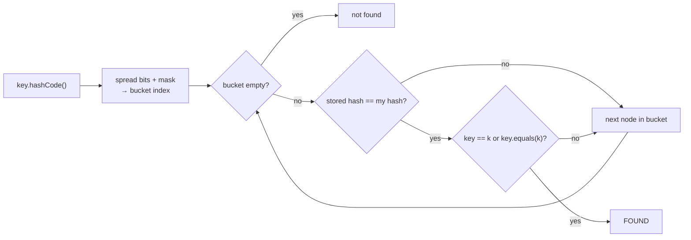

# `equals()` and `hashCode()` — The Contract

> **Level:** SDE-II / SDE-III · **Area:** Java · **Prereqs:** [Primitives, wrappers & equality](../01-java-basics/02-primitives-wrappers-equality.md) · **Next:** [HashMap internals](03-hashmap-internals.md)

## TL;DR

- `hashCode()` answers **"which bucket should I look in?"** (fast, approximate).
- `equals()` answers **"is this the exact same key?"** (slower, precise).
- **The contract:** if `a.equals(b)` then `a.hashCode() == b.hashCode()`. The reverse is *not* required — different objects may share a hash (a *collision*).
- Break the contract and `HashMap`/`HashSet` don't throw — they **silently lose or duplicate data**. That is why this is a favourite interview topic.

## The analogy: a library

Imagine a library with 16 numbered shelves.

| Library | Java |
|---|---|
| Shelf number computed from the book's title | `hashCode()` → bucket index |
| Walking to that shelf instead of scanning the whole building | `O(1)` instead of `O(n)` |
| Checking the ISBN of each book on the shelf to find *your* book | `equals()` |
| Two different books that belong on the same shelf | hash **collision** |

If the librarian shelves a book using one rule (title → shelf) and a visitor looks it up using a different rule, the book is "in the library" but nobody can ever find it. That is exactly what an inconsistent `equals`/`hashCode` does.



Note the cheap integer comparison of hashes happens **before** `equals()` — `HashMap` caches each key's hash in the node so most non-matching nodes are rejected without calling `equals()` at all.

## 1. What you get by default

`Object` provides:

- `equals(Object o)` → `this == o` (**reference identity**).
- `hashCode()` → the **identity hash code**. It is generated lazily the first time it is asked for and stored in the object's header. In HotSpot the default algorithm is a thread-local pseudo-random generator — **not** the memory address (a common misconception; objects move during GC, so an address would be unstable).

So by default two `new User(1)` objects are *different* keys. When you want *"same data = same key"* you must override **both** methods.

## 2. The full contract (Effective Java, Items 10 & 11)

`equals` must be an **equivalence relation**:

| Property | Meaning |
|---|---|
| Reflexive | `x.equals(x)` is `true` |
| Symmetric | `x.equals(y)` ⇔ `y.equals(x)` |
| Transitive | `x.equals(y)` and `y.equals(z)` ⇒ `x.equals(z)` |
| Consistent | repeated calls give the same answer if nothing changed |
| Non-null | `x.equals(null)` is `false` (never throws) |

`hashCode` must be:

1. **Stable** — same value every call while the fields used by `equals` are unchanged.
2. **Consistent with `equals`** — equal objects ⇒ equal hash codes.
3. *(Quality, not correctness)* — unequal objects *should* spread across the int range.

## 3. What breaks, with proof

```java
// Run: BrokenContracts.java
import java.util.*;

public class BrokenContracts {

    /** Mistake 1: overrides equals(), forgets hashCode(). */
    static class EqualsOnly {
        final int id;
        EqualsOnly(int id) { this.id = id; }
        @Override public boolean equals(Object o) {
            return o instanceof EqualsOnly e && e.id == id;
        }
    }

    /** Mistake 2: overrides hashCode(), forgets equals(). */
    static class HashOnly {
        final int id;
        HashOnly(int id) { this.id = id; }
        @Override public int hashCode() { return Integer.hashCode(id); }
    }

    /** Mistake 3: a mutable key. */
    static class MutableKey {
        int id;
        MutableKey(int id) { this.id = id; }
        @Override public boolean equals(Object o) {
            return o instanceof MutableKey k && k.id == id;
        }
        @Override public int hashCode() { return Integer.hashCode(id); }
    }

    public static void main(String[] args) {
        // 1. Same "logical" key, different default hashes -> lookup fails.
        Map<EqualsOnly, String> m1 = new HashMap<>();
        m1.put(new EqualsOnly(1), "alice");
        System.out.println("1. get(new EqualsOnly(1))   = " + m1.get(new EqualsOnly(1)));

        // 2. Same bucket, but equals() says "different" -> duplicates.
        Set<HashOnly> s2 = new HashSet<>();
        s2.add(new HashOnly(1));
        s2.add(new HashOnly(1));
        System.out.println("2. HashSet size after adding 'same' key twice = " + s2.size());

        // 3. Mutate the key after insertion -> entry becomes unreachable.
        Map<MutableKey, String> m3 = new HashMap<>();
        MutableKey k = new MutableKey(1);
        m3.put(k, "alice");
        k.id = 2;
        System.out.println("3. get(k) after mutation      = " + m3.get(k));
        System.out.println("   containsKey(new Key(1))    = " + m3.containsKey(new MutableKey(1)));
        System.out.println("   size / still iterable      = " + m3.size() + " / " + m3.values());
    }
}
```

Output:

```text
1. get(new EqualsOnly(1))   = null
2. HashSet size after adding 'same' key twice = 2
3. get(k) after mutation      = null
   containsKey(new Key(1))    = false
   size / still iterable      = 1 / [alice]
```

| Mistake | What happens inside | Symptom |
|---|---|---|
| `equals` only | Two equal keys get unrelated random hashes → different buckets | `get` returns `null`; `contains` is `false` |
| `hashCode` only | Same bucket, but `equals` falls back to `==` | Duplicates in `Set`; `Map` never updates, it appends |
| Mutating a key | Entry sits in the bucket for the *old* hash; lookups go to the *new* bucket | A "ghost" entry: counted in `size()`, visible in iteration, impossible to `get`/`remove` → memory leak |

> [!TIP]
> Use **immutable keys**: `String`, `Integer`, `UUID`, enums, `record`s, or classes with only `final` fields.

## 4. Writing them correctly

### The modern way: a `record`

```java
public record UserId(long tenant, long id) { }
// equals, hashCode, toString are generated from ALL components.
```

### Hand-written (when you need a subset of fields, or a class)

```java
// Run: GoodUser.java
import java.util.*;

public class GoodUser {
    private final long id;
    private final String email;     // part of identity
    private String displayName;     // NOT part of identity (mutable, cosmetic)

    GoodUser(long id, String email, String displayName) {
        this.id = id; this.email = email; this.displayName = displayName;
    }

    @Override public boolean equals(Object o) {
        if (this == o) return true;                       // fast path, reflexive
        if (o == null || getClass() != o.getClass()) return false;
        GoodUser that = (GoodUser) o;
        return id == that.id && Objects.equals(email, that.email);
    }

    @Override public int hashCode() {
        return Objects.hash(id, email);                   // same fields as equals!
    }

    public static void main(String[] args) {
        Map<GoodUser, String> m = new HashMap<>();
        m.put(new GoodUser(1, "a@x.com", "Alice"), "gold");
        // different displayName, same identity -> same key
        System.out.println(m.get(new GoodUser(1, "a@x.com", "A.")));   // gold
    }
}
```

**Rule of thumb:** `hashCode` must use a *subset* of the fields `equals` uses (never a superset).
If `hashCode` used `displayName` but `equals` did not, equal objects could hash differently → contract broken.

### Comparing the field types correctly

| Field type | Use in `equals` | Use in `hashCode` |
|---|---|---|
| primitives (not float/double) | `==` | `Integer.hashCode(x)`, `Long.hashCode(x)` … |
| `float` / `double` | `Float.compare` / `Double.compare` `== 0` (handles `NaN`, `-0.0`) | `Double.hashCode(x)` |
| objects (nullable) | `Objects.equals(a, b)` | `Objects.hashCode(a)` |
| arrays | `Arrays.equals` / `Arrays.deepEquals` | `Arrays.hashCode` / `Arrays.deepHashCode` |

## 5. Advanced: pitfalls that separate SDE-II from SDE-III

### 5.1 `getClass()` vs `instanceof` — the inheritance trap

```java
// Run: SymmetryTrap.java
public class SymmetryTrap {
    static class Point {
        final int x, y;
        Point(int x, int y) { this.x = x; this.y = y; }
        @Override public boolean equals(Object o) {
            return o instanceof Point p && p.x == x && p.y == y;
        }
        @Override public int hashCode() { return 31 * x + y; }
    }
    static class ColorPoint extends Point {
        final String color;
        ColorPoint(int x, int y, String color) { super(x, y); this.color = color; }
        @Override public boolean equals(Object o) {
            return o instanceof ColorPoint c && super.equals(o) && c.color.equals(color);
        }
    }

    public static void main(String[] args) {
        Point p = new Point(1, 2);
        ColorPoint cp = new ColorPoint(1, 2, "red");
        System.out.println("p.equals(cp) = " + p.equals(cp));   // true
        System.out.println("cp.equals(p) = " + cp.equals(p));   // false  -> NOT symmetric!
    }
}
```

There is **no way** to extend an instantiable class, add a value component, and keep `equals` symmetric *and* transitive while using `instanceof`. Options:

- Use `getClass() != o.getClass()` (strict; subclasses never equal superclasses) — simple, but breaks the Liskov Substitution Principle for things like anonymous subclasses.
- **Prefer composition**: make `ColorPoint` *have a* `Point`.
- Make the class `final` / a `record` (records are final, so the problem disappears).

### 5.2 JPA / Hibernate entities

- Hibernate may return a **proxy subclass** of your entity → `getClass()`-based `equals` fails against the real class. Use `instanceof` (or `Hibernate.getClass`) here.
- A database-generated `id` is `null` until the entity is persisted. If `hashCode` is based on `id`, the hash **changes on save** → an entity added to a `HashSet` before `persist()` becomes a ghost. Prefer a **business key** (e.g. unique email, UUID assigned at construction) or a constant `hashCode` such as `getClass().hashCode()` with an `id`-null-safe `equals`.
- Lombok's `@Data`/`@EqualsAndHashCode` on entities includes lazy associations by default → triggers lazy loading or infinite recursion in bidirectional relations. Restrict to the identity fields.

### 5.3 `hashCode()` quality and performance

- A constant `hashCode()` (`return 42;`) is **legal** but turns the map into a single bucket: `O(n)` per lookup (or `O(log n)` if keys are `Comparable` and the bin is treeified — see [HashMap internals](03-hashmap-internals.md#5-treeification)).
- `String.hashCode()` is `s[0]*31^(n-1) + … + s[n-1]`, **cached** in the string after the first call. `31` is an odd prime; `31*x == (x << 5) - x`, which the JIT compiles to a shift and subtract.
- Collisions are guaranteed to exist for strings: `"Aa".hashCode() == "BB".hashCode() == 2112`. Attackers have used this to craft hash-flooding DoS payloads, which is partly why Java 8 added tree bins.

### 5.4 `equals` vs `compareTo` consistency

`TreeSet`/`TreeMap` use `compareTo`/`Comparator` — **never** `equals`. If the two disagree you get different sets:

```java
// Run: BigDecimalTrap.java
import java.math.BigDecimal;
import java.util.*;

public class BigDecimalTrap {
    public static void main(String[] args) {
        BigDecimal a = new BigDecimal("1.0"), b = new BigDecimal("1.00");
        System.out.println("equals:    " + a.equals(b));        // false (scale differs)
        System.out.println("compareTo: " + a.compareTo(b));     // 0     (numerically equal)

        Set<BigDecimal> hash = new HashSet<>(List.of(a, b));
        Set<BigDecimal> tree = new TreeSet<>(List.of(a, b));
        System.out.println("HashSet size = " + hash.size());    // 2
        System.out.println("TreeSet size = " + tree.size());    // 1
    }
}
```

Javadoc calls this "**inconsistent with equals**". Document it, or normalise with `stripTrailingZeros()`.

## 6. Pitfalls checklist

> [!WARNING]
> - Override **both** or **neither**.
> - `equals(Object)` — the parameter type must be `Object`. `equals(User u)` is an *overload*, not an override; `HashMap` will never call it. Always annotate with `@Override`.
> - Do not use mutable fields in `hashCode()` for objects stored in hash collections.
> - Do not use `float`/`double` fields with `==` in `equals`.
> - Do not make `equals` depend on unreliable resources (e.g. DNS resolution — `java.net.URL.equals` does this, avoid `URL` as a key; use `URI`).
> - Do not forget `null` handling: `equals(null)` → `false`.

## 7. Interview Q&A

<details>
<summary><b>Q1.</b> What is the contract between <code>equals()</code> and <code>hashCode()</code>?</summary>

If two objects are equal per `equals`, they **must** return the same `hashCode`. The converse is not required. `hashCode` must also be consistent across invocations while the object's identity fields are unchanged. `equals` must be reflexive, symmetric, transitive, consistent and null-safe.
</details>

<details>
<summary><b>Q2.</b> What happens if you override <code>equals</code> but not <code>hashCode</code> and use the object as a <code>HashMap</code> key?</summary>

Two logically equal keys receive different identity hash codes, so they land in different buckets (almost always). `get(new Key(1))` returns `null` even though an "equal" key is stored, and `put` creates a duplicate instead of replacing.
</details>

<details>
<summary><b>Q3.</b> Can two unequal objects have the same <code>hashCode</code>? What does <code>HashMap</code> do?</summary>

Yes — a collision (`"Aa"` and `"BB"`). The pigeonhole principle makes collisions unavoidable (2³² hashes, unbounded objects). `HashMap` stores colliding entries in the same bucket (linked list, treeified to a red-black tree after enough collisions) and uses `equals` to distinguish them.
</details>

<details>
<summary><b>Q4.</b> Is the default <code>Object.hashCode()</code> the memory address?</summary>

No. It is an *identity hash* generated lazily and cached in the object header. HotSpot's default is a thread-local xorshift pseudo-random number. It is stable even if GC moves the object. The algorithm is switchable only through an experimental VM flag, so don't rely on it.
</details>

<details>
<summary><b>Q5.</b> Why should <code>HashMap</code> keys be immutable?</summary>

The bucket is chosen from the key's hash at insertion time. If a field participating in `hashCode` later changes, lookups compute a different bucket and miss the entry. The entry remains in memory, counted in `size()`, but unreachable — a leak.
</details>

<details>
<summary><b>Q6.</b> <code>equals(Object)</code> vs <code>equals(MyType)</code> — what's the bug?</summary>

`equals(MyType)` *overloads*; it doesn't override. Collections call `equals(Object)`, which still has the identity implementation. Use `@Override` so the compiler catches it.
</details>

<details>
<summary><b>Q7.</b> How do records handle <code>equals</code>/<code>hashCode</code>?</summary>

They are generated from **all** components using component-wise `equals` (and `Double.compare`/`Float.compare` semantics for floating-point components). The exact `hashCode` formula is unspecified but consistent with `equals`. You can override them explicitly if needed.
</details>

<details>
<summary><b>Q8.</b> You added an entity to a <code>HashSet</code> before it was saved and <code>hashCode</code> is based on the generated ID. What goes wrong?</summary>

The ID goes from `null` → a number on persist, so the hash changes while the object is inside the set. `contains(entity)` now returns `false`. Use a business key / UUID assigned at construction, or a stable hash.
</details>

<details>
<summary><b>Q9.</b> Why does <code>HashMap</code> compare hash values before calling <code>equals</code>?</summary>

`equals` can be expensive (deep comparisons, long strings). Comparing two cached `int` hashes is nearly free and rules out almost every non-matching node in a bucket.
</details>

## 8. Predict the output

<details>
<summary><b>P1.</b> What does this print?</summary>

```java
record P(int x, int y) {}
Set<P> s = new HashSet<>();
s.add(new P(1, 2)); s.add(new P(1, 2));
System.out.println(s.size());
```

**`1`** — records have value-based `equals`/`hashCode`.
</details>

<details>
<summary><b>P2.</b> What does this print?</summary>

```java
List<Integer> a = new ArrayList<>(List.of(1, 2));
List<Integer> b = new LinkedList<>(List.of(1, 2));
System.out.println(a.equals(b) + " " + (a.hashCode() == b.hashCode()));
```

**`true true`** — `List.equals` is defined across all `List` implementations (same elements, same order), and `List.hashCode` is specified by a formula, so it matches too. Likewise `Set` and `Map` have cross-implementation equality.
</details>

<details>
<summary><b>P3.</b> What does this print?</summary>

```java
Object[] x = {1, 2}; Object[] y = {1, 2};
System.out.println(x.equals(y) + " " + Arrays.equals(x, y));
```

**`false true`** — arrays inherit identity `equals` from `Object`; use `Arrays.equals`.
</details>

---
[↑ Back to Collections index](README.md)
