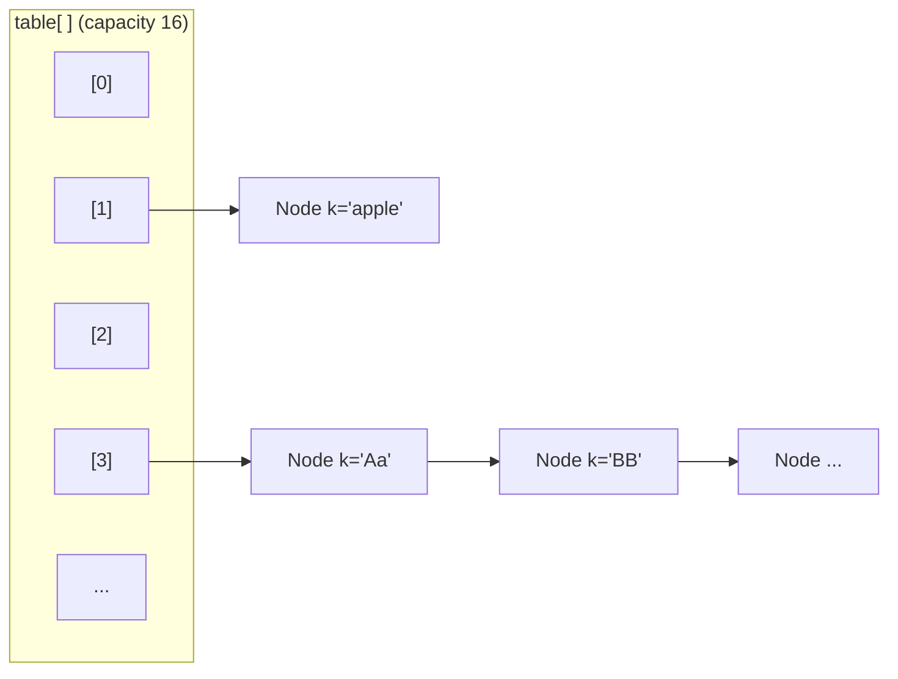
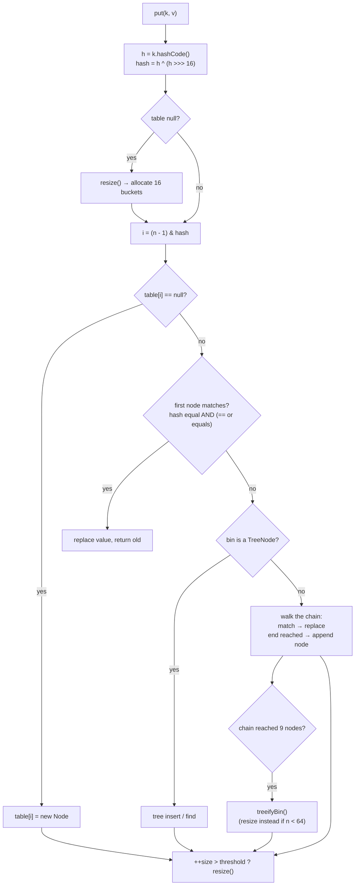
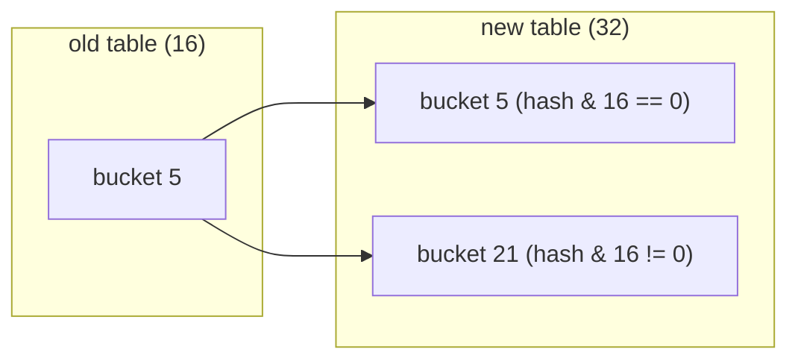

# `HashMap` Internals

> **Level:** SDE-II / SDE-III · **Area:** Java · **Prereqs:** [equals & hashCode](02-equals-hashcode.md) · **Next:** [Ordered maps & LRU](04-ordered-maps-lru.md)

## TL;DR

`HashMap` is **an array of buckets**. `hashCode()` picks the bucket, `equals()` picks the entry inside it. Collisions chain into a linked list that becomes a red-black tree when it gets long. When the map is ~75 % full the array **doubles** and entries are redistributed. Average `get`/`put` is `O(1)`; worst case `O(log n)` (since Java 8). It is **not thread-safe**.

## The analogy: a mailroom with numbered pigeonholes

- The **array** is the wall of pigeonholes (default **16**).
- A **bucket** is one pigeonhole.
- Each letter is a **node**; letters for the same hole are stapled together in a **chain** (linked list).
- When a hole gets stuffed (≥ 8 letters, with a big enough wall) the clerk reorganises that hole into a **sorted tree** so finding a letter stays fast.
- When the wall is 75 % full the building adds a second wall of **twice** the size and re-files every letter. That is a **resize/rehash** — expensive, so size it up front if you know the count.

## 1. Anatomy

```java
// simplified from java.util.HashMap
static class Node<K,V> implements Map.Entry<K,V> {
    final int hash;     // spread hash, cached so we never recompute / compare equals needlessly
    final K key;
    V value;
    Node<K,V> next;     // next node in the SAME bucket
}
transient Node<K,V>[] table;   // length is ALWAYS a power of two; allocated lazily on first put
transient int size;
int threshold;                 // capacity * loadFactor
final float loadFactor;        // default 0.75
```



Three things to remember: the array is **lazily allocated**, its length is **always a power of two**, and `Node.hash` is **cached**.

## 2. `put(key, value)` step by step



### 2.1 Why `h ^ (h >>> 16)`? (bit spreading)

The index is `(n - 1) & hash`. For a table of 16, that is `hash & 0b1111` — **only the lowest 4 bits** matter. Keys whose hashes differ only in their high bits (e.g. `Float` values, large multiples of 2^k) would all collide. XOR-ing the high 16 bits into the low 16 bits lets *every* bit influence the bucket cheaply.

### 2.2 Why is the capacity a power of two?

Because `(n - 1) & hash` equals `hash % n` **only** when `n` is a power of two — and `&` is far cheaper than `%`. It also gives the resize trick in §4. If you pass a non-power-of-two, e.g. `new HashMap<>(100)`, it is rounded **up** to 128.

### 2.3 Seeing it in action

```java
// Run: BucketIndexDemo.java
public class BucketIndexDemo {
    static int spread(int h) { return h ^ (h >>> 16); }
    static int index(Object key, int capacity) {
        int h = (key == null) ? 0 : spread(key.hashCode());   // null key -> hash 0 -> bucket 0
        return (capacity - 1) & h;
    }

    public static void main(String[] args) {
        for (String k : new String[] { "apple", "banana", "Aa", "BB" }) {
            System.out.printf("%-7s hashCode=%-11d bucket(16)=%-2d bucket(32)=%d%n",
                k, k.hashCode(), index(k, 16), index(k, 32));
        }
        System.out.println("null key bucket = " + index(null, 16));
    }
}
```

Output:

```text
apple   hashCode=93029210    bucket(16)=1  bucket(32)=17
banana  hashCode=-1396355227 bucket(16)=0  bucket(32)=0
Aa      hashCode=2112        bucket(16)=0  bucket(32)=0
BB      hashCode=2112        bucket(16)=0  bucket(32)=0
null key bucket = 0
```

`"Aa"` and `"BB"` collide in **every** table size because their full hashes are identical. Note `apple` moves from bucket 1 to bucket 17 when the table doubles — exactly `i` → `i + oldCap`, the resize split rule from §4.

## 3. `get(key)` and `remove(key)`

Same path as `put` without the insertion: compute hash → index → check first node → walk chain/tree comparing `hash` first, then `==`/`equals`. `remove` additionally unlinks the node.

## 4. Resizing

- **Threshold** = `capacity × loadFactor`. Default: `16 × 0.75 = 12`. The resize triggers when `++size > threshold`, i.e. on the **13th** insertion.
- Capacity **doubles** (16 → 32 → 64 …); threshold doubles too.
- **The split trick:** because capacity is a power of two, each node either stays at index `i` or moves to `i + oldCap`, decided by **one bit**: `(hash & oldCap) == 0 ? stay : move`. No hashes are recomputed (they're cached) and the relative order within each half is preserved.
- Cost: `O(n)` for that single insertion. Amortised across inserts it's still `O(1)`.



### Pre-sizing

If you know you'll store `n` entries, avoid repeated resizes:

```java
Map<String,Integer> m = new HashMap<>((int) (n / 0.75f) + 1); // classic
Map<String,Integer> m2 = HashMap.newHashMap(n);               // Java 19+, does the maths for you
```

> [!NOTE]
> `new HashMap<>(n)` does **not** mean "room for n entries" — it means *capacity* n (rounded to a power of two) with a 0.75 load factor, so it resizes before reaching n entries.

## 4½. Load factor trade-off

| Load factor | Memory | Collisions | Use when |
|---|---|---|---|
| Lower (0.5) | more empty buckets | fewer | lookup-heavy, memory is cheap |
| **0.75 (default)** | balanced | balanced | almost always |
| Higher (1.0+) | compact | more | memory-tight, can accept slower lookups |

## 5. Treeification

When many keys share a bucket, a linked chain costs `O(n)` to search. Since Java 8, long chains become **red-black trees** (`TreeNode`).

| Constant | Value | Meaning |
|---|---|---|
| `TREEIFY_THRESHOLD` | 8 | A chain that grows beyond 8 nodes (i.e. when a **9th** is appended) is considered for treeification |
| `MIN_TREEIFY_CAPACITY` | 64 | If `table.length < 64`, **resize instead** — more buckets is the cheaper cure |
| `UNTREEIFY_THRESHOLD` | 6 | A tree bin shrinks back to a list when a resize splits it to ≤ 6 nodes (or removals empty it) |

Details worth knowing:

- Ordering inside a tree bin is by `hash`; ties are broken with `compareTo` **if the key class implements `Comparable<ItsOwnClass>`**, otherwise by `System.identityHashCode`/class name. So `Comparable` keys give a genuinely `O(log n)` worst case; non-comparable keys with identical hashes can still degrade towards `O(n)` inside the tree.
- `TreeNode` extends `Node` and still keeps `next` pointers, so iteration order of the bin remains stable.
- Tree nodes are ~2× the memory of plain nodes — treeification is a defence mechanism, not a normal state.

### Watching it happen (reflection demo)

```java
// Run: TreeifyDemo.java  (needs: java --add-opens java.base/java.util=ALL-UNNAMED TreeifyDemo.java)
import java.lang.reflect.Field;
import java.util.*;

public class TreeifyDemo {
    /** Every instance has the SAME hash -> every key lands in one bucket. Comparable -> tree can order them. */
    static class BadKey implements Comparable<BadKey> {
        final int id;
        BadKey(int id) { this.id = id; }
        @Override public int hashCode() { return 42; }
        @Override public boolean equals(Object o) { return o instanceof BadKey b && b.id == id; }
        @Override public int compareTo(BadKey o) { return Integer.compare(id, o.id); }
    }

    static Object[] table(HashMap<?,?> m) throws Exception {
        Field f = HashMap.class.getDeclaredField("table");
        f.setAccessible(true);
        return (Object[]) f.get(m);
    }

    public static void main(String[] args) throws Exception {
        HashMap<BadKey,Integer> map = new HashMap<>();   // default capacity 16
        for (int i = 1; i <= 12; i++) {
            map.put(new BadKey(i), i);
            Object[] t = table(map);
            int idx = (t.length - 1) & (42 ^ (42 >>> 16));
            System.out.printf("size=%-2d tableLength=%-3d bin type=%s%n",
                map.size(), t.length, t[idx].getClass().getSimpleName());
        }
    }
}
```

Output:

```text
size=1  tableLength=16  bin type=Node
...
size=8  tableLength=16  bin type=Node
size=9  tableLength=32  bin type=Node      <- 9th node: table < 64, so RESIZE instead of treeify
size=10 tableLength=64  bin type=Node      <- 10th: resize again
size=11 tableLength=64  bin type=TreeNode  <- 11th: table is now >= 64, so TREEIFY
size=12 tableLength=64  bin type=TreeNode
```

Two thresholds working together: you need **both** a long chain *and* a table of at least 64.

## 6. `null` handling

- One `null` **key** is allowed (hash `0` → bucket 0). Many `null` values are fine.
- Because of that, `get(k) == null` is ambiguous: *absent* or *mapped to null*? Use `containsKey` or `getOrDefault`.
- `ConcurrentHashMap`, `Hashtable`, `Map.of` reject `null`s.

## 7. Iteration & fail-fast behaviour

`HashMap` keeps an internal `modCount`. Iterators snapshot it and throw `ConcurrentModificationException` if the map is structurally modified by anything other than the iterator's own `remove()`. It is **best-effort** (not a guarantee for concurrency bugs).

```java
// Run: FailFastDemo.java
import java.util.*;

public class FailFastDemo {
    public static void main(String[] args) {
        Map<String,Integer> m = new HashMap<>(Map.of("a", 1, "b", 2, "c", 3));

        try {
            for (String k : m.keySet()) if (k.equals("a")) m.remove(k);   // structural change mid-iteration
        } catch (ConcurrentModificationException e) {
            System.out.println("CME while removing in for-each");
        }

        m.keySet().removeIf(k -> k.equals("a"));          // OK: supported API
        m.entrySet().removeIf(e -> e.getValue() == 2);    // OK
        System.out.println(m);                            // {c=3}
    }
}
```

Iteration order is **unspecified** and can change after a resize. Never write code that depends on it (use `LinkedHashMap` or `TreeMap`).

## 8. Java 8+ convenience methods (use them!)

| Method | Replaces | Notes |
|---|---|---|
| `getOrDefault(k, d)` | `containsKey` + `get` | doesn't insert |
| `putIfAbsent(k, v)` | check-then-put | returns existing value or `null` |
| `computeIfAbsent(k, fn)` | check, build, put | great for `Map<K, List<V>>` |
| `merge(k, v, fn)` | get + combine + put | the idiomatic counter |
| `compute(k, fn)` | get + transform + put | `fn` returning `null` **removes** the key |
| `replaceAll`, `forEach` | loops | |

```java
// Run: WordCount.java
import java.util.*;

public class WordCount {
    public static void main(String[] args) {
        String text = "to be or not to be";
        Map<String,Integer> freq = new TreeMap<>();
        for (String w : text.split(" ")) freq.merge(w, 1, Integer::sum);       // counter
        System.out.println(freq);                                              // {be=2, not=1, or=1, to=2}

        Map<Integer, List<String>> byLen = new TreeMap<>();
        for (String w : text.split(" ")) byLen.computeIfAbsent(w.length(), k -> new ArrayList<>()).add(w);
        System.out.println(byLen);                                             // {2=[to, be, or, to, be], 3=[not]}
    }
}
```

> [!WARNING]
> The mapping function of `computeIfAbsent`/`compute`/`merge` **must not modify the same map**. Since Java 9 `HashMap` detects this and throws `ConcurrentModificationException` — the classic recursive-memoised-Fibonacci bug. See the practice set.

## 9. Thread safety — what actually goes wrong

`HashMap` has no synchronisation or memory-visibility guarantees:

- **Lost updates:** two threads do `put` on the same bucket and one write vanishes. `map.put(k, map.get(k) + 1)` from two threads loses increments.
- **Stale reads / broken visibility:** no happens-before between threads.
- **Java 7 and earlier:** concurrent resize could create a **cyclic chain** → `get` spins at 100 % CPU forever (resize inserted at the head and reversed order). Java 8's order-preserving split removed that specific hang, but the map is still **unsafe**.
- Fix: `ConcurrentHashMap` (see [Concurrent collections](05-concurrent-collections.md)), or confine the map to one thread.

## 10. `HashSet` is just a `HashMap`

```java
// simplified
public class HashSet<E> {
    private transient HashMap<E,Object> map;
    private static final Object PRESENT = new Object();
    public boolean add(E e) { return map.put(e, PRESENT) == null; }
}
```

So everything about equals/hashCode/resizing applies to `HashSet` unchanged. `LinkedHashSet` is backed by `LinkedHashMap`, `TreeSet` by `TreeMap`.

## 11. Complexity summary

| Operation | Average | Worst (Java 8+) | Worst (Java 7) |
|---|---|---|---|
| `get` / `put` / `remove` / `containsKey` | `O(1)` | `O(log n)` (comparable keys) | `O(n)` |
| Iteration | `O(capacity + n)` | same | same |
| Resize | `O(n)` occasionally | | |

Iteration cost depends on **capacity**, not just size — a map that once held a million entries and was `clear()`ed keeps its big table. Create a fresh map if iteration speed matters.

## 12. Interview Q&A

<details>
<summary><b>Q1.</b> Walk me through <code>HashMap.put()</code>.</summary>

Compute `hash = h ^ (h >>> 16)` → allocate the table if needed → `i = (n-1) & hash` → empty bucket: insert a node; else compare `hash` then `==`/`equals` along the chain (or tree) and replace on match or append on miss → if the chain exceeds 8 nodes, treeify (or resize when the table is < 64) → `++size > threshold` ⇒ resize (double).
</details>

<details>
<summary><b>Q2.</b> Why is the table length a power of two?</summary>

Index = `(n-1) & hash` replaces a modulo with a single AND, and during resize each node's new index is either `i` or `i + oldCap`, decided by one bit.
</details>

<details>
<summary><b>Q3.</b> What is the point of <code>h ^ (h &gt;&gt;&gt; 16)</code>?</summary>

With small tables only the low bits select the bucket; XOR-ing the high half down makes high bits influence the index and reduces collisions from poorly distributed hash codes.
</details>

<details>
<summary><b>Q4.</b> When does a bucket become a tree, and when does it revert?</summary>

When a chain would exceed 8 nodes **and** the table length is ≥ 64 (otherwise it resizes). It reverts when a resize leaves ≤ 6 nodes in the bin (or removals empty it).
</details>

<details>
<summary><b>Q5.</b> What is the time complexity of <code>get</code>?</summary>

`O(1)` average with a good hash; `O(log n)` worst case since Java 8 (comparable keys in tree bins); `O(n)` in Java 7 or with non-comparable, fully colliding keys.
</details>

<details>
<summary><b>Q6.</b> How would you store 1,000,000 entries efficiently?</summary>

Pre-size: `HashMap.newHashMap(1_000_000)` (Java 19+) or `new HashMap<>((int)(1_000_000/0.75f)+1)` to avoid ~17 doublings and rehashes. Also consider primitive-specialised collections (Eclipse Collections, fastutil) to avoid boxing overhead.
</details>

<details>
<summary><b>Q7.</b> Why is <code>HashMap</code> not thread-safe? What do you use instead?</summary>

Unsynchronised writes lose updates and resizes race; no visibility guarantees. Use `ConcurrentHashMap` (or confine to a thread). `Collections.synchronizedMap` works but uses a single lock and needs external locking for iteration.
</details>

<details>
<summary><b>Q8.</b> Difference between <code>HashMap</code>, <code>Hashtable</code>, <code>LinkedHashMap</code>, <code>TreeMap</code>, <code>ConcurrentHashMap</code>?</summary>

| | Order | Null key | Thread-safe | Lookup |
|---|---|---|---|---|
| `HashMap` | none | 1 | no | O(1) |
| `Hashtable` (legacy) | none | no | whole-table lock | O(1) |
| `LinkedHashMap` | insertion / access | 1 | no | O(1) |
| `TreeMap` | sorted by key | no (natural order) | no | O(log n) |
| `ConcurrentHashMap` | none | no | fine-grained (CAS + per-bin lock) | O(1) |
</details>

<details>
<summary><b>Q9.</b> Does <code>HashMap</code> shrink when you remove entries?</summary>

No. The table never shrinks; `clear()` nulls the buckets but keeps the capacity.
</details>

<details>
<summary><b>Q10.</b> How would an attacker abuse <code>HashMap</code>, and how does Java defend?</summary>

By sending many keys with identical hashes (e.g. crafted strings like `"Aa"`/`"BB"` combinations) to force one long chain → CPU exhaustion (hash flooding). Java 8+ treeifies long chains (`O(log n)`), and frameworks cap request-parameter counts.
</details>

---
[↑ Back to Collections index](README.md)
