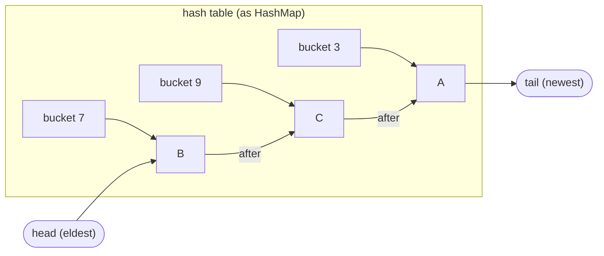

# Ordered Maps: `LinkedHashMap`, `TreeMap` & the LRU Cache

> **Level:** SDE-II / SDE-III · **Area:** Java · **Prereqs:** [HashMap internals](03-hashmap-internals.md) · **Next:** [Concurrent collections](05-concurrent-collections.md)

## TL;DR

- **`LinkedHashMap`** = `HashMap` + a doubly linked list through the entries → **predictable order** (insertion, or *access* order) at `O(1)`. Access order + `removeEldestEntry` gives you an **LRU cache in ~10 lines**.
- **`TreeMap`** = red-black tree → **sorted keys** and **navigation** (`floorKey`, `ceilingKey`, `subMap`) at `O(log n)`.
- Both change *what "same key" means or how it's found*: `LinkedHashMap` still uses `hashCode/equals`; `TreeMap` uses **only `compareTo`/`Comparator`**.

## The analogy

- `HashMap` — a coat check: fast, but coats are in no particular order.
- `LinkedHashMap` — the coat check **plus a ticket log** in the order coats arrived (or were last collected).
- `TreeMap` — a **phone book**: always alphabetical, so "who's the next name after *Mehta*?" is easy.

## 1. `LinkedHashMap`



Each entry carries `before`/`after` pointers. Lookups still use the hash table; the list only drives **iteration order** and eviction.

Two modes, chosen by the constructor's third argument:

| `accessOrder` | Order is | Re-`put` of existing key | `get` |
|---|---|---|---|
| `false` (default) | insertion | does **not** move it | no effect |
| `true` | least → most recently **accessed** | moves to end | moves to end |

### 1.1 LRU cache (a classic interview question)

```java
// Run: LruCache.java
import java.util.*;

public class LruCache<K, V> extends LinkedHashMap<K, V> {
    private final int capacity;

    public LruCache(int capacity) {
        super(16, 0.75f, true);              // true = access order
        this.capacity = capacity;
    }

    @Override
    protected boolean removeEldestEntry(Map.Entry<K, V> eldest) {
        return size() > capacity;            // called after every put; true => evict eldest
    }

    public static void main(String[] args) {
        LruCache<String, Integer> cache = new LruCache<>(3);
        cache.put("a", 1); cache.put("b", 2); cache.put("c", 3);
        cache.get("a");                      // 'a' becomes most recently used
        cache.put("d", 4);                   // evicts the eldest = 'b'
        System.out.println(cache.keySet());  // [c, a, d]
        System.out.println(cache.containsKey("b")); // false
    }
}
```

Why it works: `get("a")` relinks `a` to the tail; `put("d")` pushes size to 4 > 3, so `removeEldestEntry` evicts the head (`b`). Every operation is `O(1)`.

**Production caveats** (SDE-III talking points): not thread-safe (wrap with `Collections.synchronizedMap` — even `get` mutates the structure in access-order mode — or use Caffeine); no TTL, no size-in-bytes weighing, no stats. For an interviewer who forbids `LinkedHashMap`, implement it manually: `HashMap<K, Node>` + doubly linked list with sentinel head/tail (see [practice problems](06-practice-problems.md#1-lru-cache-from-scratch)).

### 1.2 Other uses

- Preserve insertion order for JSON-ish output or deduplicating while keeping order: `new LinkedHashSet<>(list)`.
- First non-repeating character: `LinkedHashMap<Character,Integer>` counts, then first entry with count 1.
- Java 21: `lhm.firstEntry()`, `lastEntry()`, `pollFirstEntry()`, `reversed()`, `putFirst()`, `sequencedKeySet()`.

## 2. `TreeMap` / `TreeSet`

A **red-black tree** (self-balancing BST, height ≤ 2·log₂(n+1)) ordered by `Comparable` keys or a supplied `Comparator`.

### 2.1 The navigation API

| Method | Returns |
|---|---|
| `firstKey()`, `lastKey()` | smallest / largest key |
| `floorKey(k)` | greatest key **≤ k** |
| `lowerKey(k)` | greatest key **< k** |
| `ceilingKey(k)` | smallest key **≥ k** |
| `higherKey(k)` | smallest key **> k** |
| `headMap(k, inclusive)` / `tailMap(...)` / `subMap(from, to)` | **live views** of a key range |
| `descendingMap()`, `pollFirstEntry()` | reverse view; remove-and-return the min |

All `O(log n)`. `HashMap` cannot answer "closest key below x" at all without scanning.

```java
// Run: TreeMapDemo.java
import java.util.*;

public class TreeMapDemo {
    public static void main(String[] args) {
        // Grade boundaries: score -> grade. floorEntry finds the right band.
        TreeMap<Integer,String> grades = new TreeMap<>(Map.of(0, "F", 60, "D", 70, "C", 80, "B", 90, "A"));
        for (int score : new int[] { 55, 60, 79, 95 })
            System.out.println(score + " -> " + grades.floorEntry(score).getValue());

        // Meeting-room conflict check: is there an overlapping booking?
        TreeMap<Integer,Integer> bookings = new TreeMap<>();     // start -> end (non-overlapping)
        System.out.println(book(bookings, 10, 20));              // true
        System.out.println(book(bookings, 15, 25));              // false (overlaps 10-20)
        System.out.println(book(bookings, 20, 30));              // true  (touching is ok)
        System.out.println(bookings);                            // {10=20, 20=30}
    }

    static boolean book(TreeMap<Integer,Integer> m, int start, int end) {
        Map.Entry<Integer,Integer> before = m.floorEntry(start);     // latest booking starting <= start
        Map.Entry<Integer,Integer> after  = m.ceilingEntry(start);   // earliest booking starting >= start
        if (before != null && before.getValue() > start) return false;
        if (after  != null && after.getKey()   < end)   return false;
        m.put(start, end);
        return true;
    }
}
```

Output:

```text
55 -> F
60 -> D
79 -> C
95 -> A
true
false
true
{10=20, 20=30}
```

This is the standard "My Calendar I" solution — **range lookups are the reason to choose `TreeMap`**.

### 2.2 The rule people forget: `TreeMap` ignores `equals`

Key identity in a `TreeMap` is `compare(a, b) == 0`. A `Comparator` that compares only *part* of an object **silently merges** keys:

```java
// Run: TreeMapCompareTrap.java
import java.util.*;

public class TreeMapCompareTrap {
    record Emp(String name, int dept) {}

    public static void main(String[] args) {
        // Sorting by dept only -> two employees in the same dept are "the same key"
        TreeSet<Emp> byDept = new TreeSet<>(Comparator.comparingInt(Emp::dept));
        byDept.add(new Emp("Asha", 1));
        byDept.add(new Emp("Ben", 1));             // compare == 0 -> treated as duplicate, NOT added
        System.out.println(byDept);                // [Emp[name=Asha, dept=1]]

        // Fix: add a tie-breaker so the comparator is consistent with equals
        TreeSet<Emp> fixed = new TreeSet<>(Comparator.comparingInt(Emp::dept).thenComparing(Emp::name));
        fixed.add(new Emp("Asha", 1)); fixed.add(new Emp("Ben", 1));
        System.out.println(fixed.size());          // 2
    }
}
```

Also: `TreeMap` throws `ClassCastException` if keys aren't `Comparable` and no comparator is given, and `NullPointerException` for `null` keys with natural ordering.

### 2.3 Comparator pitfalls

```java
(a, b) -> a - b                        // WRONG: overflow, e.g. a = Integer.MAX_VALUE, b = -1
(a, b) -> Integer.compare(a, b)        // right
Comparator.naturalOrder()              // right
```

A comparator must be a **total order**: antisymmetric (`sgn(cmp(a,b)) == -sgn(cmp(b,a))`) and **transitive**; violating it makes `List.sort`/`TimSort` throw *"Comparison method violates its general contract!"* on some inputs.

## 3. Special-purpose maps (know these exist)

| Map | Idea | Use for |
|---|---|---|
| `EnumMap` | array indexed by `ordinal()` | keys are an `enum` — fastest & smallest |
| `IdentityHashMap` | compares keys with `==` | graph traversal marking, serialization frameworks |
| `WeakHashMap` | keys held weakly; entry vanishes when the key is otherwise unreachable | canonicalising caches, metadata attached to objects |
| `ConcurrentSkipListMap` | concurrent sorted map | thread-safe `TreeMap` alternative |

## 4. Choosing between them

| Requirement | Pick |
|---|---|
| Fastest lookup, don't care about order | `HashMap` |
| Iterate in insertion order | `LinkedHashMap` |
| Evict least-recently-used | `LinkedHashMap(accessOrder=true)` |
| Sorted iteration, range/nearest-key queries | `TreeMap` |
| Sorted + thread-safe | `ConcurrentSkipListMap` |
| Enum keys | `EnumMap` |

## 5. Interview Q&A

<details>
<summary><b>Q1.</b> How do you implement an LRU cache in Java?</summary>

Subclass `LinkedHashMap` with `accessOrder = true` and override `removeEldestEntry` to return `size() > capacity`. All ops O(1). The manual version is `HashMap<K, Node>` plus a doubly linked list: on `get`, move the node to the head; on `put`, insert at head and evict the tail when full.
</details>

<details>
<summary><b>Q2.</b> Why would you pick <code>TreeMap</code> over <code>HashMap</code>?</summary>

When you need sorted iteration or neighbour/range queries (`floorKey`, `ceilingKey`, `subMap`). You pay O(log n) instead of O(1).
</details>

<details>
<summary><b>Q3.</b> What does <code>TreeMap</code> use to decide two keys are the same?</summary>

`compare(a,b) == 0` (or `compareTo`), **not** `equals`. A comparator inconsistent with `equals` violates the `Map` contract and can merge distinct keys.
</details>

<details>
<summary><b>Q4.</b> Is <code>LinkedHashMap</code> slower than <code>HashMap</code>?</summary>

Slightly — two extra references per entry and list maintenance — but still O(1). Iteration is actually *faster* than `HashMap` for sparse tables because it walks the list, not all buckets.
</details>

<details>
<summary><b>Q5.</b> Is <code>get()</code> on an access-ordered <code>LinkedHashMap</code> a read-only operation?</summary>

No — it re-links the entry, so it is a **structural modification** for fail-fast purposes and needs write-level synchronisation in concurrent code.
</details>

<details>
<summary><b>Q6.</b> Red-black tree vs AVL: why does Java use red-black?</summary>

Red-black trees do fewer rotations on insert/delete (at most 2 on insert, 3 on delete) at the cost of being slightly less tightly balanced (height ≤ 2 log n vs ~1.44 log n). Write-friendly, which suits general-purpose maps.
</details>

---
[↑ Back to Collections index](README.md)
