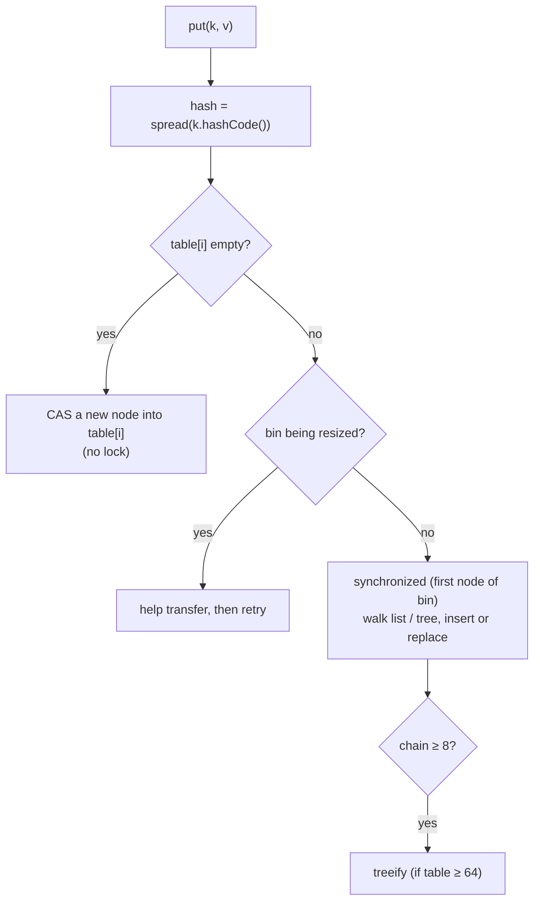

# Concurrent Collections

> **Level:** SDE-II / SDE-III · **Area:** Java · **Prereqs:** [HashMap internals](03-hashmap-internals.md) · **Next:** [Practice problems](06-practice-problems.md)

## TL;DR

Plain collections are for **one thread**. For shared data use the `java.util.concurrent` family: `ConcurrentHashMap` (maps), `CopyOnWriteArrayList` (read-mostly lists), `BlockingQueue` (producer/consumer), `ConcurrentLinkedQueue`/`Deque` (lock-free queues), `ConcurrentSkipListMap` (sorted). The single most important rule: **individually thread-safe operations don't make a *sequence* of operations atomic** — use the built-in atomic methods (`merge`, `computeIfAbsent`, `putIfAbsent`).

## The analogy: a shared whiteboard

- `HashMap` — a whiteboard with no rules: two people write over each other.
- `Collections.synchronizedMap` — **one marker** for the whole board: safe, but everyone queues.
- `ConcurrentHashMap` — the board is divided into **many small panels**; people only wait if they need the *same panel*, and reading never blocks.
- `CopyOnWriteArrayList` — every edit is made on a **fresh photocopy**, then swapped in; readers keep reading the old copy undisturbed.

## 1. Proof that `HashMap` loses updates

```java
// Run: LostUpdates.java
import java.util.*;
import java.util.concurrent.*;

public class LostUpdates {
    static final int THREADS = 4, PER_THREAD = 50_000;

    static void hammer(Runnable task) throws Exception {
        Thread[] ts = new Thread[THREADS];
        for (int i = 0; i < THREADS; i++) { ts[i] = new Thread(task); ts[i].start(); }
        for (Thread t : ts) t.join();
    }

    public static void main(String[] args) throws Exception {
        Map<String,Integer> unsafe = new HashMap<>();
        hammer(() -> { for (int i = 0; i < PER_THREAD; i++) unsafe.put("n", unsafe.getOrDefault("n", 0) + 1); });

        Map<String,Integer> safe = new ConcurrentHashMap<>();
        hammer(() -> { for (int i = 0; i < PER_THREAD; i++) safe.merge("n", 1, Integer::sum); });

        int expected = THREADS * PER_THREAD;
        System.out.println("expected             = " + expected);
        System.out.println("HashMap              = " + unsafe.get("n") + "   (almost certainly < expected)");
        System.out.println("ConcurrentHashMap.merge = " + safe.get("n"));
    }
}
```

Typical output (the `HashMap` figure varies per run):

```text
expected             = 200000
HashMap              = 53112   (almost certainly < expected)
ConcurrentHashMap.merge = 200000
```

`getOrDefault` + `put` is a **check-then-act** race: two threads read `5`, both write `6`. Even if `ConcurrentHashMap.get` and `.put` were used here instead, the *race would remain* — only `merge`/`compute` make the read-modify-write atomic.

## 2. `ConcurrentHashMap` (Java 8+ design)



Key properties:

| Aspect | Behaviour |
|---|---|
| Locking | **Lock-free reads**; writes use **CAS** for empty bins and `synchronized` on the *head node of one bin* otherwise — granularity = one bucket (Java 7 used 16 coarser "segments") |
| Nulls | **Not allowed** (key or value). `get(k)==null` must unambiguously mean "absent"; with nulls you couldn't tell in a concurrent setting whether the key was absent or concurrently mapped to `null` |
| Resize | Concurrent: other threads that touch a bin being moved **help** with the transfer |
| `size()` | Approximate under concurrency; implemented with striped counters (`LongAdder`-style), so no global bottleneck. Use `mappingCount()` for a `long` |
| Iterators | **Weakly consistent**: never throw CME; reflect the table at some point, may or may not show concurrent updates |
| Atomic compound ops | `putIfAbsent`, `computeIfAbsent`, `compute`, `merge`, `replace(k, old, new)`, `remove(k, v)` |
| Bulk ops | `forEach(parallelism, …)`, `reduce`, `search` with a parallelism threshold |

### 2.1 The check-then-act trap, even on `ConcurrentHashMap`

```java
// BROKEN: two threads can both see "absent" and both create+insert
if (!map.containsKey(k)) map.put(k, expensive(k));

// RIGHT (atomic per key, function runs at most once per absent key)
map.computeIfAbsent(k, key -> expensive(key));
```

Rules for the function you pass to `compute*`/`merge`: keep it **short, side-effect-free and non-blocking**, and **never touch the same map** (it can deadlock or throw `IllegalStateException: Recursive update`).

### 2.2 Compound state across *multiple* keys is not atomic

Moving money between two keys with two `merge` calls is not atomic; you need a lock, a transaction, or to put both balances inside one immutable object updated with `compute`.

## 3. Other concurrent collections

| Class | Use when | Mechanism / Trade-off |
|---|---|---|
| `CopyOnWriteArrayList` / `CopyOnWriteArraySet` | **Many reads, very rare writes** (listener lists, config) | Each write copies the whole array: `O(n)`; iterators are snapshots, never CME |
| `ConcurrentLinkedQueue` / `Deque` | High-throughput unbounded non-blocking queue | Lock-free CAS (Michael–Scott); `size()` is `O(n)` |
| `ArrayBlockingQueue` | Bounded producer/consumer, back-pressure | One lock, fixed capacity, optional fairness |
| `LinkedBlockingQueue` | Producer/consumer, optionally bounded | Two locks (put/take) → better throughput than `ArrayBlockingQueue` under contention |
| `PriorityBlockingQueue` | Concurrent priority scheduling | Single lock, unbounded |
| `DelayQueue` | Items usable only after a delay (retry, expiry) | Elements implement `Delayed` |
| `SynchronousQueue` | Direct hand-off (used by `Executors.newCachedThreadPool`) | No storage |
| `LinkedTransferQueue` | Hand-off + queueing | `transfer()` waits for a consumer |
| `ConcurrentSkipListMap` / `Set` | Sorted + concurrent | Skip list, O(log n), lock-free |

### Producer / consumer with `BlockingQueue`

```java
// Run: ProducerConsumer.java
import java.util.concurrent.*;

public class ProducerConsumer {
    private static final int POISON = -1;

    public static void main(String[] args) throws Exception {
        BlockingQueue<Integer> q = new ArrayBlockingQueue<>(2);   // bounded -> producer blocks when full

        Thread producer = new Thread(() -> {
            try {
                for (int i = 1; i <= 5; i++) q.put(i);            // blocks if the queue is full
                q.put(POISON);                                    // tell the consumer to stop
            } catch (InterruptedException e) { Thread.currentThread().interrupt(); }
        });

        Thread consumer = new Thread(() -> {
            try {
                int sum = 0;
                for (int v; (v = q.take()) != POISON; ) sum += v; // blocks if empty
                System.out.println("sum = " + sum);               // 15
            } catch (InterruptedException e) { Thread.currentThread().interrupt(); }
        });

        producer.start(); consumer.start();
        producer.join(); consumer.join();
    }
}
```

## 4. Synchronised wrappers vs concurrent collections

| | `Collections.synchronizedMap(new HashMap<>())` | `ConcurrentHashMap` |
|---|---|---|
| Lock | single mutex on every method | CAS + per-bin lock; lock-free reads |
| Iteration | **must** manually `synchronized(map)` or you risk CME | safe, weakly consistent |
| Compound ops | still need external locking | atomic `merge`/`compute` built-in |
| Nulls | allowed | forbidden |
| Throughput under contention | low | high |

## 5. Memory-visibility reminder

Even a "benign" shared `HashMap` read can see a **stale or partially published** structure because there is no *happens-before* edge. Safely publishing an effectively immutable map (built once, never changed) requires `final` fields, `volatile`, a lock, or a concurrent container. (More in the upcoming Java Memory Model note.)

## 6. Interview Q&A

<details>
<summary><b>Q1.</b> How does <code>ConcurrentHashMap</code> achieve thread safety in Java 8+?</summary>

Per-bucket granularity: CAS to insert into an empty bin, `synchronized` on the bin's head node for collisions, lock-free `volatile` reads, cooperative resizing, and striped counters for size. Java 7 used segment locks (default 16).
</details>

<details>
<summary><b>Q2.</b> Why doesn't <code>ConcurrentHashMap</code> allow <code>null</code> keys/values?</summary>

In a concurrent map `get(k)==null` must mean "absent". With nulls you can't distinguish absent from mapped-to-null, and you can't cheaply check `containsKey` + `get` atomically (the mapping could change in between). `Hashtable` made the same decision.
</details>

<details>
<summary><b>Q3.</b> Is <code>if (!map.containsKey(k)) map.put(k, v)</code> safe on a <code>ConcurrentHashMap</code>?</summary>

No. Each call is atomic, the pair is not. Use `putIfAbsent` or `computeIfAbsent`.
</details>

<details>
<summary><b>Q4.</b> When would you use <code>CopyOnWriteArrayList</code>?</summary>

Read-heavy, write-rare lists whose iteration must never block or fail — e.g. event listener registries. Avoid when writes are frequent or the list is large (each write copies the array).
</details>

<details>
<summary><b>Q5.</b> What is a weakly consistent iterator?</summary>

It never throws `ConcurrentModificationException`, is guaranteed to traverse elements as they existed when the iterator was created, and *may* (not must) reflect later updates.
</details>

<details>
<summary><b>Q6.</b> <code>ArrayBlockingQueue</code> vs <code>LinkedBlockingQueue</code>?</summary>

`ArrayBlockingQueue` is always bounded, uses one lock and a preallocated array (predictable memory, optional fairness). `LinkedBlockingQueue` uses separate put/take locks (higher throughput), allocates nodes, and is unbounded unless capacity is given — an unbounded queue can hide back-pressure problems and cause OOM.
</details>

<details>
<summary><b>Q7.</b> How would you implement a thread-safe LRU cache?</summary>

Simple: `Collections.synchronizedMap(new LruCache<>(n))` (all ops including `get` need the lock). Better: a library (Caffeine) with striped buffers and async eviction. Or `ConcurrentHashMap` + a lock-protected recency structure if reads must scale.
</details>

<details>
<summary><b>Q8.</b> Why is <code>ConcurrentHashMap.size()</code> only approximate?</summary>

It sums striped counter cells while other threads are updating; there is no moment where all threads pause. Treat it as an estimate for monitoring, not for logic.
</details>

---
[↑ Back to Collections index](README.md)
