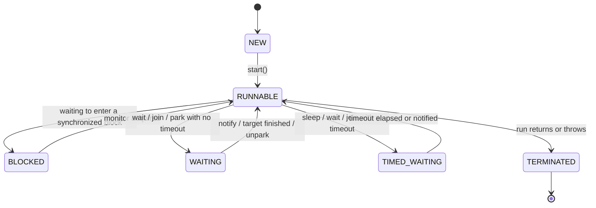

# `Runnable`, `Callable`, `Thread` & Friends: What Is a "Task"?

> **Level:** SDE-I → SDE-II · **Area:** Java · **Prev:** [Multithreading from scratch](00-concurrency-from-scratch.md) · **Next:** [Executors & thread pools](01-executors-thread-pools.md)

## TL;DR

- **`Runnable`** is an interface with one method, `void run()`. It means *"a piece of work to do"*. It returns **nothing** and cannot throw **checked** exceptions. A **runnable class** is simply a class that implements it.
- A **`Thread`** is the **worker** that executes a task. `Runnable` is the **task**. Keeping them separate is the whole design idea.
- **`Callable<V>`** is a `Runnable` that **returns a value** and **may throw checked exceptions**.
- **`run()` is not `start()`**: calling `run()` executes the code on your *current* thread; only `start()` begins a new thread.
- The thread state **`RUNNABLE`** (see §8) has nothing to do with the `Runnable` interface; the names just look alike.

## The analogy: a recipe card and a cook

- A **`Runnable`** is a **recipe card** that says *"make a salad"*. It describes the work but doesn't cook anything and doesn't say who will.
- A **`Thread`** is a **cook**. Hand a cook a card (`new Thread(card)`), call `start()`, and that cook works at the same time as everyone else.
- A **`Callable`** is an **order slip that expects a dish back**: *"make a salad and bring it to table 4"*. You get a **receipt** (`Future`) to collect the dish later.
- A **thread pool** is a team of cooks who take cards from a rail one after another.

## 1. The interface

```java
@FunctionalInterface
public interface Runnable {
    void run();                         // no parameters, no return value, no checked exceptions
}
```

Because it has exactly **one abstract method**, it is a *functional interface*, so you can write it in four ways:

```java
class Greeter implements Runnable {                       // 1. a named class ("runnable class")
    public void run() { System.out.println("hello"); }
}
Runnable a = new Greeter();
Runnable b = new Runnable() {                              // 2. anonymous class
    public void run() { System.out.println("hello"); }
};
Runnable c = () -> System.out.println("hello");            // 3. lambda (the usual choice)
Runnable d = SomeClass::doSomething;                       // 4. method reference (a method with no args and no result needed)
```

Use a **named class** when the task has its own state or needs to be reused and tested; use a **lambda** for short one-off tasks.

## 2. `run()` vs `start()` and "a `Thread` is also a `Runnable`"

```java
// Run: RunnableDemo.java
import java.util.concurrent.*;

public class RunnableDemo {
    static class Greeter implements Runnable {                 // a "runnable class"
        private final String name;
        Greeter(String name) { this.name = name; }
        @Override public void run() { System.out.println("hello " + name + " from " + Thread.currentThread().getName()); }
    }
    static int work() { return 42; }
    static void sideEffect() { }

    public static void main(String[] args) throws Exception {
        Runnable r = new Greeter("class");
        Runnable lambda = () -> System.out.println("hello lambda from " + Thread.currentThread().getName());
        Runnable ref = RunnableDemo::sideEffect;               // method reference

        System.out.println("-- run() executes on the CALLING thread");
        r.run();
        lambda.run();

        System.out.println("-- start() executes on a NEW thread");
        Thread t1 = new Thread(r, "worker-1"); t1.start(); t1.join();
        Thread t2 = new Thread(lambda, "worker-2"); t2.start(); t2.join();

        System.out.println("-- Thread is itself a Runnable: calling run() on it does NOT start a thread");
        Thread t3 = new Thread(() -> System.out.println("body ran on " + Thread.currentThread().getName()), "t3");
        Runnable asRunnable = t3;
        asRunnable.run();

        ExecutorService pool = Executors.newFixedThreadPool(2);
        System.out.println("-- Callable returns a value");
        Callable<Integer> c = RunnableDemo::work;
        System.out.println("callable result = " + pool.submit(c).get());
        System.out.println("runnable via submit -> Future.get() = " + pool.submit(r).get());

        System.out.println("-- which overload does a lambda pick?");
        Future<?> value = pool.submit(() -> 7);                                   // returns a value -> Callable
        Future<?> none = pool.submit(() -> { System.out.println("void lambda -> Runnable"); });
        System.out.println(value.get() + " / " + none.get());

        Future<String> bad = pool.submit(() -> { throw new java.io.IOException("checked exception is fine in a Callable"); });
        try { bad.get(); } catch (ExecutionException e) { System.out.println("get() -> ExecutionException, cause = " + e.getCause()); }
        pool.shutdown();

        System.out.println("-- FutureTask is BOTH a Runnable and a Future");
        FutureTask<String> ft = new FutureTask<>(() -> "result from FutureTask");
        new Thread(ft, "ft-thread").start();
        System.out.println(ft.get());

        System.out.println("-- CompletableFuture: runAsync(Runnable) vs supplyAsync(Supplier)");
        System.out.println(CompletableFuture.runAsync(() -> {}).get() + " / " + CompletableFuture.supplyAsync(() -> 5).get());
    }
}
```

Output (the pool thread is named `pool-1-thread-N`, so the exact `N` can vary):

```text
-- run() executes on the CALLING thread
hello class from main
hello lambda from main
-- start() executes on a NEW thread
hello class from worker-1
hello lambda from worker-2
-- Thread is itself a Runnable: calling run() on it does NOT start a thread
body ran on main
-- Callable returns a value
callable result = 42
hello class from pool-1-thread-2
runnable via submit -> Future.get() = null
-- which overload does a lambda pick?
void lambda -> Runnable
7 / null
get() -> ExecutionException, cause = java.io.IOException: checked exception is fine in a Callable
-- FutureTask is BOTH a Runnable and a Future
result from FutureTask
-- CompletableFuture: runAsync(Runnable) vs supplyAsync(Supplier)
null / 5
```

What to take from it:

1. **`run()` runs on `main`; `start()` runs on the new thread.** The most common beginner bug is calling `thread.run()` and wondering why nothing is concurrent.
2. **`Thread implements Runnable`.** That is why `new Thread(task)` works, and why passing a `Thread` where a `Runnable` is expected compiles — but then you only ever call its `run()` on the caller's thread.
3. A `Runnable` submitted to an executor gives a `Future` whose `get()` is **`null`** (no result).

## 3. Why `implements Runnable` and not `extends Thread`?

| | `implements Runnable` ✅ | `extends Thread` |
|---|---|---|
| Separates **what** to do from **who** runs it | yes | no, they are fused |
| Can also extend another class | yes (one superclass only is free) | no |
| Works with **executors/thread pools** | yes (`pool.submit(task)`) | clumsy: pools want tasks, not threads |
| Reuse the same task on many threads | yes | creates a new subclass instance each time |
| Easy to test (call `run()` directly in a unit test) | yes | harder |

Rule: **write tasks as `Runnable`/`Callable`; hand them to an executor.** Extend `Thread` only if you are genuinely changing how a thread behaves, which is rare.

## 4. `Callable` — a task that returns a result

```java
@FunctionalInterface
public interface Callable<V> {
    V call() throws Exception;          // returns a value, may throw ANY exception
}
```

| | `Runnable` | `Callable<V>` |
|---|---|---|
| Method | `void run()` | `V call() throws Exception` |
| Returns a value | no | **yes** |
| Checked exceptions | **no** (must catch/wrap) | **yes** |
| Since | Java 1.0 | Java 5 |
| Executed via | `Thread`, `execute`, `submit` | `submit`, `invokeAll`, `FutureTask` |
| Result handle | none (`Future<?>`, `get()` = null) | `Future<V>` |

```java
Callable<Integer> job = () -> expensiveCalculation();     // may throw a checked exception
Future<Integer> receipt = pool.submit(job);               // returns immediately
Integer result = receipt.get(2, TimeUnit.SECONDS);        // waits, with a timeout; failure arrives as ExecutionException
```

Failures from a `Callable` do not appear where it ran; they come back wrapped in `ExecutionException` from `get()` (shown in the demo above). Details: [Executors §6](01-executors-thread-pools.md#6-callable-and-future) and [async error handling](03-async-error-handling-http.md).

### Which one does a lambda pick? (`submit(() -> …)`)

`ExecutorService.submit` has two overloads: `submit(Runnable)` and `submit(Callable<T>)`. The compiler decides from the lambda **body**:

| Lambda body | Chosen | Example |
|---|---|---|
| expression that **produces a value** | `Callable` | `() -> 7`, `() -> compute()` (if `compute()` returns something) |
| block with **no `return value`** (a statement) | `Runnable` | `() -> { log("x"); }` |
| block that **only throws** | `Callable` (so checked exceptions are allowed) | `() -> { throw new IOException(); }` |

Gotcha: `pool.submit(() -> compute())` is a **Callable** if `compute()` returns a value, even if you ignore the result; if `compute()` is `void`, it's a `Runnable`. If you want to be explicit, assign to a typed variable first (`Callable<Integer> c = …`).

## 5. The family of "task" types

| Type | Shape | Used for |
|---|---|---|
| **`Runnable`** | `() → void` | fire-and-forget work; `Thread`, `Executor.execute` |
| **`Callable<V>`** | `() → V` (may throw) | work with a result; `ExecutorService.submit` |
| **`Future<V>`** | handle: `get()`, `cancel()`, `isDone()` | the **receipt** for submitted work |
| **`FutureTask<V>`** | `Runnable` **and** `Future<V>` | wraps a `Callable` so a plain `Thread` can run it and you can `get()` the result |
| **`Executor`** | `void execute(Runnable)` | the *"who runs it"* abstraction; `ExecutorService` extends it |
| **`ScheduledExecutorService`** | `schedule(Runnable/Callable, delay)` | run later or repeatedly |
| **`Supplier<T>`** | `() → T` | `CompletableFuture.supplyAsync` (same shape as `Callable` but **no checked exceptions**) |
| **`Consumer<T>` / `Function<T,R>`** | `T → void` / `T → R` | `thenAccept` / `thenApply` steps in a [CompletableFuture chain](02-completablefuture.md) |
| **`CompletableFuture.runAsync(Runnable)`** | start async work, no result | vs **`supplyAsync(Supplier)`** which gives a value |
| **`ForkJoinTask`**: `RecursiveAction` / `RecursiveTask<V>` | divide-and-conquer tasks | `ForkJoinPool`, parallel streams under the hood |
| **`TimerTask`** | abstract class implementing `Runnable` | legacy `java.util.Timer`; prefer `ScheduledExecutorService` |
| **`ThreadFactory`** | `Thread newThread(Runnable)` | how a pool creates (and names) its workers |
| **`Thread.UncaughtExceptionHandler`** | `(Thread, Throwable) → void` | where an escaping exception from `run()` lands |

Mental map: **a task** (`Runnable`/`Callable`) → handed to **an executor** → run by **a thread** → result tracked by **a `Future`**.

## 6. Giving a task input and getting output

`Runnable.run()` takes no arguments and returns nothing, so you pass data **in** by capturing it and get data **out** some other way:

```java
String name = "Ada";                                           // captured: must be final or effectively final
Runnable greet = () -> System.out.println("hello " + name);

// OUT: use a Callable + Future (clean) ...
Future<Integer> len = pool.submit(() -> name.length());
// ... or a thread-safe holder (when you must use a Runnable)
AtomicReference<String> out = new AtomicReference<>();
pool.submit(() -> out.set(name.toUpperCase()));                // wait for completion before reading!
```

- **Don't** write results into plain fields/arrays from several threads without synchronisation; that is a data race ([Locks & `volatile`](04-locks-volatile-deadlock.md)).
- **Don't** capture a *mutable, non-thread-safe* object (like an `ArrayList`) in several tasks.

## 7. Exceptions inside `run()`

- A `Runnable` **cannot throw a checked exception**; catch it inside, or wrap it: `catch (IOException e) { throw new UncheckedIOException(e); }`.
- An **unchecked** exception escaping `run()` kills that thread and goes to the thread's `UncaughtExceptionHandler`; with `submit()` it is **stored in the `Future` instead and may vanish silently**. This is covered in depth in [Executors §5](01-executors-thread-pools.md#5-submit-vs-execute--where-do-exceptions-go) and the [async error handling note](03-async-error-handling-http.md).

## 8. Thread lifecycle (the states)



| State | Meaning | Typical cause |
|---|---|---|
| `NEW` | created, `start()` not called yet | `new Thread(task)` |
| **`RUNNABLE`** | running **or ready to run** (the OS decides; Java doesn't separate "running" from "ready") | CPU work, and also blocking I/O in many cases |
| `BLOCKED` | waiting for a **monitor lock** | another thread holds the `synchronized` lock |
| `WAITING` | waiting **indefinitely** for another thread | `Object.wait()`, `Thread.join()`, `LockSupport.park()` |
| `TIMED_WAITING` | waiting **with a deadline** | `Thread.sleep(ms)`, `wait(ms)`, `join(ms)` |
| `TERMINATED` | `run()` finished or threw | cannot be restarted |

You can see every state with `Thread.getState()`; this program forces each one:

```java
// Run: ThreadStates.java
public class ThreadStates {
    static void sleep(long ms) { try { Thread.sleep(ms); } catch (InterruptedException e) { Thread.currentThread().interrupt(); } }

    public static void main(String[] args) throws Exception {
        Object lock = new Object();

        Thread sleeper = new Thread(() -> sleep(300));
        System.out.println("before start()        : " + sleeper.getState());
        sleeper.start(); sleep(100);
        System.out.println("inside Thread.sleep() : " + sleeper.getState());

        Thread waiter = new Thread(() -> { synchronized (lock) { try { lock.wait(); } catch (InterruptedException e) { } } });
        waiter.start(); sleep(100);
        System.out.println("inside Object.wait()  : " + waiter.getState());

        Thread blocked;
        synchronized (lock) {                               // main holds the monitor, so 'blocked' cannot enter
            blocked = new Thread(() -> { synchronized (lock) { } });
            blocked.start(); sleep(100);
            System.out.println("waiting for a monitor : " + blocked.getState());
            lock.notifyAll();
        }
        sleeper.join(); waiter.join(); blocked.join();
        System.out.println("after it finished     : " + sleeper.getState());

        Thread spinner = new Thread(() -> { long n = 0; while (!Thread.currentThread().isInterrupted()) n++; });
        spinner.start(); sleep(100);
        System.out.println("busy computing        : " + spinner.getState());
        spinner.interrupt(); spinner.join();
    }
}
```

```text
before start()        : NEW
inside Thread.sleep() : TIMED_WAITING
inside Object.wait()  : WAITING
waiting for a monitor : BLOCKED
after it finished     : TERMINATED
busy computing        : RUNNABLE
```

> [!WARNING]
> **`Thread.State.RUNNABLE` is not the `Runnable` interface.** A thread in state `RUNNABLE` is *eligible to run* (running or ready). A `Runnable` object is a *task*. A thread whose task is a `Runnable` goes through `NEW → RUNNABLE → … → TERMINATED`.

Practical use: in a **thread dump** (`jstack`), many `BLOCKED` threads pointing at the same lock = contention or deadlock; many `WAITING` threads on `park` in a pool = idle workers.

## 9. Interview Q&A

<details>
<summary><b>Q1.</b> What is <code>Runnable</code>? What is a "runnable class"?</summary>

A functional interface with one method, `void run()`, representing a task. A runnable class is a class that implements `Runnable` (so its instances can be passed to a `Thread` or an executor).
</details>

<details>
<summary><b>Q2.</b> <code>Runnable</code> vs <code>Callable</code>?</summary>

`Runnable.run()` returns nothing and cannot throw checked exceptions. `Callable.call()` returns a value and may throw any exception. Submit a `Callable` to get a `Future<V>`; a `Runnable` gives a `Future<?>` whose `get()` is `null`.
</details>

<details>
<summary><b>Q3.</b> <code>Thread.start()</code> vs <code>Thread.run()</code>?</summary>

`start()` creates a new thread and calls `run()` on it. Calling `run()` directly just executes the method on the current thread, so there is no concurrency.
</details>

<details>
<summary><b>Q4.</b> Why implement <code>Runnable</code> instead of extending <code>Thread</code>?</summary>

It separates the task from the worker, leaves your class free to extend something else, works with thread pools, and lets one task be reused. Extending `Thread` ties the task to one thread object and wastes your single inheritance slot.
</details>

<details>
<summary><b>Q5.</b> Can a <code>Runnable</code> return a value or throw a checked exception?</summary>

No. Use a `Callable`, or a holder (`AtomicReference`, a `Future` from `FutureTask`) for the result, and wrap checked exceptions in unchecked ones inside `run()`.
</details>

<details>
<summary><b>Q6.</b> What is <code>FutureTask</code>?</summary>

A class that implements both `Runnable` and `Future<V>`. It wraps a `Callable`, so a plain `Thread` can run it, and you can later call `get()` for the result. `ExecutorService.submit` uses it internally.
</details>

<details>
<summary><b>Q7.</b> <code>Runnable</code> vs <code>Supplier</code> vs <code>Callable</code>?</summary>

All are no-argument tasks. `Runnable` returns nothing; `Supplier<T>` returns a value but cannot throw checked exceptions (used by `supplyAsync`); `Callable<V>` returns a value and can throw checked exceptions (used by `submit`).
</details>

<details>
<summary><b>Q8.</b> What are the thread states?</summary>

`NEW`, `RUNNABLE`, `BLOCKED`, `WAITING`, `TIMED_WAITING`, `TERMINATED`. `BLOCKED` is waiting for a monitor; `WAITING`/`TIMED_WAITING` are waiting for another thread or a timeout (`wait`, `join`, `park`, `sleep`).
</details>

<details>
<summary><b>Q9.</b> Why is <code>submit(() -&gt; { throw new IOException(); })</code> allowed?</summary>

A lambda that only throws is compatible with `Callable`, whose `call()` declares `throws Exception`, so the compiler chooses that overload. A `Runnable` could not compile it.
</details>

## 10. Predict the output

<details>
<summary><b>P1.</b></summary>

```java
Thread t = new Thread(() -> System.out.println(Thread.currentThread().getName()), "T");
t.run();
```

Prints **`main`**: `run()` executes the task on the calling thread. Use `t.start()` to see `T`.
</details>

<details>
<summary><b>P2.</b></summary>

```java
Future<?> f = pool.submit(() -> System.out.println("hi"));
System.out.println(f.get());
```

Prints **`hi`** and then **`null`**: it is a `Runnable`, so there is no result.
</details>

<details>
<summary><b>P3.</b></summary>

```java
Thread t = new Thread(() -> {});
System.out.println(t.getState());
t.start(); t.join();
System.out.println(t.getState());
t.start();
```

Prints **`NEW`**, then **`TERMINATED`**, then throws **`IllegalThreadStateException`**: a thread cannot be started twice.
</details>

---
[↑ Back to Concurrency index](README.md)
