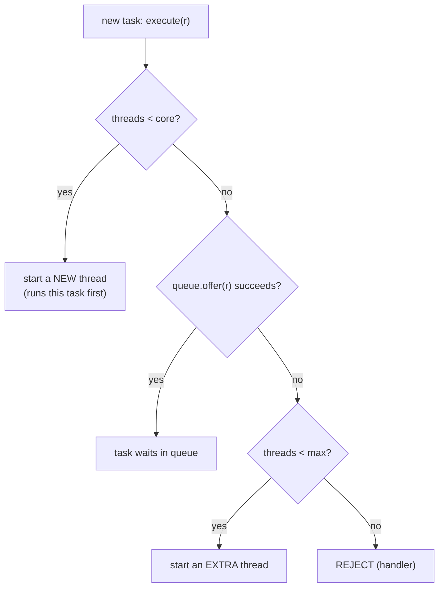

# Executors & Thread Pools

> **Level:** SDE-II / SDE-III · **Area:** Java · **Prereqs:** [Exceptions](../01-java-basics/05-exceptions.md) · **Next:** [CompletableFuture](02-completablefuture.md)

## TL;DR

- Don't `new Thread()` per task: threads are expensive (≈1 MB stack each, OS scheduling) and unbounded creation kills the JVM. Use an **`ExecutorService`**: a pool of reusable workers fed by a queue.
- A pool is defined by **core size, max size, queue, rejection policy**. Surprising rule: **extra threads (beyond core) are created only when the queue is FULL.**
- `Executors.newFixedThreadPool` has an **unbounded queue** (memory risk); `newCachedThreadPool` has **unbounded threads**. In production build a `ThreadPoolExecutor` with a **bounded** queue.
- **`submit()` swallows exceptions into the `Future`; `execute()` sends them to the thread's `UncaughtExceptionHandler`.** If you `submit` and never call `get()`, failures vanish silently.
- Always **shut down** pools, always **name** your threads, always put **timeouts** on `get()`.

## The analogy: a restaurant kitchen

- Tasks = **orders**; threads = **cooks**; the queue = the **order rail**; the pool size = how many cooks are on shift.
- Core cooks (always on shift) take orders. When all are busy, orders **pile on the rail**. Only when the **rail is full** does the manager call in extra cooks, up to a maximum. If the rail is full *and* every cook is in, new orders are **turned away** (rejection).
- `newFixedThreadPool` = a rail of **infinite length** — nobody is ever turned away, so a rush quietly piles up thousands of orders until the kitchen collapses (OOM).
- `newCachedThreadPool` = a manager who hires **a new cook for every order** if none is free — a rush hires 10,000 cooks (thread explosion).

## 1. Why not `new Thread(...)`?

| `new Thread` per task | Pool |
|---|---|
| ~1 MB stack + OS thread creation per task | reuse a few threads |
| No limit → `OutOfMemoryError: unable to create native thread` | bounded by config |
| No result/exception channel | `Future` / `CompletableFuture` |
| No queueing/back-pressure | queue + rejection policy |
| Hard to shut down cleanly | `shutdown()` / `close()` |

## 2. The `ThreadPoolExecutor` model

```java
new ThreadPoolExecutor(
    corePoolSize, maximumPoolSize,
    keepAliveTime, unit,            // idle time before threads ABOVE core are retired
    workQueue,                      // ArrayBlockingQueue / LinkedBlockingQueue / SynchronousQueue
    threadFactory,                  // naming, daemon flag, UncaughtExceptionHandler
    rejectedExecutionHandler);      // what to do when saturated
```



The order is **core → queue → extra threads → reject**. Hence with an **unbounded** queue the "queue full" branch never happens, `maximumPoolSize` is ignored, and the pool stays at `corePoolSize` forever.

### Proof (deterministic demo)

```java
// Run: PoolBehavior.java
import java.util.concurrent.*;

public class PoolBehavior {
    public static void main(String[] args) throws Exception {
        CountDownLatch release = new CountDownLatch(1);          // keeps every task busy until we say so
        ThreadPoolExecutor pool = new ThreadPoolExecutor(
            1, 3, 1, TimeUnit.MINUTES,                           // core=1, max=3
            new ArrayBlockingQueue<>(1),                         // queue capacity = 1
            new ThreadPoolExecutor.AbortPolicy());               // default: throw on saturation
        try {
            for (int i = 1; i <= 5; i++) {
                try {
                    pool.execute(() -> { try { release.await(); } catch (InterruptedException ignored) { } });
                    System.out.printf("task %d accepted: threads=%d queued=%d%n",
                        i, pool.getPoolSize(), pool.getQueue().size());
                } catch (RejectedExecutionException e) {
                    System.out.printf("task %d REJECTED%n", i);
                }
            }
        } finally {
            release.countDown();
            pool.shutdown();
            pool.awaitTermination(5, TimeUnit.SECONDS);
        }
    }
}
```

```text
task 1 accepted: threads=1 queued=0     <- core thread
task 2 accepted: threads=1 queued=1     <- core busy -> queue
task 3 accepted: threads=2 queued=1     <- queue FULL -> extra thread
task 4 accepted: threads=3 queued=1     <- extra thread (now at max)
task 5 REJECTED                         <- queue full AND max threads busy
```

## 3. `Executors` factory methods — what they really are

| Factory | Equivalent | Danger |
|---|---|---|
| `newFixedThreadPool(n)` | core=max=n, **unbounded `LinkedBlockingQueue`** | queue grows without limit → `OutOfMemoryError`, latency explodes silently |
| `newCachedThreadPool()` | core=0, max=∞, `SynchronousQueue`, 60 s keep-alive | **unbounded threads** under bursts |
| `newSingleThreadExecutor()` | 1 thread, unbounded queue | same queue risk; guarantees order |
| `newScheduledThreadPool(n)` | delayed/periodic tasks | a task that throws **cancels its own future runs** |
| `newWorkStealingPool()` | `ForkJoinPool` | daemon threads; CPU-bound only |
| `newVirtualThreadPerTaskExecutor()` (21) | a new virtual thread per task | see [virtual threads](05-virtual-threads.md) |

**Production recipe:** a `ThreadPoolExecutor` with a **bounded** queue and an explicit rejection policy.

```java
static ExecutorService ioPool(String name, int threads, int queueCapacity) {
    AtomicInteger n = new AtomicInteger();
    return new ThreadPoolExecutor(
        threads, threads, 0L, TimeUnit.MILLISECONDS,
        new ArrayBlockingQueue<>(queueCapacity),
        r -> { Thread t = new Thread(r, name + "-" + n.incrementAndGet()); t.setDaemon(false); return t; },
        new ThreadPoolExecutor.CallerRunsPolicy());     // back-pressure: the submitter does the work itself
}
```

### Rejection policies

| Policy | Behaviour | Use when |
|---|---|---|
| `AbortPolicy` (default) | throws `RejectedExecutionException` | you want to fail fast and map to HTTP 503 |
| `CallerRunsPolicy` | the **submitting thread runs the task** | natural **back-pressure**: slows producers down |
| `DiscardPolicy` | silently drops | metrics/best-effort work only (dangerous otherwise) |
| `DiscardOldestPolicy` | drops the oldest queued task | latest-wins workloads |

## 4. Sizing a pool

- **CPU-bound** (computation): threads ≈ **cores** (or cores + 1). More just adds context switching.
- **I/O-bound** (HTTP/DB waits): threads ≈ **cores × (1 + wait time / compute time)**. A task that computes 10 ms and waits 90 ms ⇒ ~10 × cores.
- **Little's law:** `concurrency = arrival rate × latency` — 200 requests/s × 0.5 s latency ≈ 100 tasks in flight.
- **Separate pools per concern** (bulkhead): don't let a slow third party exhaust the pool that serves everything else.
- Alternative for blocking I/O at scale in Java 21: **virtual threads** — then you don't size a pool, you limit concurrency with a `Semaphore`.

## 5. `submit` vs `execute` — where do exceptions go?

```java
// Run: ExecutorErrors.java
import java.util.concurrent.*;
import java.util.concurrent.atomic.AtomicInteger;

public class ExecutorErrors {
    static ThreadFactory named(String prefix) {
        AtomicInteger n = new AtomicInteger(1);
        return r -> {
            Thread t = new Thread(r, prefix + "-" + n.getAndIncrement());
            t.setUncaughtExceptionHandler((th, ex) ->
                System.out.println("  [UncaughtExceptionHandler] " + th.getName() + " died with " + ex));
            return t;
        };
    }

    public static void main(String[] args) throws Exception {
        try (ExecutorService pool = Executors.newFixedThreadPool(1, named("worker"))) {   // close() waits for tasks (Java 19+)

            // 1. submit(): the exception is CAPTURED in the Future. Nobody is told unless you call get().
            Future<?> f = pool.submit(() -> { throw new IllegalStateException("from submit"); });
            Thread.sleep(200);
            System.out.println("1. submit: done=" + f.isDone() + " -- and nothing was logged anywhere");
            try { f.get(); }
            catch (ExecutionException e) { System.out.println("   get() throws ExecutionException, cause = " + e.getCause()); }

            // 2. execute(): the exception reaches the thread's UncaughtExceptionHandler; the worker DIES and is replaced
            pool.execute(() -> { throw new IllegalStateException("from execute"); });
            Thread.sleep(200);

            // 3. the replacement worker has a new name
            pool.submit(() -> System.out.println("3. next task ran on " + Thread.currentThread().getName())).get();
        }
    }
}
```

```text
1. submit: done=true -- and nothing was logged anywhere
   get() throws ExecutionException, cause = java.lang.IllegalStateException: from submit
  [UncaughtExceptionHandler] worker-1 died with java.lang.IllegalStateException: from execute
3. next task ran on worker-2
```

> [!WARNING]
> **The silent-failure bug:** `executor.submit(() -> doWork());` with the returned `Future` ignored. If `doWork()` throws, **nothing is logged**. Fix with one of: (a) call `get()`/attach handlers, (b) wrap the task body in `try/catch` that logs, (c) use `execute()` plus an `UncaughtExceptionHandler`, (d) use `CompletableFuture` with `.exceptionally(...)`/`.whenComplete(...)` (next note).

A reusable guard:

```java
static Runnable logged(Runnable task) {
    return () -> {
        try { task.run(); }
        catch (Throwable t) { log.error("background task failed", t); }   // never let it vanish
    };
}
pool.submit(logged(() -> sendEmail(user)));
```

## 6. `Callable` and `Future`

```java
Callable<Integer> job = () -> compute();             // returns a value AND may throw checked exceptions
Future<Integer> f = pool.submit(job);

try {
    int result = f.get(2, TimeUnit.SECONDS);         // ALWAYS use a timeout
} catch (TimeoutException e) {
    f.cancel(true);                                  // a timeout does NOT stop the task; cancel(true) interrupts it
    // ... fallback
} catch (ExecutionException e) {
    Throwable cause = e.getCause();                  // the REAL exception thrown by the task
    // handle/translate cause
} catch (InterruptedException e) {
    Thread.currentThread().interrupt();              // restore the flag, then stop waiting
    throw new IllegalStateException("interrupted while waiting", e);
}
```

| `Future` method | Notes |
|---|---|
| `get()` / `get(timeout)` | blocks; `ExecutionException` wraps the task's exception |
| `cancel(true)` | sets cancelled; **interrupts** the thread — the task must cooperate (check `Thread.interrupted()`, use interruptible calls) |
| `isDone()` | true when completed, failed **or cancelled** |
| `invokeAll(tasks)` | runs all and waits; returns futures in order |
| `invokeAny(tasks)` | returns the first successful result and cancels the rest |

`Future` is **blocking** and not composable — that's the reason `CompletableFuture` exists.

## 7. Lifecycle: shutting down

```java
pool.shutdown();                                       // stop accepting, finish queued tasks
if (!pool.awaitTermination(30, TimeUnit.SECONDS)) {
    List<Runnable> dropped = pool.shutdownNow();       // interrupt workers, return never-started tasks
    // optionally wait again
}
// Java 19+: try (ExecutorService pool = ...) { ... }  -> close() = shutdown + awaitTermination
```

- A forgotten non-daemon pool **keeps the JVM alive** after `main` finishes.
- In Spring: define the pool as a `@Bean` with `destroyMethod = "shutdown"` (Spring does this for `ThreadPoolTaskExecutor`, with `setWaitForTasksToCompleteOnShutdown`).
- `shutdownNow` only *interrupts* — tasks that ignore interrupts keep running.

## 8. Rules for tasks that run in pools

1. **Name threads** (thread dumps and logs become readable).
2. **Never block a pool on work submitted to the same pool** (thread-starvation deadlock: all workers wait for queued subtasks nobody can run).
3. **Handle interrupts**: on `InterruptedException` either propagate or re-set the flag — never swallow.
4. **Clear `ThreadLocal`s** (`remove()` in `finally`) — pool threads outlive requests.
5. **Use timeouts** on every blocking wait and on every network call.
6. **Don't share mutable state** between tasks without synchronisation.
7. MDC/logging context and security context **don't propagate** to pool threads automatically — copy them in a wrapper (Spring: `TaskDecorator`).

## 9. Interview Q&A

<details>
<summary><b>Q1.</b> Explain how <code>ThreadPoolExecutor</code> decides whether to create a thread, queue a task, or reject it.</summary>

If fewer than `corePoolSize` threads run → create one. Else try to enqueue. If the queue is full and fewer than `maximumPoolSize` run → create an extra thread. Else → reject via the `RejectedExecutionHandler`. Consequently, with an unbounded queue the pool never grows past core.
</details>

<details>
<summary><b>Q2.</b> What's wrong with <code>Executors.newFixedThreadPool</code> and <code>newCachedThreadPool</code> in production?</summary>

Fixed: unbounded `LinkedBlockingQueue` → work piles up, memory grows, latency hides the overload, eventual OOM. Cached: unbounded threads → under bursts you create thousands of threads. Build a `ThreadPoolExecutor` with a bounded queue, named threads and a deliberate rejection policy.
</details>

<details>
<summary><b>Q3.</b> <code>submit()</code> vs <code>execute()</code> and exceptions?</summary>

`execute(Runnable)` lets the exception escape the worker → `UncaughtExceptionHandler`, worker thread dies and is replaced. `submit` wraps the task in a `FutureTask`, which stores the exception; it only surfaces from `get()` as `ExecutionException`. Ignoring the returned Future means silent failure.
</details>

<details>
<summary><b>Q4.</b> How do you size a thread pool?</summary>

CPU-bound ≈ number of cores; I/O-bound ≈ cores × (1 + wait/compute); validate with Little's law and load tests; isolate pools per downstream dependency; or use virtual threads for blocking I/O and cap concurrency with a semaphore.
</details>

<details>
<summary><b>Q5.</b> What happens when <code>Future.get(timeout)</code> times out?</summary>

You get a `TimeoutException`, but the task **keeps running**. Call `future.cancel(true)` to interrupt it; the task must respond to interrupts to actually stop.
</details>

<details>
<summary><b>Q6.</b> What is a thread-starvation deadlock?</summary>

All pool threads are blocked waiting (`future.get()`) for tasks that are queued in the same pool and can never start because no thread is free. Avoid by using separate pools, never blocking on same-pool results, or using non-blocking composition (`thenCompose`).
</details>

<details>
<summary><b>Q7.</b> Name the rejection policies and when you'd use <code>CallerRunsPolicy</code>.</summary>

Abort, CallerRuns, Discard, DiscardOldest. `CallerRuns` gives back-pressure: when saturated the submitting thread executes the task, which naturally throttles the producer.
</details>

<details>
<summary><b>Q8.</b> A scheduled task stops running after one exception. Why?</summary>

`ScheduledExecutorService.scheduleAtFixedRate/WithFixedDelay`: if a run throws, subsequent executions are **suppressed** and the exception sits in the returned `ScheduledFuture`. Wrap the body in try/catch.
</details>

## 10. Predict the output

<details>
<summary><b>P1.</b></summary>

```java
ThreadPoolExecutor p = new ThreadPoolExecutor(2, 10, 1, TimeUnit.MINUTES, new LinkedBlockingQueue<>());
// submit 100 long-running tasks
System.out.println(p.getPoolSize());
```

**`2`** — the unbounded queue never fills, so threads beyond core are never created; `maximumPoolSize = 10` is irrelevant.
</details>

<details>
<summary><b>P2.</b></summary>

```java
ExecutorService p = Executors.newSingleThreadExecutor();
p.submit(() -> { throw new RuntimeException("x"); });
System.out.println("after");
p.shutdown();
```

Prints **`after`** only. The exception is stored in a discarded `Future`; no stack trace, no log.
</details>

---
[↑ Back to Concurrency index](README.md)
