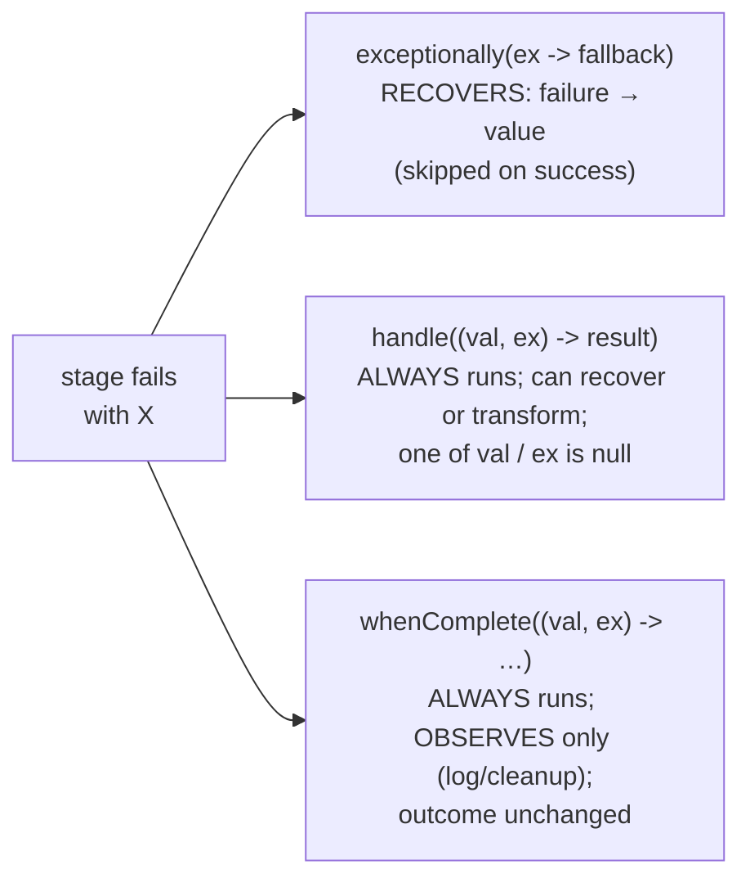

# `CompletableFuture`: Composition, Threads & Error Operators

> **Level:** SDE-II / SDE-III · **Area:** Java · **Prev:** [Executors](01-executors-thread-pools.md) · **Next:** [Async error handling & HTTP](03-async-error-handling-http.md)

## TL;DR

- `CompletableFuture<T>` (CF) = a `Future` you can **chain**: *"when this finishes, do that"* — without blocking a thread to wait.
- Think of it as `Optional`/`Stream` for *time*: **`thenApply` = map**, **`thenCompose` = flatMap**, **`thenCombine` = zip**, **`allOf`/`anyOf`** = fan-in.
- **By default `supplyAsync` runs on the shared `ForkJoinPool.commonPool()`** (daemon threads, sized to the CPU). For **blocking I/O always pass your own executor.**
- Errors don't throw — they **travel down the chain** until something handles them (`exceptionally`, `handle`, `whenComplete`). Dependents see a **`CompletionException`** wrapping the real cause → **unwrap it**.
- Add **timeouts** (`orTimeout`) and a **terminal error handler** to every chain; a failed CF nobody looks at fails **silently**.

## The analogy: ordering with a pager

`Future.get()` is *standing at the counter staring at the kitchen* until your food is ready (you're blocked). A `CompletableFuture` is a **restaurant pager** with instructions you leave in advance: *"when my pizza is ready, add a drink; when both pizza and salad are ready, carry them to table 4; if the pizza burns, order a sandwich instead."* You sit down and do other things; the callbacks fire when each result arrives.

## 1. Building blocks

| Goal | Method | Analogy |
|---|---|---|
| Start async work returning a value | `CompletableFuture.supplyAsync(supplier [, executor])` | |
| Start async work, no value | `runAsync(runnable [, executor])` | |
| Already-known value / failure | `completedFuture(v)`, `failedFuture(ex)` (Java 9) | `Optional.of` |
| Transform the result | `thenApply(fn)` | `map` |
| Chain another async step | `thenCompose(v -> otherFuture)` | `flatMap` |
| Combine two independent futures | `a.thenCombine(b, (x, y) -> …)` | `zip` |
| Consume the result | `thenAccept(consumer)` / `thenRun(runnable)` | |
| Wait for all / first | `allOf(...)` / `anyOf(...)` | |
| Handle errors | `exceptionally`, `handle`, `whenComplete` | `catch` / `catch+map` / `finally` |
| Time limits | `orTimeout(n, unit)`, `completeOnTimeout(default, n, unit)` (Java 9) | |
| Block for the result (at the edge only!) | `join()` (unchecked) / `get()` (checked) | |

**Shape cheat-sheet** — which one do I call?

```java
CompletableFuture<User>   fu = fetchUser(id);
CompletableFuture<String> a  = fu.thenApply(User::name);                         // fn returns a plain value
CompletableFuture<Order>  b  = fu.thenCompose(u -> fetchLatestOrder(u));         // fn returns ANOTHER CF  (thenApply here would give CF<CF<Order>>)
CompletableFuture<Pair>   c  = fu.thenCombine(fetchPrefs(id), Pair::new);        // two independent calls run in PARALLEL
```

## 2. Composition in action

```java
// Run: CfComposition.java
import java.util.concurrent.*;

public class CfComposition {
    // A dedicated, daemon I/O pool. NEVER run blocking calls on the common pool.
    static final ExecutorService IO = Executors.newFixedThreadPool(4, r -> {
        Thread t = new Thread(r, "io"); t.setDaemon(true); return t;
    });

    static void sleep(long ms) { try { Thread.sleep(ms); } catch (InterruptedException e) { Thread.currentThread().interrupt(); } }

    static CompletableFuture<String>  fetchUser(int id)        { return CompletableFuture.supplyAsync(() -> { sleep(100); return "user" + id; }, IO); }
    static CompletableFuture<Integer> fetchOrderCount(String u) { return CompletableFuture.supplyAsync(() -> { sleep(150); return u.length(); }, IO); }
    static CompletableFuture<Double>  fetchDiscount(String u)   { return CompletableFuture.supplyAsync(() -> { sleep(150); return 0.15; }, IO); }

    public static void main(String[] args) {
        long t0 = System.nanoTime();

        String summary = fetchUser(7)                                                    // 100 ms
            .thenCompose(u -> fetchOrderCount(u)                                          // depends on the user...
                .thenCombine(fetchDiscount(u),                                            // ...these two run IN PARALLEL (150 ms, not 300)
                    (n, d) -> u + " has " + n + " orders, discount " + d))
            .join();

        long ms = (System.nanoTime() - t0) / 1_000_000;
        System.out.println(summary);
        System.out.println("ran in parallel? " + (ms < 350) + "   (sequential would be ~400 ms)");
    }
}
```

```text
user7 has 5 orders, discount 0.15
ran in parallel? true   (sequential would be ~400 ms)
```

### Which thread runs my callback?

| Method | Runs on |
|---|---|
| `thenApply(fn)` (no `Async`) | the thread that **completes** the previous stage — or the **caller's** thread if it is already complete. Don't put slow work here. |
| `thenApplyAsync(fn)` | the **common pool** (unless you pass an executor) |
| `thenApplyAsync(fn, executor)` | your executor ✔ |

Rule: **if a callback blocks or is CPU-heavy, use an `…Async(…, executor)` variant with your own executor.** Never block inside the common pool (it's shared by parallel streams and every other CF in the JVM).

## 3. Error operators — what each really does



| Operator | Runs when | Can change the result? | Think of it as |
|---|---|---|---|
| `exceptionally(fn)` | only on failure | yes → supplies a replacement value | `catch` |
| `handle(bifn)` | always | yes (value *or* new failure by throwing) | `catch` + `map` |
| `whenComplete(biconsumer)` | always | **no** (original outcome passes through; if your consumer throws on a *successful* stage, the result becomes failed) | `finally` |
| `exceptionallyCompose(fn)` (12) | only on failure | yes → recover with *another future* | `catch` returning async work |

### The `CompletionException` wrapping rule (the #1 source of confusion)

```java
// Run: CfErrors.java
import java.util.concurrent.*;

public class CfErrors {
    static Throwable unwrap(Throwable t) {
        while ((t instanceof CompletionException || t instanceof ExecutionException) && t.getCause() != null) t = t.getCause();
        return t;
    }

    public static void main(String[] args) throws Exception {
        CompletableFuture<Integer> bad = CompletableFuture.supplyAsync(() -> { throw new IllegalArgumentException("bad input"); });

        // 1. An exception thrown inside a stage is WRAPPED in CompletionException for handlers
        bad.exceptionally(ex -> {
            System.out.println("1. exceptionally sees: " + ex.getClass().getSimpleName()
                + " (cause: " + ex.getCause().getClass().getSimpleName() + ")");
            return -1;
        }).join();

        // 2. completeExceptionally(ex) stores ex RAW on that future; dependents get it wrapped
        CompletableFuture<Integer> manual = new CompletableFuture<>();
        manual.completeExceptionally(new IllegalArgumentException("manual"));
        manual.exceptionally(ex -> { System.out.println("2a. direct handler sees: " + ex.getClass().getSimpleName()); return -1; }).join();
        manual.thenApply(x -> x + 1)
              .exceptionally(ex -> { System.out.println("2b. after a thenApply sees: " + ex.getClass().getSimpleName()); return -1; }).join();

        // 3. join() throws unchecked CompletionException; get() throws checked ExecutionException
        try { bad.join(); } catch (CompletionException e) { System.out.println("3a. join -> CompletionException, cause=" + e.getCause()); }
        try { bad.get(); }  catch (ExecutionException e)  { System.out.println("3b. get  -> ExecutionException,  cause=" + e.getCause()); }

        // 4. Always unwrap before you test the type
        bad.exceptionally(ex -> { System.out.println("4. unwrapped: " + unwrap(ex)); return -1; }).join();

        // 5. handle() = catch + map (exactly one of the two args is null)
        System.out.println("5. handle -> " + bad.handle((v, ex) -> ex != null ? -2 : v).join());

        // 6. whenComplete = finally: runs on success AND failure, never changes the outcome
        System.out.println("6a. success stays: " + CompletableFuture.completedFuture(5)
            .whenComplete((v, ex) -> System.out.println("    whenComplete saw v=" + v)).join());
        try {
            bad.whenComplete((v, ex) -> System.out.println("    cleanup ran even though it failed")).join();
        } catch (CompletionException e) { System.out.println("6b. ...and it is STILL failed: " + unwrap(e).getMessage()); }

        // 7. Recovery in the middle of a chain: later stages continue normally
        System.out.println("7. recovered chain -> " + bad.exceptionally(ex -> 10).thenApply(x -> x * 2).join());
    }
}
```

```text
1. exceptionally sees: CompletionException (cause: IllegalArgumentException)
2a. direct handler sees: IllegalArgumentException
2b. after a thenApply sees: CompletionException
3a. join -> CompletionException, cause=java.lang.IllegalArgumentException: bad input
3b. get  -> ExecutionException,  cause=java.lang.IllegalArgumentException: bad input
4. unwrapped: java.lang.IllegalArgumentException: bad input
5. handle -> -2
    whenComplete saw v=5
6a. success stays: 5
    cleanup ran even though it failed
6b. ...and it is STILL failed: bad input
7. recovered chain -> 20
```

**Rules**

1. A handler may receive either the raw exception *or* a `CompletionException` wrapper depending on how the failure arose. **Always unwrap** (`unwrap` helper above) before `instanceof`.
2. `join()` = unchecked (`CompletionException`), good in lambdas; `get()` = checked `ExecutionException` + `InterruptedException`.
3. Put **one `exceptionally`/`handle` at the end** of each chain (the "terminal handler") and *additional* ones where you can truly recover.
4. Throwing inside `handle`/`exceptionally` creates a *new* failure.
5. To raise a failure from a stage: `throw new CompletionException(cause)` or return `CompletableFuture.failedFuture(ex)` from a `thenCompose`.

## 4. Fan-out / fan-in: `allOf`, partial failures, timeouts

```java
// Run: CfAllOf.java
import java.util.*;
import java.util.concurrent.*;

public class CfAllOf {
    static void sleep(long ms) { try { Thread.sleep(ms); } catch (InterruptedException e) { Thread.currentThread().interrupt(); } }

    static CompletableFuture<String> task(String name, boolean fail) {
        return CompletableFuture.supplyAsync(() -> {
            sleep(50);
            if (fail) throw new IllegalStateException(name + " blew up");
            return name + "-ok";
        });
    }

    public static void main(String[] args) {
        // allOf() fails if ANY fails — and you lose the successful results. Convert each future to a value first:
        List<CompletableFuture<String>> outcomes = List.of(task("A", false), task("B", true), task("C", false)).stream()
            .map(f -> f.handle((v, ex) -> ex == null ? v : "FAILED(" + root(ex).getMessage() + ")"))
            .toList();
        CompletableFuture.allOf(outcomes.toArray(CompletableFuture[]::new)).join();   // can't fail now: every future already handled
        outcomes.forEach(f -> System.out.println(f.join()));

        // Timeouts: orTimeout fails the future with TimeoutException; completeOnTimeout supplies a default.
        CompletableFuture<String> slow = CompletableFuture.supplyAsync(() -> { sleep(1000); return "late"; });
        try { slow.orTimeout(100, TimeUnit.MILLISECONDS).join(); }
        catch (CompletionException e) { System.out.println("timeout -> " + e.getCause().getClass().getSimpleName()); }

        String fallback = CompletableFuture.supplyAsync(() -> { sleep(1000); return "late"; })
            .completeOnTimeout("default", 100, TimeUnit.MILLISECONDS).join();
        System.out.println("completeOnTimeout -> " + fallback);
    }

    static Throwable root(Throwable t) {                         // strip CompletionException / ExecutionException wrappers
        while ((t instanceof CompletionException || t instanceof ExecutionException) && t.getCause() != null) t = t.getCause();
        return t;
    }
}
```

```text
A-ok
FAILED(B blew up)
C-ok
timeout -> TimeoutException
completeOnTimeout -> default
```

Notes:

- `allOf(...)` returns `CompletableFuture<Void>`; read each future's value yourself. If **any** input failed, `allOf` completes exceptionally **after all have finished**, and it does **not** cancel the others.
- `anyOf(...)` completes with the **first to complete — including a failure**.
- `orTimeout` doesn't stop the underlying work — the task keeps running on its thread. Design tasks to be cancellable/idempotent, or use the downstream's own timeout (HTTP request timeout).
- `cf.cancel(true)` on a `CompletableFuture` completes it with `CancellationException` but does **not** interrupt the running supplier.

## 5. Pitfalls checklist

> [!WARNING]
> - **Blocking in the common pool** (`supplyAsync(() -> http.get())` with no executor) — starves every other CF and parallel stream in the JVM.
> - **Fire-and-forget without a handler:** `CompletableFuture.runAsync(task);` — if `task` throws, nobody ever knows. Add `.exceptionally(ex -> { log.error("…", unwrap(ex)); return null; })` or `.whenComplete(...)`.
> - **`join()`/`get()` in the middle of a chain** or inside pool threads → starvation deadlocks. Block **only at the edge** (controller/main), or never (return the CF).
> - **`thenApply` with a function that returns a CF** → `CF<CF<T>>`; you wanted `thenCompose`.
> - Forgetting that **`thenApply` may run on the caller's thread** if the stage was already complete.
> - **Checked exceptions in suppliers** don't compile: wrap (`throw new CompletionException(e)`) or catch and return `failedFuture`.
> - **Losing context:** MDC, security context, `@Transactional` and `ThreadLocal`s don't follow you to another thread.
> - **Unbounded fan-out:** `list.stream().map(this::callAsync)` over 10,000 items fires 10,000 calls at once. Bound it with a semaphore or batch.

## 6. Interview Q&A

<details>
<summary><b>Q1.</b> <code>thenApply</code> vs <code>thenCompose</code> vs <code>thenCombine</code>?</summary>

`thenApply`: sync transformation (`T → U`), like `map`. `thenCompose`: next step is itself async (`T → CF<U>`), like `flatMap` — avoids `CF<CF<U>>`. `thenCombine`: wait for two *independent* futures and merge results, like `zip`; they run in parallel.
</details>

<details>
<summary><b>Q2.</b> <code>exceptionally</code> vs <code>handle</code> vs <code>whenComplete</code>?</summary>

`exceptionally`: failure-only recovery value. `handle`: always runs, receives (value, exception), returns a new value (catch + map). `whenComplete`: always runs, observes only, returns the same outcome (finally-like, ideal for logging/cleanup/releasing a permit).
</details>

<details>
<summary><b>Q3.</b> Which thread pool does <code>supplyAsync</code> use, and why is that a problem?</summary>

Without an executor argument, `ForkJoinPool.commonPool()` — a small shared pool of daemon threads sized for CPU work. Blocking tasks there starve other users of the pool, and the daemon threads won't keep the JVM alive. Pass a dedicated executor for I/O.
</details>

<details>
<summary><b>Q4.</b> What's the difference between <code>join()</code> and <code>get()</code>?</summary>

Both block. `get()` throws checked `InterruptedException`/`ExecutionException`; `join()` throws unchecked `CompletionException` (convenient in lambdas). Both wrap the original failure as the `cause`.
</details>

<details>
<summary><b>Q5.</b> How do you run N calls in parallel and keep partial results when some fail?</summary>

Convert each future with `handle` into a result/outcome value, then `allOf(...).join()` and read each; or collect per-future `Result` objects. Raw `allOf` loses successes if one fails.
</details>

<details>
<summary><b>Q6.</b> How do you implement a timeout, and does it cancel the work?</summary>

`orTimeout`/`completeOnTimeout` (Java 9) complete the future with `TimeoutException`/a default, but the underlying task continues. Real cancellation requires interruptible work (`Future.cancel(true)`) or a downstream timeout (HTTP request timeout, JDBC query timeout).
</details>

<details>
<summary><b>Q7.</b> What happens to an exception in a CF chain nobody handles?</summary>

It's stored in the future and silently dropped when the future is garbage-collected — nothing is logged. Always end chains with an error handler or return the future to someone who will.
</details>

<details>
<summary><b>Q8.</b> Why avoid <code>get()</code> inside a callback running on a pool thread?</summary>

You hold a pool thread while waiting for another task that may need a thread from the same pool → starvation/deadlock. Compose with `thenCompose` instead.
</details>

## 7. Predict the output

<details>
<summary><b>P1.</b></summary>

```java
CompletableFuture<Integer> f = CompletableFuture.supplyAsync(() -> 1 / 0);
System.out.println(f.handle((v, ex) -> ex == null ? "ok" : ex.getClass().getSimpleName()).join());
```

**`CompletionException`** — the `ArithmeticException` is wrapped. Use `ex.getCause()` (or an `unwrap` helper) to see `ArithmeticException`.
</details>

<details>
<summary><b>P2.</b></summary>

```java
String s = CompletableFuture.supplyAsync(() -> "a")
    .thenApply(x -> { throw new RuntimeException("oops"); })
    .exceptionally(ex -> "recovered")
    .thenApply(x -> x + "!")
    .join();
System.out.println(s);
```

**`recovered!`** — the failure is recovered, and the following `thenApply` runs normally.
</details>

<details>
<summary><b>P3.</b></summary>

```java
CompletableFuture<String> f = CompletableFuture.supplyAsync(() -> "x")
    .whenComplete((v, ex) -> { throw new IllegalStateException("cleanup failed"); });
f.join();
```

Throws **`CompletionException` (cause `IllegalStateException: cleanup failed`)** — an exception thrown in `whenComplete` on a *successful* stage turns the result into a failure. Keep cleanup code non-throwing.
</details>

---
[↑ Back to Concurrency index](README.md)
