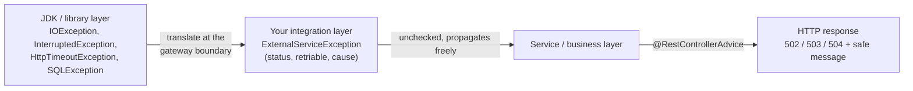

# Async Error Handling & Calling External Services

> **Level:** SDE-II / SDE-III · **Area:** Java · **Prereqs:** [Exceptions](../01-java-basics/05-exceptions.md), [Executors](01-executors-thread-pools.md), [CompletableFuture](02-completablefuture.md) · **Next:** [Locks, volatile & deadlocks](04-locks-volatile-deadlock.md)

## TL;DR

- In async code an exception **doesn't unwind your call stack** — it is **captured** and delivered somewhere else (a `Future`, a CF chain, an `UncaughtExceptionHandler`). If nobody looks there, it **disappears**. The whole skill is: *know where each failure lands and make sure something handles it.*
- Treat `IOException` as the JDK's low-level "I/O failed" signal. At **your boundary** (an `HttpGateway`/client class) **translate** it into **one unchecked domain exception** that carries what callers need (`status`, `retriable`, the original `cause`). Business code then never sees `IOException`.
- `InterruptedException` is different: it means *"someone asked this thread to stop"*. **Restore the interrupt flag** and stop; don't swallow or retry it.
- An HTTP **404/500 is not an exception** in `java.net.http` — you must check the status yourself.
- Every outbound call needs: **timeout · bounded retries (idempotent calls only, with backoff) · concurrency limit · one clear error type · logging with the cause**.

## The analogy: sending parcels through couriers

A synchronous call is **handing a parcel to a clerk and waiting**: if something's wrong they tell you to your face (exception thrown at the call site). Async is **dropping the parcel in a courier's drop-box with a tracking number** (the `Future`/CF): problems are recorded on the **tracking page**, not shouted at you. If you never check the tracking page (never call `get`/`handle`), a lost parcel is *never noticed*. A good setup = you attach a **notification rule** to every tracking number ("if lost, email me and try the backup courier").

## 1. Where does a failure go? (the mental model)

| You wrote | The task throws… | It surfaces as | Who sees it |
|---|---|---|---|
| plain method call | `X` | `X` thrown at the call site | caller (`try/catch` works) |
| `new Thread(r).start()` | `X` | `Thread.UncaughtExceptionHandler` (default: stack trace on stderr); thread dies | **not the starter** |
| `executor.execute(r)` | `X` | thread's `UncaughtExceptionHandler`; worker replaced | **not the submitter** |
| `executor.submit(c)` | `X` | stored in `Future`; `ExecutionException(cause=X)` from `get()` | **only if you call `get()`** |
| `CompletableFuture.supplyAsync` | `X` | stored; handlers see `CompletionException(cause=X)`; `join()` → `CompletionException`; `get()` → `ExecutionException` | only if you attach a handler / join |
| `parallelStream` | `X` | thrown in the calling thread when the terminal op finishes | caller |
| Spring `@Async void` | `X` | `AsyncUncaughtExceptionHandler` | handler bean |
| Spring `@Async CompletableFuture<T>` | `X` | the returned future fails | whoever uses the future |
| virtual thread task | `X` | same rules as platform threads | same |

**The golden rule: every async chain ends in a place that *handles or logs* failures.**

## 2. Seven rules for async error handling

1. **No fire-and-forget without a terminal handler.** `runAsync(task)` / `submit(task)` must be paired with `.exceptionally(log)` / `whenComplete(log)` / a logging wrapper.
2. **Unwrap before you decide.** `CompletionException`/`ExecutionException` are *wrappers*; look at `getCause()` (loop until it's neither).
3. **Translate at boundaries.** Convert low-level exceptions (`IOException`, `SQLException`, JSON errors) into **your** exception type at the edge of the integration, preserving the `cause`.
4. **Decide retriable vs non-retriable once** (in the translator), not at every call site.
5. **Respect interruption.** On `InterruptedException`: `Thread.currentThread().interrupt()` and exit/propagate; never retry or swallow.
6. **Always set timeouts** (connect, request/read, overall deadline). A call without a timeout can hold a thread forever.
7. **Clean up in the equivalent of `finally`** (`whenComplete`, or try-with-resources *inside* the task) so permits/connections are released on success **and** failure.

## 3. `IOException` vs your own exception — what to throw where



| Failure | What it really means | Do this |
|---|---|---|
| `IOException` (`ConnectException`, `SocketException`, `UnknownHostException`) | network-level failure; request may or may not have reached the server | wrap → `ExternalServiceException(retriable = true*)` (*only retry idempotent requests*) |
| `HttpTimeoutException` / `HttpConnectTimeoutException` | too slow | wrap → retriable (idempotent) or fail fast; map to **504** |
| HTTP **4xx** | *our* request is wrong (400, 401, 403, 404, 422) | **non-retriable**; surface a precise error (log request id) |
| HTTP **429 / 503** | rate-limited / overloaded | retriable with backoff; honour `Retry-After` |
| HTTP **5xx** | their bug / outage | retriable for idempotent calls, otherwise fail; consider circuit breaker |
| Unparseable body | contract violation | non-retriable, `ExternalServiceException("bad response", cause)` |
| `InterruptedException` | cancellation request | restore flag (`Thread.currentThread().interrupt()`), then throw an unchecked exception or return |
| `NullPointerException`, `IllegalArgumentException` from *our* code | bug | don't retry, let it fail loudly |

**Why not just let `IOException` bubble up?** It's checked, so every caller, lambda and stream step must catch or declare it (leaky abstraction), and callers can't tell *"worth retrying"* from *"our bug"*. One unchecked domain exception with a `retriable` flag keeps business code clean.

## 4. The synchronous version: `try / catch / finally` done right

```java
public String fetch(URI uri) {
    HttpRequest req = HttpRequest.newBuilder(uri).timeout(Duration.ofSeconds(2)).GET().build();
    try {
        HttpResponse<String> resp = client.send(req, HttpResponse.BodyHandlers.ofString());   // throws IOException, InterruptedException
        if (resp.statusCode() / 100 != 2) {                                                   // non-2xx is NOT an exception!
            throw new ExternalServiceException("HTTP " + resp.statusCode(), resp.statusCode(),
                                               resp.statusCode() == 429 || resp.statusCode() >= 500, null);
        }
        return resp.body();
    } catch (HttpTimeoutException e) {                                                        // subclass of IOException: catch FIRST
        throw new ExternalServiceException("timeout calling " + uri, -1, true, e);
    } catch (IOException e) {
        throw new ExternalServiceException("I/O failure calling " + uri, -1, true, e);        // keep the cause!
    } catch (InterruptedException e) {
        Thread.currentThread().interrupt();                                                   // restore the flag
        throw new ExternalServiceException("interrupted calling " + uri, -1, false, e);
    }
    // no finally needed: HttpClient pools connections and closes the body for you with BodyHandlers.ofString()
}
```

When you *do* open a resource yourself, use try-with-resources (it closes before `catch`, and records close failures as **suppressed** exceptions — see [Exceptions](../01-java-basics/05-exceptions.md#3-try-with-resources-and-suppressed-exceptions)).

Use **one shared `HttpClient`** (thread-safe, pools connections, supports HTTP/2); set `connectTimeout` on the client and `timeout` per request. Java 21 makes `HttpClient` `AutoCloseable`.

## 5. The asynchronous version: a gateway with retries (runnable)

Everything from the table above in one place — against a local test server so no internet is needed. Scenarios: success, transient failure then success, permanent 503, slow endpoint (timeout), 404, connection refused.

```java
// Run: HttpGatewayDemo.java
import com.sun.net.httpserver.HttpExchange;
import com.sun.net.httpserver.HttpServer;
import java.io.IOException;
import java.net.*;
import java.net.http.*;
import java.nio.charset.StandardCharsets;
import java.time.Duration;
import java.util.concurrent.*;
import java.util.concurrent.atomic.AtomicInteger;

public class HttpGatewayDemo {

    /** The ONE exception type our business code sees. Unchecked; carries what callers need to decide. */
    static class ExternalServiceException extends RuntimeException {
        final int status;            // HTTP status, or -1 when no response was received
        final boolean retriable;
        ExternalServiceException(String msg, int status, boolean retriable, Throwable cause) {
            super(msg, cause); this.status = status; this.retriable = retriable;
        }
    }

    static Throwable unwrap(Throwable t) {
        while ((t instanceof CompletionException || t instanceof ExecutionException) && t.getCause() != null) t = t.getCause();
        return t;
    }

    static class Gateway {
        private final HttpClient client = HttpClient.newBuilder().connectTimeout(Duration.ofSeconds(1)).build();
        private final String base;
        Gateway(String base) { this.base = base; }

        /** GET is idempotent, so retrying is safe. (Never blindly retry POSTs.) */
        CompletableFuture<String> get(String path, int maxAttempts) { return attempt(path, 1, maxAttempts); }

        private CompletableFuture<String> attempt(String path, int n, int max) {
            HttpRequest req = HttpRequest.newBuilder(URI.create(base + path))
                .timeout(Duration.ofMillis(500)).GET().build();                       // per-request timeout

            return client.sendAsync(req, HttpResponse.BodyHandlers.ofString())
                .thenApply(this::checkStatus)                                         // non-2xx -> exception
                .handle((body, ex) -> {                                               // single place that decides: retry or fail
                    if (ex == null) return CompletableFuture.completedFuture(body);
                    ExternalServiceException e = translate(unwrap(ex));
                    if (e.retriable && n < max) {
                        long backoff = 50L << (n - 1);                                // 50, 100, 200 ms ...
                        System.out.println("    attempt " + n + " failed (" + e.getMessage() + "), retrying in " + backoff + " ms");
                        Executor later = CompletableFuture.delayedExecutor(backoff, TimeUnit.MILLISECONDS);
                        return CompletableFuture.supplyAsync(() -> (Void) null, later).thenCompose(v -> attempt(path, n + 1, max));
                    }
                    return CompletableFuture.<String>failedFuture(e);                 // give up with our domain exception
                })
                .thenCompose(f -> f);                                                 // flatten CF<CF<String>>
        }

        private String checkStatus(HttpResponse<String> r) {
            int s = r.statusCode();
            if (s >= 200 && s < 300) return r.body();
            throw new ExternalServiceException("HTTP " + s, s, s == 429 || s >= 500, null);   // 4xx (except 429) -> not retriable
        }

        private static ExternalServiceException translate(Throwable t) {
            if (t instanceof ExternalServiceException e) return e;
            if (t instanceof HttpTimeoutException)       return new ExternalServiceException("timeout", -1, true, t);   // before IOException!
            if (t instanceof IOException)                return new ExternalServiceException("I/O failure: " + t.getClass().getSimpleName(), -1, true, t);
            return new ExternalServiceException("unexpected: " + t, -1, false, t);
        }
    }

    // ---- tiny local server so the demo is self-contained -------------------------------------------------------
    static void reply(HttpExchange ex, int status, String body) throws IOException {
        byte[] bytes = body.getBytes(StandardCharsets.UTF_8);
        ex.sendResponseHeaders(status, bytes.length);
        try (var os = ex.getResponseBody()) { os.write(bytes); }
    }
    static void sleep(long ms) { try { Thread.sleep(ms); } catch (InterruptedException e) { Thread.currentThread().interrupt(); } }

    static void run(String label, CompletableFuture<String> f) {
        try {
            System.out.println(label + " -> " + f.join());
        } catch (CompletionException e) {
            Throwable c = e.getCause();
            if (c instanceof ExternalServiceException x)
                System.out.println(label + " FAILED: \"" + x.getMessage() + "\" [status=" + x.status + ", retriable=" + x.retriable
                    + ", cause=" + (x.getCause() == null ? "none" : x.getCause().getClass().getSimpleName()) + "]");
            else System.out.println(label + " FAILED unexpectedly: " + c);
        }
    }

    public static void main(String[] args) throws Exception {
        HttpServer server = HttpServer.create(new InetSocketAddress(InetAddress.getLoopbackAddress(), 0), 0);
        ExecutorService serverPool = Executors.newFixedThreadPool(8);
        server.setExecutor(serverPool);
        AtomicInteger flaky = new AtomicInteger(), hard = new AtomicInteger();
        server.createContext("/ok",         ex -> reply(ex, 200, "hello"));
        server.createContext("/flaky",      ex -> { if (flaky.incrementAndGet() <= 2) reply(ex, 503, "busy"); else reply(ex, 200, "recovered"); });
        server.createContext("/always503",  ex -> { hard.incrementAndGet(); reply(ex, 503, "down"); });
        server.createContext("/slow",       ex -> { sleep(2000); reply(ex, 200, "too late"); });
        server.createContext("/missing",    ex -> reply(ex, 404, "nope"));
        server.start();

        try {
            Gateway gw = new Gateway("http://" + InetAddress.getLoopbackAddress().getHostAddress() + ":" + server.getAddress().getPort());
            run("ok",         gw.get("/ok", 3));
            run("flaky",      gw.get("/flaky", 3));
            run("always503",  gw.get("/always503", 3));
            System.out.println("    (server saw " + hard.get() + " calls)");
            run("slow",       gw.get("/slow", 2));
            run("missing",    gw.get("/missing", 3));
            run("refused",    new Gateway("http://127.0.0.1:1").get("/x", 2));
        } finally {                                                                   // try/finally still matters: always release the server
            server.stop(0);
            serverPool.shutdownNow();
        }
    }
}
```

Expected output:

```text
ok -> hello
    attempt 1 failed (HTTP 503), retrying in 50 ms
    attempt 2 failed (HTTP 503), retrying in 100 ms
flaky -> recovered
    attempt 1 failed (HTTP 503), retrying in 50 ms
    attempt 2 failed (HTTP 503), retrying in 100 ms
always503 FAILED: "HTTP 503" [status=503, retriable=true, cause=none]
    (server saw 3 calls)
    attempt 1 failed (timeout), retrying in 50 ms
slow FAILED: "timeout" [status=-1, retriable=true, cause=HttpTimeoutException]
missing FAILED: "HTTP 404" [status=404, retriable=false, cause=none]
    attempt 1 failed (I/O failure: ConnectException), retrying in 50 ms
refused FAILED: "I/O failure: ConnectException" [status=-1, retriable=true, cause=ConnectException]
```

What to notice:

- **One decision point** (`handle`) per attempt: success → value; retriable & attempts left → delayed retry; else → `failedFuture(domainException)`.
- `404` was **not retried** (non-retriable), `503` was (retriable), a **timeout** surfaced as the JDK's `HttpTimeoutException` and was translated.
- The caller sees only `ExternalServiceException`, with `cause` preserved for logs.
- `CompletableFuture.delayedExecutor` gives non-blocking backoff (no thread sleeps).
- Production upgrades: **jitter** on the backoff, an **overall deadline**, honour `Retry-After`, a **circuit breaker** (Resilience4j) so you stop hammering a dead service, and **metrics** per outcome.

## 6. `try / catch / finally` ↔ async equivalents

| Synchronous | Async (`CompletableFuture`) |
|---|---|
| `try { x } catch (E e) { fallback }` | `.exceptionally(ex -> fallback)` / `.handle((v, ex) -> …)` |
| `catch (A \| B e)` | in the handler: `Throwable c = unwrap(ex); if (c instanceof A) … else if (c instanceof B) …` |
| `finally { release(); }` | `.whenComplete((v, ex) -> release())` (runs on success **and** failure, doesn't change the result) |
| `try (var r = open()) { … }` | open **and** close inside the same task (try-with-resources inside the lambda), or close in `whenComplete` |
| `throw new X(cause)` | `throw new CompletionException(new X(cause))` inside a stage, or `return CompletableFuture.failedFuture(new X(cause))` from `thenCompose`/`handle` |
| rethrow after logging | `.whenComplete((v, ex) -> { if (ex != null) log.error("…", unwrap(ex)); })` (outcome unchanged) |
| catching at the top | the last `.exceptionally(...)` in the chain, or the caller of `join()` |

### Releasing a permit in the "finally" of an async call (runnable)

```java
// Run: AsyncFinally.java
import java.util.concurrent.*;

public class AsyncFinally {
    public static void main(String[] args) throws Exception {
        Semaphore permits = new Semaphore(2);                         // limit concurrent calls to the downstream service

        CompletableFuture<String> call = callLimited(permits, true);  // this one will FAIL
        try { call.join(); } catch (CompletionException e) { System.out.println("call failed: " + e.getCause().getMessage()); }

        System.out.println("permits after failure : " + permits.availablePermits());   // 2  -> released via whenComplete
        System.out.println("permits after success : " + callLimitedThenPermits(permits));
    }

    static CompletableFuture<String> callLimited(Semaphore permits, boolean fail) throws InterruptedException {
        permits.acquire();                                            // take a permit BEFORE starting async work
        try {
            return CompletableFuture.supplyAsync(() -> { if (fail) throw new IllegalStateException("downstream error"); return "ok"; })
                .whenComplete((v, ex) -> permits.release());          // "finally": always give the permit back
        } catch (RuntimeException e) {                                // supplyAsync itself failed to start (e.g. rejected)
            permits.release();
            throw e;
        }
    }

    static int callLimitedThenPermits(Semaphore permits) throws Exception {
        callLimited(permits, false).join();
        return permits.availablePermits();
    }
}
```

```text
call failed: downstream error
permits after failure : 2
permits after success : 2
```

(Notice the subtle second release: if *starting* the async work throws synchronously, `whenComplete` was never attached, so a plain `try/catch` must release.)

## 7. Cancellation and interruption

- A thread is asked to stop with `thread.interrupt()` / `future.cancel(true)` / `executor.shutdownNow()`. It sets a flag; blocking calls (`sleep`, `wait`, `BlockingQueue.take`, `Future.get`, `HttpClient.send`) throw `InterruptedException` and **clear** it.
- Correct handling:

```java
try {
    work();
} catch (InterruptedException e) {
    Thread.currentThread().interrupt();     // restore: tell the callers above we were interrupted
    return;                                  // or throw an unchecked exception — but STOP
}
```

- Long CPU loops should poll `Thread.currentThread().isInterrupted()`.
- `CompletableFuture.cancel(true)` does **not** interrupt the running task; to really stop work you need an interruptible call or a downstream timeout.

## 8. Spring Boot pointers (details in the Spring section later)

| Concern | Spring way |
|---|---|
| Map `ExternalServiceException` to HTTP | `@RestControllerAdvice` with `@ExceptionHandler`: timeout → **504**, upstream 5xx/connection → **502/503**, their 4xx → usually **502** (don't leak internals), our validation → **400** |
| `@Async` | return `CompletableFuture<T>` so the caller can handle errors; `void` methods need an `AsyncUncaughtExceptionHandler`; configure a **named, bounded** `ThreadPoolTaskExecutor` |
| HTTP clients | `RestClient`/`WebClient`/`HttpClient` as a **single bean** with timeouts configured |
| Resilience | Resilience4j: retry, circuit breaker, bulkhead, rate limiter, time limiter |
| Virtual threads | `spring.threads.virtual.enabled=true` (Boot 3.2+) — then plain blocking `try/catch` code scales (next notes) |

## 9. Interview Q&A

<details>
<summary><b>Q1.</b> How do you handle exceptions in <code>CompletableFuture</code> chains?</summary>

End every chain with `exceptionally`/`handle`/`whenComplete` (logging or recovery). Use `handle` for catch+map, `whenComplete` for finally-like cleanup, `exceptionally` for failure-only recovery. Unwrap `CompletionException`/`ExecutionException` before inspecting types. Convert low-level exceptions to a domain exception at the boundary.
</details>

<details>
<summary><b>Q2.</b> Where do exceptions go in a thread, an <code>execute()</code> task, a <code>submit()</code> task and a CF?</summary>

Thread/`execute`: `UncaughtExceptionHandler` (stack trace, thread dies). `submit`: stored in the `Future`, rethrown as `ExecutionException` on `get()`. CF: stored; dependents see `CompletionException`; `join` → `CompletionException`, `get` → `ExecutionException`. If nothing consumes them they are silently lost.
</details>

<details>
<summary><b>Q3.</b> Should you let <code>IOException</code> propagate or wrap it?</summary>

Wrap it at the boundary of the integration in an unchecked domain exception with the original as `cause` plus classification (`retriable`, `status`). It keeps business code free of checked exceptions, works in lambdas, and lets callers (and central handlers) decide retry/HTTP mapping.
</details>

<details>
<summary><b>Q4.</b> Does <code>java.net.http.HttpClient</code> throw on a 404 or 500?</summary>

No. Only transport failures throw (`IOException`, `HttpTimeoutException`, `InterruptedException`). A response with any status code is a normal `HttpResponse`; you must check `statusCode()` and decide.
</details>

<details>
<summary><b>Q5.</b> What do you do on <code>InterruptedException</code>?</summary>

Restore the interrupt flag (`Thread.currentThread().interrupt()`), stop doing work (return or throw an unchecked exception). Never swallow it or retry in a loop, because it's a cancellation request (shutdown, timeout, cancel).
</details>

<details>
<summary><b>Q6.</b> What makes a retry safe, and how should it be designed?</summary>

Only **idempotent** operations (GET/PUT/DELETE, or POST with an idempotency key) and **transient** failures (timeouts, 429/503, connection errors). Use bounded attempts, exponential backoff **with jitter**, an overall deadline, and a circuit breaker; don't retry 4xx or programming errors; make sure retries across layers don't multiply (retry storms).
</details>

<details>
<summary><b>Q7.</b> How do you implement <code>finally</code> in async code?</summary>

`whenComplete((v, ex) -> cleanup())` — runs on both outcomes without changing the result — or open/close resources entirely inside the task with try-with-resources. Remember to also handle the case where the async work fails to *start* synchronously.
</details>

<details>
<summary><b>Q8.</b> Why do you need timeouts at several levels?</summary>

Connect timeout (can't establish a connection), request/read timeout (server accepted but is slow), and an overall deadline across retries (user-facing latency budget). Without them a slow dependency can hold threads indefinitely and cascade into an outage.
</details>

## 10. Predict the output

<details>
<summary><b>P1.</b></summary>

```java
ExecutorService p = Executors.newFixedThreadPool(1);
Future<?> f = p.submit(() -> { throw new IllegalStateException("x"); });
p.shutdown();
System.out.println("done");
```

Prints **`done`**. The exception sits in `f`; with no `get()` it's never reported.
</details>

<details>
<summary><b>P2.</b></summary>

```java
try {
    CompletableFuture.supplyAsync(() -> { throw new IllegalStateException("x"); }).get();
} catch (Exception e) {
    System.out.println(e.getClass().getSimpleName() + " / " + e.getCause().getClass().getSimpleName());
}
```

**`ExecutionException / IllegalStateException`**. With `join()` it would be `CompletionException / IllegalStateException`.
</details>

<details>
<summary><b>P3.</b> Which <code>catch</code> order compiles?</summary>

```java
try { client.send(req, ofString()); }
catch (IOException e) { … }
catch (HttpTimeoutException e) { … }
```

**Neither is reachable in this order → compile error** ("exception HttpTimeoutException has already been caught"): `HttpTimeoutException` extends `IOException`, so catch the **subclass first**.
</details>

---
[↑ Back to Concurrency index](README.md)
