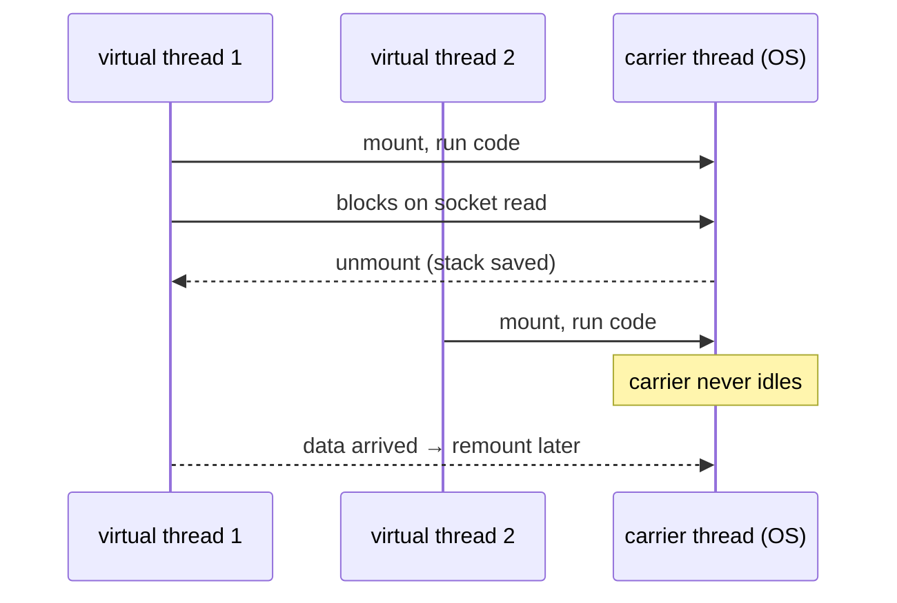

# Virtual Threads (Java 21)

> **Level:** SDE-II / SDE-III · **Area:** Java · **Prev:** [Locks, volatile & deadlocks](04-locks-volatile-deadlock.md) · **Related:** [Executors](01-executors-thread-pools.md), [Async error handling](03-async-error-handling-http.md)

## TL;DR

- A **virtual thread** is a JVM-managed, very cheap thread (a few KB, millions possible). When it **blocks** on I/O, sleep or a lock, the JVM **unmounts** it from its OS "carrier" thread so the carrier runs something else.
- Result: you write **simple blocking code** (`client.send(...)`, `try/catch/finally`, stack traces that make sense) and still **scale to tens of thousands of concurrent I/O waits** — the thing you previously needed `CompletableFuture`/reactive for.
- **Don't pool them** (create one per task). **Limit concurrency with a `Semaphore`**, not pool size.
- No benefit for **CPU-bound** work (you still have N cores).
- Java 21 gotcha: blocking inside **`synchronized`** (or native frames) **pins** the carrier — prefer `ReentrantLock`. (JDK 24 removes the `synchronized` pinning.)

## The analogy: waiters and tables

- **Platform threads** = a restaurant where each **waiter is bolted to one table** for the whole meal. 200 waiters → 200 tables served, even though diners spend 95 % of the time *reading the menu/eating* (waiting on I/O).
- **Virtual threads** = waiters who **walk away while a diner is thinking** and serve other tables, returning when the diner is ready. A handful of waiters (carrier threads ≈ CPU cores) can look after 10,000 tables.
- **CompletableFuture/reactive** = the same efficiency, but the waiters have to write every interaction as *"when X happens, then do Y"* sticky notes (callbacks). Virtual threads give you efficiency **with straight-line code**.

## 1. Platform vs virtual threads

| | Platform thread | Virtual thread |
|---|---|---|
| Backed by | one OS thread | scheduled by the JVM on a small `ForkJoinPool` of carriers |
| Memory | ~1 MB stack reserved | grows on demand (KBs; stack lives on the heap) |
| Creation cost | expensive → pool | trivial → **one per task** |
| Practical count | hundreds–low thousands | **millions** |
| Blocking I/O | holds an OS thread | **unmounts**, frees the carrier |
| Daemon | configurable | **always daemon** |
| Pooling | yes (that's the point of executors) | **no** — pooling defeats the purpose |
| Best for | CPU-bound, long-lived workers | **I/O-bound**, request-per-thread servers |



## 2. Creating them

```java
Thread.startVirtualThread(() -> work());                          // quick
Thread t = Thread.ofVirtual().name("worker-", 0).start(() -> work());   // named: worker-0, worker-1...
try (ExecutorService ex = Executors.newVirtualThreadPerTaskExecutor()) { // the idiomatic way
    Future<String> f = ex.submit(() -> callRemote());                   // normal Future, normal try/catch around get()
}                                                                       // close() waits for all tasks
```

`Thread.currentThread().isVirtual()` tells you which kind you're on.

## 3. Scale demo

```java
// Run: VirtualThreadsDemo.java
import java.util.concurrent.*;
import java.util.concurrent.atomic.AtomicInteger;

public class VirtualThreadsDemo {
    static final int TASKS = 2_000;          // each "request" waits 200 ms (think: an HTTP call)

    static long timeMs(ExecutorService ex) throws Exception {
        AtomicInteger done = new AtomicInteger();
        long t0 = System.nanoTime();
        try (ex) {                                                        // close() waits for everything
            for (int i = 0; i < TASKS; i++)
                ex.submit(() -> { Thread.sleep(200); done.incrementAndGet(); return null; });
        }
        if (done.get() != TASKS) throw new IllegalStateException("lost tasks: " + done);
        return (System.nanoTime() - t0) / 1_000_000;
    }

    public static void main(String[] args) throws Exception {
        long platform = timeMs(Executors.newFixedThreadPool(100));        // 100 platform threads -> 20 waves of 200 ms
        long virtual  = timeMs(Executors.newVirtualThreadPerTaskExecutor());

        System.out.println(TASKS + " tasks x 200 ms wait:");
        System.out.println("  100 platform threads : ~4 s expected, took > 3 s? " + (platform > 3000));
        System.out.println("  virtual threads      : ~0.2-1 s expected, took < 2 s? " + (virtual < 2000));
        System.out.println("  virtual is >= 3x faster? " + (platform >= 3 * virtual));

        Thread.ofVirtual().start(() -> {
            Thread t = Thread.currentThread();
            System.out.println("isVirtual=" + t.isVirtual() + " isDaemon=" + t.isDaemon());
        }).join();
    }
}
```

```text
2000 tasks x 200 ms wait:
  100 platform threads : ~4 s expected, took > 3 s? true
  virtual threads      : ~0.2-1 s expected, took < 2 s? true
  virtual is >= 3x faster? true
isVirtual=true isDaemon=true
```

Same code, same task — only the executor changed.

## 4. How it changes your async/error-handling code

```java
// Virtual-thread style: plain blocking code, plain try/catch/finally, normal stack traces
String loadProfile(long id) {
    try {
        User u = userClient.get(id);                    // blocks the *virtual* thread, not an OS thread
        List<Order> orders = orderClient.list(u);       // sequential and readable
        return render(u, orders);
    } catch (ExternalServiceException e) {
        return fallbackProfile(id);
    }
}

// Fan-out: start many virtual-thread tasks and join; failures arrive as ExecutionException from get()
try (var ex = Executors.newVirtualThreadPerTaskExecutor()) {
    List<Future<Price>> futures = tickers.stream().map(t -> ex.submit(() -> priceClient.get(t))).toList();
    for (Future<Price> f : futures) {
        try { results.add(f.get(2, TimeUnit.SECONDS)); }
        catch (ExecutionException e) { failures.add(e.getCause()); }       // same unwrap rule as before
        catch (TimeoutException e)   { f.cancel(true); }
    }
}
```

**Rules that still apply:** timeouts everywhere, retries only for idempotent calls, unwrap `ExecutionException`, restore interrupt flag. What *disappears*: callback nesting, `thenCompose` plumbing, "which thread am I on?" confusion.

### Limit downstream concurrency with a semaphore (not a pool)

```java
private final Semaphore dbPermits = new Semaphore(50);          // at most 50 concurrent calls to the database

Result query(String sql) throws InterruptedException {
    dbPermits.acquire();                                         // virtual thread parks cheaply while waiting
    try { return jdbc.query(sql); }
    finally { dbPermits.release(); }
}
```

Unlimited virtual threads can overload a downstream service or DB connection pool — **the number of threads is no longer your throttle, so add one.**

## 5. Pitfalls

> [!WARNING]
> - **Pinning (Java 21):** a virtual thread inside a `synchronized` block (or a native/JNI frame) that blocks **cannot unmount**, holding its carrier. With many pinned threads you lose the scalability. Prefer `ReentrantLock`, and watch `-Djdk.tracePinnedThreads=full`. (JDK 24 fixed the `synchronized` case.)
> - **CPU-bound work:** a million virtual threads still share N cores. No speed-up.
> - **Pooling them** (`newFixedThreadPool` of virtual threads) misses the point — create per task.
> - **`ThreadLocal`:** supported, but with millions of threads big per-thread caches (e.g. a pooled buffer per thread) explode memory. Prefer passing context explicitly; scoped values (preview) are the intended replacement.
> - **Unbounded concurrency** can DOS your own dependencies — use semaphores/rate limiters.
> - **Connection pools** (Hikari) are still limited: 10,000 virtual threads waiting on 10 DB connections is *fine*, but know where the real bottleneck is.
> - **Don't `parallelStream()` or run blocking code on the common ForkJoinPool** thinking virtual threads will rescue it — they only help on virtual-thread executors.
> - Debugging: thread dumps with `jcmd <pid> Thread.dump_to_file -format=json` show virtual threads (normal `jstack` doesn't list all of them).

## 6. When to choose what

| Situation | Choice |
|---|---|
| Request-per-thread server doing blocking I/O (Spring MVC, JDBC, REST clients) | **virtual threads** (Spring Boot 3.2+: `spring.threads.virtual.enabled=true`) |
| Composing a few async calls with fallbacks, library already returns CFs | `CompletableFuture` |
| Streaming/back-pressure pipelines, huge fan-in of events | reactive (WebFlux/Reactor) |
| CPU-heavy computation | fixed pool sized to cores / `ForkJoinPool` |
| Periodic jobs | `ScheduledExecutorService` |
| Strict ordering per entity | single-thread executor per key / queue |

**Structured concurrency** (`StructuredTaskScope`, preview in 21+) is the next step: treat a group of subtasks as one unit with automatic cancellation and error propagation — worth knowing the name, not yet the default.

## 7. Interview Q&A

<details>
<summary><b>Q1.</b> What problem do virtual threads solve?</summary>

Thread-per-request code is simple but platform threads are expensive, capping concurrency at thousands. Async/reactive removes the cap but complicates code and debugging. Virtual threads make blocking cheap, so you keep the simple model and scale I/O-bound workloads to very high concurrency.
</details>

<details>
<summary><b>Q2.</b> How do virtual threads work under the hood?</summary>

The JVM runs virtual threads on a small `ForkJoinPool` of carrier (platform) threads. When a virtual thread performs a blocking operation that the JDK has been adapted for (socket I/O, `sleep`, `Lock`, `BlockingQueue`), its stack is copied to the heap (a continuation) and the carrier is freed to run another virtual thread; when ready it is re-mounted.
</details>

<details>
<summary><b>Q3.</b> Should you pool virtual threads?</summary>

No. They are cheap to create and designed to be one per task. Pools exist to amortise expensive creation and to cap concurrency; with virtual threads cap concurrency via a `Semaphore`/rate limiter instead.
</details>

<details>
<summary><b>Q4.</b> What is pinning?</summary>

A virtual thread that can't unmount while blocked — in Java 21 when it's inside a `synchronized` block/method or a native frame. The carrier stays occupied, reducing scalability (and with enough pinned threads can starve the scheduler). Use `ReentrantLock`; fixed for `synchronized` in JDK 24.
</details>

<details>
<summary><b>Q5.</b> Would virtual threads make a CPU-bound task faster?</summary>

No. Parallelism is limited by cores; virtual threads help only when threads spend most time waiting.
</details>

<details>
<summary><b>Q6.</b> Virtual threads vs <code>CompletableFuture</code>/reactive — how do you choose?</summary>

Virtual threads for blocking I/O services where readability matters and libraries are blocking (JDBC, HTTP clients). CF for explicit composition of a few async stages or when APIs are already async. Reactive for streaming with back-pressure. Exception handling in virtual threads is just ordinary `try/catch`.
</details>

## 8. Predict the output

<details>
<summary><b>P1.</b></summary>

```java
Thread t = Thread.ofVirtual().unstarted(() -> {});
System.out.println(t.isDaemon());
```

**`true`** — virtual threads are always daemon threads (they don't keep the JVM alive; `main` must wait for them).
</details>

<details>
<summary><b>P2.</b></summary>

```java
public static void main(String[] a) {
    Thread.startVirtualThread(() -> { try { Thread.sleep(500); } catch (InterruptedException e) {} System.out.println("done"); });
}
```

Probably prints **nothing**: `main` ends, no non-daemon threads remain, the JVM exits before the virtual thread finishes. `join()` it (or use an executor in try-with-resources).
</details>

---
[↑ Back to Concurrency index](README.md)
