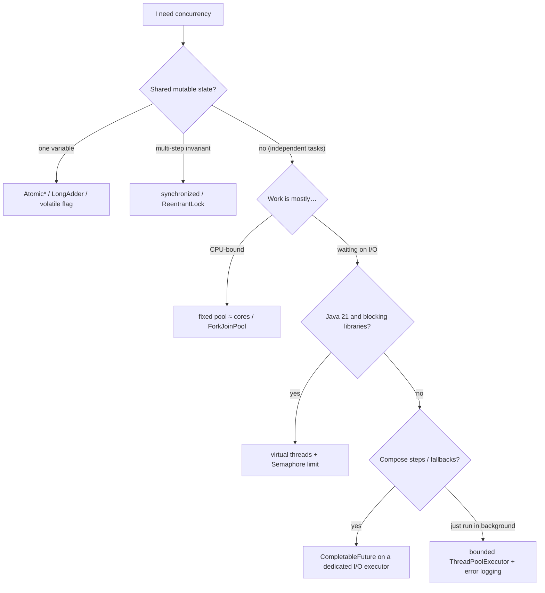

# Java — Concurrency & Async

[← Back to Java](../README.md)

Read in order. Focus: **which tool to use**, and **how failures propagate** in async code (the part that usually goes wrong in production).

| # | Note | You will learn |
|---|------|----------------|
| 0 | [**Multithreading from scratch (start here)**](00-concurrency-from-scratch.md) | the kitchen analogy; race conditions, locks, `volatile`, pools, futures, deadlock, virtual threads in plain steps |
| 0b | [**`Runnable`, `Callable`, `Thread` & the task family**](00-runnable-callable-and-threads.md) | what `Runnable` is, runnable classes, `run()` vs `start()`, `Runnable` vs `Callable` vs `Supplier`, `FutureTask`, which overload a lambda picks, **thread states** (with a demo of all six) |
| 1 | [Executors & thread pools](01-executors-thread-pools.md) | Why not `new Thread`, `ThreadPoolExecutor` decision order, sizing, rejection, **`submit` vs `execute` exception behaviour** |
| 2 | [`CompletableFuture`](02-completablefuture.md) | `thenApply`/`thenCompose`/`thenCombine`, which thread runs what, **`exceptionally` vs `handle` vs `whenComplete`**, `CompletionException` unwrapping, `allOf`, timeouts |
| 3 | [Async error handling & external calls](03-async-error-handling-http.md) | **Where each failure lands**, `IOException` vs domain exception, `HttpClient`, retries/backoff/timeouts, `try/catch/finally` ↔ async equivalents |
| 4 | [Locks, `volatile`, atomics, deadlocks](04-locks-volatile-deadlock.md) | Happens-before, why `volatile` ≠ atomic, `synchronized` vs `ReentrantLock`, CAS, deadlock detection & prevention |
| 5 | [Virtual threads (Java 21)](05-virtual-threads.md) | How they scale blocking I/O, pinning, semaphores, when to pick them over CF |

Related: [Concurrent collections](../02-collections/05-concurrent-collections.md) · [Choosing the right tool](../01-java-basics/09-choosing-the-right-tool.md#5-concurrency-which-async-tool).

## One-page decision guide

## Revision checklist

- [ ] Explain core → queue → extra threads → reject, and why `newFixedThreadPool` can OOM
- [ ] Say where an exception goes for `Thread`, `execute`, `submit`, `CompletableFuture`
- [ ] Distinguish `thenApply`/`thenCompose`/`thenCombine` and `exceptionally`/`handle`/`whenComplete`
- [ ] Write a gateway that translates `IOException` → domain exception and retries only retriable, idempotent calls
- [ ] Explain why `volatile int; i++` is broken, and fix it three ways
- [ ] Reproduce a deadlock and fix it with lock ordering or `tryLock`
- [ ] Explain virtual threads, pinning, and why not to pool them
