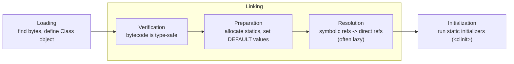
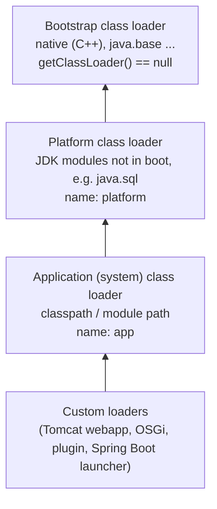
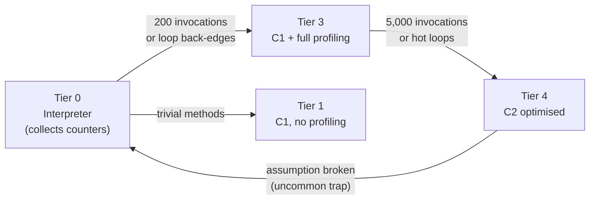

# Class Loading, Initialization & the JIT Compiler

> **Level:** SDE-II / SDE-III · **Area:** Java · **Prereqs:** [Memory model](../01-java-basics/01-memory-model.md) · **Next:** [Garbage collectors](02-garbage-collectors.md)

## TL;DR

- A class goes through **load → link (verify, prepare, resolve) → initialize**. Loading and initialization are **separate**: a class can be loaded and never initialized. Initialization (`<clinit>`, i.e. static initializers) is **lazy** and runs **at most once, under a lock**.
- **Parent delegation**: a loader first asks its parent, and only loads the class itself if the parent can't. This guarantees there is **one** `java.lang.String` and that application code can't replace core classes.
- Java 9+ has **three** built-in loaders: **boot** (core `java.base` etc., shows up as `null`), **platform** (e.g. `java.sql`), **app** (your classpath/modulepath). The old *extension* loader is gone.
- **Class identity = (fully-qualified name, defining loader).** The same bytes loaded by two loaders are **two different classes** (`ClassCastException: Cannot cast Plugin to Plugin`). That is the root of app-server/plugin classloader leaks.
- **JIT**: the JVM starts in the **interpreter**, counts invocations and loop back-edges, compiles hot methods with **C1** (fast, lightly optimised) and then **C2** (slow to compile, heavily optimised: inlining, escape analysis, loop opts). If an assumption breaks it **deoptimises** back to the interpreter.
- Consequence: **Java gets faster after it has run for a while.** A naive `System.nanoTime()` benchmark mostly measures warm-up. Use **JMH**.

## The analogy: a restaurant that learns the menu

A new chef (the **interpreter**) follows the recipe card line by line: slow but ready instantly. After the 200th order of the same dish the kitchen writes a **quick-prep sheet** (C1: pre-chopped, still being timed with a stopwatch). After the 5,000th order the head chef designs a **production line** for it (C2: merges steps, skips steps that provably don't matter). If a customer suddenly orders something the line wasn't designed for (a new subclass appears, a branch that was "never taken" is taken), the line is **shut down** and the chef goes back to the recipe card (**deoptimisation**).

Class loading is the **library**: the head librarian (boot loader) is asked first, then the department librarian (platform), then the local one (app). Only if nobody has the book is it fetched from the shelf *you* provided. And the book is only **read aloud** (initialized) the first time somebody really needs it.

## 1. The class lifecycle



| Phase | What happens | Failure you can see |
|---|---|---|
| **Loading** | A `ClassLoader` finds the `.class` bytes (file, jar, network, generated) and the JVM builds a `Class` object + metadata in **Metaspace**. | `ClassNotFoundException` (explicit `loadClass`/`forName`), `NoClassDefFoundError` (linked code needs a class that can't be found) |
| **Verification** | Checks the bytecode is structurally valid and type-safe (stack map frames, no jumping into the middle of an instruction...). Protects the JVM from corrupt/malicious classes. | `VerifyError` |
| **Preparation** | Allocates static fields and sets them to **default values** (`0`, `null`, `false`). Note: `static int x = 5` is `0` here; `5` is assigned during initialization. (Exception: `static final` compile-time constants carry a `ConstantValue` attribute.) | - |
| **Resolution** | Replaces symbolic references (`"java/util/List.add"`) by direct pointers. HotSpot does this **lazily**, on first use of that call site. | `NoSuchMethodError`, `IllegalAccessError`, `NoSuchFieldError` |
| **Initialization** | Runs `<clinit>` = all `static {}` blocks and static field initialisers, in textual order, superclass first. | `ExceptionInInitializerError`, then `NoClassDefFoundError` |

> [!NOTE]
> `ClassNotFoundException` (checked, thrown by *your* call to `Class.forName`/`loadClass`) vs `NoClassDefFoundError` (an **Error**, thrown by the JVM when code that compiled fine can't find a class at runtime, **or** when the class's static initializer failed earlier). The second cause surprises people; see the demo below.

## 2. When is a class initialized? (and a demo that proves it's lazy)

A class is initialized **on first active use**:

| Triggers initialization | Does **not** trigger it |
|---|---|
| `new Foo()` | Reading a `static final` **compile-time constant** (`static final int MAX = 10;`, `static final String S = "x"`). `javac` inlines it. |
| Calling a `static` method | Declaring a variable / array of the type (`new Foo[3]`) |
| Reading/writing a **non-constant** static field | Class literal `Foo.class` |
| `Class.forName("Foo")` (1-arg, initializes) | `Class.forName("Foo", false, loader)`; `loader.loadClass("Foo")` |
| Initializing a **subclass** (superclass first) | Referencing a static field **through a subclass** that is declared in the **superclass** (`Child.p` only initializes `Parent`) |
| The class containing `main` | Extending an interface (interfaces are initialized only if they declare `default` methods and an implementing class is initialized) |

```java
// Run: ClassInitDemo.java
public class ClassInitDemo {
    static class Config {
        static final int MAX = 10;                       // compile-time constant: inlined by javac, NO init needed
        static final String NAME = "cfg";                // also a constant
        static final Object LOCK = new Object();         // NOT a constant: reading it triggers init
        static { System.out.println("  [Config.<clinit> runs]"); }
        static void hello() { System.out.println("  Config.hello()"); }
    }

    static class Parent { static { System.out.println("  [Parent.<clinit>]"); } static int p = 1; }
    static class Child extends Parent { static { System.out.println("  [Child.<clinit>]"); } static int c = 2; }

    static class Broken {
        static final int VALUE = compute();
        static int compute() { throw new IllegalStateException("config file missing"); }
    }

    public static void main(String[] args) throws Exception {
        System.out.println("1. mention the class, constants, array, class literal:");
        int m = Config.MAX;                              // constant -> no init
        String n = Config.NAME;
        Config[] arr = new Config[3];                    // array of Config: no init
        Class<?> lit = Config.class;                     // class literal: loaded, not initialized
        System.out.println("  MAX=" + m + ", NAME=" + n + ", array length=" + arr.length + ", literal=" + lit.getSimpleName());

        System.out.println("2. Class.forName(name, false, loader) loads but does not initialize:");
        Class.forName("ClassInitDemo$Config", false, ClassInitDemo.class.getClassLoader());
        System.out.println("  (still nothing printed)");

        System.out.println("3. first static method call / non-constant static field read triggers init:");
        Config.hello();

        System.out.println("4. subclass init forces superclass init first; reading Child.p only inits Parent:");
        int p = Child.p;                                 // p is declared in Parent -> only Parent is initialized
        System.out.println("  read Child.p = " + p);
        int c = Child.c;
        System.out.println("  read Child.c = " + c);

        System.out.println("5. exception in a static initializer:");
        try { System.out.println(Broken.VALUE); }
        catch (Throwable t) { System.out.println("  1st access -> " + t.getClass().getSimpleName() + ", cause: " + t.getCause()); }
        try { System.out.println(Broken.VALUE); }
        catch (Throwable t) { System.out.println("  2nd access -> " + t.getClass().getSimpleName() + ": " + t.getMessage()); }
    }
}
```

```text
1. mention the class, constants, array, class literal:
  MAX=10, NAME=cfg, array length=3, literal=Config
2. Class.forName(name, false, loader) loads but does not initialize:
  (still nothing printed)
3. first static method call / non-constant static field read triggers init:
  [Config.<clinit> runs]
  Config.hello()
4. subclass init forces superclass init first; reading Child.p only inits Parent:
  [Parent.<clinit>]
  read Child.p = 1
  [Child.<clinit>]
  read Child.c = 2
5. exception in a static initializer:
  1st access -> ExceptionInInitializerError, cause: java.lang.IllegalStateException: config file missing
  2nd access -> NoClassDefFoundError: Could not initialize class ClassInitDemo$Broken
```

What to notice:

- `[Config.<clinit> runs]` appears **only at step 3**, even though `Config` was mentioned, arrayed, literal-ed and `forName`-loaded before.
- The **first** failure is `ExceptionInInitializerError` (wrapping the real cause). The class is then marked **erroneous forever** in that loader: every later use throws `NoClassDefFoundError: Could not initialize class ...` with **no stack trace of the original problem**. In production logs, always search upwards for the *first* `ExceptionInInitializerError`.
- Initialization is **thread-safe**: the JVM holds a per-class init lock, so other threads block until `<clinit>` finishes. That is why the *initialization-on-demand holder* singleton is lazy and thread-safe without `synchronized`. The flip side: two classes whose static initialisers depend on each other, initialised from two threads, can **deadlock** (a "class-init deadlock", visible in a thread dump as threads stuck in `<clinit>`).
- You can watch it live: `java -Xlog:class+load` (loading, with the *source*: `shared objects file`, `jrt:/java.base`, a jar path) and `java -Xlog:class+init`. For the tiny `Class.forName` program in the Predict section (compiled with `javac`, run with `java -Xlog:class+load P3`) the log listed 589 loaded classes, 579 of them with `source: shared objects file` (the CDS archive, see section 7); only `P3` and `P3$Lazy` came from the class directory.

## 3. The class loader hierarchy (Java 9+) and parent delegation



```java
// Run: LoaderHierarchy.java
public class LoaderHierarchy {
    static void show(String label, Class<?> c) {
        System.out.println(label + " -> " + c.getClassLoader());
    }
    public static void main(String[] args) {
        show("java.lang.String      ", String.class);                       // boot loader: null
        show("java.sql.Connection   ", java.sql.Connection.class);          // platform loader
        show("java.util.logging.Logger", java.util.logging.Logger.class);
        show("this class            ", LoaderHierarchy.class);

        System.out.println("-- parent chain of the app loader (as seen by this program):");
        for (ClassLoader l = LoaderHierarchy.class.getClassLoader(); l != null; l = l.getParent())
            System.out.println("   " + l.getName() + "  (" + l.getClass().getName() + ")");
        System.out.println("   <boot loader is represented as null>");
        System.out.println("system class loader = " + ClassLoader.getSystemClassLoader().getName());
        System.out.println("context class loader = " + Thread.currentThread().getContextClassLoader().getName());
    }
}
```

```text
java.lang.String       -> null
java.sql.Connection    -> jdk.internal.loader.ClassLoaders$PlatformClassLoader@5ef60048
java.util.logging.Logger -> null
this class             -> com.sun.tools.javac.launcher.Main$MemoryClassLoader@2b546384
-- parent chain of the app loader (as seen by this program):
   null  (com.sun.tools.javac.launcher.Main$MemoryClassLoader)
   app  (jdk.internal.loader.ClassLoaders$AppClassLoader)
   platform  (jdk.internal.loader.ClassLoaders$PlatformClassLoader)
   <boot loader is represented as null>
system class loader = app
context class loader = app
```

(Because we run with `java File.java` the *source launcher* compiles in memory and defines our class in its own `MemoryClassLoader`, whose parent is `app`. If you compile and run normally, `this class` is the `app` loader. Which JDK module sits in boot vs platform is a JDK-internal detail that can change between versions: `java.logging` was boot here on JDK 21.)

**How delegation works** (`ClassLoader.loadClass`, simplified):

1. `findLoadedClass(name)`: already defined by *this* loader? return it.
2. else `parent.loadClass(name)` (boot loader if parent is `null`).
3. else (parent threw `ClassNotFoundException`) `findClass(name)`: **you** override this to read bytes from wherever, then call `defineClass`.

**Why delegate?**

| Reason | Meaning |
|---|---|
| **Security** | Your classpath can't contain a malicious `java.lang.String` that gets picked up: the boot loader answers first. |
| **Consistency** | One `Object`, one `String`, one `List` across the whole JVM, so core types exchanged between libraries are the *same* type. |
| **No duplicates** | A class available to the parent is never redefined by children. |

**When people deliberately break delegation:** Servlet containers (a webapp's `WEB-INF/lib` must win over the container's own copy: *child-first* for non-JDK classes), OSGi, JDBC drivers/SPI (`ServiceLoader` uses the **context class loader** so a core class like `DriverManager` can see classes from the app loader, i.e. delegation going *down*), hot-reload tools, and Spring Boot's fat-jar `LaunchedClassLoader` that reads nested jars.

### Same name, different loader = different class

```java
// Run: TwoLoaders.java
import javax.tools.*;
import java.net.*;
import java.nio.file.*;

public class TwoLoaders {
    public static void main(String[] args) throws Exception {
        // 1. compile a tiny class "Plugin" to a temp dir at runtime (stand-in for a plugin jar / webapp class)
        Path dir = Files.createTempDirectory("plugin");
        Path src = dir.resolve("Plugin.java");
        Files.writeString(src, "public class Plugin { public String hi() { return \"hi from Plugin\"; } }");
        JavaCompiler javac = ToolProvider.getSystemJavaCompiler();
        if (javac.run(null, null, null, src.toString()) != 0) throw new IllegalStateException("compile failed");

        URL[] cp = { dir.toUri().toURL() };
        // 2. two independent loaders (parent = platform loader, so they can't "see" each other)
        try (URLClassLoader a = new URLClassLoader("A", cp, ClassLoader.getPlatformClassLoader());
             URLClassLoader b = new URLClassLoader("B", cp, ClassLoader.getPlatformClassLoader())) {

            Class<?> pa = a.loadClass("Plugin"), pb = b.loadClass("Plugin");
            System.out.println("same name         : " + pa.getName().equals(pb.getName()));
            System.out.println("same Class object : " + (pa == pb));
            System.out.println("loader of pa / pb : " + pa.getClassLoader().getName() + " / " + pb.getClassLoader().getName());
            System.out.println("a.loadClass again : " + (a.loadClass("Plugin") == pa) + "   (a loader caches what it defined)");

            Object o = pa.getDeclaredConstructor().newInstance();
            System.out.println("pb.isInstance(o)  : " + pb.isInstance(o));
            try {
                pb.cast(o);
            } catch (ClassCastException e) {
                System.out.println("cast -> " + e.getClass().getSimpleName() + ": " + e.getMessage());
            }
            // 3. parent delegation: a class the parent can see is loaded by the parent, not by us
            Class<?> s = a.loadClass("java.lang.String");
            System.out.println("String via loader A -> defining loader: " + s.getClassLoader() + " (null = boot)");
        }
    }
}
```

```text
same name         : true
same Class object : false
loader of pa / pb : A / B
a.loadClass again : true   (a loader caches what it defined)
pb.isInstance(o)  : false
cast -> ClassCastException: Cannot cast Plugin to Plugin
String via loader A -> defining loader: null (null = boot)
```

This is the infamous `ClassCastException: com.foo.Bar cannot be cast to com.foo.Bar` (same name on both sides!). Typical causes: the same library jar on both the container classpath **and** inside the webapp, hot-reload, or a singleton/`static` registry shared across loaders while the types it stores come from different ones.

## 4. Class loader leaks

A class loader (and **every class it defined**, plus their static fields, plus their Metaspace) can only be unloaded when **nothing reachable** references the loader, any of its classes, or any instance of those classes. In app servers, redeploying a webapp = dropping its loader. If anything from a **longer-lived** loader still points in, the old copy stays: each redeploy leaks the whole webapp, and eventually `OutOfMemoryError: Metaspace`.

```java
// Run: LoaderLeak.java
import javax.tools.*;
import java.lang.ref.WeakReference;
import java.net.*;
import java.nio.file.*;
import java.util.*;

public class LoaderLeak {
    static final List<Object> REGISTRY = new ArrayList<>();        // lives in the app loader == "the container's static cache"
    static Path dir;

    static WeakReference<ClassLoader> deploy(boolean leak) throws Exception {
        URLClassLoader loader = new URLClassLoader("webapp", new URL[]{dir.toUri().toURL()}, ClassLoader.getPlatformClassLoader());
        Object plugin = loader.loadClass("Plugin").getDeclaredConstructor().newInstance();
        if (leak) REGISTRY.add(plugin);                            // an instance of a webapp class escapes into a long-lived structure
        return new WeakReference<>(loader);                        // we keep only a WEAK ref to the loader itself
    }

    static boolean unloaded(WeakReference<ClassLoader> ref) throws Exception {
        for (int i = 0; i < 10 && ref.get() != null; i++) { System.gc(); Thread.sleep(50); }
        return ref.get() == null;
    }

    public static void main(String[] args) throws Exception {
        dir = Files.createTempDirectory("plugin");
        Files.writeString(dir.resolve("Plugin.java"), "public class Plugin { }");
        ToolProvider.getSystemJavaCompiler().run(null, null, null, dir.resolve("Plugin.java").toString());

        System.out.println("redeploy, nothing escapes : loader collected = " + unloaded(deploy(false)));
        System.out.println("redeploy, instance leaked : loader collected = " + unloaded(deploy(true)));
    }
}
```

```text
redeploy, nothing escapes : loader collected = true
redeploy, instance leaked : loader collected = false
```

One leaked **instance** pinned `Plugin.class` → its `ClassLoader` → every class the loader ever defined.

Classic real-world culprits (all are "something long-lived references something from the webapp's loader"):

- A `static` cache/registry in a **shared** (container/parent) loader holding webapp objects.
- A **`ThreadLocal`** whose value's class comes from the webapp, on a **pooled** container thread that outlives the webapp (the thread's `threadLocals` map keeps the value → class → loader). Always `remove()` in a `finally`.
- JDBC drivers registered with `DriverManager` (parent loader) and never deregistered; shutdown hooks; `Thread`s started by the webapp and never stopped; `java.util.logging`/log4j appenders; `ResourceBundle` caches.
- Diagnose with a heap dump: look for **multiple instances of `ClassLoader`** (or many `Class` instances for the same name) and follow **path to GC roots** (see [diagnosing production issues](03-diagnosing-production-issues.md)). Metaspace is not a heap region, so `GC.class_histogram` + `jcmd <pid> VM.metaspace` / `GC.heap_info` help.

## 5. The JIT: from interpreter to C2

HotSpot is a **mixed-mode** VM: it interprets bytecode first and compiles only the hot parts to native code, using **profiling data collected at run time**. That is its edge over ahead-of-time compilers: it can optimise for how your program *actually* behaves.



- **Tiers**: 0 interpreter, 1 C1 without profiling (trivial methods, or when C2 is busy), 2 C1 with limited profiling, **3 C1 with full profiling**, **4 C2**. Both compilers run on **background threads**; your code keeps running (interpreted/lower tier) while the better version is built.
- **Counters**: *invocation counter* (method calls) and *back-edge counter* (loop iterations). The defaults on this JDK 21 (`java -XX:+PrintFlagsFinal`): `Tier3InvocationThreshold=200`, `Tier3BackEdgeThreshold=60000`, `Tier4InvocationThreshold=5000`, `Tier4BackEdgeThreshold=40000`. The real decision also scales with compile-queue load, so treat them as orders of magnitude.
- **OSR (on-stack replacement)**: a method called *once* that loops for ages (like `main`) can't wait for the next call, so the JVM compiles the loop and **jumps from interpreted into compiled code mid-loop**. Marked `%` in `PrintCompilation`.
- **Code cache**: compiled code lives in a native-memory region (`ReservedCodeCacheSize`, 240 MB here). If it fills up, the JIT **stops compiling** ("CodeCache is full") and the app falls back to the slow interpreter: a rare but nasty production slowdown.

### The big C2 optimisations

| Optimisation | Idea | Why it matters |
|---|---|---|
| **Inlining** | Replace the call with the callee's body. Small/"hot" methods only (`MaxInlineSize=35` bytecodes, `FreqInlineSize=325` for hot ones). | Removes call overhead **and** unlocks all other optimisations across the old boundary. The most important one. |
| **Escape analysis** | Prove an object never escapes the method/thread. | Enables **scalar replacement** (fields kept in registers, **no heap allocation**) and **lock elision** (drop `synchronized` on a never-shared object). |
| **Speculative devirtualisation** | If profiling saw only one (or two) receiver type at a call site, inline that one behind a cheap type check. | Interface/virtual calls become as fast as direct calls... until a new type shows up. |
| **Loop opts** | Unrolling, range-check elimination, (some) vectorisation. | Tight loops over arrays. |
| **Branch pruning** | Branches never taken in the profile are compiled as an **uncommon trap**. | Smaller, faster hot path. |
| **Deoptimisation** | When an assumption fails (class hierarchy changed, uncommon branch taken), the JVM discards the compiled code and returns to the interpreter. Shows up as `made not entrant`. | Safety net that makes the speculative optimisations legal. |

### Escape analysis, proven by counting allocated bytes

```java
// Run: EscapeDemo.java  (compare with: java -XX:-DoEscapeAnalysis EscapeDemo.java)
import java.lang.management.ManagementFactory;

public class EscapeDemo {
    record Point(int x, int y) {}

    static int distSq(int a, int b) {
        Point p = new Point(a, b);                 // never leaves this method -> candidate for scalar replacement
        return p.x() * p.x() + p.y() * p.y();
    }

    public static void main(String[] args) {
        var mx = (com.sun.management.ThreadMXBean) ManagementFactory.getThreadMXBean();
        long tid = Thread.currentThread().threadId();
        int sink = 0;
        for (int i = 0; i < 200_000; i++) sink += distSq(i, i + 1);     // warm-up so C2 compiles distSq

        long before = mx.getThreadAllocatedBytes(tid);
        for (int i = 0; i < 5_000_000; i++) sink += distSq(i, i + 1);
        long allocated = mx.getThreadAllocatedBytes(tid) - before;

        System.out.printf("5,000,000 calls allocated %,d bytes (%.1f bytes/call)  sink=%d%n",
                allocated, allocated / 5_000_000.0, sink);
    }
}
```

Default run, then the same program with `java -XX:-DoEscapeAnalysis EscapeDemo.java`:

```text
5,000,000 calls allocated 0 bytes (0.0 bytes/call)  sink=1098194304
5,000,000 calls allocated 120,000,000 bytes (24.0 bytes/call)  sink=1098194304
```

With escape analysis the `new Point` **never exists**: zero bytes allocated (so zero GC pressure). Without it, 24 bytes per call (12-byte header + two ints, aligned). The answer is identical. Moral: "allocation is expensive, avoid `new` in hot paths" is **not** always true: short-lived, non-escaping objects are often free. It also means you can't judge allocation by reading source; measure (JFR allocation events, as above).

## 6. Warm-up and why naive microbenchmarks lie

```java
// Run: WarmUp.java
public class WarmUp {
    static int mix(int x) { return Integer.rotateLeft(x * 31 + 7, 5) ^ (x >>> 3); }

    static long work(int n) {
        long acc = 0;
        for (int i = 0; i < n; i++) acc += mix(i);
        return acc;
    }

    public static void main(String[] args) {
        System.out.println("== Same code, same input, 12 rounds (us per round) ==");
        long sink = 0;
        for (int round = 1; round <= 12; round++) {
            long t = System.nanoTime();
            sink += work(2_000_000);
            long us = (System.nanoTime() - t) / 1_000;
            System.out.printf("round %2d: %6d us%n", round, us);
        }

        System.out.println("== Naive benchmark that lies: result never used ==");
        for (int i = 0; i < 3; i++) {
            long t = System.nanoTime();
            work(50_000_000);                         // result thrown away: C2 may remove/shrink the loop
            long usDiscarded = (System.nanoTime() - t) / 1_000;
            t = System.nanoTime();
            sink += work(50_000_000);                 // result consumed
            long usUsed = (System.nanoTime() - t) / 1_000;
            System.out.printf("pass %d: discarded=%7d us   consumed=%7d us%n", i + 1, usDiscarded, usUsed);
        }
        System.out.println("sink=" + sink);
    }
}
```

One real run on this machine (JDK 21, 8 cores). Numbers differ a lot between runs and machines (an earlier run on a busier machine gave 26.7 ms for round 1 and ~7.4 ms steady state): that noise is part of the lesson.

```text
== Same code, same input, 12 rounds (us per round) ==
round  1:   8481 us
round  2:   1874 us
round  3:   5730 us
round  4:   1970 us
round  5:   1859 us
round  6:   1836 us
round  7:   1839 us
round  8:   1808 us
round  9:   1822 us
round 10:   1814 us
round 11:   1835 us
round 12:   1853 us
== Naive benchmark that lies: result never used ==
pass 1: discarded=  46373 us   consumed=  45013 us
pass 2: discarded=  41112 us   consumed=  41766 us
pass 3: discarded=  41802 us   consumed=  41720 us
sink=29496640389692820
```

What to notice:

- Identical work: round 1 took **~8.5 ms**, settled rounds ~**1.8 ms**: ~4.6x faster once C2 has compiled it. Round 3 is a **blip back up to 5.7 ms**: the transition (OSR code thrown away and recompiled, compiler threads competing for cores). The same program with `-Xint` (interpreter only) took ~**63 ms per round** (35x slower than compiled steady state).
- The second block is an **honest negative result**: I expected the unused-result loop to be optimised away (**dead-code elimination**), but on this JVM C2 did *not* remove it, so both columns are equal. DCE is real in other shapes (and a frequent source of "my benchmark says 0.3 ns/op" nonsense), but you cannot assume either way, which is exactly the point: **don't trust hand-rolled benchmarks.**

The JIT log from a separate run (`java -XX:+PrintCompilation WarmUp.java`, only the `WarmUp::` lines; timestamps and ids differ per run):

```text
2567 1403       3       WarmUp::mix (16 bytes)
2573 1406       4       WarmUp::mix (16 bytes)
2574 1403       3       WarmUp::mix (16 bytes)   made not entrant
2583 1407 %     3       WarmUp::work @ 4 (25 bytes)
2585 1408       3       WarmUp::work (25 bytes)
2587 1409 %     4       WarmUp::work @ 4 (25 bytes)
2629 1407 %     3       WarmUp::work @ 4 (25 bytes)   made not entrant
2633 1409 %     4       WarmUp::work @ 4 (25 bytes)   made not entrant
2721 1443 %     4       WarmUp::work @ 4 (25 bytes)
2761 1444       4       WarmUp::work (25 bytes)
2795 1408       3       WarmUp::work (25 bytes)   made not entrant
```

How to read it: **columns** = ms since JVM start · compile id · flags (`%` = OSR, `n` = native, `!` = has exception handlers, `s` = synchronized) · **tier** (3 = C1 profiled, 4 = C2) · method (+ `@ bci` for the OSR loop entry) · bytecode size · notes.

- `mix` is compiled by C1 (tier 3) then by **C2 (tier 4)**; the tier-3 version is then **`made not entrant`** (new calls won't use it).
- `work @ 4` is an **OSR** compile (`%`): the loop was hot while `work` was still running.
- `1409 % 4 ... made not entrant` followed by a **new** `1443 % 4` is a **deoptimise-and-recompile**: the first C2 OSR version was thrown away and rebuilt. The *why* is not in `PrintCompilation`; `java -Xlog:deoptimization=debug WarmUp.java` prints it. The `WarmUp` line from my run: `osr level=4 WarmUp.work(I)J trap_bci=6 osr_bci=4 unstable_if reinterpret`. `unstable_if` = a branch the profile said was never taken (here the loop **exit** branch, since the loop was still running when profiled) was taken, so the compiled code hit an uncommon trap and was discarded. That is the slow blip you see in round 3.

### Rules for measuring performance on the JVM

1. **Warm up** (thousands of iterations; seconds, not milliseconds) and measure only the steady state, but also know your **cold-start** cost if you run in serverless/short-lived processes.
2. **Consume results** (return them / use a `Blackhole`) so dead-code elimination can't delete the work; **don't use constants** (constant folding).
3. **Beware of profile pollution**: a call site that saw one implementation during warm-up and then sees another gets deoptimised.
4. **Use JMH** (OpenJDK's Java Microbenchmark Harness, `org.openjdk.jmh`): it forks fresh JVMs, handles warm-up iterations, `@Benchmark` methods, `Blackhole.consume`, `@State` scopes, and reports error bars. (Maven: `org.openjdk.jmh:jmh-core` + `jmh-generator-annprocess`. *Not run locally here: it needs the dependencies and annotation-processor setup.*)
5. For services, prefer **load tests + JFR/profilers** over microbenchmarks; micro-optimising a method that isn't hot (or that JIT already optimises away) is wasted effort.

## 7. Faster startup: CDS, AOT, GraalVM native image, Leyden (brief)

| Technology | What it does | Trade-off |
|---|---|---|
| **CDS** (Class Data Sharing) | Pre-parsed JDK classes in a memory-mapped archive: faster startup, shared memory across JVMs. On by default (`java -version` prints `sharing`). | - |
| **AppCDS** (dynamic archive) | Same for **your** classes. JDK 13+: `-XX:ArchiveClassesAtExit=app.jsa` then `-XX:SharedArchiveFile=app.jsa`. JDK 19+: `-XX:+AutoCreateSharedArchive -XX:SharedArchiveFile=app.jsa` (creates it on first exit, reuses after). I ran the latter on JDK 21: it produced a ~10.9 MB `app.jsa`. | Archive must match the exact JDK + classpath |
| **GraalVM Native Image** | Closed-world AOT: compiles the app to a standalone native executable. Starts in milliseconds, small RSS. | No dynamic class loading/reflection without config (reachability metadata), longer builds, **no runtime JIT** so peak throughput can be lower than C2, different GC options. Spring Boot 3 supports it. *Not run locally.* |
| **Project CRaC** | Checkpoint a warmed-up JVM and restore it. | Needs a CRaC-enabled JDK; resource handling at checkpoint. *Not run locally.* |
| **Project Leyden** | OpenJDK effort to improve startup/warm-up with AOT caches of loaded/linked classes and profiles. Landing in stages in newer JDKs (JEP 483 AOT class loading & linking in JDK 24; JEP 515 AOT method profiling in JDK 25). *From the JEP titles as I know them; not run locally; JDK 21 doesn't have them.* | Still evolving |

## 8. Pitfalls

> [!WARNING]
> - **Assuming `static` init runs at startup.** It runs at first *active use*; a heavy `static {}` (file/DB/network read) makes the first request slow or fails in a random place.
> - **Swallowing the first `ExceptionInInitializerError`.** Everything after is `NoClassDefFoundError: Could not initialize class X` with no cause. Fix the first one.
> - **Static init cycles** (`A` needs `B` and `B` needs `A` during `<clinit>`) can observe default values (`null`/`0`) or deadlock across threads.
> - **Same library on container classpath and in the webapp** → `ClassCastException: X cannot be cast to X`, `LinkageError` (`loader constraint violation`).
> - **Leaking a class loader** with `ThreadLocal`s, static caches, unregistered drivers, forgotten threads → Metaspace OOM after N redeploys.
> - **Benchmarking without warm-up or JMH**; trusting a single run; benchmarking on a laptop in power-save mode.
> - **Fiddling with JIT flags** (`-XX:CompileThreshold`, `-XX:-TieredCompilation`, `-XX:TieredStopAtLevel=1`) without measurement. (`TieredStopAtLevel=1` = C1 only: sometimes useful for short-lived CLIs/tests, bad for long-running throughput.)
> - **Code cache exhaustion** (very large apps, heavy dynamic proxies/generated code): the JIT silently turns off. Watch `jcmd <pid> Compiler.codecache`.

## 9. Interview Q&A

<details>
<summary><b>Q1.</b> Walk me through what happens when the JVM loads a class.</summary>

**Load** (a loader finds the bytes and defines a `Class`), **link** = *verify* (bytecode is well-formed and type-safe), *prepare* (allocate statics with **default** values), *resolve* (symbolic refs → direct refs, usually lazily), then **initialize** (run `<clinit>`: static blocks and static field initialisers, superclass first, once, under a lock). Loading and linking can happen long before initialization; initialization happens on first active use.
</details>

<details>
<summary><b>Q2.</b> What is the parent delegation model and why does it exist?</summary>

A loader first delegates to its parent; only if the parent can't find the class does it try itself. It protects the core (you can't shadow `java.lang.String`), keeps core types unique across the JVM, and avoids duplicate definitions. Tomcat/OSGi/plugin frameworks deliberately invert it (child-first) so each application can carry its own library versions.
</details>

<details>
<summary><b>Q3.</b> What are the built-in class loaders in Java 9+?</summary>

Bootstrap (native, loads `java.base` and other core modules; `getClassLoader()` returns `null`), Platform (other JDK modules like `java.sql`; replaces the Java 8 extension loader), Application/System (classpath and module path). The `ext` directory / `-Djava.ext.dirs` mechanism no longer exists.
</details>

<details>
<summary><b>Q4.</b> <code>ClassNotFoundException</code> vs <code>NoClassDefFoundError</code>?</summary>

`ClassNotFoundException` is a **checked exception** thrown when *your code* asks a loader for a class by name (`Class.forName`, `loadClass`) and it isn't found. `NoClassDefFoundError` is an **Error** thrown by the JVM when a class that was present at compile time is missing at runtime (bad packaging/classpath), **or** when its static initializer previously failed (`Could not initialize class`).
</details>

<details>
<summary><b>Q5.</b> Does <code>static final int X = 5</code> trigger class initialization when read? What about <code>static final Object O = new Object()</code>?</summary>

The first is a compile-time constant, inlined at the use site by `javac`: **no initialization**. The second is not a constant, so reading it initializes the class.
</details>

<details>
<summary><b>Q6.</b> How can the same class be loaded twice, and what breaks?</summary>

Two class loaders that are not in a parent/child delegation relationship each define their own `Class` object. Types are identified by name **and** defining loader, so instances aren't assignable to each other: `ClassCastException: Foo cannot be cast to Foo`, `LinkageError: loader constraint violation`. Common in app servers, OSGi, plugin systems, hot-reload.
</details>

<details>
<summary><b>Q7.</b> How does a class-loader / Metaspace leak happen and how do you find it?</summary>

Something long-lived (static cache in a shared loader, a pooled thread's `ThreadLocal`, a registered JDBC driver, a non-stopped thread) holds a reference to an object/class from a loader that should have been discarded, which pins the loader and all its classes in Metaspace. Symptoms: Metaspace growth per redeploy and eventually `OutOfMemoryError: Metaspace`. Find it with a heap dump: several `ClassLoader` instances with the same name, then **path to GC roots** on the old one.
</details>

<details>
<summary><b>Q8.</b> Explain tiered compilation.</summary>

Code starts interpreted (tier 0, gathering counters). Once a method or loop crosses invocation/back-edge thresholds it is compiled by **C1** (quick, with profiling at tier 3) and, if it stays hot, by **C2** (tier 4: aggressive optimisation using the collected profile). Compilation runs on background threads; loops in long-running methods use **OSR**. If speculative assumptions fail, the code is **deoptimised** back to the interpreter and later recompiled.
</details>

<details>
<summary><b>Q9.</b> What is escape analysis and what does it buy?</summary>

C2 analyses whether an object can be seen outside the method/thread that created it. If not, it can **scalar-replace** it (keep its fields in registers: no heap allocation, no GC work) and **elide locks** on it. In the demo above 5M `new Point` calls allocated 0 bytes with EA and 120 MB without.
</details>

<details>
<summary><b>Q10.</b> Why is <code>System.nanoTime()</code> around a loop a bad benchmark, and what should you use?</summary>

Because of interpretation → C1 → C2 warm-up, OSR, deoptimisation, dead-code elimination, constant folding, GC and CPU frequency noise; you mostly measure the JVM warming up. Use **JMH** (forked JVMs, warm-up iterations, `Blackhole`, statistics) and validate with a realistic load test + profiler.
</details>

<details>
<summary><b>Q11.</b> What is deoptimisation and how do you see it?</summary>

C2 compiles with optimistic assumptions from the profile (a branch is never taken, a call site has one receiver type, a class has no subclasses). If one breaks, an **uncommon trap** fires, execution returns to the interpreter and the compiled method is **made not entrant**. See it in `-XX:+PrintCompilation` (`made not entrant`, followed by a recompile).
</details>

<details>
<summary><b>Q12.</b> JIT vs AOT (GraalVM native image): when would you choose which?</summary>

JIT: best peak throughput for long-running services thanks to profile-guided optimisation, dynamic features work, but slow start and warm-up, higher memory. Native image: millisecond startup and low footprint (serverless, CLIs, scale-to-zero), but closed world (reflection/proxies need configuration), no run-time profiling, longer builds. CDS/AppCDS/CRaC/Leyden are middle paths that keep the JIT.
</details>

## 10. Predict the output / Spot the bug

<details>
<summary><b>P1.</b> What does this print, in order?</summary>

```java
static class A { static { System.out.println("A init"); } static final int X = 5; static int Y = 6; }
public static void main(String[] args) {
    System.out.println(A.X);
    System.out.println(A.Y);
}
```

Run result:

```text
5
A init
6
```

`A.X` is a compile-time constant (inlined, no init). `A.Y` is a normal static: it triggers `A`'s initialization first.
</details>

<details>
<summary><b>P2.</b> Init order with a virtual call in a constructor.</summary>

```java
static class Base {
    static { System.out.println("1 Base static"); }
    { System.out.println("3 Base instance block"); }
    Base() { System.out.println("4 Base ctor"); show(); }
    void show() { System.out.println("Base.show"); }
}
static class Derived extends Base {
    static { System.out.println("2 Derived static"); }
    int v = 42;
    { System.out.println("5 Derived instance block"); }
    Derived() { System.out.println("6 Derived ctor"); }
    @Override void show() { System.out.println("Derived.show v=" + v); }
}
public static void main(String[] args) { new Derived(); }
```

Run result:

```text
1 Base static
2 Derived static
3 Base instance block
4 Base ctor
Derived.show v=0
5 Derived instance block
6 Derived ctor
```

Static init (class level, superclass first) happens once before any instance work. Then per instance: super constructor (with its instance initialisers) completes **before** the subclass's field initialisers run, so the overridden `show()` called from `Base`'s constructor sees `v == 0`, not `42`. Never call overridable methods from constructors.
</details>

<details>
<summary><b>P3.</b> Which lines print?</summary>

```java
static class Lazy { static { System.out.println("Lazy init"); } }
public static void main(String[] args) throws Exception {
    Class<?> c = Class.forName("P3$Lazy");
    System.out.println("after forName");
    Object o = Class.forName("P3$Lazy", false, P3.class.getClassLoader());
    Lazy[] arr = new Lazy[2];
    System.out.println("done " + arr.length);
}
```

Run result:

```text
Lazy init
after forName
done 2
```

One-arg `Class.forName` **initializes** (so `Lazy init` is printed before `after forName`); the second call returns the already-initialized class, and `new Lazy[2]` creates an array, not instances, so nothing more is printed. Had we only called the 3-arg form with `false`, `Lazy init` would never print.
</details>

<details>
<summary><b>P4. Spot the bug.</b> A webapp redeploy leaves Metaspace growing. Why?</summary>

```java
// in a library jar placed on the SERVER's shared classpath
public class RequestContext {
    private static final ThreadLocal<Object> CURRENT = new ThreadLocal<>();
    public static void set(Object o) { CURRENT.set(o); }
}
// in the webapp, on a pooled worker thread:
RequestContext.set(new UserSession());   // UserSession is a webapp class; nobody ever calls remove()
```

The pooled **server thread** outlives the webapp; its `threadLocals` map still references the `UserSession` instance → `UserSession.class` → the **webapp class loader** → all its classes. Redeploying leaks the whole loader. Fix: `try { ... } finally { CURRENT.remove(); }` (or a servlet filter that always clears it).
</details>

---
[↑ Back to JVM internals index](README.md)
