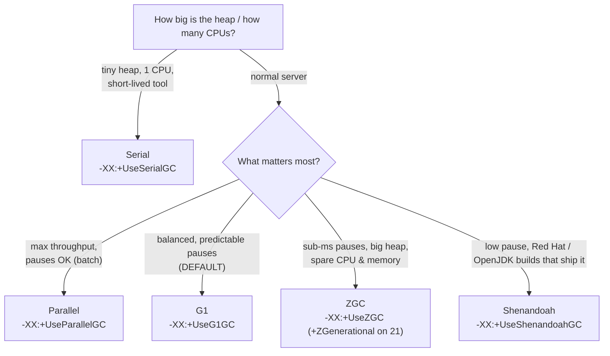
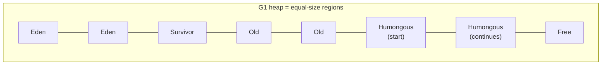
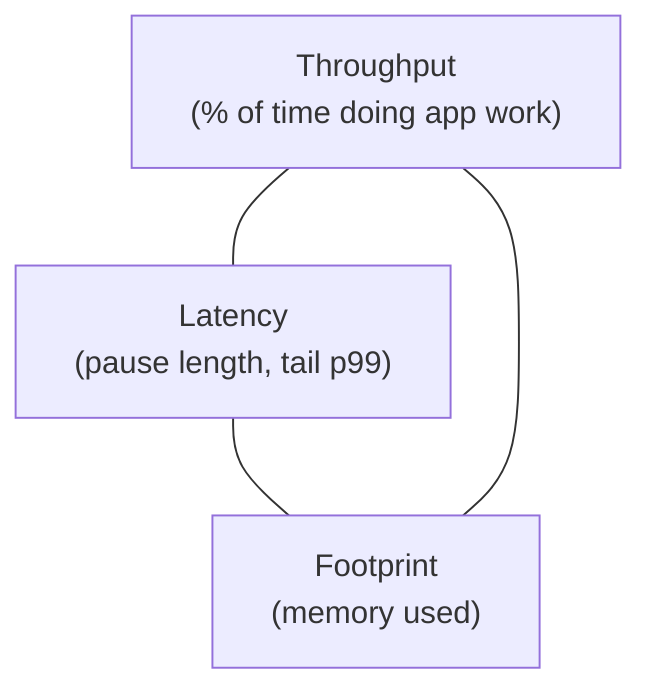

# Garbage Collectors: How They Work, How to Choose, How to Read the Logs

> **Level:** SDE-II / SDE-III · **Area:** Java · **Prev:** [Class loading & JIT](01-class-loading-and-jit.md) · **Prereqs:** [Memory model](../01-java-basics/01-memory-model.md) (heap layout, young/old, GC roots, leaks: *not repeated here*) · **Next:** [Diagnosing production issues](03-diagnosing-production-issues.md)

## TL;DR

- Every collector does the same job: **find live objects (mark from GC roots), reclaim dead ones (sweep / copy), and keep memory usable (compact)**. They differ in **how much of that happens while your threads are stopped**.
- **Stop-the-world (STW)** pause = all application threads halted. **Concurrent** = GC threads run alongside your code (needs *barriers* to stay correct, and costs throughput + headroom).
- **Pick by goal**: throughput (batch) → **Parallel**; balanced default for servers → **G1** (default since Java 9 on "server-class" machines); very low pause on big heaps → **ZGC** (or **Shenandoah**); tiny heap / 1 CPU container → **Serial**.
- **Most "GC problems" are allocation or leak problems.** Tuning flags rarely beat "allocate less" or "fix the leak". The workflow is **measure → find the bottleneck → change one thing → measure again**.
- Know the **OOM family**: `Java heap space`, `GC overhead limit exceeded`, `Metaspace`, `unable to create native thread`, `Direct buffer memory`, `Requested array size exceeds VM limit`: each has a different cause and fix.
- In containers: set the heap relative to the **container limit** (`-XX:MaxRAMPercentage`), and leave room for non-heap memory.

## The analogy: cleaning a shared office

- **Mark** = a cleaner walks the office with a list of desks that are "in use" (GC roots) and tags everything those desks still point to.
- **Sweep** = throw away everything untagged, **leaving gaps** (fragmentation).
- **Copy** = instead, move all tagged items to a fresh empty room and lock the old one: no gaps, and cleaning cost depends on what is *kept*, not what is thrown away. (Great when 95% is trash: the *young generation*.)
- **Compact** = slide everything to one end of the room.
- **Stop-the-world** = everyone must leave the office while cleaning. **Concurrent** = the cleaner works around people, and must carefully re-check anything people moved meanwhile (the *write/load barrier*).
- **Generational hypothesis** = most things on a desk are junk after a few minutes (a coffee cup), a few last for years (the filing cabinet). So clean the *junk bin* often and cheaply, the *filing cabinet* rarely.

## 1. What a GC has to do

| Step | Meaning | Cost depends on |
|---|---|---|
| **Mark** | Trace the object graph from roots (thread stacks, statics, JNI handles...) | number of **live** objects |
| **Sweep** | Reclaim unmarked memory in place (free lists), leaves holes | heap size / garbage |
| **Compact** | Slide live objects together, fix up references | live data + references to patch |
| **Copy (evacuate)** | Copy live objects to another region, then free the whole source region | live data only (garbage costs nothing) |

**Generational hypothesis** (weak form): *most objects die young*. So the heap is split into **young** (Eden + 2 survivor spaces: copying collector, frequent, short) and **old** (long-lived: collected rarely, more expensive). Objects surviving enough young collections (**tenuring threshold**, `MaxTenuringThreshold=15` on this JDK) are **promoted**. Cross-generation pointers (old → young) are tracked with a **card table / remembered set** so a young GC doesn't have to scan all of old. The cost: a **write barrier** on every reference store.

**Concurrent collectors need barriers.** While GC threads trace the graph, your threads keep changing it:
- *SATB (snapshot-at-the-beginning)* pre-write barrier (**G1**, Shenandoah): remember the *old* value being overwritten, so nothing alive at the start of marking is missed.
- *Load barrier* (**ZGC**): every reference **read** from the heap goes through a tiny check of pointer metadata and "heals" stale pointers (so objects can be **moved while the app runs**).
- Barriers are why concurrent collectors cost some throughput even when not collecting.

## 2. The collectors



### 2.1 Serial and Parallel (the "classic" STW collectors)

- **Serial**: one GC thread, STW for young (copy) and old (mark-sweep-**compact**). Smallest footprint, no concurrency overhead. Fine for tiny heaps / single-CPU containers / short CLI tools. The JVM **selects it automatically** when it sees fewer than 2 CPUs (verified below) or very little memory (docs say < ~1792 MB; not tested).
- **Parallel** ("throughput collector"): the same algorithms but with **many GC threads** (`ParallelGCThreads`, 8 here). Maximises **throughput** (least total time in GC) but pauses grow with heap size/live set. Good for batch jobs and offline processing where a few hundred ms of pause is irrelevant.

### 2.2 G1: the default (regions, remembered sets, mixed collections)

The heap is cut into **equal-size regions** (1 to 32 MB, power of two, chosen from heap size to aim at ~2048 regions; `Heap Region Size: 2M` here with the default 4 GB max heap, 1M for a 64-256 MB heap in the demos). A region is dynamically **Eden, Survivor, Old or Humongous**; there is no fixed contiguous young/old split, so G1 can resize them to meet the **pause-time goal** (`-XX:MaxGCPauseMillis`, default **200 ms**; a *goal*, not a guarantee).



**G1 life cycle**

1. **Young collection** (STW, parallel): evacuate live objects from Eden+Survivor regions into new Survivor/Old regions. Log: `Pause Young (Normal) (G1 Evacuation Pause)`.
2. When old-gen occupancy crosses the **IHOP** (`InitiatingHeapOccupancyPercent`, 45 by default, adapted at run time), the young pause is flagged **`Concurrent Start`** and a **concurrent marking cycle** begins (initial mark piggybacks on that young pause) → *concurrent mark* → short STW **Remark** → **Cleanup** (reclaims completely empty regions, picks candidates).
3. **Mixed collections**: after marking, the following young pauses also evacuate a few of the **most garbage-rich old regions** (the "garbage-first" idea; spread over `G1MixedGCCountTarget`=8 pauses; stops when reclaimable < `G1HeapWastePercent`=5%). Log: `Pause Young (Prepare Mixed)` then `Pause Young (Mixed)`.
4. **Full GC** (`Pause Full (G1 Compaction Pause)`): the fallback when G1 can't keep up (evacuation failure / no free regions): a **STW, parallel compaction of the whole heap**. If you see these, you have a problem (heap too small, leak, or allocation rate > G1's ability).

**Remembered sets (RSets)**: each region records *which other regions/cards point into it*, kept up to date by a **post-write barrier** (+ concurrent refinement threads). That lets G1 collect **any subset of regions** while scanning only their RSets instead of the whole old gen. It costs memory (a few % of heap) and some write overhead.

**Humongous objects**: any allocation ≥ **half a region** is *humongous*: allocated directly in **contiguous** old-ish regions, never copied, and reclaimed only at specific points (cleanup/young pauses/Full GC). Large arrays/buffers/strings (e.g. 1.5 MB byte[] with a 1 MB region) cause **fragmentation**, premature concurrent cycles and even Full GCs. Fixes: larger `-XX:G1HeapRegionSize` (e.g. 8m/16m), stream/chunk the data, reuse buffers.

### 2.3 ZGC: pause times independent of heap size

- **Concurrent mark, concurrent relocation (compaction)**; STW pauses only for tiny root-scanning steps: in the first generational-ZGC demo run below, **130 minor pauses totalled 1 ms**. Designed for multi-GB to **TB** heaps (up to 16 TB).
- **Colored pointers + load barriers**: spare bits in each 64-bit reference carry GC state (marked/remapped/...). A **load barrier** on every heap reference read checks those bits and, if the pointer is stale (object moved), fixes it ("**self-healing**"). That is what allows moving objects while threads run. (Because of this, pointers aren't compressed: no compressed oops, so a bit larger footprint.)
- **Generational ZGC** (JEP 439): ZGC originally had **no generations** (every cycle marked the whole heap), which wastes work and, with high allocation rates, can cause **allocation stalls**. In **JDK 21** enable it with `-XX:+UseZGC -XX:+ZGenerational` (verified in the demo below). I recall that it became the default in JDK 23 and the non-generational mode was removed in JDK 24 (from the JEP list; *not run locally, JDK 21 only here*).
- Cost: needs **CPU and heap headroom** (concurrent work competes with your threads); lower raw throughput than Parallel/G1 on small heaps. If allocation outpaces the collector, threads wait: `Allocation Stall`.

### 2.4 Shenandoah (also pause-time focused)

Concurrent **compaction** like ZGC but via a different mechanism: *forwarding pointers* and **load-reference barriers** (+ SATB marking). Pause times are small and mostly independent of heap size. Shipped in many OpenJDK builds (Red Hat's and Temurin's, verified here), but not every vendor's build includes it. Non-generational in JDK 21 (a generational mode arrived in later JDKs: check the release notes). Verified present here: `-XX:+UseShenandoahGC` on Temurin 21.

### 2.5 The triangle: throughput · latency · footprint



You can optimise **two**. Parallel = throughput + footprint, sacrifices latency. ZGC/Shenandoah = latency (and throughput on big heaps), sacrifices footprint (headroom, barriers). Serial = footprint. **G1 is the balanced default**.

### 2.6 Decision table

| Situation | Choose | Why |
|---|---|---|
| Typical Spring Boot service, 1-16 GB heap, p99 target 100s of ms | **G1** (default) | Good balance, mature, tunable with one knob |
| Batch/ETL/analytics, nobody waits on individual requests | **Parallel** | Highest throughput, simplest |
| Strict latency SLO (p99.9 in low ms), heap 8 GB-TB, spare cores | **ZGC** (generational on 21+) / **Shenandoah** | Sub-ms pauses, independent of live set |
| Container with < 2 CPUs or ~<256-512 MB heap, CLI, serverless | **Serial** (auto-selected on 1 CPU) | Least overhead, no GC threads competing |
| Huge allocation rate of large arrays | G1 with bigger regions, or ZGC | Avoid humongous trouble |

Measure before you switch: on a **small** heap with a high allocation rate, non-generational ZGC did not shine in our demo (see 4.1).

## 3. Key flags

| Flag | Meaning | Notes |
|---|---|---|
| `-Xms` / `-Xmx` | initial / max heap | In servers/containers set **equal** to avoid resize pauses (and surprise OOM-kills when it grows). Default max = **25% of RAM** (`MaxRAMPercentage=25`): 4 GB on this 16 GB machine. |
| `-XX:MaxRAMPercentage=N` | max heap as % of **available** memory (container limit if present) | `75` is common for a JVM-only container; the rest is for non-heap |
| `-XX:InitialRAMPercentage`, `MinRAMPercentage` | initial % (1.56 default); % used when RAM is small (default 50) | `Min...` applies only to small memory (so `-XX:MaxRAMPercentage` alone may seem ignored on tiny containers) |
| `-XX:+UseG1GC` / `UseParallelGC` / `UseSerialGC` / `UseZGC` / `UseShenandoahGC` | collector | `-XX:+UseZGC -XX:+ZGenerational` on JDK 21 |
| `-XX:MaxGCPauseMillis=N` | G1 pause **goal** (default 200) | Lower → smaller young gen → more frequent GCs → less throughput |
| `-XX:G1HeapRegionSize=N` | G1 region size (1-32 MB) | Raise to fight humongous allocations |
| `-XX:InitiatingHeapOccupancyPercent` | when G1 starts concurrent marking (45) | Lower if you see Full GCs after late marking |
| `-XX:ParallelGCThreads` / `ConcGCThreads` | STW / concurrent worker count | Defaults follow CPU count (8 / 2 here), **container CPU limits matter** |
| `-XX:SoftMaxHeapSize` | ZGC/Shenandoah soft target (manageable) | |
| `-XX:+HeapDumpOnOutOfMemoryError`, `-XX:HeapDumpPath=` | write a `.hprof` on OOM | **Always set in production** |
| `-XX:+ExitOnOutOfMemoryError` / `-XX:+CrashOnOutOfMemoryError` | die instead of limping on | Let the orchestrator restart it |
| `-Xlog:gc*:file=gc.log:time,uptime,level,tags:filecount=5,filesize=20m` | unified GC log (Java 9+) | The Java-8 flags `-XX:+PrintGCDetails` etc. are gone |
| `-XX:+AlwaysPreTouch` | touch all heap pages at start | Predictable latency, slower start |
| `-XX:+DisableExplicitGC` | make `System.gc()` a no-op | Careful: breaks `DirectByteBuffer` cleanup that relies on it; see Q&A P2 |

**Containers** (Linux cgroups: *not run locally, this is a Windows host*): JDK 10+ (and 8u191+) is **container-aware** (`UseContainerSupport` is on by default on Linux): `Runtime.availableProcessors()` and the default heap come from the **cgroup CPU/memory limits**, not the host. Verified on this machine that the JVM derives its defaults from what it is told: `-XX:ActiveProcessorCount=1` made the JVM choose **Serial**, `-XX:ActiveProcessorCount=3` made `availableProcessors()` return 3, and `-XX:MaxRAMPercentage=50` doubled `maxMemory` (4032 MB default → 8064 MB). Rules:

- A pod with `limits.memory: 2Gi` and an uncapped heap gets a heap of 25% (512 MB), which is probably too little; and a heap of **100%** gets **OOM-killed by the kernel** (heap + metaspace + code cache + thread stacks + direct buffers + the JVM itself). Typical: `-XX:MaxRAMPercentage=70..75`.
- A CPU **limit** of `500m` → the JVM sees 1 CPU → **Serial GC** and 1 compiler thread, painful for throughput. Use a CPU *request* without a tight limit, or set the collector explicitly.
- Java's `Runtime.maxMemory()` reports slightly less than `-Xmx` (4032 MB for a 4 GB heap here), because one survivor space is not counted.

## 4. Reading GC logs (real runs)

All outputs below are from JDK 21.0.13 (Temurin), 8 cores, 16 GB RAM, Windows. Timings vary run to run.

### 4.1 The demo

A program that allocates ~75-100 million short-lived 2 KB arrays for 3 seconds plus a ~20 MB cache that is slowly replaced:

```java
// Run: GcDemo.java  (needs: java -Xms256m -Xmx256m -Xlog:gc GcDemo.java)
import java.lang.management.*;

public class GcDemo {
    static final byte[][] CACHE = new byte[20_000][];          // ~20 MB of "long-lived" data, slowly replaced

    public static void main(String[] args) {
        long end = System.nanoTime() + 3_000_000_000L;           // run for ~3 s
        long n = 0, sink = 0;
        while (System.nanoTime() < end) {
            byte[] garbage = new byte[2_000];                   // short-lived: dies young
            garbage[0] = (byte) n;
            sink += garbage[0];
            if (n % 20 == 0) CACHE[(int) ((n / 20) % CACHE.length)] = new byte[1_000];   // survives a while, then replaced
            n++;
        }
        System.out.println("allocated objects: " + n + " (sink=" + sink + ")");
        for (GarbageCollectorMXBean gc : ManagementFactory.getGarbageCollectorMXBeans())
            System.out.printf("  collector %-22s count=%d  total time=%d ms%n", gc.getName(), gc.getCollectionCount(), gc.getCollectionTime());
    }
}
```

Run as `java -Xms256m -Xmx256m -Xlog:gc GcDemo.java` (G1 is the default on this machine; add `-XX:+UseG1GC` to be explicit). **G1** output:

```text
[0.012s][info][gc] Using G1
[0.767s][info][gc] GC(0) Pause Young (Normal) (G1 Evacuation Pause) 23M->4M(256M) 7.231ms
[0.877s][info][gc] GC(1) Pause Young (Normal) (G1 Evacuation Pause) 32M->6M(256M) 4.494ms
[0.892s][info][gc] GC(2) Pause Young (Normal) (G1 Evacuation Pause) 51M->8M(256M) 1.932ms
[0.950s][info][gc] GC(3) Pause Young (Normal) (G1 Evacuation Pause) 157M->11M(256M) 3.084ms
[1.054s][info][gc] GC(4) Pause Young (Normal) (G1 Evacuation Pause) 157M->25M(256M) 3.691ms
[1.150s][info][gc] GC(5) Pause Young (Normal) (G1 Evacuation Pause) 158M->26M(256M) 3.388ms
...
allocated objects: 75447832 (sink=-37723628)
  collector G1 Young Generation    count=31  total time=102 ms
  collector G1 Concurrent GC       count=0  total time=0 ms
  collector G1 Old Generation      count=0  total time=0 ms
```

**How to read a line**: `[uptime][level][tags] GC(id) <phase/kind> (<cause>) <heap before>M-><heap after>M(<committed heap>M) <pause duration>`

- `GC(5) Pause Young (Normal) (G1 Evacuation Pause) 158M->26M(256M) 3.388ms`: a young pause; heap went from 158 MB used to 26 MB, out of 256 MB committed, and the world was stopped for **3.4 ms**. The 26 MB left is the live set (our 20 MB cache + extras) = "what survives"; the steady **before** value (~158 MB) shows **Eden fills to ~130 MB** between pauses.
- **Healthy G1 young-only picture**: pauses of a few ms, `after` value flat (no growth = no leak), no `Concurrent`/`Mixed`/`Full` lines, old gen untouched (`G1 Old Generation count=0`).
- 31 pauses in ~3 s (~100 ms apart) and ~102 ms total = **~3% of wall time paused**: that is the **GC overhead** you compute from a log.

**Per-phase detail and region counts** with `-Xlog:gc*,gc+heap=debug` (one pause, trimmed):

```text
[0.604s][info ][gc,start    ] GC(3) Pause Young (Normal) (G1 Evacuation Pause)
[0.604s][debug][gc,heap     ] GC(3)   region size 1024K, 153 young (156672K), 4 survivors (4096K)
[0.604s][info ][gc,task     ] GC(3) Using 6 workers of 8 for evacuation
[0.609s][info ][gc,phases   ] GC(3)   Pre Evacuate Collection Set: 0.13ms
[0.609s][info ][gc,phases   ] GC(3)   Merge Heap Roots: 0.05ms
[0.609s][info ][gc,phases   ] GC(3)   Evacuate Collection Set: 4.18ms
[0.609s][info ][gc,phases   ] GC(3)   Post Evacuate Collection Set: 0.42ms
[0.609s][info ][gc,phases   ] GC(3)   Other: 0.12ms
[0.609s][info ][gc,heap     ] GC(3) Eden regions: 149->0(133)
[0.609s][info ][gc,heap     ] GC(3) Survivor regions: 4->20(20)
[0.609s][info ][gc,heap     ] GC(3) Old regions: 6->6
[0.609s][info ][gc,heap     ] GC(3) Humongous regions: 0->0
[0.609s][info ][gc          ] GC(3) Pause Young (Normal) (G1 Evacuation Pause) 158M->25M(256M) 5.290ms
```

- **Eden regions `149->0(133)`**: 149 Eden regions before, **0 after** (all evacuated), and `(133)` is the Eden target size for the next cycle (what G1 resized to for the pause goal). **Survivor `4->20(20)`**: survivors grew as live data was copied. **Old `6->6`**: nothing promoted yet.
- **Where the time went**: `Evacuate Collection Set: 4.18 ms` out of 5.29 ms: copying live objects is what costs, proportional to the **live set**, not the garbage. `Merge Heap Roots` is where **remembered sets** are processed.

**ZGC (generational)**: `java -Xms256m -Xmx256m -XX:+UseZGC -XX:+ZGenerational -Xlog:gc GcDemo.java`

```text
[1.154s][info][gc] GC(6) Minor Collection (Allocation Rate) 106M(41%)->64M(25%) 0.007s
[1.154s][info][gc] GC(2) Major Collection (Warmup) 124M(48%)->64M(25%) 0.114s
[1.270s][info][gc] GC(7) Minor Collection (Allocation Rate)
[1.277s][info][gc] GC(7) Minor Collection (Allocation Rate) 172M(67%)->60M(23%) 0.007s
...
allocated objects: 71036439 (sink=-35517955)
  collector ZGC Minor Cycles       count=24  total time=189 ms
  collector ZGC Minor Pauses       count=72  total time=0 ms
  collector ZGC Major Cycles       count=3  total time=255 ms
  collector ZGC Major Pauses       count=15  total time=0 ms
```

- Different shape: each cycle logs a **start** line and an **end** line, and the duration (`0.007s`) is the **whole concurrent cycle**, not a pause. The **pauses are reported separately** by the MXBeans: `ZGC Minor Pauses count=72 total time=0 ms`, `Major Pauses count=15 total=0 ms` (sub-millisecond; they round to 0 ms). That is the ZGC promise: latency isn't affected by how long the cycles take.
- The `Cause` in parentheses explains **why** it started: `Warmup` (initial cycles while the JVM learns), `Allocation Rate` (heuristics predict the heap would fill up).
- `106M(41%)->64M(25%)`: ZGC logs usage with the **percentage of max heap**. Generational ZGC does frequent **Minor** (young) and occasional **Major** (whole heap) collections.

**ZGC without generations** (JDK 21 default for ZGC) in the same 256 MB heap logged `Allocation Stall (main) 24.213ms` and `Garbage Collection (Allocation Stall) 256M(100%)->22M(9%)`: the heap reached 100% before the cycle finished, so the **allocating thread had to wait**. Lesson: concurrent collectors need **headroom**; on a tiny heap with a high allocation rate (about 20 million objects per second here) they can lose to simpler collectors. The MXBean totals of the other collectors, from the same program (one run each):

| Collector (same program, 256 MB heap, 3 s) | Objects allocated | Pause/GC totals reported |
|---|---:|---|
| G1 | 75.4 M | Young: 31 pauses, 102 ms |
| Parallel | 107.8 M | Scavenge: 130 pauses, 371 ms (young pauses ~2.3-5.8 ms) |
| Serial | 76.1 M | Copy: 57 pauses, 287 ms; MarkSweepCompact: 3, 79 ms (old gen fills and is compacted) |
| ZGC (generational) | 71.0 M | Pauses: 87 total, 0 ms (but 444 ms of concurrent cycle time on GC threads) |
| ZGC (non-gen) | not summed (stalls observed) | n/a |

**Parallel** ran the most allocations (throughput winner here) with the most STW time: its pauses are all STW but short because the live set is tiny. **This is one small synthetic run on a noisy machine, not a benchmark: do not generalise the numbers, only the shapes.**

**Shenandoah** (`-XX:+UseShenandoahGC`) log shape: a cycle is a sequence of mostly `Concurrent ...` lines with two tiny pauses:

```text
[0.646s][info][gc] Trigger: Learning 1 of 5. Free (177M) is below initial threshold (179M)
[0.647s][info][gc] GC(0) Concurrent reset 0.379ms
[0.647s][info][gc] GC(0) Pause Init Mark (unload classes) 0.328ms
[0.655s][info][gc] GC(0) Concurrent marking (unload classes) 6.628ms
[0.655s][info][gc] GC(0) Pause Final Mark (unload classes) 0.288ms
```

### 4.2 G1 under pressure: concurrent cycle, mixed collection, evacuation failure, Full GC

To force old-gen activity, keep ~140 MB live in a 256 MB heap (above the 45% IHOP) and churn it:

```java
// Run: MixedDemo.java  (needs: java -Xms256m -Xmx256m -XX:+UseG1GC -Xlog:gc MixedDemo.java)
public class MixedDemo {
    static final byte[][] LIVE = new byte[140_000][];            // ~140 MB of long-lived data: > 45% of a 256 MB heap
    public static void main(String[] args) {
        long end = System.nanoTime() + 4_000_000_000L, n = 0, sink = 0;
        while (System.nanoTime() < end) {
            byte[] garbage = new byte[2_000];
            garbage[0] = (byte) n; sink += garbage[0];
            if (n % 5 == 0) LIVE[(int) ((n / 5) % LIVE.length)] = new byte[1_000];   // churn the "old" data so old regions become partly garbage
            n++;
        }
        System.out.println("done " + sink);
    }
}
```

First part of one real log (the sequence differs from run to run):

```text
[0.445s][info][gc] GC(0) Pause Young (Normal) (G1 Evacuation Pause) 24M->4M(256M) 2.823ms
[0.505s][info][gc] GC(3) Pause Young (Normal) (G1 Evacuation Pause) 157M->74M(256M) 10.918ms
[0.522s][info][gc] GC(4) Pause Young (Normal) (G1 Evacuation Pause) 124M->126M(256M) 9.125ms
[0.536s][info][gc] GC(5) Pause Young (Concurrent Start) (G1 Evacuation Pause) 173M->174M(256M) 6.880ms
[0.536s][info][gc] GC(6) Concurrent Mark Cycle
[0.549s][info][gc] GC(6) Pause Remark 213M->196M(256M) 0.840ms
[0.564s][info][gc] GC(6) Pause Cleanup 234M->234M(256M) 0.148ms
[0.565s][info][gc] GC(6) Concurrent Mark Cycle 28.631ms
[0.567s][info][gc] GC(11) Pause Young (Prepare Mixed) (G1 Evacuation Pause) 240M->241M(256M) 1.905ms
[0.570s][info][gc] GC(12) Pause Young (Mixed) (G1 Evacuation Pause) (Evacuation Failure) 251M->250M(256M) 1.366ms
[0.573s][info][gc] GC(13) Pause Young (Concurrent Start) (G1 Evacuation Pause) (Evacuation Failure) 256M->256M(256M) 1.022ms
[0.585s][info][gc] GC(14) Pause Full (G1 Compaction Pause) 256M->138M(256M) 12.810ms
```

Read it as a story:

1. Pauses 0-4: the old gen fills up because the live set is being **promoted** (`124M->126M`: *after is not smaller than before*: nothing was freed, everything was live).
2. `Pause Young (Concurrent Start)` → `Concurrent Mark Cycle` (with a short **Remark** and **Cleanup** pause, and the cycle total of 28.6 ms running **concurrently**) = G1 crossed the IHOP.
3. `Prepare Mixed` → `Mixed`: old regions are now being evacuated along with young ones.
4. **`(Evacuation Failure)`** = G1 ran out of free regions to copy survivors into. Followed by **`Pause Full (G1 Compaction Pause) 256M->138M`**: the fallback STW compaction. In this run it happened **46 times** in 4 seconds (`grep -c "Pause Full"`): the heap is simply too small for 140 MB live data plus a high allocation rate.
5. **Fix**: more heap (the live set is 138 MB: aim for the live set ≈ 30-50% of the heap), or reduce the live set, or lower IHOP so marking starts earlier. Not a flag magic.

### 4.3 Humongous allocation in the G1 log

```java
// Run: HumongousDemo.java  (needs: java -Xms64m -Xmx64m -XX:+UseG1GC -Xlog:gc*:file=gc.log HumongousDemo.java)
public class HumongousDemo {
    public static void main(String[] args) {
        Object[] keep = new Object[4];
        long sink = 0;
        for (int i = 0; i < 40; i++) {
            byte[] big = new byte[1_500_000];          // 1.5 MB > half of a 1 MB region -> HUMONGOUS (needs 2 contiguous regions)
            big[0] = (byte) i;
            sink += big[0];
            keep[i % keep.length] = big;               // keep a few alive so they are not all trivially dead
        }
        System.out.println("done " + sink);
    }
}
```

`grep -E "Humongous|Pause|Heap Region Size" gc.log` (real output):

```text
[0.014s][info][gc,init] Heap Region Size: 1M
[0.645s][info][gc,start    ] GC(0) Pause Young (Concurrent Start) (G1 Humongous Allocation)
[0.652s][info][gc,heap     ] GC(0) Humongous regions: 28->8
[0.652s][info][gc          ] GC(0) Pause Young (Concurrent Start) (G1 Humongous Allocation) 46M->10M(64M) 6.738ms
[0.653s][info][gc,start    ] GC(2) Pause Young (Concurrent Start) (G1 Humongous Allocation)
[0.658s][info][gc,heap     ] GC(2) Humongous regions: 28->8
[0.658s][info][gc          ] GC(2) Pause Young (Concurrent Start) (G1 Humongous Allocation) 30M->10M(64M) 5.038ms
```

The tell-tale: the **cause** is **`G1 Humongous Allocation`** and the pause kind is `Concurrent Start`. Each 1.5 MB array took 2 contiguous 1 MB regions (`Humongous regions: 28->8`). G1 started GC *because of* humongous allocation, with no Eden pressure at all. In production, grep your GC log for `Humongous Allocation`; if frequent, raise `-XX:G1HeapRegionSize` or stop allocating huge arrays (e.g. JSON `byte[]` buffers).

## 5. The OutOfMemoryError family (all reproduced)

```java
// Run: OomDemo.java  (needs: java -Xmx32m -Dmode=heap -XX:+HeapDumpOnOutOfMemoryError -XX:HeapDumpPath=. OomDemo.java)
import java.net.*;
import java.nio.ByteBuffer;
import java.nio.file.*;
import java.util.*;
import javax.tools.ToolProvider;

public class OomDemo {
    public static void main(String[] args) throws Exception {
        String mode = System.getProperty("mode", "heap");
        System.out.println("mode = " + mode);
        switch (mode) {
            case "heap" -> {                                   // live data > -Xmx
                List<byte[]> hold = new ArrayList<>();
                while (true) hold.add(new byte[1_000_000]);
            }
            case "overhead" -> {                               // Parallel GC: >98% time in GC, <2% recovered
                Map<Integer, String> m = new HashMap<>();
                for (int i = 0; ; i++) m.put(i, "value-" + i);
            }
            case "direct" -> {                                 // off-heap: limited by -XX:MaxDirectMemorySize
                List<ByteBuffer> hold = new ArrayList<>();
                while (true) hold.add(ByteBuffer.allocateDirect(1_000_000));
            }
            case "metaspace" -> {                              // leak class loaders (see the class-loading note)
                Path dir = Files.createTempDirectory("plugin");
                Files.writeString(dir.resolve("Plugin.java"), "public class Plugin { }");
                ToolProvider.getSystemJavaCompiler().run(null, null, null, dir.resolve("Plugin.java").toString());
                List<Object> leak = new ArrayList<>();
                for (int i = 0; ; i++) {
                    URLClassLoader l = new URLClassLoader(new URL[]{dir.toUri().toURL()}, ClassLoader.getPlatformClassLoader());
                    leak.add(l.loadClass("Plugin"));           // Class -> loader -> stays in Metaspace
                }
            }
            default -> throw new IllegalArgumentException(mode);
        }
    }
}
```

The four runs (first lines of the real output, JDK 21):

| Command | Real output (first lines) |
|---|---|
| `java -Xmx32m -Dmode=heap -XX:+HeapDumpOnOutOfMemoryError -XX:HeapDumpPath=. OomDemo.java` | `java.lang.OutOfMemoryError: Java heap space` / `Dumping heap to .\java_pid25916.hprof ...` / `Heap dump file created [37908204 bytes in 0.029 secs]` / then the uncaught-exception stack trace |
| `java -Xmx32m -Dmode=overhead -XX:+UseParallelGC OomDemo.java` | `Exception in thread "main" java.lang.OutOfMemoryError: GC overhead limit exceeded` (`at java.util.HashMap.newNode`) |
| `java -XX:MaxDirectMemorySize=16m -Dmode=direct OomDemo.java` | `java.lang.OutOfMemoryError: Cannot reserve 1000000 bytes of direct buffer memory (allocated: 16008192, limit: 16777216)` |
| `java -XX:MaxMetaspaceSize=24m -Dmode=metaspace OomDemo.java` | `java.lang.OutOfMemoryError: Metaspace` (`at ClassLoader.defineClass1`) |

| Message | Meaning | Typical cause | First move |
|---|---|---|---|
| `Java heap space` | live data doesn't fit in `-Xmx` (after a full GC) | **leak**, unbounded cache/queue, loading a huge result set/file in memory, heap too small | heap dump (`-XX:+HeapDumpOnOutOfMemoryError`) → MAT dominator tree |
| `GC overhead limit exceeded` | **Parallel GC** spends > 98% of time in GC recovering < 2% (verified: the same program under G1, Serial and ZGC just gives `Java heap space`) | same as above, but "slow death" | same; it is a *symptom* (`-XX:-UseGCOverheadLimit` only hides it) |
| `Metaspace` | class metadata exceeds `MaxMetaspaceSize` (default unlimited; native memory) | **class loader leak**, runaway dynamic class generation (proxies, scripting, reflection inflation) | `jcmd <pid> GC.class_histogram`, heap dump, count `ClassLoader` instances |
| `unable to create native thread` | OS refused another thread (`ulimit -u`, container `pids` limit, native memory exhausted: each thread has a stack of `-Xss`, default 1 MB on 64-bit Linux/Windows) | thread leak, pool without bound, per-request `new Thread` | thread dump: count threads by name; use bounded pools / virtual threads. *Not run locally (would stress this machine).* |
| `Direct buffer memory` | `ByteBuffer.allocateDirect` over `MaxDirectMemorySize` (defaults to ≈ max heap) | Netty/NIO buffers not released, many large direct buffers | `-XX:NativeMemoryTracking=summary`, `jcmd VM.native_memory`, fix leak/`release()` |
| `Requested array size exceeds VM limit` | asked for an array of ~`Integer.MAX_VALUE` elements | bug computing a size (see P1) | fix the size |
| `Compressed class space` / `Out of swap space` / `request N bytes for ...` | native memory exhausted (OS) | container limit too tight, native leak (JNI, direct) | NMT, raise limit |

> [!WARNING]
> An `OutOfMemoryError` thrown in **one thread** does not necessarily kill the JVM. The thread dies (or you catch it) while the process keeps running in a degraded state, with other threads possibly failing in odd ways. In production prefer `-XX:+ExitOnOutOfMemoryError` (or `CrashOnOutOfMemoryError`) so the orchestrator restarts a clean process, and **keep the heap dump** (`HeapDumpPath` on a volume that survives the restart, and big enough for it: a dump is about the size of the live heap).

## 6. GC tuning workflow

1. **Define the goal** in numbers: p99 latency of requests, throughput, memory budget. Without a number you can't know if you've improved.
2. **Turn on GC logging in production permanently** (`-Xlog:gc*:file=...:filecount=5,filesize=20m`: cheap). Collect under realistic load.
3. **Read the log, find the bottleneck**:
   - Pause too long? Which phase: `Evacuate Collection Set` (large live set / promotion), `Remark`, Full GCs?
   - Pauses too frequent? Allocation rate too high (`before`->`after` and the interval between pauses): **allocate less** (profile with JFR allocation events), larger young gen.
   - `after` value creeping upward after every full cycle? That's a **leak**, not tuning.
   - `Pause Full`, `Evacuation Failure`, `Humongous Allocation`, `Allocation Stall`: each has a specific fix (4.2-4.3).
   - GC overhead = sum(pause) / wall time: under ~1-5% is usually fine for G1/Parallel.
4. **Change one thing** (heap size → pause goal → region size → collector), re-run the same load, compare. Keep notes.
5. **Fix the code first** if you can: shrink the live set, avoid humongous arrays, pool/reuse big buffers, bound caches and queues, stream instead of loading.
6. **Switch collector last**, with a measurement, not a hunch. Resist copy-pasting 30 flags from the internet: defaults are good, and most flags interact.

Quick sizing rules of thumb (rules of thumb, not laws): live set after full GC ≈ 30-50% of `-Xmx`; for G1 don't set `-Xmn`/`NewSize` (it disables the adaptive young sizing needed to meet the pause goal); for services set `Xms == Xmx`.

## 7. Pitfalls

> [!WARNING]
> - **Calling `System.gc()`**: forces a Full GC (STW) (unless `-XX:+DisableExplicitGC`). Some libraries (RMI, NIO direct buffers) call it; look for `(System.gc())` in logs.
> - **Setting `-Xmx` equal to the container limit**: heap + metaspace + threads + direct memory exceeds the limit → **OOMKilled** with no Java exception (exit code 137). Use `MaxRAMPercentage` 60-75%.
> - **"We have a memory leak because the heap is always 90% full"**: with G1/Parallel the JVM *uses* the heap it's given; look at the usage **after** full/mixed GCs.
> - **Throwing flags at it**: `-XX:MaxGCPauseMillis=20` on G1 with a big live set just causes tiny young gens and more frequent pauses (and lower throughput).
> - **Huge `byte[]`/`String` allocations under G1** → humongous problems.
> - **Finalizers / `Cleaner` abuse**: objects with finalizers survive an extra cycle and slow reclamation; avoid (deprecated for removal).
> - **Benchmarking collectors on a laptop with a small heap** (see the table above).
> - **Forgetting off-heap memory**: GC logs look fine while RSS grows (direct buffers, JNI, thread stacks, Metaspace, code cache): use NMT.

## 8. Interview Q&A

<details>
<summary><b>Q1.</b> What are the main GC algorithms and what trade-offs do they make?</summary>

Mark-sweep (cheap marking, leaves fragmentation), mark-compact (no fragmentation, moves objects: must fix references, expensive), copying (cost ∝ live data, needs spare space: ideal for young gen). Generational collectors combine them: copy for young, mark-compact/sweep for old. Concurrent collectors move more work off the pause but add barriers and need headroom.
</details>

<details>
<summary><b>Q2.</b> What is the difference between stop-the-world and concurrent collection?</summary>

STW halts all application threads while GC runs (simple, correct, pause ∝ work). Concurrent GC runs alongside application threads, so pauses are short, but it requires barriers (SATB pre-write barrier in G1, load barriers in ZGC) to stay correct while the object graph changes, costs CPU and needs spare heap; if the app allocates faster than the collector reclaims, you get **allocation stalls** or a fallback **Full GC**.
</details>

<details>
<summary><b>Q3.</b> How does G1 work, and why is it called "garbage first"?</summary>

The heap is split into equal regions; young = a set of regions evacuated (copied) in STW pauses sized to meet `MaxGCPauseMillis`. A concurrent marking cycle (SATB) computes liveness per region; then **mixed collections** also evacuate the old regions with the **most garbage first** (best reclaim per ms of pause). Remembered sets per region let it collect any subset of regions without scanning the whole heap. Allocations ≥ half a region are humongous. Fallback is a STW Full GC.
</details>

<details>
<summary><b>Q4.</b> What is a humongous object and why does it matter?</summary>

In G1, an object ≥ 50% of the region size is allocated directly in contiguous regions and is never copied. It can fragment the heap, trigger concurrent cycles early (`G1 Humongous Allocation` cause, shown in the log above), and cause Full GCs when no contiguous run is free. Fix: bigger regions (`-XX:G1HeapRegionSize`), smaller chunks, buffer reuse.
</details>

<details>
<summary><b>Q5.</b> How does ZGC get sub-millisecond pauses? What's generational ZGC?</summary>

All heavy phases (mark, relocate, remap) are concurrent. Pointer metadata (colour bits) plus a **load barrier** on reference loads lets ZGC move objects while threads run and fix stale references lazily (self-healing), so STW pauses are limited to tiny root scans: independent of heap/live-set size. Non-generational ZGC re-marked the whole heap every cycle; **generational ZGC** (JEP 439, `-XX:+ZGenerational` in JDK 21) collects young objects often and cheaply, which fixes allocation-stall and CPU overhead for the "most objects die young" case.
</details>

<details>
<summary><b>Q6.</b> How do you choose a collector?</summary>

By goal and environment: Parallel for batch throughput, G1 as the balanced default, ZGC/Shenandoah when tail latency matters and there are spare cores and memory, Serial for very small or single-CPU deployments. Then verify with GC logs under realistic load rather than assuming.
</details>

<details>
<summary><b>Q7.</b> A service has latency spikes every few minutes. How do you investigate GC as a cause?</summary>

Enable/inspect `-Xlog:gc*`. Correlate spike timestamps with pauses: which kind (Young/Mixed/Remark/Full) and cause. If young pauses are long: big live set/promotion (`Evacuate Collection Set`), or too-ambitious pause goal. If `Pause Full` / `Evacuation Failure` / `Humongous Allocation`: heap too small, leak or large allocations. If GC is clean, look elsewhere (thread dumps, lock contention, downstream calls): see [diagnosing production issues](03-diagnosing-production-issues.md).
</details>

<details>
<summary><b>Q8.</b> The <code>-Xlog:gc</code> line says <code>158M->26M(256M) 3.388ms</code>. What does each part mean?</summary>

158 MB heap used before the collection, 26 MB after (the survivors/live data), 256 MB currently committed heap, and a 3.4 ms stop-the-world pause. A flat "after" across collections is healthy; a rising "after" after full GCs means a leak or a growing live set.
</details>

<details>
<summary><b>Q9.</b> What causes <code>OutOfMemoryError: Metaspace</code>, and does increasing <code>-Xmx</code> help?</summary>

Class metadata is stored in native memory (Metaspace), not the heap, so `-Xmx` is irrelevant. Cause: too many classes: a class-loader leak (redeploys), unbounded dynamic proxies/bytecode generation. Check `MaxMetaspaceSize`, class histogram, number of `ClassLoader` instances. Raising the limit only delays a leak.
</details>

<details>
<summary><b>Q10.</b> How should the heap be sized in a container?</summary>

Don't use the default (25% of the container limit) blindly, and don't use 100%. Set `-XX:MaxRAMPercentage` (≈ 60-75%) and `-Xms` equal to max for services; account for Metaspace, code cache, thread stacks, direct buffers. Remember CPU limits change what the JVM sees (`availableProcessors`) and can make it pick Serial GC.
</details>

<details>
<summary><b>Q11.</b> Does an <code>OutOfMemoryError</code> always crash the app? What do you configure in production?</summary>

No: it's an `Error` thrown in the thread that failed; other threads may continue in a damaged state. Production: `-XX:+HeapDumpOnOutOfMemoryError` with a sane `HeapDumpPath`, `-XX:+ExitOnOutOfMemoryError` (restart by the orchestrator), plus GC logging and alerts on heap-after-GC.
</details>

<details>
<summary><b>Q12.</b> Why would adding more heap sometimes make pauses longer, and sometimes shorter?</summary>

With Parallel/Serial, young-gen size grows with heap: fewer but not shorter collections, and Full GC of a bigger old gen is longer. With G1, more heap gives headroom (fewer mixed/Full GCs) while the pause goal still caps young pause length. With a leak more heap only delays the failure. With ZGC/Shenandoah more headroom avoids allocation stalls and does not affect pause times.
</details>

## 9. Predict the output / Spot the bug

<details>
<summary><b>P1.</b> What does each line print? (run with <code>-Xmx64m</code>)</summary>

```java
try { int[] a = new int[Integer.MAX_VALUE]; }     catch (OutOfMemoryError e) { System.out.println("A: " + e.getMessage()); }
try { int[] a = new int[Integer.MAX_VALUE - 8]; } catch (OutOfMemoryError e) { System.out.println("B: " + e.getMessage()); }
try { long[] a = new long[-1]; }                  catch (Throwable e)        { System.out.println("C: " + e); }
System.out.println("still alive");
```

Run result:

```text
A: Requested array size exceeds VM limit
B: Java heap space
C: java.lang.NegativeArraySizeException: -1
still alive
```

`MAX_VALUE` exceeds what the VM can represent for an array header, so it fails *before* even looking at the heap; `MAX_VALUE - 8` is a legal length but 8 GB doesn't fit in 64 MB. A negative size is a different exception (not an OOM). And the JVM obviously survives caught `OutOfMemoryError`s.
</details>

<details>
<summary><b>P2.</b> Which of the three lines print <code>true</code>? Does <code>-XX:+DisableExplicitGC</code> change it?</summary>

```java
Object strong = new Object();
WeakReference<Object> weakToStrong = new WeakReference<>(strong);
WeakReference<Object> weak = new WeakReference<>(new Object());
SoftReference<byte[]> soft = new SoftReference<>(new byte[1024]);
System.gc(); Thread.sleep(100);
System.out.println(weakToStrong.get() != null);
System.out.println(weak.get() != null);
System.out.println(soft.get() != null);
```

Run result with a normal run, then with `-XX:+DisableExplicitGC`:

```text
true     true
false    true
true     true
```

`strong` is still strongly reachable so its weak ref stays (line 1); the object only weakly reachable is cleared by the GC (line 2); soft references survive until memory is tight (line 3). With `-XX:+DisableExplicitGC`, `System.gc()` does nothing, so the weak reference was **not** cleared in this tiny run: never rely on `System.gc()` for semantics. (Run on the default G1; the collector can still clear weak refs in a later natural GC.)
</details>

<details>
<summary><b>P3. Spot the bug.</b> A pod has <code>limits.memory: 1Gi</code> and runs <code>java -Xmx1g -jar app.jar</code>. It restarts every few hours with exit code 137 and no Java exception or heap dump. Why?</summary>

The JVM heap alone may use the whole 1 GiB; plus Metaspace, code cache, thread stacks, direct buffers and GC structures, the **process** exceeds the cgroup limit and the kernel OOM-killer terminates it (137 = 128 + SIGKILL), so the JVM never gets to throw `OutOfMemoryError`. Fix: `-XX:MaxRAMPercentage=70` (or `-Xmx` around 650-700 MB), check non-heap with `-XX:NativeMemoryTracking=summary` / `jcmd <pid> VM.native_memory`, and size the container accordingly. (Container behaviour reasoned from how cgroups work: not run locally on this Windows host.)
</details>

<details>
<summary><b>P4. Spot the bug.</b> G1 log shows <code>Pause Young (Concurrent Start) (G1 Humongous Allocation)</code> every few seconds, with Eden nearly empty. What is the code smell?</summary>

The app allocates arrays/strings larger than half a G1 region repeatedly (e.g. reading whole files or big JSON payloads into one `byte[]`/`String`, 1 MB+ buffers per request). Humongous allocations trigger concurrent cycles regardless of Eden occupancy. Fix by streaming/chunking, reusing buffers, or increasing `-XX:G1HeapRegionSize` so those objects are no longer humongous.
</details>

---
[↑ Back to JVM internals index](README.md)
