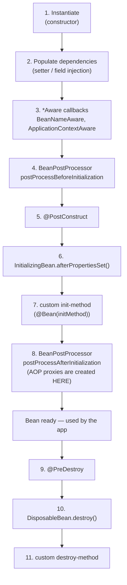
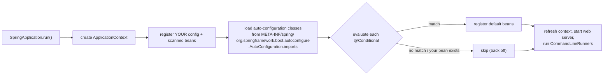

# IoC, Dependency Injection, Bean Lifecycle & Auto-Configuration

> **Level:** SDE-II / SDE-III · **Area:** Spring Boot 3.x · **Next:** [Proxies, transactions & async](02-proxies-transactions-async.md)

> [!NOTE]
> **Verification status:** these Spring notes were written without executing the samples in this repo (unlike the plain-Java notes). The behaviour described is standard Spring Boot 3.x / Framework 6 behaviour, but run anything you plan to rely on. Where I'm hedging on a version detail, the text says so.

## TL;DR

- **IoC (Inversion of Control):** you stop creating and wiring your objects; the **container** (`ApplicationContext`) creates them (*beans*), injects their dependencies and manages their lifecycle.
- Prefer **constructor injection**: dependencies are `final`, required, testable without Spring, and cycles are caught early.
- Beans are **singletons by default** — one per container, **not thread-safe by magic**.
- **Auto-configuration** = "if this class is on the classpath and you haven't defined your own bean, configure a sensible default" — implemented with `@Conditional…` annotations. **Your beans always win.**
- `javax.*` became `jakarta.*` in Boot 3 (Java 17+ baseline).

## The analogy: a restaurant kitchen with a manager

Without Spring, each cook (class) goes shopping and builds their own tools (`new PaymentGateway()`): hard to replace, hard to test. With Spring, a **kitchen manager** (the container) knows every cook and tool, **hands each cook what they declared they need** (constructor parameters), and decides how many of each tool exist (scope). **Auto-configuration** is the manager's default equipment list: *"If there's a database driver on the shelf and nobody ordered a DataSource, set one up — but if you bring your own, I'll use yours."*

## 1. DI styles

```java
@Service
public class OrderService {
    private final PaymentClient payments;          // final => immutable, never null
    private final OrderRepository orders;

    public OrderService(PaymentClient payments, OrderRepository orders) {   // single constructor: @Autowired not needed
        this.payments = payments;
        this.orders = orders;
    }
}
```

| Style | Verdict | Why |
|---|---|---|
| **Constructor** | ✅ default choice | immutable fields; instantiate in a plain unit test (`new OrderService(mockA, mockB)`); too many params = visible design smell; circular deps fail fast |
| Setter | optional dependencies only | allows partially-initialised objects |
| Field (`@Autowired private X x;`) | ❌ avoid | needs reflection/Spring to test, hides dependency count, non-final |

Resolution rules when several beans match a type: `@Primary` (default winner) → `@Qualifier("name")` → parameter-name match. You can inject `List<Handler>` / `Map<String, Handler>` to get **all** beans of a type (a cheap strategy-pattern registry).

## 2. Defining beans

| Mechanism | Use for |
|---|---|
| `@Component` / `@Service` / `@Repository` / `@Controller` | your own classes (found by `@ComponentScan`); `@Repository` also translates persistence exceptions |
| `@Bean` method inside `@Configuration` | third-party classes you can't annotate, or when construction needs logic |

```java
@Configuration                              // proxyBeanMethods = true (default)
class AppConfig {
    @Bean Clock clock() { return Clock.systemUTC(); }
    @Bean TokenService tokens() { return new TokenService(clock()); }   // calls clock() -> gets THE singleton, not a new Clock
}
```

`@Configuration` classes are **CGLIB-subclassed** so that inter-`@Bean` calls return the container's singleton ("full mode"). `@Configuration(proxyBeanMethods = false)` ("lite mode", used by Boot's own auto-configs) skips the proxy for faster startup but then `clock()` would create a *new* `Clock` — pass beans as method parameters instead.

## 3. Scopes

| Scope | Instances | Notes |
|---|---|---|
| **singleton** (default) | one per container | shared by all threads → keep it **stateless** or make state thread-safe |
| prototype | new per injection/lookup | container doesn't call destroy callbacks |
| request / session | per HTTP request/session | web only |

**The prototype-in-singleton trap:** injecting a prototype into a singleton injects it **once**, so it behaves like a singleton. Fix by asking the container each time:

```java
@Service
class ReportService {
    private final ObjectProvider<ReportBuilder> builders;      // prototype-scoped bean
    ReportService(ObjectProvider<ReportBuilder> builders) { this.builders = builders; }
    Report run() { return builders.getObject().build(); }      // fresh instance per call
}
```

(Alternatives: `@Lookup` method injection, or `@Scope(value="prototype", proxyMode=TARGET_CLASS)`.)

## 4. Bean lifecycle — the order you must know



Practical consequences:

- **Constructor** runs before injection of setters/fields → never use an injected *field* in a constructor.
- Do initialisation that needs injected dependencies in **`@PostConstruct`**. Keep it fast (it blocks startup); never do remote calls there without timeouts.
- Because **proxies are created in step 8**, `@Transactional`/`@Async` are **not active inside the bean's own `@PostConstruct`**.
- Singleton beans are destroyed on context close (graceful shutdown); **prototype beans are not** — you must clean them up.

## 5. Circular dependencies

`A(B b)` ↔ `B(A a)` with constructor injection is impossible (each needs the other first). **Since Spring Boot 2.6, circular references are prohibited by default** (`spring.main.allow-circular-references=false`): the app fails at startup with a `BeanCurrentlyInCreationException`/"circular reference" error. Fixes, best first:

1. **Redesign**: extract the shared logic into a third bean `C` that both `A` and `B` use.
2. Use an event or an interface (dependency inversion) so only one side depends on the other.
3. `@Lazy` on one injection point (injects a lazy proxy) — a workaround, not a fix.
4. Re-enabling `allow-circular-references=true` — hides the design problem; avoid.

## 6. Auto-configuration: how Boot "just works"

`@SpringBootApplication` = **`@SpringBootConfiguration`** (it's a `@Configuration`) + **`@EnableAutoConfiguration`** + **`@ComponentScan`** (scans the package of the annotated class **and below** — put your main class in the root package).



Common conditions:

| Condition | Meaning |
|---|---|
| `@ConditionalOnClass` / `OnMissingClass` | a class is (not) on the classpath — how `spring-boot-starter-data-jpa` "switches on" JPA |
| **`@ConditionalOnMissingBean`** | *back-off*: only create the default if the user hasn't defined one |
| `@ConditionalOnProperty` | feature flag via configuration |
| `@ConditionalOnWebApplication`, `@ConditionalOnBean` … | environment / dependency checks |

**Writing your own starter-style auto-configuration:**

```java
@AutoConfiguration
@EnableConfigurationProperties(GreetingProperties.class)
public class GreetingAutoConfiguration {
    @Bean
    @ConditionalOnMissingBean                       // user-defined GreetingService wins
    GreetingService greetingService(GreetingProperties props) {
        return new GreetingService(props.prefix());
    }
}
// register it in: src/main/resources/META-INF/spring/org.springframework.boot.autoconfigure.AutoConfiguration.imports
//   com.example.GreetingAutoConfiguration
```

Debugging: run with `--debug` (or `debug=true`) to print the **conditions evaluation report** (positive matches, negative matches with the reason, exclusions); with Actuator: `/actuator/conditions`. Exclude one with `@SpringBootApplication(exclude = DataSourceAutoConfiguration.class)` or `spring.autoconfigure.exclude=…`.

> A **starter** (e.g. `spring-boot-starter-web`) is just a dependency descriptor bundling libraries; the **auto-configuration** (`spring-boot-autoconfigure`) is what reacts to them. Before Boot 2.7 the registration file was `META-INF/spring.factories`.

## 7. Externalized configuration

**Precedence (simplified; highest wins):** command-line args → Java system properties (`-D`) → OS environment variables → profile-specific files (`application-prod.yml`) → `application.yml/.properties` → `@PropertySource` → defaults. External files next to the jar beat the packaged ones. (The full list in the Boot docs has ~17 levels.)

```java
@ConfigurationProperties(prefix = "payments")
@Validated
public record PaymentsProperties(
        @NotBlank String baseUrl,
        @DefaultValue("2s") Duration timeout,
        @Min(1) @Max(10) @DefaultValue("3") int maxAttempts) { }
// @EnableConfigurationProperties(PaymentsProperties.class)  or  @ConfigurationPropertiesScan
```

```yaml
payments:
  base-url: https://pay.internal      # relaxed binding: base-url == baseUrl == BASE_URL (env: PAYMENTS_BASE_URL)
  timeout: 3s
```

| `@ConfigurationProperties` | `@Value("${x}")` |
|---|---|
| typed, grouped, validated at startup (fails fast with a clear message) | single scattered values, SpEL, no relaxed binding guarantees |
| Records bind via the constructor automatically in Boot 3 | fine for one-off values |

**Profiles:** `spring.profiles.active=prod` (or env `SPRING_PROFILES_ACTIVE`), `@Profile("dev")` on beans, `application-{profile}.yml`, profile groups. **Never commit secrets**: use environment variables, a secrets manager, or Spring Cloud Config/Vault.

> **Spring Boot 4 / Spring Framework 7** (released late 2025) is the current generation. The concepts above carry over. I haven't verified the migration details here — check the official migration guide for: starters/auto-config being split into smaller modules, Jackson upgrade, and removal of APIs that were deprecated in 3.x (e.g. `@MockBean` in favour of `@MockitoBean`).

## 8. Pitfalls

> [!WARNING]
> - Field injection and `new`-ing a bean yourself (`new OrderService()`): not managed → no injection, **no proxies** (`@Transactional` silently ignored).
> - Mutable state in a singleton (a `private List<…> cache` written by request threads) — a data race.
> - Main class outside the root package → components not scanned.
> - Defining two beans of the same type with no `@Primary`/`@Qualifier` → `NoUniqueBeanDefinitionException`.
> - Heavy work in `@PostConstruct` / constructors → slow, flaky startup; failing readiness.
> - Relying on component-scan order or bean-creation order — declare `@DependsOn`/dependencies explicitly.
> - Overriding an auto-configured bean without realising the whole default (e.g. your own `ObjectMapper` bean replaces Boot's configured one) — customise via `Jackson2ObjectMapperBuilderCustomizer`/properties instead.

## 9. Interview Q&A

<details>
<summary><b>Q1.</b> What is IoC vs DI?</summary>

IoC is the principle: the framework controls object creation/wiring and your code is called by it. DI is the mechanism: dependencies are supplied from outside (constructor/setter/field) rather than created inside. Spring's container is the IoC container; DI is how it assembles beans.
</details>

<details>
<summary><b>Q2.</b> Why is constructor injection preferred?</summary>

Immutable (`final`) required dependencies, no partially constructed objects, trivially unit-testable without Spring, makes too-many-dependencies and circular dependencies obvious, works without reflection hacks.
</details>

<details>
<summary><b>Q3.</b> Is a Spring singleton the same as the GoF Singleton? Is it thread-safe?</summary>

No. A Spring singleton is one instance **per container** (per bean definition), not per JVM/classloader. It's shared by all request threads, so it must be stateless or internally thread-safe.
</details>

<details>
<summary><b>Q4.</b> Describe the bean lifecycle.</summary>

Instantiate → inject → Aware callbacks → `BeanPostProcessor` before-init → `@PostConstruct` → `afterPropertiesSet` → custom init → `BeanPostProcessor` after-init (proxies) → in use → `@PreDestroy` → `destroy` → custom destroy. Prototypes aren't destroyed by the container.
</details>

<details>
<summary><b>Q5.</b> How does Spring Boot auto-configuration work?</summary>

`@EnableAutoConfiguration` imports the classes listed in `AutoConfiguration.imports`; each is guarded by `@Conditional…` annotations (class present, bean missing, property set). Because they use `@ConditionalOnMissingBean`, user-defined beans override defaults. `--debug` prints why each did or didn't apply.
</details>

<details>
<summary><b>Q6.</b> How do you inject a prototype bean into a singleton correctly?</summary>

`ObjectProvider<T>`/`Provider<T>` (call `getObject()` each time), `@Lookup`, or a scoped proxy — otherwise the prototype is injected once.
</details>

<details>
<summary><b>Q7.</b> What changed about circular dependencies in recent Boot versions?</summary>

From Boot 2.6 they're disallowed by default (`spring.main.allow-circular-references=false`) — startup fails. Refactor rather than re-enable.
</details>

<details>
<summary><b>Q8.</b> <code>@Configuration</code> vs <code>@Component</code> with <code>@Bean</code> methods?</summary>

`@Configuration` (full mode) is CGLIB-proxied so calls between `@Bean` methods return the shared singleton; in a `@Component` (lite mode) such calls are plain Java calls that create new objects. `proxyBeanMethods=false` opts into lite mode for speed.
</details>

## 10. Predict / spot the bug

<details>
<summary><b>P1.</b> What's wrong?</summary>

```java
@Service class A { @Autowired private B b; A() { b.init(); } }
```

**NPE at startup** — field injection happens *after* the constructor. Use constructor injection (or `@PostConstruct`).
</details>

<details>
<summary><b>P2.</b> A `@Scope("prototype") Counter` is injected into a `@Service`. Two calls to `service.next()` — same counter?</summary>

**Yes** — injected once at singleton creation. Use `ObjectProvider<Counter>`.
</details>

<details>
<summary><b>P3.</b> You define your own <code>DataSource</code> bean. What happens to Boot's?</summary>

It **backs off** (`@ConditionalOnMissingBean`) — Boot's `DataSource` auto-configuration isn't applied, so `spring.datasource.*` properties are ignored unless you bind them yourself.
</details>

---
[↑ Back to Spring Boot index](README.md)
