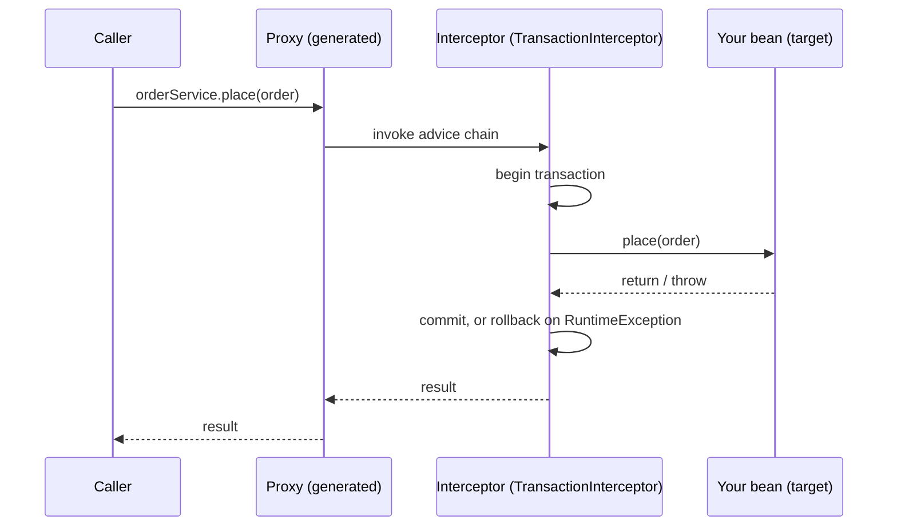

# Proxies, AOP, `@Transactional`, `@Async` & `@Cacheable`

> **Level:** SDE-II / SDE-III · **Area:** Spring Boot 3.x · **Prev:** [IoC & auto-configuration](01-ioc-di-and-auto-configuration.md) · **Next:** [JPA & Hibernate](03-jpa-hibernate.md)

> [!NOTE]
> **Verification status:** written without running the samples in this repo; behaviour is standard Spring Framework 6 / Boot 3. Run the "proof" snippets (`AopUtils.isAopProxy`, `isActualTransactionActive`) yourself if you want to see it live.

## TL;DR

- `@Transactional`, `@Async`, `@Cacheable`, `@Validated`, `@Retryable`… are **not magic: Spring wraps your bean in a proxy** that runs extra logic (open transaction, hand off to another thread, check cache) *around* your method.
- The proxy only sees calls that **come through it**. So **`this.method()` (self-invocation), `private`/`final` methods, and objects you created with `new` bypass it** — the annotation is *silently ignored*.
- `@Transactional` rolls back on **unchecked exceptions and `Error`s only**; **checked exceptions commit** unless you set `rollbackFor`.
- **Default `@Async` swallows nothing but also tells nobody**: a `void` async method's exception goes to an `AsyncUncaughtExceptionHandler`; return a `CompletableFuture` to propagate it (see [async error handling](../03-concurrency/03-async-error-handling-http.md)).

## The analogy: a receptionist in front of the doctor

The **doctor** is your method. The **receptionist** (proxy) greets every visitor: checks the appointment (cache), opens the patient file (transaction), books a different doctor if it's a "call back later" (async). If you **walk through the back door** (calling `this.method()` from inside the clinic), you reach the doctor **without the receptionist ever knowing** — no file opened, no cache check.

## 1. How the proxy is built and called



- Created in the **`BeanPostProcessor.postProcessAfterInitialization`** phase ([lifecycle](01-ioc-di-and-auto-configuration.md#4-bean-lifecycle--the-order-you-must-know)); the container injects the **proxy**, not your raw object.
- **JDK dynamic proxy**: implements your bean's *interfaces*; **CGLIB**: generates a *subclass* of your class. Spring Boot defaults to **CGLIB** (`spring.aop.proxy-target-class=true`), so even beans without interfaces get proxied.
- CGLIB consequences: the class and the intercepted methods can't be `final`; `private` methods can't be intercepted; the constructor may be invoked for the proxy instance (keep constructors side-effect free).
- Proof in a test/debugger: `AopUtils.isAopProxy(bean)`; `bean.getClass()` prints something like `OrderService$$SpringCGLIB$$0`.

## 2. What the proxy can't see (and the fixes)

```java
@Service
public class InvoiceService {

    public void process(Invoice i) {
        this.save(i);              // ❌ self-invocation: goes straight to the target, NOT the proxy
    }

    @Transactional
    public void save(Invoice i) { /* no transaction when reached via process() */ }

    @Transactional
    private void audit() { }       // ❌ private: never intercepted

    @Async
    public void notifyUser() { }   // ❌ via this.notifyUser(): runs synchronously on the caller thread
}
```

| Bypass | Why | Fix |
|---|---|---|
| **Self-invocation** `this.m()` | call doesn't cross the proxy | move `m()` to **another bean** (cleanest); or put `@Transactional` on the *entry* method; or inject the bean into itself (`@Lazy`/`ObjectProvider`) and call `self.m()`; or `TransactionTemplate`; or AspectJ weaving mode (compile/load-time) |
| `private` / `static` methods | not intercepted | make them public on a separate bean |
| `final` class/method (CGLIB) | can't subclass/override | remove `final` (Kotlin: `allopen`) |
| `new Service()` | not a bean, no proxy | inject it |
| `@PostConstruct` / constructor | proxy doesn't exist yet | use `ApplicationReadyEvent`/`SmartInitializingSingleton`, or a `TransactionTemplate` |
| Annotation on an interface method with CGLIB-based setups | historically unreliable | annotate the **class** methods |
| Method visibility | public methods always work; Spring 6.0+ also supports protected/package-visible with class-based proxies | keep `@Transactional` methods `public` |

## 3. AOP vocabulary + writing your own aspect

| Term | Meaning |
|---|---|
| Aspect | cross-cutting module (logging, timing, security) |
| Join point | a point in execution — in Spring AOP always a **method execution** |
| Pointcut | expression selecting join points, e.g. `execution(* com.acme.service..*(..))` or `@annotation(Timed)` |
| Advice | what to do: `@Before`, `@AfterReturning`, `@AfterThrowing`, `@After` (finally), **`@Around`** |
| Weaving | applying aspects — Spring AOP does it at runtime via proxies; AspectJ can weave at compile/load time (also handles self-invocation and private methods) |

```java
@Aspect
@Component
public class TimingAspect {
    private static final Logger log = LoggerFactory.getLogger(TimingAspect.class);

    @Around("@annotation(com.acme.Timed)")
    public Object time(ProceedingJoinPoint pjp) throws Throwable {
        long t0 = System.nanoTime();
        try {
            return pjp.proceed();                      // call the target (or the next advice)
        } finally {
            log.info("{} took {} ms", pjp.getSignature().toShortString(), (System.nanoTime() - t0) / 1_000_000);
        }
    }
}
```

Order of multiple aspects: `@Order(n)` (lower = outermost). `@Transactional`'s advice runs at lowest precedence by default, i.e. *innermost* relative to most custom aspects unless you change it.

## 4. `@Transactional` in depth

### 4.1 Rollback rules (the #1 interview trap)

| Exception thrown from the method | Default result |
|---|---|
| `RuntimeException` (unchecked) | **rollback** |
| `Error` | **rollback** |
| Checked `Exception` (`IOException`, `Exception`) | **COMMIT** (!) |
| Any exception you **catch and swallow** inside the method | normal completion → **commit** |

```java
@Transactional(rollbackFor = Exception.class)         // make checked exceptions roll back too
public void importFile(Path p) throws IOException { … }

@Transactional(noRollbackFor = DuplicateEmailException.class)   // rarely: commit despite this unchecked exception
```

### 4.2 Propagation — what happens when a transactional method calls another

| Propagation | Behaviour | Typical use |
|---|---|---|
| **REQUIRED** (default) | join the existing transaction, or start one | almost everything |
| **REQUIRES_NEW** | **suspend** the current one, run in a brand-new transaction (new connection), commit/rollback independently | audit log that must persist even if the business transaction fails |
| NESTED | savepoint inside the outer transaction (JDBC; limited with JPA) | partial rollback |
| SUPPORTS | use one if present, else none | read helpers |
| NOT_SUPPORTED | suspend, run without | long non-transactional work |
| MANDATORY | must already be in one, else exception | enforce a service-layer contract |
| NEVER | must **not** be in one | |

**Trap — rollback-only poisoning:** the inner `REQUIRED` method throws a runtime exception → the *shared* transaction is marked **rollback-only**. If the outer method **catches** that exception and carries on, at commit time Spring throws **`UnexpectedRollbackException`** ("Transaction silently rolled back because it has been marked as rollback-only"). Fix: don't catch it, or make the inner call `REQUIRES_NEW`/`NESTED`.

**Trap — `REQUIRES_NEW` and the connection pool:** the outer transaction still holds its connection while the inner takes a second one. Under load with a small pool, threads can **deadlock waiting for a second connection** while holding the first.

### 4.3 Isolation

| Level | Dirty read | Non-repeatable read | Phantom |
|---|---|---|---|
| READ_UNCOMMITTED | possible | possible | possible |
| **READ_COMMITTED** | no | possible | possible |
| REPEATABLE_READ | no | no | possible (DB-dependent) |
| SERIALIZABLE | no | no | no |

`@Transactional(isolation = …)` default is **`DEFAULT` = the database's default**: PostgreSQL, Oracle, SQL Server, H2 → **READ COMMITTED**; MySQL InnoDB → **REPEATABLE READ**. Higher isolation = more locking/aborts; prefer **optimistic locking** (`@Version`, see [JPA](03-jpa-hibernate.md)) for lost-update protection.

### 4.4 Other attributes and rules

- **`readOnly = true`**: an optimisation hint — with Hibernate it skips dirty-checking flushes; some drivers/routers use it for read replicas. It is **not** a security guarantee against writes.
- **`timeout`** (seconds) applies to the whole transaction; **`transactionManager`** selects among several.
- Put `@Transactional` on the **service layer** (one use-case = one transaction), not repositories or controllers.
- **Keep transactions short.** Never call slow external HTTP APIs inside one: you hold a DB connection (and row locks) for the duration of someone else's latency → pool exhaustion. Pattern: do the DB work in a transaction, call out afterwards, or use the **transactional outbox** (write the event row in the same transaction; a relay publishes it).
- **Dual-write problem:** "save to DB then publish to Kafka" can fail between the two. Fix with the outbox pattern or `@TransactionalEventListener(phase = AFTER_COMMIT)` (fires only after a successful commit; the listener runs *outside* the transaction — start a new one if it needs DB access).
- Reading lazy collections after the transaction ended → `LazyInitializationException` ([JPA note](03-jpa-hibernate.md)).
- Distributed transactions across services/databases: avoid 2PC; use **Saga**/compensations ([system design](../../../01-system-design/README.md)).

### "My `@Transactional` isn't rolling back" — suspect list

1. Checked exception thrown (no `rollbackFor`). 2. Exception caught and swallowed. 3. Self-invocation / private method / bean created with `new`. 4. Wrong `@Transactional` import (`javax.transaction` vs `org.springframework.transaction.annotation`; both work, behaviours differ slightly). 5. Different thread (`@Async`, parallel stream) — the transaction is **thread-bound**. 6. Non-transactional storage (MyISAM, a message broker). 7. Rollback-only already set / `UnexpectedRollbackException`. 8. Test is `@Transactional` and rolls back by default (hides commit-time failures).

## 5. `@Async`

```java
@Configuration
@EnableAsync
class AsyncConfig {
    @Bean(name = "ioExecutor")
    ThreadPoolTaskExecutor ioExecutor() {
        var ex = new ThreadPoolTaskExecutor();
        ex.setThreadNamePrefix("io-");
        ex.setCorePoolSize(8);
        ex.setMaxPoolSize(16);
        ex.setQueueCapacity(200);                                   // BOUNDED: avoids hidden memory growth
        ex.setRejectedExecutionHandler(new ThreadPoolExecutor.CallerRunsPolicy());
        ex.setWaitForTasksToCompleteOnShutdown(true);
        ex.setAwaitTerminationSeconds(30);
        return ex;
    }
}

@Service
class Notifier {
    @Async("ioExecutor")                                // name the executor explicitly
    public CompletableFuture<Void> sendEmail(String to) {   // return a future so failures can propagate
        mailClient.send(to);                            // exception completes the future exceptionally
        return CompletableFuture.completedFuture(null);
    }
}
```

- Needs `@EnableAsync` and a call **through the proxy** (not `this`).
- Boot's default executor (`applicationTaskExecutor`, `ThreadPoolTaskExecutor`) has **core size 8 and an effectively unbounded queue** — configure your own for production. With `spring.threads.virtual.enabled=true` (Boot 3.2+, Java 21) async work runs on virtual threads.
- **Return types:** `void` → exceptions go to `AsyncUncaughtExceptionHandler` (default: log); `Future`/`CompletableFuture` → exception stored in the future. Implement `AsyncConfigurer.getAsyncUncaughtExceptionHandler()` for `void`.
- **Context does not propagate**: `SecurityContext`, MDC logging context and the current transaction stay on the calling thread → use a `TaskDecorator`/`DelegatingSecurityContextAsyncTaskExecutor`.
- Don't mix `@Transactional` and `@Async` expecting one transaction — the async method starts its own on its own thread.

## 6. `@Cacheable` and `@Scheduled` in two minutes

- `@EnableCaching` + `@Cacheable("users")` on a method: key = arguments; `@CacheEvict`, `@CachePut`; `condition`/`unless` for fine control. Same **proxy rules** (self-invocation = cache never hit).
- Without a provider Boot uses a simple in-memory `ConcurrentMapCacheManager`: **no TTL, no size bound** → memory leak risk. Use **Caffeine** (local) or **Redis** (shared) with expiry.
- Cache stampede: many threads miss the same key at once — `@Cacheable(sync = true)` serialises loading per key.
- `@Scheduled`: Boot's default scheduler has **one thread** (`spring.task.scheduling.pool.size=1`) — one slow job delays all others. In a multi-instance deployment each instance runs the job → use ShedLock/Quartz/leader election.

## 7. Interview Q&A

<details>
<summary><b>Q1.</b> How does <code>@Transactional</code> work under the hood?</summary>

A `BeanPostProcessor` wraps the bean in a proxy with a `TransactionInterceptor`. A call through the proxy asks the `PlatformTransactionManager` to begin (or join) a transaction, invokes the target, then commits or rolls back based on the outcome. The transaction/connection is bound to the current thread.
</details>

<details>
<summary><b>Q2.</b> Why doesn't <code>@Transactional</code> work when a method calls another method in the same class?</summary>

The call is `this.other()` on the raw target object — it never passes through the proxy, so no interceptor runs. Move the method to another bean, or restructure so the annotated method is the entry point.
</details>

<details>
<summary><b>Q3.</b> What's the default rollback behaviour?</summary>

Rollback for `RuntimeException` and `Error`; commit for checked exceptions. Override with `rollbackFor`/`noRollbackFor`.
</details>

<details>
<summary><b>Q4.</b> Explain REQUIRED vs REQUIRES_NEW. Give a use case and a risk.</summary>

REQUIRED joins the caller's transaction; REQUIRES_NEW suspends it and uses a fresh one. Use for audit logs that must survive a business rollback. Risk: needs a second connection while holding the first → pool exhaustion/deadlock under load, and inconsistent data if the outer transaction later fails.
</details>

<details>
<summary><b>Q5.</b> What causes <code>UnexpectedRollbackException</code>?</summary>

An inner participating (REQUIRED) transaction marked the shared transaction rollback-only (threw a runtime exception), but the outer code caught the exception and tried to commit. Spring detects the rollback-only flag and throws on commit.
</details>

<details>
<summary><b>Q6.</b> JDK vs CGLIB proxies — and which does Boot use?</summary>

JDK proxies implement interfaces; CGLIB subclasses the class. Boot defaults to CGLIB (`proxy-target-class=true`), so classes must not be `final` and proxied methods must not be `private`/`final`.
</details>

<details>
<summary><b>Q7.</b> How do you handle exceptions from <code>@Async</code> methods?</summary>

Return a `CompletableFuture` and handle the failure on it (`exceptionally`/`handle`), or for `void` methods register an `AsyncUncaughtExceptionHandler`. Without either, errors only appear as a logged stack trace.
</details>

<details>
<summary><b>Q8.</b> Why shouldn't you call an external API inside a transaction?</summary>

The transaction holds a pooled DB connection (and possibly row locks) while waiting on a remote service; slow/unavailable dependencies exhaust the pool and block unrelated requests. Do the call before/after the transaction or use an outbox.
</details>

<details>
<summary><b>Q9.</b> What does <code>readOnly = true</code> actually do?</summary>

It's a hint: Hibernate switches to manual flush (no dirty checking), the connection may be marked read-only, and routing data sources can send it to a replica. It doesn't guarantee writes fail.
</details>

## 8. Predict / spot the bug

<details>
<summary><b>P1.</b> Does <code>process()</code> run in a transaction?</summary>

```java
@Service class S {
  public void process() { save(); }
  @Transactional public void save() { repo.save(new X()); }
}
```

**No transaction from `process()`** (self-invocation). Calling `s.save()` directly from another bean would be transactional.
</details>

<details>
<summary><b>P2.</b> Is the row saved?</summary>

```java
@Transactional
public void register() throws IOException {
    repo.save(user);
    throw new IOException("mail failed");
}
```

**Yes — it commits.** Checked exception, no `rollbackFor`.
</details>

<details>
<summary><b>P3.</b> What's printed by <code>Thread.currentThread().getName()</code> inside <code>@Async</code> method <code>a()</code> when called as <code>this.a()</code>?</summary>

The **caller's** thread name (e.g. `http-nio-8080-exec-1`) — it ran synchronously because the proxy was bypassed.
</details>

---
[↑ Back to Spring Boot index](README.md)
