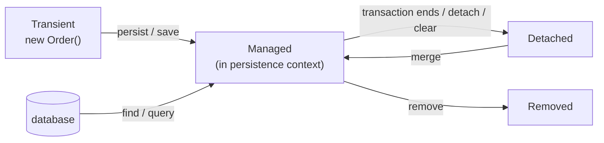
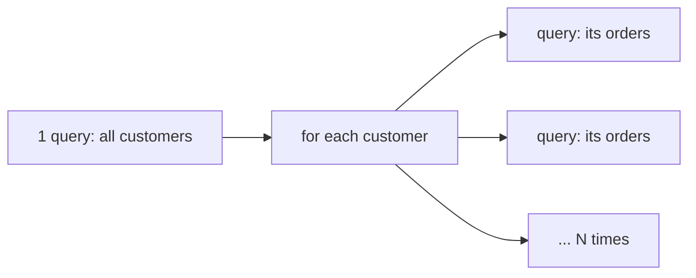

# Spring Data JPA & Hibernate: Persistence Context, Lazy Loading, N+1

> **Level:** SDE-II / SDE-III · **Area:** Spring Boot 3.x (Hibernate 6) · **Prev:** [Proxies & transactions](02-proxies-transactions-async.md) · **Next:** [REST, errors, security & testing](04-rest-errors-security-testing.md)

> [!NOTE]
> **Verification status:** written without running the samples in this repo. The mechanics (dirty checking, N+1, `LazyInitializationException`, fetch-join pagination warning) are standard Hibernate behaviour; the exact SQL text and warning IDs can vary by Hibernate version — check with the logging setup in §1.

## TL;DR

- Hibernate keeps a **persistence context** (a per-transaction first-level cache). Entities loaded inside it are **managed**: change a field and the **UPDATE happens at flush/commit with no `save()`** (*dirty checking*).
- **Relationships are lazy by default for collections** (`@OneToMany`, `@ManyToMany`) and **eager for `@ManyToOne`/`@OneToOne`**. Touching a lazy collection outside the session → `LazyInitializationException`.
- **N+1 problem:** 1 query for the parents + N queries for each parent's lazy children. Fix with **`JOIN FETCH`**, **`@EntityGraph`**, **batch fetching**, or **DTO projections** — never by making everything `EAGER`.
- Use **`@Version`** (optimistic locking) to prevent lost updates; keep **transactions short**; mind the **connection pool**.

## The analogy: a library desk

The **persistence context** is the librarian's desk during one visit (transaction). Books you ask for are **placed on the desk** (managed); if you scribble in one, the librarian **notices and updates the shelf copy when you leave** (flush at commit) — you needn't ask. **Lazy loading** is a note saying "chapters are in the basement — fetch when someone actually asks". N+1 is the librarian walking to the basement **once per book** instead of fetching all the chapters in one trip. Once you leave (transaction ends) the desk is cleared; asking for a basement chapter then fails (`LazyInitializationException`).

## 1. See what Hibernate does (always start here)

```yaml
spring:
  jpa:
    open-in-view: false                  # see §6
    properties:
      hibernate:
        format_sql: true
        generate_statistics: true        # logs statement counts per session
logging:
  level:
    org.hibernate.SQL: debug             # the SQL
    org.hibernate.orm.jdbc.bind: trace   # bind parameter values (Hibernate 6 logger name)
```

You can't tune what you can't see: **count the SQL statements per request** when debugging performance.

## 2. Entity states and dirty checking



```java
@Transactional
public void rename(Long id, String name) {
    Customer c = customerRepository.findById(id).orElseThrow();   // managed
    c.setName(name);                                              // no save() call...
}                                                                 // ...flush at commit => UPDATE customer SET name=? WHERE id=?
```

- Flush happens at **commit**, **before a query** that might see the changes (`FlushMode.AUTO`), or on `flush()`.
- `repository.save(e)` = `persist` if the entity is **new** (`@Id` null, or `@Version` null), otherwise `merge` (copies state onto a managed instance, returns that instance — **use the returned object**).
- `findById` twice in one transaction → second call hits the **first-level cache**, not the DB.
- `@Transactional(readOnly = true)` skips dirty-check flushing (cheaper for reads).
- **Bulk JPQL updates/deletes** (`@Modifying @Query("update …")`) bypass the persistence context → stale managed entities; use `@Modifying(clearAutomatically = true)`.

### ID generation

| Strategy | Notes |
|---|---|
| `IDENTITY` | DB auto-increment; Hibernate must **insert immediately** to learn the id → **disables JDBC insert batching** |
| `SEQUENCE` | fetches ids in blocks (`allocationSize`, default 50) → **batching works**; preferred on Postgres/Oracle |
| `UUID` | no DB roundtrip; random UUIDs fragment indexes — prefer time-ordered ones for big tables |

## 3. Lazy vs eager

| Association | Default fetch |
|---|---|
| `@ManyToOne`, `@OneToOne` | **EAGER** |
| `@OneToMany`, `@ManyToMany` | **LAZY** |

Best practice: make **everything `LAZY`** (`@ManyToOne(fetch = LAZY)`) and fetch what each use-case needs **explicitly** in the query. `EAGER` is not a fix for `LazyInitializationException` — it just moves you to **over-fetching and hidden N+1** (a JPQL query ignores `EAGER` and then fires extra queries).

### `LazyInitializationException`

```java
Order o = orderRepository.findById(1L).orElseThrow();   // transaction ended when the repo call returned (no outer tx)
o.getItems().size();                                    // 💥 LazyInitializationException: no Session
```

| Fix | Verdict |
|---|---|
| Fetch what you need in the query (`JOIN FETCH` / `@EntityGraph`) | ✅ best |
| Map to a **DTO inside the `@Transactional` service** and return the DTO | ✅ best (never return entities from the web layer) |
| Open the transaction around the whole use-case (`@Transactional` on the service method) | ✅ fine |
| `Hibernate.initialize(o.getItems())` inside the transaction | ✅ OK for one-offs |
| Make the association `EAGER` | ❌ hides the problem |
| Rely on **Open-Session-In-View** | ❌ see §6 |

## 4. The N+1 problem and its fixes

```java
@Entity class Customer { @Id Long id; String name;
    @OneToMany(mappedBy = "customer") List<Order> orders = new ArrayList<>(); }
@Entity class Order    { @Id Long id; @ManyToOne(fetch = LAZY) Customer customer; BigDecimal total; }

List<Customer> customers = customerRepository.findAll();   // 1 query: select * from customer
for (Customer c : customers) {
    total += c.getOrders().size();                         // N queries: select * from orders where customer_id = ?
}                                                          // => 1 + N round trips (101 for 100 customers)
```



| Fix | How | Trade-offs |
|---|---|---|
| **`JOIN FETCH`** | `@Query("select distinct c from Customer c join fetch c.orders")` | 1 query; **can't paginate in the DB** with collection fetch (see below); duplicates parents without `distinct`; cartesian explosion with two collections |
| **`@EntityGraph`** | `@EntityGraph(attributePaths = "orders") List<Customer> findAll();` | same as fetch join, declarative, reusable |
| **Batch fetching** | `spring.jpa.properties.hibernate.default_batch_fetch_size=50` or `@BatchSize(size=50)` | turns N queries into N/50 (`WHERE customer_id IN (?,?,…)`); works with pagination; **great default** |
| **DTO projection** | `@Query("select new com.acme.CustomerOrderCount(c.id, count(o)) from Customer c left join c.orders o group by c.id")` or interface/record projection | 1 query, only needed columns, no entities — best for read-only lists/reports |
| `@Fetch(SUBSELECT)` | one extra query using the original query as a subselect | fine for small result sets |

**Pitfalls of fetch joins**

- **Pagination + collection fetch join:** `Pageable` with `join fetch c.orders` makes Hibernate load *everything* and paginate **in memory** (warning `HHH90003004: firstResult/maxResults specified with collection fetch; applying in memory`). Fix: paginate the **parent ids** in a first query, then fetch children for those ids (or use batch fetching).
- **`MultipleBagFetchException`:** fetch-joining two `List` collections at once. Use `Set`s, or fetch one collection per query.
- **Cartesian product:** `join fetch a.x join fetch a.y` returns |x|×|y| rows per parent.
- `@ManyToOne` to-one fetch joins are always safe for pagination.

## 5. Spring Data repositories — the useful 20 %

```java
interface OrderRepository extends JpaRepository<Order, Long> {
    List<Order> findByCustomerIdAndStatusOrderByCreatedAtDesc(Long customerId, Status status);   // derived query
    Page<Order> findByStatus(Status status, Pageable pageable);          // Page => extra COUNT query
    Slice<Order> findByCustomerId(Long id, Pageable pageable);           // Slice => no count (just "has next")
    @Query("select o.id as id, o.total as total from Order o where o.status = :s")
    List<OrderSummary> summaries(@Param("s") Status s);                  // interface projection
    boolean existsByCustomerIdAndStatus(Long customerId, Status s);      // cheaper than counting/loading
}
record OrderSummaryDto(Long id, BigDecimal total) { }                    // class/record DTO projection also supported
```

- Derived queries get unreadable fast — switch to `@Query` for anything with 3+ conditions.
- `Page` runs a **COUNT** query; use `Slice` for infinite scroll. Offset pagination degrades on deep pages → **keyset (seek) pagination** (`where id > :last order by id limit n`).
- `getReferenceById(id)` returns a lazy proxy without hitting the DB (useful to set a foreign key without loading the row).
- Avoid `findAll()` on big tables; avoid loading entities when you only need a few columns.

## 6. Open-Session-In-View (`spring.jpa.open-in-view`)

**Defaults to `true` in Spring Boot** (and logs a startup warning). The `EntityManager` stays open for the **entire HTTP request**, so lazy loading *works in controllers and during JSON serialisation*. That's why code "works" in dev and then:

- Hidden N+1 queries triggered by Jackson serialising lazy collections.
- A **DB connection is held longer** (until the response is written) → pool exhaustion under load.
- Blurs transaction boundaries.

**Recommendation:** `spring.jpa.open-in-view=false`, fetch explicitly, return DTOs.

## 7. Locking and concurrency

```java
@Entity class Account {
    @Id Long id;
    @Version long version;          // Hibernate adds "AND version = ?" to UPDATE and increments it
    BigDecimal balance;
}
```

- **Optimistic locking:** if another transaction changed the row since you read it, the UPDATE matches 0 rows → `OptimisticLockException` (Spring translates to `ObjectOptimisticLockingFailureException`). Catch and **retry** or return **409 Conflict**. No DB locks held → scales well. Best for read-mostly data with rare conflicts.
- **Pessimistic locking:** `@Lock(LockModeType.PESSIMISTIC_WRITE)` on a repository method → `SELECT … FOR UPDATE`. Use for hot rows with frequent conflicts (inventory decrement), keep the transaction tiny, set a lock timeout, always lock in a consistent order (deadlocks).
- Atomic update alternative: `update account set balance = balance - :amt where id = :id and balance >= :amt` (check the updated-rows count).
- Isolation levels and propagation: [Proxies & transactions](02-proxies-transactions-async.md#43-isolation).

## 8. Mapping rules of thumb

- **Bidirectional associations:** keep both sides in sync with helper methods (`order.addItem(item)` sets `item.setOrder(order)`); `mappedBy` marks the non-owning side; the side with the foreign key (the `@ManyToOne`) owns the relationship.
- `cascade = ALL` + `orphanRemoval = true` only for true **parent-owns-child** aggregates (Order → OrderItem), never `CascadeType.REMOVE` on a shared entity.
- **`equals`/`hashCode`:** don't use a generated id that's `null` before persist in a `HashSet`; use a business key or a stable id strategy ([details](../02-collections/02-equals-hashcode.md)); use `instanceof`-based `equals` because of Hibernate proxies.
- **Lombok `@Data` on entities** generates `toString`/`equals`/`hashCode` over all fields → triggers lazy loading and **infinite recursion** in bidirectional mappings. Exclude associations or write them by hand.
- Prefer **`Set`** or an `@OrderColumn` over `List` bags for collections you fetch-join.
- Use `@Enumerated(EnumType.STRING)`, never `ORDINAL`.
- Prefer a DB migration tool (**Flyway/Liquibase**) over `ddl-auto=update`; `validate` in production.
- **Don't expose entities** over REST (lazy proxies, cyclic JSON, leaking columns, over-posting). Use DTOs/records.

## 9. Connection pool (HikariCP) basics

- Default `maximumPoolSize` is **10**. A request holds a connection for the duration of its transaction (or the whole request with open-in-view).
- Throughput ≈ `pool size / average transaction time`. 10 connections with 100 ms transactions ⇒ ~100 tx/s max; slow transactions (external calls, big loops) crush it. A bigger pool is not a cure — the **database** has its own concurrency limit (often tuned around cores × 2 + spindles).
- Symptom of exhaustion: threads blocked in `HikariPool.getConnection`, "Connection is not available, request timed out after 30000ms".

## 10. Interview Q&A

<details>
<summary><b>Q1.</b> What is the persistence context and dirty checking?</summary>

A first-level, per-transaction identity map of managed entities. Hibernate snapshots loaded state and at flush compares each managed entity to its snapshot, issuing UPDATEs for changes — so modifying a managed entity needs no `save()`.
</details>

<details>
<summary><b>Q2.</b> Explain the N+1 problem and how you'd detect and fix it.</summary>

Loading N parents then lazily loading each parent's association issues 1 + N queries. Detect via SQL logging/Hibernate statistics/query counts in tests (e.g. datasource-proxy). Fix with fetch join or `@EntityGraph` for small bounded sets, batch fetching for pagination-friendly lists, or DTO projections for read models.
</details>

<details>
<summary><b>Q3.</b> LAZY vs EAGER — defaults and recommendation?</summary>

`@ManyToOne`/`@OneToOne` eager, `@OneToMany`/`@ManyToMany` lazy by default. Make associations lazy and fetch explicitly per use-case; eager causes over-fetching and N+1 with JPQL.
</details>

<details>
<summary><b>Q4.</b> How do you fix <code>LazyInitializationException</code> properly?</summary>

Load the data you need inside the transaction (fetch join / entity graph / DTO projection) and return DTOs. Don't switch to EAGER and don't depend on open-in-view.
</details>

<details>
<summary><b>Q5.</b> Why is <code>spring.jpa.open-in-view</code> controversial?</summary>

It keeps the session open through the web layer so lazy loading "works" in controllers/serialisation, hiding N+1 and holding DB connections for the full request. Disable it and fetch explicitly.
</details>

<details>
<summary><b>Q6.</b> Optimistic vs pessimistic locking?</summary>

Optimistic: `@Version` check at update time, no DB locks, retry on conflict — good for low contention. Pessimistic: `SELECT … FOR UPDATE` blocks others — good for high contention, but risks deadlocks and reduces throughput.
</details>

<details>
<summary><b>Q7.</b> Why does <code>GenerationType.IDENTITY</code> hurt batch inserts?</summary>

Hibernate needs the generated key immediately after each insert, so it can't defer and batch them. `SEQUENCE` with an allocation size lets it assign ids up front and batch.
</details>

<details>
<summary><b>Q8.</b> What happens with <code>join fetch</code> + <code>Pageable</code> on a collection?</summary>

Hibernate can't apply `LIMIT` correctly to the joined rows, so it fetches everything and paginates in memory (warning HHH90003004) — dangerous on large tables. Paginate parent ids first, or use batch fetching.
</details>

<details>
<summary><b>Q9.</b> <code>save()</code> vs <code>saveAndFlush()</code> vs dirty checking?</summary>

`save` persists/merges (no immediate SQL necessarily); `saveAndFlush` forces a flush now; for managed entities inside a transaction you don't need `save` — dirty checking updates at commit.
</details>

## 11. Predict / spot the bug

<details>
<summary><b>P1.</b> How many SQL statements?</summary>

```java
@Transactional(readOnly = true)
public int count() {
    return customerRepository.findAll().stream().mapToInt(c -> c.getOrders().size()).sum();
}   // 50 customers, lazy orders
```

**51** — 1 for customers + 50 lazy loads. With `default_batch_fetch_size=50` it drops to ~2.
</details>

<details>
<summary><b>P2.</b> Is the name updated?</summary>

```java
public void rename(Long id, String n) {         // NOT @Transactional
    Customer c = repo.findById(id).orElseThrow();
    c.setName(n);
}
```

**No** — the entity is detached once `findById` returns (the repository's own transaction ended), and nothing flushes the change. Add `@Transactional` (or call `repo.save(c)`).
</details>

<details>
<summary><b>P3.</b> Two users edit the same row with <code>@Version</code>; the second saves last. Result?</summary>

The second `UPDATE … WHERE id=? AND version=?` matches 0 rows → `ObjectOptimisticLockingFailureException`; handle with retry or 409.
</details>

---
[↑ Back to Spring Boot index](README.md)
