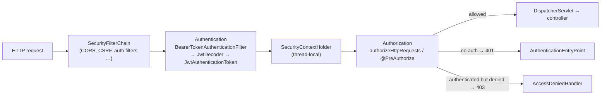

# REST, Validation, Error Handling, Security (JWT), Testing & Production

> **Level:** SDE-II / SDE-III · **Area:** Spring Boot 3.x · **Prev:** [JPA & Hibernate](03-jpa-hibernate.md) · **Next:** [Interview Q&A sheet](05-spring-boot-interview-qa.md)

> [!NOTE]
> **Verification status:** written without running the samples in this repo. The APIs used (`ProblemDetail`, `RestClient`, `SecurityFilterChain` lambda DSL, `@MockitoBean`) are Boot 3.4/3.5-era; check class names against your exact Boot version if a sample doesn't compile.

## TL;DR

- Controllers take **DTOs (records)**, never entities; validate with `@Valid`; **one `@RestControllerAdvice`** turns every exception into a consistent **`ProblemDetail`** JSON — and maps upstream failures to **502/503/504**, not 500.
- Calling other services: one shared **`RestClient`** with **connect + read timeouts**, status handlers that translate to **your** domain exception (same design as the [async error-handling note](../03-concurrency/03-async-error-handling-http.md)).
- Security = a **filter chain**; for APIs use **stateless JWT** (resource server), CSRF off, `401` = not authenticated, `403` = authenticated but not allowed.
- Test with **slices** (`@WebMvcTest`, `@DataJpaTest`), not `@SpringBootTest` everywhere; expose **Actuator** health probes in production.

## The analogy: a building with a front desk, ID checks and a complaints office

The **filter chain** is the security desk (checks your badge before you reach any office). The **controller** is the reception that takes your form (DTO) and rejects incomplete ones (`@Valid`). When anything goes wrong inside, the **complaints office** (`@RestControllerAdvice`) writes a polite, standard-format letter (`ProblemDetail`) — it never hands over internal memos (stack traces).

## 1. Controllers and DTOs

```java
public record CreateOrderRequest(
        @NotNull Long customerId,
        @NotEmpty List<@Valid Line> lines) {
    public record Line(@NotBlank String sku, @Min(1) int qty) { }
}
public record OrderResponse(Long id, BigDecimal total, Instant createdAt) { }

@RestController
@RequestMapping("/api/orders")
class OrderController {
    private final OrderService service;
    OrderController(OrderService service) { this.service = service; }

    @PostMapping
    ResponseEntity<OrderResponse> create(@Valid @RequestBody CreateOrderRequest req) {
        OrderResponse created = service.create(req);
        return ResponseEntity.created(URI.create("/api/orders/" + created.id())).body(created);   // 201 + Location
    }

    @GetMapping("/{id}")
    OrderResponse get(@PathVariable Long id) { return service.get(id); }      // throws OrderNotFoundException -> 404 via advice
}
```

- Keep controllers thin: bind → validate → call a service → map to a response. No business logic, no transactions.
- **Never return JPA entities**: lazy proxies, cycles, leaked columns, mass-assignment of fields you didn't intend.
- Status codes: `200` OK · `201` Created (+`Location`) · `204` No Content · `400` malformed/invalid · `401` unauthenticated · `403` forbidden · `404` not found · `409` conflict (duplicate, optimistic lock) · `422` semantic validation (optional) · `429` rate-limited · `500` our bug · `502` bad gateway (upstream failed) · `503` unavailable (overload) · `504` upstream timeout.
- **Idempotency:** `GET/PUT/DELETE` are idempotent by definition; for `POST` accept an **`Idempotency-Key`** header and store the result so client retries don't create duplicates.
- Paginate collection endpoints (`page`/`size` with a **max size**, or cursor/keyset); never return unbounded lists.
- Jackson: ISO-8601 dates (`Instant`/`LocalDate`, `spring.jackson.serialization.write-dates-as-timestamps=false`), `Long` ids beyond 2⁵³ break JavaScript (send as strings), be deliberate about `FAIL_ON_UNKNOWN_PROPERTIES`.

## 2. Validation: which exception for which failure

| Situation | Exception | Default status |
|---|---|---|
| `@Valid @RequestBody` fails constraints | `MethodArgumentNotValidException` | 400 |
| `@PathVariable`/`@RequestParam` constraints (with `@Validated` class or Spring 6.1+ built-in method validation) | `ConstraintViolationException` / `HandlerMethodValidationException` (6.1+) | 400 |
| Malformed JSON / wrong type | `HttpMessageNotReadableException` | 400 |
| Missing required param | `MissingServletRequestParameterException` | 400 |
| Unsupported method / media type | `HttpRequestMethodNotSupportedException` / `HttpMediaTypeNotSupportedException` | 405 / 415 |

Bean Validation does **format/shape** checks (`@NotBlank`, `@Size`, `@Pattern`, custom `@Constraint`). **Business rules** (stock available, user unique) belong in the service and raise domain exceptions. Validate again at the **persistence** layer with DB constraints — the database is the last line of defence against races.

## 3. Global error handling with `ProblemDetail`

```java
public class ExternalServiceException extends RuntimeException {      // from the async error-handling note
    final int status; final boolean retriable;
    public ExternalServiceException(String m, int status, boolean retriable, Throwable cause) { super(m, cause); this.status = status; this.retriable = retriable; }
    public boolean isTimeout() { return getCause() instanceof java.net.http.HttpTimeoutException
                                    || getCause() instanceof java.net.SocketTimeoutException; }
}

@RestControllerAdvice
class ApiExceptionHandler extends ResponseEntityExceptionHandler {   // handles Spring MVC's own exceptions as ProblemDetail

    @ExceptionHandler(OrderNotFoundException.class)
    ProblemDetail notFound(OrderNotFoundException e) {
        ProblemDetail p = ProblemDetail.forStatusAndDetail(HttpStatus.NOT_FOUND, e.getMessage());
        p.setTitle("Order not found");
        return p;
    }

    @ExceptionHandler(ExternalServiceException.class)
    ProblemDetail upstream(ExternalServiceException e) {
        HttpStatus s = e.isTimeout() ? HttpStatus.GATEWAY_TIMEOUT                       // 504: upstream too slow
                     : e.retriable   ? HttpStatus.SERVICE_UNAVAILABLE                   // 503: transient, client may retry
                     :                 HttpStatus.BAD_GATEWAY;                          // 502: upstream said no / garbage
        log.warn("upstream failure status={} retriable={}", e.status, e.retriable, e);  // full detail goes to LOGS only
        return ProblemDetail.forStatusAndDetail(s, "Upstream service unavailable");     // generic text to the client
    }

    @ExceptionHandler(Exception.class)
    ProblemDetail fallback(Exception e) {
        log.error("unhandled", e);
        return ProblemDetail.forStatusAndDetail(HttpStatus.INTERNAL_SERVER_ERROR, "Unexpected error");   // never e.getMessage()/stack trace
    }
}
```

- `ProblemDetail` follows RFC 7807/9457 (`type`, `title`, `status`, `detail`, `instance`, plus custom properties via `setProperty`). Enable Boot's built-in handling for Spring MVC exceptions with `spring.mvc.problemdetails.enabled=true`, or extend `ResponseEntityExceptionHandler` as above.
- **Never leak** stack traces, SQL, class names or upstream bodies. Include a **correlation/trace id** property so support can find the log line.
- `@ControllerAdvice` is global per application; most specific `@ExceptionHandler` wins.
- Retry hints: add `Retry-After` for 429/503.

## 4. Calling other services: `RestClient`

```java
@Configuration
class PaymentsClientConfig {
    @Bean
    RestClient paymentsClient(PaymentsProperties props) {
        HttpClient http = HttpClient.newBuilder().connectTimeout(Duration.ofSeconds(1)).build();
        JdkClientHttpRequestFactory factory = new JdkClientHttpRequestFactory(http);
        factory.setReadTimeout(Duration.ofSeconds(2));                       // ALWAYS set both timeouts

        return RestClient.builder()
                .baseUrl(props.baseUrl())
                .requestFactory(factory)
                .defaultStatusHandler(HttpStatusCode::is5xxServerError, (req, res) -> {
                    throw new ExternalServiceException("payments " + res.getStatusCode().value(), res.getStatusCode().value(), true, null);
                })
                .defaultStatusHandler(HttpStatusCode::is4xxClientError, (req, res) -> {
                    int s = res.getStatusCode().value();
                    throw new ExternalServiceException("payments " + s, s, s == 429, null);
                })
                .build();
    }
}

@Component
class PaymentsGateway {
    private final RestClient client;
    PaymentsGateway(@Qualifier("paymentsClient") RestClient client) { this.client = client; }

    Receipt charge(ChargeRequest r) {
        try {
            return client.post().uri("/charges").body(r).retrieve().body(Receipt.class);
        } catch (ResourceAccessException e) {                                // Spring wraps IOException/timeouts in this
            throw new ExternalServiceException("payments unreachable", -1, true, e);
        }
    }
}
```

| Client | Style | Use when |
|---|---|---|
| **`RestClient`** (Spring 6.1/Boot 3.2+) | blocking, fluent | default for new MVC code |
| `RestTemplate` | blocking, older | legacy (in maintenance mode) |
| `WebClient` | reactive/non-blocking (also usable blocking) | WebFlux apps, streaming, high fan-out without virtual threads |
| HTTP interface (`@HttpExchange`) | declarative proxy over `RestClient`/`WebClient` | many endpoints on one service |

Retries/circuit breaker/bulkhead: **Resilience4j** (`@Retry`, `@CircuitBreaker`, `@TimeLimiter`) — retry only **idempotent** calls with backoff + jitter ([details](../03-concurrency/03-async-error-handling-http.md)). On Java 21, `spring.threads.virtual.enabled=true` lets blocking `RestClient` calls scale.

## 5. Spring Security essentials

### Request flow



- With `spring-boot-starter-security` on the classpath and **no config**, Boot secures **everything** (form login + a generated password in the log). Define your own `SecurityFilterChain` to take over.
- **Authentication** = who are you (401 if unknown). **Authorization** = may you do this (403 if known but forbidden).
- `SecurityContextHolder` is **thread-local**: it does *not* follow you into `@Async`/new threads unless you use `DelegatingSecurityContext…` wrappers. With virtual threads it works per-thread as usual.

### Stateless API with JWT (resource server)

```java
@Configuration
@EnableMethodSecurity
class SecurityConfig {

    @Bean
    SecurityFilterChain api(HttpSecurity http) throws Exception {
        return http
            .csrf(csrf -> csrf.disable())                                   // OK: stateless, token in Authorization header (no cookies)
            .sessionManagement(s -> s.sessionCreationPolicy(SessionCreationPolicy.STATELESS))
            .authorizeHttpRequests(a -> a
                .requestMatchers("/actuator/health/**").permitAll()
                .requestMatchers("/api/admin/**").hasRole("ADMIN")
                .anyRequest().authenticated())
            .oauth2ResourceServer(o -> o.jwt(j -> j.jwtAuthenticationConverter(rolesConverter())))
            .build();
    }

    // Production usually uses an issuer: spring.security.oauth2.resourceserver.jwt.issuer-uri (RS256, keys via JWKS).
    // Symmetric HS256 variant (shared secret) — fine for internal/service-to-service or tests:
    @Bean
    JwtDecoder jwtDecoder(@Value("${app.jwt.secret}") String secret) {
        SecretKey key = new SecretKeySpec(secret.getBytes(StandardCharsets.UTF_8), "HmacSHA256");   // ≥ 32 bytes
        return NimbusJwtDecoder.withSecretKey(key).build();
    }

    private JwtAuthenticationConverter rolesConverter() {
        var authorities = new JwtGrantedAuthoritiesConverter();
        authorities.setAuthoritiesClaimName("roles");         // default reads "scope"/"scp" with prefix SCOPE_
        authorities.setAuthorityPrefix("ROLE_");              // so hasRole("ADMIN") matches roles:["ADMIN"]
        var conv = new JwtAuthenticationConverter();
        conv.setJwtGrantedAuthoritiesConverter(authorities);
        return conv;
    }
}

@Service
class AdminService {
    @PreAuthorize("hasRole('ADMIN') or #userId == authentication.name")     // method-level rule (needs @EnableMethodSecurity)
    public Profile profile(String userId) { … }
}
```

**JWT in one minute:** `base64url(header).base64url(payload).signature`. The server **verifies the signature** and standard claims — `exp` (expiry), `iss` (issuer), `aud` (audience), `nbf` — then trusts the claims (`sub`, roles). The payload is **encoded, not encrypted** → no secrets in it.

| Topic | Guidance |
|---|---|
| Algorithms | **RS256/ES256** (asymmetric: services only need the public key) for multi-service; HS256 only when issuer and verifier are the same trust domain; reject `alg=none` (libraries do by default — don't override) |
| Lifetime | short-lived access token (5–15 min) + refresh token (rotated, stored server-side, revocable) |
| Revocation | stateless tokens can't be recalled → short TTL, deny-list by `jti`, or opaque tokens + introspection |
| Storage (browser) | `HttpOnly; Secure; SameSite` cookie resists XSS theft but then **CSRF protection is needed again**; `localStorage` is readable by any XSS |
| Always | validate `iss`/`aud`/`exp`, use TLS, use strong secrets from a vault, never log tokens |
| Role vs authority | `hasRole("ADMIN")` checks authority `ROLE_ADMIN`; `hasAuthority("SCOPE_read")` checks exactly |

**CSRF vs CORS:** CSRF protects **cookie-authenticated** browsers from forged cross-site requests (disable only for token-in-header APIs). CORS is a **browser** policy controlling which origins' JavaScript may read your responses — configure a `CorsConfigurationSource` bean; it is not a security control against non-browser clients.

**Passwords:** store only salted adaptive hashes via `PasswordEncoder` (`BCryptPasswordEncoder`/`Argon2`/`DelegatingPasswordEncoder`), never reversible encryption.

**OAuth2/OIDC at a glance:** *Authorization Code + PKCE* for user logins (browser/mobile → authorization server → code → token), *Client Credentials* for service-to-service, ID tokens (OIDC) carry identity, access tokens carry permissions.

## 6. Testing with slices

| Annotation | Loads | Use for |
|---|---|---|
| `@WebMvcTest(OrderController.class)` | MVC layer only + MockMvc (+ security/advice) | controller mapping, validation, error JSON |
| `@DataJpaTest` | JPA + embedded DB, rolls back each test | repository queries, N+1 assertions |
| `@JsonTest`, `@RestClientTest` | Jackson / RestClient pieces | serialization, client + mock server |
| `@SpringBootTest` (+ `webEnvironment=RANDOM_PORT`) | everything | a few end-to-end smoke tests |
| Testcontainers (`@ServiceConnection`, Boot 3.1+) | real Postgres/Kafka in Docker | tests that must match production DB behaviour |

```java
@WebMvcTest(OrderController.class)
class OrderControllerTest {
    @Autowired MockMvc mvc;
    @MockitoBean OrderService service;                 // Boot 3.4+/Framework 6.2: replaces the deprecated @MockBean

    @Test
    void invalidRequestReturns400ProblemDetail() throws Exception {
        mvc.perform(post("/api/orders").contentType(APPLICATION_JSON).content("{\"lines\":[]}"))
           .andExpect(status().isBadRequest())
           .andExpect(jsonPath("$.status").value(400));
    }

    @Test
    void upstreamTimeoutMapsTo504() throws Exception {
        when(service.get(1L)).thenThrow(new ExternalServiceException("slow", -1, true,
                new java.net.http.HttpTimeoutException("timeout")));
        mvc.perform(get("/api/orders/1")).andExpect(status().isGatewayTimeout());
    }
}
```

Speed and reliability: Spring **caches the application context** across tests with identical configuration — every distinct `@MockitoBean`/`@TestPropertySource`/profile combination creates a new context, so keep configurations uniform; avoid `@DirtiesContext` (throws the cache away). For security tests use `spring-security-test` (`@WithMockUser`, `jwt()` post-processor). Plain unit tests (JUnit 5 + Mockito, no Spring context) are the fastest and should be the bulk of your tests; a dedicated testing note is still on the to-do list in the [tracker](../../../TRACKER.md).

## 7. Production readiness checklist

| Area | What to do |
|---|---|
| **Health** | `spring-boot-starter-actuator`; `management.endpoint.health.probes.enabled=true` → `/actuator/health/liveness` and `/readiness` for Kubernetes (liveness = "restart me", readiness = "send me traffic") |
| **Exposure** | `management.endpoints.web.exposure.include=health,info,metrics,prometheus`; **secure** the rest (heapdump/env can leak secrets) or run on a separate management port |
| **Metrics** | Micrometer (`MeterRegistry`: counters, timers, gauges) → Prometheus/Datadog; alert on error rate, latency percentiles, pool usage, GC |
| **Logging** | structured JSON logs; put a **correlation id** in MDC; log exceptions **once**; don't log secrets/PII |
| **Graceful shutdown** | `server.shutdown=graceful` + `spring.lifecycle.timeout-per-shutdown-phase=30s` so in-flight requests finish during a rolling deploy |
| **Timeouts everywhere** | HTTP client connect/read, DB (`spring.datasource.hikari.connection-timeout`, query timeouts), `@Transactional(timeout=…)` |
| **Pools** | Hikari `maximumPoolSize` sized to the DB, not "as big as possible"; bounded thread-pool queues |
| **Config & secrets** | env vars / secrets manager; profiles per environment; `ddl-auto=validate` + Flyway/Liquibase |
| **Container** | `mvn spring-boot:build-image` (buildpacks) or layered jar Dockerfile; set `-XX:MaxRAMPercentage` so the heap follows the container memory limit (JVM/GC note still on the [tracker](../../../TRACKER.md)) |
| **Virtual threads** | `spring.threads.virtual.enabled=true` (Java 21, Boot 3.2+) for I/O-heavy services; still cap downstream concurrency |
| **Resilience** | timeouts, bounded retries, circuit breaker, bulkheads, rate limiting, idempotent endpoints |

## 8. Interview Q&A

<details>
<summary><b>Q1.</b> How do you implement global exception handling in Spring Boot?</summary>

A `@RestControllerAdvice` with `@ExceptionHandler` methods returning `ProblemDetail`/`ResponseEntity`; extend `ResponseEntityExceptionHandler` to standardise Spring MVC's own exceptions. Map domain exceptions to status codes, log details server-side, return generic safe messages with a correlation id.
</details>

<details>
<summary><b>Q2.</b> <code>@Valid</code> vs <code>@Validated</code>?</summary>

`@Valid` (Jakarta) triggers validation and cascades into nested objects; `@Validated` (Spring) adds **validation groups** and enables method-level validation on a class (for `@PathVariable`/`@RequestParam`/service parameters).
</details>

<details>
<summary><b>Q3.</b> Which status code when the upstream service times out? When it returns 500?</summary>

Timeout → **504 Gateway Timeout**. Upstream 5xx/connection failure → **502 Bad Gateway** or **503 Service Unavailable** (if retry is sensible). Never 500 for known upstream failures, and never expose their error body.
</details>

<details>
<summary><b>Q4.</b> Explain the Spring Security filter chain and 401 vs 403.</summary>

Requests pass an ordered chain of servlet filters (CORS, CSRF, authentication filters such as the bearer-token filter, authorization). If no valid authentication → `AuthenticationEntryPoint` → **401**. If authenticated but not permitted → `AccessDeniedHandler` → **403**.
</details>

<details>
<summary><b>Q5.</b> How does stateless JWT authentication work, and what are its weaknesses?</summary>

The client sends a signed token; the server verifies signature and claims (`exp`, `iss`, `aud`) and builds the `Authentication` without server-side session state. Weaknesses: can't revoke before expiry (use short TTL, refresh rotation, deny-list), payload is readable, token theft = impersonation, key management.
</details>

<details>
<summary><b>Q6.</b> When can you disable CSRF protection?</summary>

When the API is stateless and authenticated by a token in a header (not an automatically-sent cookie), so a forged cross-site request can't carry credentials. Keep it for session/cookie-based browser apps.
</details>

<details>
<summary><b>Q7.</b> <code>@WebMvcTest</code> vs <code>@SpringBootTest</code>?</summary>

`@WebMvcTest` loads only the web slice (controllers, advice, converters, security) with collaborators mocked via `@MockitoBean` — fast. `@SpringBootTest` loads the whole context (optionally a real server) — slower, for integration/smoke tests.
</details>

<details>
<summary><b>Q8.</b> How would you make a call to an external API resilient?</summary>

Timeouts (connect + read + overall deadline), bounded retries with exponential backoff + jitter for idempotent calls only, circuit breaker, bulkhead/concurrency limit, fallback or degraded response, translation to a domain exception, metrics and logging of every failure.
</details>

<details>
<summary><b>Q9.</b> Liveness vs readiness probes?</summary>

Liveness: is the process healthy enough to keep running (failing → restart). Readiness: can it serve traffic now (failing → remove from load balancer). Don't tie liveness to downstream dependencies — that causes restart storms.
</details>

## 9. Predict / spot the bug

<details>
<summary><b>P1.</b> What's wrong with this handler?</summary>

```java
@ExceptionHandler(Exception.class)
ResponseEntity<String> any(Exception e) { return ResponseEntity.status(500).body(e.toString()); }
```

It **leaks internals** (class names/messages) to clients and returns a non-standard body. Log the exception, return a generic `ProblemDetail`.
</details>

<details>
<summary><b>P2.</b> A POST works in Postman but fails from the browser with a CORS error. Is security broken?</summary>

No — CORS is enforced by the browser. Add a `CorsConfigurationSource` (and make sure the preflight `OPTIONS` isn't blocked by authentication).
</details>

<details>
<summary><b>P3.</b> <code>hasRole("ADMIN")</code> denies a user whose JWT has <code>"roles": ["ADMIN"]</code>. Why?</summary>

The default converter reads `scope`/`scp` with the `SCOPE_` prefix, so no `ROLE_ADMIN` authority exists. Configure `JwtGrantedAuthoritiesConverter` (claim name `roles`, prefix `ROLE_`).
</details>

---
[↑ Back to Spring Boot index](README.md)
