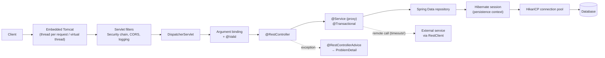

# Java — Spring Boot (lean revision set)

[← Back to Java](../README.md)

Baseline: **Spring Boot 3.5 / Spring Framework 6 / Java 21.** Focus: *how it works*, the traps interviewers probe, and the failure modes (proxies, transactions, lazy loading, error propagation).

> [!NOTE]
> **Verification status:** unlike the plain-Java notes, these Spring notes were **written without running the samples**. They follow standard Spring Boot 3.x behaviour, but run anything you intend to rely on (a scratch Boot project + the tips in each note makes that quick).

| # | Note | You will learn |
|---|------|----------------|
| 1 | [IoC, DI & auto-configuration](01-ioc-di-and-auto-configuration.md) | Constructor injection, scopes & the prototype trap, **bean lifecycle order**, circular deps, how auto-config/`@Conditional` works, config precedence, `@ConfigurationProperties` |
| 2 | [Proxies, transactions & async](02-proxies-transactions-async.md) | **Why `@Transactional`/`@Async`/`@Cacheable` fail on self-invocation**, AOP, **rollback rules**, propagation & isolation, `UnexpectedRollbackException`, bounded `@Async` executors |
| 3 | [JPA & Hibernate](03-jpa-hibernate.md) | Persistence context & dirty checking, lazy vs eager, **N+1 and its four fixes**, fetch-join pagination trap, open-in-view, `@Version`, Hikari |
| 4 | [REST, errors, security, testing & prod](04-rest-errors-security-testing.md) | DTOs & validation, **`@RestControllerAdvice` + `ProblemDetail` (502/503/504 mapping)**, `RestClient` with timeouts, **filter chain & JWT resource server**, test slices, Actuator checklist |
| 5 | [Interview Q&A sheet](05-spring-boot-interview-qa.md) | 45 rapid-fire questions + 8 scenario questions, each linking to the note |

## How a request flows through a Spring Boot app

## Revision checklist

- [ ] State the bean lifecycle order and where proxies are created
- [ ] Explain constructor injection, singleton ≠ thread-safe, prototype-in-singleton fix
- [ ] Explain how auto-configuration backs off and how to debug it (`--debug`)
- [ ] Explain proxy mechanics and list 4 ways `@Transactional` silently fails
- [ ] State the rollback rules, `REQUIRED` vs `REQUIRES_NEW`, and `UnexpectedRollbackException`
- [ ] Explain dirty checking, N+1 and the pagination + fetch-join trap
- [ ] Say why open-in-view should be off and what to do instead
- [ ] Design error handling: `ProblemDetail`, 502/503/504 mapping, no leaked internals
- [ ] Draw the security filter chain; explain 401 vs 403, JWT pitfalls, CSRF vs CORS
- [ ] Answer the 8 scenario questions in note 5 out loud

## Still to write
- [ ] Verified runnable example projects for the demos above (Maven + H2 + MockMvc)
- [ ] Plain JUnit 5 + Mockito testing note
- [ ] Spring Boot 4 / Framework 7 migration notes (check the official guide first)
