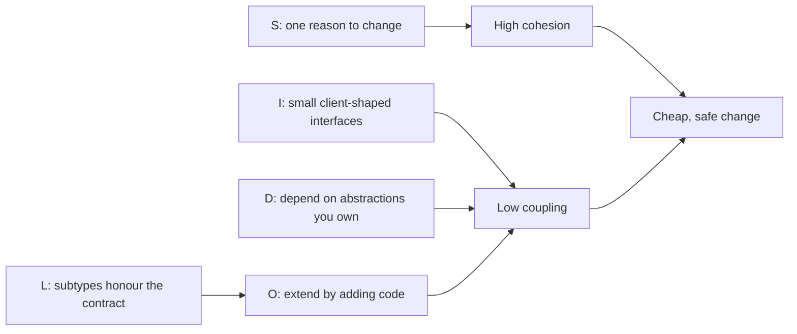
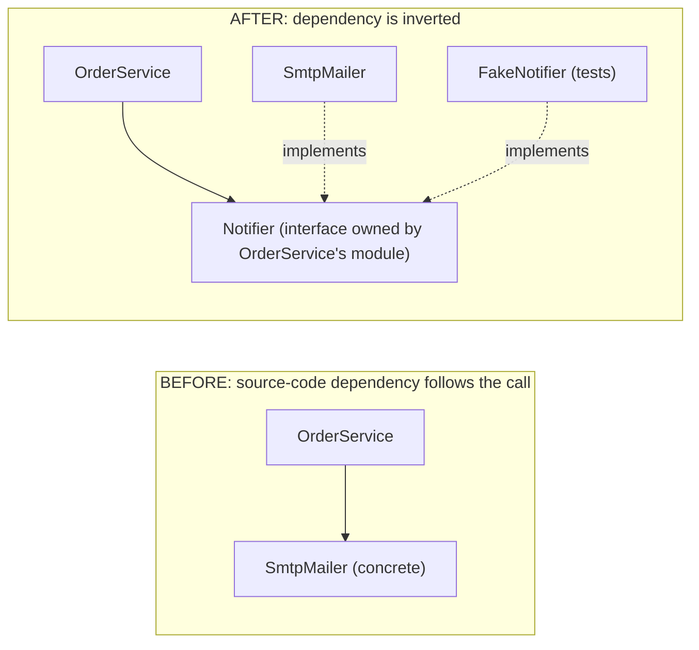

# SOLID & OOP Design: Principles, Smells and Modern Java

> **Level:** SDE-II / SDE-III · **Area:** Java · **Prev:** [Choosing the right tool](../01-java-basics/09-choosing-the-right-tool.md) · **Next:** [Design patterns](02-design-patterns.md)

## TL;DR

- **SOLID** is five *heuristics for keeping change cheap*, not laws: **S**ingle responsibility (one reason to change), **O**pen/closed (extend by adding, not editing), **L**iskov (a subtype must honour the parent's *contract*), **I**nterface segregation (small, client-shaped interfaces), **D**ependency inversion (high-level code owns the abstraction; details plug into it).
- The underlying ideas are **low coupling** (few, narrow dependencies) and **high cohesion** (things that change together live together). Every principle below is a different angle on those two.
- **Prefer composition to inheritance**: inheritance couples a child to the *implementation details* of its parent (fragile base class); composition couples only to a public interface.
- **Dependency injection** = pass collaborators in (constructor), build the object graph once at the edge (*composition root*). Spring just automates that wiring.
- **Tell, don't ask** + **Law of Demeter** + **immutability** push you toward *rich* objects that protect their own invariants, instead of *anemic* bags of getters/setters.
- Modern Java (records, sealed types, lambdas, pattern `switch`) makes several GoF patterns **one-liners** or **unnecessary** — know which.
- In an interview, the winning move is never to recite the acronym: it is to **show the violation, say what change hurts, refactor, and say when the principle is *not* worth applying**.

## The analogy: a restaurant kitchen

| Kitchen rule | Principle |
|---|---|
| The grill chef grills; the pastry chef bakes. A change in the dessert menu never touches the grill. | **S**RP |
| A new dish = hire/assign a *new station*; you don't rebuild the whole kitchen. | **O**CP |
| Any trained sous-chef can replace the head chef *for the tasks on the ticket*. A "chef" who refuses to touch fish breaks the contract. | **L**SP |
| The waiter gets a *waiter's* interface (take order, serve). They don't also need `cook()` and `orderStock()`. | **I**SP |
| The kitchen reads *order tickets* (an abstraction it defines). Whether the ticket came from a waiter, an app or a robot is irrelevant. | **D**IP |

## 1. SOLID at a glance



| Principle | Smell that tells you it is violated | Typical fix | Don't over-apply when… |
|---|---|---|---|
| **SRP** | A class changes for unrelated reasons; "and" in its description; 1000-line service | Split by *reason to change* (rules / formatting / storage) | The "responsibilities" always change together — splitting only adds indirection |
| **OCP** | `switch`/`if-else` on a type code that grows with every feature | Strategy / polymorphism / registry of rules | You have two cases and no sign of a third |
| **LSP** | Subclass throws `UnsupportedOperationException`, or `instanceof` checks after receiving the supertype | Don't inherit; extract a smaller interface; composition | — (this one is about correctness) |
| **ISP** | Implementers stub out methods; clients depend on methods they never call | Split into role interfaces | The interface is a stable, cohesive API (e.g. `List`) |
| **DIP** | `new ConcreteThing()` inside business logic; can't unit-test without a DB/SMTP | Constructor-inject an interface the *consumer* owns | Pure value objects and trivial helpers — just `new` them |

## 2. S — Single Responsibility: *one reason to change*

SRP is **not** "a class does one thing" (every class "does one thing" if you describe it vaguely). Uncle Bob's wording: *a module should have one reason to change — one **actor** it answers to.* If finance changes the tax rule, design changes the invoice layout and ops changes the database, three different people edit the same class and collide.

```java
// Run: SrpDemo.java
import java.util.*;

public class SrpDemo {
    record Item(String name, int qty, double price) {}

    // ---------- BEFORE: pricing + layout + storage in one class (3 reasons to change) ----------
    static class InvoiceManagerBad {
        double total(List<Item> items) {
            double net = 0;
            for (Item i : items) net += i.qty() * i.price();
            return net * 1.18;                                        // tax rule hard-coded here
        }
        String render(List<Item> items) {
            StringBuilder sb = new StringBuilder("INVOICE\n");        // layout lives here
            for (Item i : items) sb.append("  ").append(i.name()).append(" x").append(i.qty()).append('\n');
            return sb.append("  TOTAL ").append(String.format("%.2f", total(items))).toString();
        }
        void save(String text) { System.out.println("  [bad] INSERT INTO invoices ... (" + text.length() + " chars)"); }
    }

    // ---------- AFTER: each class answers to ONE actor ----------
    interface TaxPolicy { double apply(double net); }                  // finance
    static class PricingService {                                      // finance
        private final TaxPolicy tax;
        PricingService(TaxPolicy tax) { this.tax = tax; }
        double total(List<Item> items) { return tax.apply(items.stream().mapToDouble(i -> i.qty() * i.price()).sum()); }
    }
    static class InvoiceRenderer {                                     // design/UX
        String render(List<Item> items, double total) {
            StringBuilder sb = new StringBuilder("INVOICE\n");
            items.forEach(i -> sb.append("  ").append(i.name()).append(" x").append(i.qty()).append('\n'));
            return sb.append("  TOTAL ").append(String.format("%.2f", total)).toString();
        }
    }
    interface InvoiceStore { void save(String text); }                 // ops / DBA
    static class InvoiceService {                                      // orchestration only
        private final PricingService pricing; private final InvoiceRenderer renderer; private final InvoiceStore store;
        InvoiceService(PricingService p, InvoiceRenderer r, InvoiceStore s) { pricing = p; renderer = r; store = s; }
        String issue(List<Item> items) {
            String text = renderer.render(items, pricing.total(items));
            store.save(text);
            return text;
        }
    }

    public static void main(String[] args) {
        List<Item> items = List.of(new Item("keyboard", 1, 1000), new Item("mouse", 2, 250));

        System.out.println("BEFORE:");
        InvoiceManagerBad bad = new InvoiceManagerBad();
        String text = bad.render(items);
        bad.save(text);
        System.out.println(text);

        System.out.println("AFTER (18% tax):");
        InvoiceStore console = t -> System.out.println("  [store] saved " + t.length() + " chars");
        System.out.println(new InvoiceService(new PricingService(n -> n * 1.18), new InvoiceRenderer(), console).issue(items));

        System.out.println("AFTER (finance changes tax to 5%; nothing else is edited):");
        System.out.println(new InvoiceService(new PricingService(n -> n * 1.05), new InvoiceRenderer(), console).issue(items));
    }
}
```

```text
BEFORE:
  [bad] INSERT INTO invoices ... (48 chars)
INVOICE
  keyboard x1
  mouse x2
  TOTAL 1770.00
AFTER (18% tax):
  [store] saved 48 chars
INVOICE
  keyboard x1
  mouse x2
  TOTAL 1770.00
AFTER (finance changes tax to 5%; nothing else is edited):
  [store] saved 48 chars
INVOICE
  keyboard x1
  mouse x2
  TOTAL 1575.00
```

> **Interview angle:** "How do you decide where to split?" — *by who asks for the change*, and by what would you have to **re-test** after a change. If a tax tweak forces re-testing the HTML layout, the class has too many reasons to change.

## 3. O — Open/Closed: *open for extension, closed for modification*

You should be able to add behaviour by **adding** code, not by editing tested code. The classic enemy is a type-code `switch`.

```java
// Run: OcpDemo.java
import java.util.*;
import java.util.function.DoubleUnaryOperator;

public class OcpDemo {
    // ---------- BEFORE: every new customer type edits this method (and its tests) ----------
    static double discountBad(String type, double amount) {
        switch (type) {
            case "REGULAR": return amount;
            case "GOLD":    return amount * 0.90;
            case "VIP":     return amount * 0.80;
            default: throw new IllegalArgumentException("unknown type " + type);
            // adding "STUDENT" => edit here, re-test everything, risk breaking GOLD
        }
    }

    // ---------- AFTER: a rule is data; the engine never changes ----------
    interface DiscountRule { String type(); double apply(double amount); }
    record Rule(String type, DoubleUnaryOperator fn) implements DiscountRule {
        public double apply(double amount) { return fn.applyAsDouble(amount); }
    }
    static class PricingEngine {
        private final Map<String, DiscountRule> rules = new LinkedHashMap<>();
        PricingEngine register(DiscountRule r) { rules.put(r.type(), r); return this; }
        double price(String type, double amount) {
            DiscountRule r = rules.get(type);
            if (r == null) throw new IllegalArgumentException("unknown type " + type);
            return r.apply(amount);
        }
    }

    public static void main(String[] args) {
        System.out.println("bad  GOLD 1000    = " + discountBad("GOLD", 1000));

        PricingEngine engine = new PricingEngine()
            .register(new Rule("REGULAR", a -> a))
            .register(new Rule("GOLD",    a -> a * 0.90))
            .register(new Rule("VIP",     a -> a * 0.80));
        System.out.println("good GOLD 1000    = " + engine.price("GOLD", 1000));

        // a NEW requirement arrives: we only ADD a line; PricingEngine and the other rules are untouched
        engine.register(new Rule("STUDENT", a -> Math.max(0, a - 150)));
        System.out.println("good STUDENT 1000 = " + engine.price("STUDENT", 1000));

        try { engine.price("ALIEN", 10); } catch (IllegalArgumentException e) { System.out.println("unknown      -> " + e.getMessage()); }
    }
}
```

```text
bad  GOLD 1000    = 900.0
good GOLD 1000    = 900.0
good STUDENT 1000 = 850.0
unknown      -> unknown type ALIEN
```

> [!NOTE]
> OCP is **not** "never edit a class". It says: identify the axis of change that *keeps happening* and put a seam (interface, lambda, registry) exactly there. Adding the seam too early is *speculative generality* (see smells). A good rule: **the first time, write the `switch`; the second time, notice; the third time, refactor to a seam.**
>
> **Sealed types invert the trade-off on purpose:** a `sealed` hierarchy is deliberately *closed* so the compiler can check every `switch` for exhaustiveness (section 12 and the Visitor note in [design patterns](02-design-patterns.md)). Use polymorphism when **new types** appear often; use sealed + `switch` when **new operations** appear often (the "expression problem").

## 4. L — Liskov Substitution: *subtypes must honour the contract*

*If `S` is a subtype of `T`, code written against `T` must keep working when handed an `S`* — **without** knowing about `S`. It is about **behavioural** compatibility, not just "compiles":

| Rule | Meaning | Violation example |
|---|---|---|
| Preconditions can't be **strengthened** | child accepts at least what parent accepted | child rejects `null` the parent accepted |
| Postconditions can't be **weakened** | child promises at least what parent promised | child returns `null` where parent never did |
| **Invariants** must be preserved | rules the parent always keeps | `Square` breaks "width and height vary independently" |
| No **new checked/surprising exceptions** | child can't throw what parent's clients didn't expect | `UnsupportedOperationException` from an inherited method |
| **History constraint** | child can't mutate state the parent made immutable | |

```java
// Run: LspDemo.java
import java.util.*;

public class LspDemo {
    // ---------- BEFORE: "a square IS-A rectangle" (true in maths, false in behaviour) ----------
    static class Rectangle {
        protected int w, h;
        void setWidth(int w)  { this.w = w; }
        void setHeight(int h) { this.h = h; }
        int area() { return w * h; }
    }
    static class Square extends Rectangle {
        @Override void setWidth(int w)  { this.w = w; this.h = w; }    // keeps itself square...
        @Override void setHeight(int h) { this.w = h; this.h = h; }    // ...but breaks the Rectangle contract
    }
    /** Client code written against Rectangle's contract: width and height are independent. */
    static void stretch(Rectangle r) {
        r.setWidth(5); r.setHeight(4);
        System.out.println("  " + r.getClass().getSimpleName() + " area = " + r.area() + "   (client expected 20)");
    }

    // ---------- AFTER: no false inheritance; share only what is truly common ----------
    sealed interface Shape permits Rect, Sq { double area(); }
    record Rect(int w, int h) implements Shape { public double area() { return w * h; } }
    record Sq(int side)       implements Shape { public double area() { return side * side; } }

    public static void main(String[] args) {
        System.out.println("BEFORE (inheritance):");
        stretch(new Rectangle());
        stretch(new Square());                                         // LSP broken: same call, different truth

        System.out.println("AFTER (separate immutable types):");
        for (Shape s : List.of(new Rect(5, 4), new Sq(4))) System.out.println("  " + s + " area = " + s.area());

        System.out.println("The JDK itself bends LSP (known wart):");
        List<Integer> fixedSize = Arrays.asList(1, 2, 3);
        List<Integer> immutable = List.of(1, 2, 3);
        for (List<Integer> l : List.of(fixedSize, immutable)) {
            try { l.add(4); System.out.println("  add ok"); }
            catch (UnsupportedOperationException e) { System.out.println("  " + l.getClass().getName() + ".add -> UnsupportedOperationException"); }
        }
    }
}
```

```text
BEFORE (inheritance):
  Rectangle area = 20   (client expected 20)
  Square area = 16   (client expected 20)
AFTER (separate immutable types):
  Rect[w=5, h=4] area = 20.0
  Sq[side=4] area = 16.0
The JDK itself bends LSP (known wart):
  java.util.Arrays$ArrayList.add -> UnsupportedOperationException
  java.util.ImmutableCollections$ListN.add -> UnsupportedOperationException
```

Practical LSP checks: a subclass that **throws `UnsupportedOperationException`**, returns a **no-op**, or forces callers to write `if (x instanceof Special)` is telling you the hierarchy is wrong. Fix by **splitting the interface** (ISP), **composing** instead of inheriting, or making the types **immutable & separate** as above. (The JDK's pragmatic compromise: the `Collection` contract explicitly marks mutators *optional*, so `UnsupportedOperationException` is "allowed" — convenient, but it means a `List` parameter can never be assumed mutable.)

## 5. I — Interface Segregation: *don't force clients to depend on what they don't use*

```java
// Run: IspDemo.java
public class IspDemo {
    // ---------- BEFORE: one fat interface ----------
    interface MultiFunctionDevice { void print(String doc); void scan(String doc); void fax(String doc); }
    static class OldPrinter implements MultiFunctionDevice {
        public void print(String doc) { System.out.println("  printing " + doc); }
        public void scan(String doc)  { throw new UnsupportedOperationException("can't scan"); }   // forced to lie
        public void fax(String doc)   { throw new UnsupportedOperationException("can't fax"); }
    }

    // ---------- AFTER: role interfaces, shaped by the CLIENT's need ----------
    interface Printer { void print(String doc); }
    interface Scanner { void scan(String doc); }
    interface Fax     { void fax(String doc); }
    static class BasicPrinter implements Printer { public void print(String d) { System.out.println("  printing " + d); } }
    static class OfficeMachine implements Printer, Scanner, Fax {
        public void print(String d) { System.out.println("  printing " + d); }
        public void scan(String d)  { System.out.println("  scanning " + d); }
        public void fax(String d)   { System.out.println("  faxing " + d); }
    }
    /** This client needs ONLY printing: it can accept both devices, and can't accidentally call scan(). */
    static void report(Printer p) { p.print("monthly-report.pdf"); }

    public static void main(String[] args) {
        System.out.println("BEFORE:");
        MultiFunctionDevice d = new OldPrinter();
        d.print("a.pdf");
        try { d.scan("a.pdf"); } catch (UnsupportedOperationException e) { System.out.println("  runtime failure: " + e.getMessage()); }

        System.out.println("AFTER:");
        report(new BasicPrinter());
        report(new OfficeMachine());
        // new BasicPrinter().scan("x");   // does not compile: the mistake moved from run time to compile time
    }
}
```

```text
BEFORE:
  printing a.pdf
  runtime failure: can't scan
AFTER:
  printing monthly-report.pdf
  printing monthly-report.pdf
```

ISP is the *client-side* view of cohesion: **the consumer defines the interface it needs**. It is why `java.util.function` has 40+ tiny interfaces, why `Comparable` and `Comparator` are separate, and why Spring Data has `CrudRepository` / `PagingAndSortingRepository` layers.

## 6. D — Dependency Inversion (vs Dependency Injection vs IoC)

Three different things that interviewers love to blur:

| Term | What it is |
|---|---|
| **DIP** (principle) | High-level policy must not depend on low-level details; **both depend on an abstraction, owned by the high-level side** (`OrderService` defines `Notifier`; SMTP *implements* it). |
| **DI** (technique) | Don't `new` your collaborators — receive them (constructor, setter, parameter). |
| **IoC** (idea) | *You* don't control the flow/wiring; a **framework** calls you ("Hollywood principle": don't call us, we'll call you). A **container** (Spring) is one IoC implementation. |



```java
// Run: DipDemo.java
import java.util.*;

public class DipDemo {
    // ---------- BEFORE: the high-level class constructs the low-level detail ----------
    static class SmtpMailer { void send(String to, String body) { System.out.println("  [SMTP] REAL email to " + to); } }
    static class OrderServiceBad {
        private final SmtpMailer mailer = new SmtpMailer();         // hard-wired: can't test without sending email
        void place(String user) { mailer.send(user, "order placed"); }
    }

    // ---------- AFTER: depend on an abstraction the high-level module owns ----------
    interface Notifier { void notify(String to, String message); }
    static class OrderService {
        private final Notifier notifier;                            // injected
        OrderService(Notifier notifier) { this.notifier = Objects.requireNonNull(notifier); }
        void place(String user) { notifier.notify(user, "order placed"); }
    }
    static class SmtpNotifier implements Notifier {                 // detail depends on the abstraction
        public void notify(String to, String msg) { System.out.println("  [SMTP] REAL email to " + to); }
    }
    static class RecordingNotifier implements Notifier {            // a FAKE for tests: no network, can be asserted on
        final List<String> sent = new ArrayList<>();
        public void notify(String to, String msg) { sent.add(to + ":" + msg); }
    }

    public static void main(String[] args) {
        System.out.println("BEFORE (test would send a real email):");
        new OrderServiceBad().place("asha@example.com");

        System.out.println("AFTER, production wiring:");
        new OrderService(new SmtpNotifier()).place("asha@example.com");

        System.out.println("AFTER, unit test wiring:");
        RecordingNotifier fake = new RecordingNotifier();
        new OrderService(fake).place("ravi@example.com");
        System.out.println("  captured = " + fake.sent);

        System.out.println("AFTER, lambda as the implementation (Notifier is a functional interface):");
        new OrderService((to, msg) -> System.out.println("  [LOG] " + to + " <- " + msg)).place("meera@example.com");
    }
}
```

```text
BEFORE (test would send a real email):
  [SMTP] REAL email to asha@example.com
AFTER, production wiring:
  [SMTP] REAL email to asha@example.com
AFTER, unit test wiring:
  captured = [ravi@example.com:order placed]
AFTER, lambda as the implementation (Notifier is a functional interface):
  [LOG] meera@example.com <- order placed
```

## 7. Composition over inheritance

Inheritance is **white-box reuse**: the child depends on *how* the parent works internally. Composition is **black-box reuse**: you hold a reference and call its public API. The classic proof (Effective Java, Item 18) is a counting `HashSet`:

```java
// Run: InheritanceTrap.java
import java.util.*;

public class InheritanceTrap {
    // ---------- BEFORE: inherit to "add counting" ----------
    static class CountingHashSet<E> extends HashSet<E> {
        int addCount = 0;
        @Override public boolean add(E e) { addCount++; return super.add(e); }
        @Override public boolean addAll(Collection<? extends E> c) { addCount += c.size(); return super.addAll(c); }
    }

    // ---------- AFTER: wrap (decorator) and delegate ----------
    interface Bag<E> { boolean add(E e); boolean addAll(Collection<? extends E> c); int size(); }
    static class SetBag<E> implements Bag<E> {
        private final Set<E> set = new HashSet<>();
        public boolean add(E e) { return set.add(e); }
        public boolean addAll(Collection<? extends E> c) { return set.addAll(c); }
        public int size() { return set.size(); }
    }
    static class CountingBag<E> implements Bag<E> {
        private final Bag<E> inner; int addCount = 0;                      // HAS-A, not IS-A
        CountingBag(Bag<E> inner) { this.inner = inner; }
        public boolean add(E e) { addCount++; return inner.add(e); }
        public boolean addAll(Collection<? extends E> c) { addCount += c.size(); return inner.addAll(c); }
        public int size() { return inner.size(); }
    }

    public static void main(String[] args) {
        CountingHashSet<String> s = new CountingHashSet<>();
        s.addAll(List.of("a", "b", "c"));
        System.out.println("inheritance: size=" + s.size() + " addCount=" + s.addCount + "   <- expected 3");

        CountingBag<String> b = new CountingBag<>(new SetBag<>());
        b.addAll(List.of("a", "b", "c"));
        System.out.println("composition: size=" + b.size() + " addCount=" + b.addCount + "   <- correct");
    }
}
```

```text
inheritance: size=3 addCount=6   <- expected 3
composition: size=3 addCount=3   <- correct
```

`HashSet.addAll` (really `AbstractCollection.addAll`) is **implemented by calling `add`** for each element — an undocumented-in-the-API implementation detail. The child double-counted. If a future JDK changed that, the child would silently change behaviour again. That is the **fragile base class problem**.

| Use inheritance when… | Use composition when… |
|---|---|
| a genuine **is-a** with LSP-safe behaviour; the parent was **designed for extension** (documented hooks — Template Method) | you want to reuse behaviour; you need to **swap it at run time**; you'd inherit from a class you don't control |
| the parent is an **abstract skeleton** (`AbstractList`, `HttpServlet`) | you'd otherwise want multiple inheritance |

Defensive Java defaults: classes are `final` unless designed for extension; fields `private final`; prefer `interface` + delegate; **"favour composition" ≠ "never inherit"**.

## 8. Coupling and cohesion

| | Low (good) / High (bad) | How to see it in code |
|---|---|---|
| **Coupling** — how much A must know about B | *Low*: A uses B via a small interface; *High*: A uses B's fields, concrete type, call order, internal exceptions | change in B forces edits in A (**shotgun surgery**); can't test A without B |
| **Cohesion** — how strongly a class's members belong together | *High*: every method uses most fields; *Low*: grab-bag `Utils`, `Manager`, `Helper` | methods that touch disjoint subsets of fields → split the class |

Types of coupling, worst to best: **content** (reaches into internals) → **common** (shared mutable global) → **control** (passes a flag that steers the callee) → **stamp** (passes a whole object when a field suffices) → **data** (passes only what's needed) → **message** (events/queues). A quick heuristic: *if I can describe the class's job without the word "and", cohesion is probably fine; if I can't draw its dependencies on a napkin, coupling is too high.*

## 9. Dependency injection by hand — and what Spring automates

Plain-Java DI needs only: (1) **constructor parameters** typed as interfaces, (2) **one place that builds the graph** — the *composition root* (usually `main`).

```java
// Run: DiByHand.java
import java.util.*;

public class DiByHand {
    interface UserRepository { Optional<String> findEmail(int userId); }
    interface Mailer        { void send(String to, String msg); }

    static class InMemoryUserRepository implements UserRepository {
        private final Map<Integer, String> data = Map.of(1, "asha@example.com", 2, "ravi@example.com");
        public Optional<String> findEmail(int id) { return Optional.ofNullable(data.get(id)); }
    }
    static class ConsoleMailer implements Mailer { public void send(String to, String m) { System.out.println("  mail -> " + to + ": " + m); } }

    /** Business class: no `new`, no static lookups, no framework. Dependencies are explicit & final. */
    static class WelcomeService {
        private final UserRepository users; private final Mailer mailer;
        WelcomeService(UserRepository users, Mailer mailer) { this.users = users; this.mailer = mailer; }
        boolean welcome(int userId) {
            return users.findEmail(userId).map(email -> { mailer.send(email, "Welcome!"); return true; }).orElse(false);
        }
    }

    // ---- the COMPOSITION ROOT: the only place that knows concrete types -----------------------------
    public static void main(String[] args) {
        UserRepository repo = new InMemoryUserRepository();
        Mailer mailer = new ConsoleMailer();
        WelcomeService service = new WelcomeService(repo, mailer);        // <- this line is what Spring does for you
        System.out.println("welcome(1) = " + service.welcome(1));
        System.out.println("welcome(9) = " + service.welcome(9));

        // ---- unit test = same class, different wiring (no mocking framework needed) ----
        List<String> sent = new ArrayList<>();
        WelcomeService underTest = new WelcomeService(id -> Optional.of("t@t"), (to, m) -> sent.add(to));
        underTest.welcome(5);
        System.out.println("test double captured: " + sent);
    }
}
```

```text
  mail -> asha@example.com: Welcome!
welcome(1) = true
welcome(9) = false
test double captured: [t@t]
```

What Spring automates (display-only; details in the Spring section):

```java
@Service                                   // "this is a bean" (stereotype; found by component scan)
class WelcomeService {
    private final UserRepository users;    // final => immutable, thread-safe, test-friendly
    private final Mailer mailer;
    WelcomeService(UserRepository users, Mailer mailer) { ... }   // single constructor => @Autowired implied (Spring 4.3+)
}
// The ApplicationContext is the composition root: it finds all beans, resolves constructor args BY TYPE
// (then by name/@Qualifier/@Primary if ambiguous), builds them in dependency order, and caches singletons.
```

| Style | Verdict |
|---|---|
| **Constructor injection** | Default choice: dependencies are mandatory, explicit, `final`; object can never exist half-built; trivial to unit-test with `new`. Many parameters (> 4-5) = the class has too many responsibilities (SRP smell). |
| **Setter injection** | Only for genuinely optional/re-configurable dependencies. |
| **Field injection** (`@Autowired private X x;`) | Avoid: hides dependencies, can't be `final`, needs reflection/the container to test, easy to create circular dependencies silently. |

Circular dependency (`A → B → A`) is a *design* smell: extract the shared piece into a third class, or invert one edge with an interface/event. Spring Boot 2.6+ **forbids** circular references by default.

## 10. Tell, don't ask · Law of Demeter · anemic vs rich domain model

- **Tell, don't ask:** don't pull an object's state out, decide, and push state back (`if (acct.getBalance() >= x) acct.setBalance(acct.getBalance() - x)`). *Tell* the object what you want (`acct.withdraw(x)`) and let it enforce its own rules.
- **Law of Demeter ("only talk to your immediate friends"):** a method should call methods only on: `this`, its parameters, objects it creates, and its direct fields. Chains like `order.getCustomer().getAddress().getCity()` are **"train wrecks"**: the caller is coupled to the *structure* of three classes. (A fluent `Builder` or `stream().filter().map()` chain is **not** a violation: it returns the *same abstraction* each step — the law is about navigating *through* other objects.)
- **Anemic domain model:** entities are bags of getters/setters; all logic lives in `XxxService` classes. Invariants can be bypassed by *anyone* with a setter. **Rich domain model:** the entity owns its invariants and exposes behaviour. (Pragmatic note: with JPA/Hibernate, entities need a no-arg constructor and often setters; keep *state transitions* behind methods and keep setters package-private/`protected` where you can.)

```java
// Run: RichModelDemo.java
public class RichModelDemo {
    // ---------- BEFORE: anemic model + service holding the rules ----------
    static class AccountData {
        private long balance;
        public long getBalance() { return balance; }
        public void setBalance(long b) { this.balance = b; }          // anyone can set ANYTHING
    }
    static class AccountService {
        void withdraw(AccountData a, long amt) {
            if (a.getBalance() >= amt) a.setBalance(a.getBalance() - amt);   // ASK, decide, push back
            else throw new IllegalStateException("insufficient funds");
        }
    }

    // ---------- AFTER: rich model, invariant lives with the data ----------
    static class Account {
        private long balance;
        Account(long opening) { if (opening < 0) throw new IllegalArgumentException("negative opening balance"); balance = opening; }
        void withdraw(long amt) {                                      // TELL
            if (amt <= 0) throw new IllegalArgumentException("amount must be positive");
            if (amt > balance) throw new IllegalStateException("insufficient funds");
            balance -= amt;
        }
        long balance() { return balance; }
    }

    // ---------- Law of Demeter ----------
    static class Address  { private final String city; Address(String c) { city = c; } String city() { return city; } }
    static class Customer { private final Address address; Customer(Address a) { address = a; } Address address() { return address; } }
    static class Order    {
        private final Customer customer; Order(Customer c) { customer = c; }
        Customer customer() { return customer; }                        // exposes structure
        String shippingCity() { return customer.address().city(); }     // Order hides the path: callers talk to Order only
    }

    public static void main(String[] args) {
        AccountData anemic = new AccountData();
        anemic.setBalance(100);
        new AccountService().withdraw(anemic, 30);
        anemic.setBalance(-5000);                                       // nothing stops a rogue caller
        System.out.println("anemic balance after a buggy caller = " + anemic.getBalance());

        Account rich = new Account(100);
        rich.withdraw(30);
        try { rich.withdraw(500); } catch (IllegalStateException e) { System.out.println("rich model refuses: " + e.getMessage()); }
        System.out.println("rich balance = " + rich.balance() + "  (no setter exists, so it cannot go negative)");

        Order o = new Order(new Customer(new Address("Pune")));
        System.out.println("train wreck : " + o.customer().address().city());   // coupled to 3 classes
        System.out.println("demeter     : " + o.shippingCity());                // coupled to 1
    }
}
```

```text
anemic balance after a buggy caller = -5000
rich model refuses: insufficient funds
rich balance = 70  (no setter exists, so it cannot go negative)
train wreck : Pune
demeter     : Pune
```

## 11. Immutability: the cheapest design improvement

Immutable objects are **thread-safe for free**, safe as map keys, safe to share and cache, and make reasoning local. Checklist for a class: `final` class, `private final` fields, no setters, **defensive copies** of mutable inputs *and* outputs, no `this` escape from the constructor. Records give you the first four for free — but only **shallow** immutability.

```java
// Run: ImmutableDemo.java
import java.time.LocalDate;
import java.util.*;

public class ImmutableDemo {
    // A record with an invariant (compact constructor) and a "wither" instead of a setter
    record DateRange(LocalDate from, LocalDate to) {
        DateRange {
            Objects.requireNonNull(from); Objects.requireNonNull(to);
            if (to.isBefore(from)) throw new IllegalArgumentException("to < from");
        }
        DateRange withTo(LocalDate newTo) { return new DateRange(from, newTo); }   // returns a NEW value
    }

    // Record holding a mutable List: SHALLOW immutability bites
    record LeakyTeam(List<String> members) {}
    // Fix: copy in the compact constructor (List.copyOf is immutable and rejects null elements)
    record SafeTeam(List<String> members) { SafeTeam { members = List.copyOf(members); } }

    public static void main(String[] args) {
        DateRange r = new DateRange(LocalDate.of(2026, 1, 1), LocalDate.of(2026, 1, 10));
        System.out.println(r + "  ->  " + r.withTo(LocalDate.of(2026, 2, 1)) + "  (original unchanged: " + r.to() + ")");
        try { new DateRange(LocalDate.of(2026, 5, 1), LocalDate.of(2026, 4, 1)); }
        catch (IllegalArgumentException e) { System.out.println("invalid state is unrepresentable: " + e.getMessage()); }

        List<String> source = new ArrayList<>(List.of("asha", "ravi"));
        LeakyTeam leaky = new LeakyTeam(source);
        SafeTeam safe = new SafeTeam(source);
        source.add("INTRUDER");                                       // mutation through the original reference
        System.out.println("leaky  = " + leaky.members() + "   <- changed behind the record's back");
        System.out.println("safe   = " + safe.members());
        try { safe.members().add("x"); } catch (UnsupportedOperationException e) { System.out.println("safe.members().add -> UnsupportedOperationException"); }
    }
}
```

```text
DateRange[from=2026-01-01, to=2026-01-10]  ->  DateRange[from=2026-01-01, to=2026-02-01]  (original unchanged: 2026-01-10)
invalid state is unrepresentable: to < from
leaky  = [asha, ravi, INTRUDER]   <- changed behind the record's back
safe   = [asha, ravi]
safe.members().add -> UnsupportedOperationException
```

> [!WARNING]
> `final` on a field makes the **reference** final, not the object. `private final List<String> items = new ArrayList<>()` plus `getItems()` returning it is **not** immutable. Return `List.copyOf(items)` / `Collections.unmodifiableList(items)` (a *view* — still changes if you mutate the backing list) or an immutable copy. Also beware `Date`/arrays/`StringBuilder` in fields.

## 12. How modern Java changes the classic patterns

| Classic GoF / OOP thing | Modern Java replacement | Note |
|---|---|---|
| **Strategy**, **Command**, **Template Method callbacks**, **Observer** (single callback) | a **lambda / method reference** for any `@FunctionalInterface` (`Comparator`, `Runnable`, `Function`) | A class is still right when the strategy has state, several methods or a name worth documenting |
| **Visitor** | `sealed interface` + `record`s + pattern-matching `switch` (exhaustive, no `accept()` boilerplate) | see [patterns, section 14](02-design-patterns.md) |
| **Singleton** | `enum` with one constant, or just **one bean/instance** from the DI container | avoids reflection/serialization holes |
| **Builder** (for immutable data) | **records** + compact constructor + `withX` methods; builder only for many optional params | Lombok `@Builder` still common |
| **Value object / DTO / tuple** | **`record`** | [records vs classes](../01-java-basics/09-choosing-the-right-tool.md) |
| **State** (small, enum-like) | `enum` with per-constant behaviour, or sealed records returning the next state | [LLD: vending machine](03-lld-interview-problems.md) |
| **Null Object / "maybe" values** | `Optional<T>` return types, `List.of()` / `Collections.emptyList()` | |
| **Factory** (selecting an implementation) | `Map<String, Supplier<T>>`, or `static of(...)` factory methods, or DI | |
| **Result/Either type for expected failures** | sealed `Result<T>` with `Ok`/`Err` records | below |
| **Iterator** (hand-written) | `Iterable` + enhanced `for`; `Stream`/`Iterator` from the library; (Java 21: `SequencedCollection`) | |

Making illegal states unrepresentable with a sealed `Result` (type-safe alternative to returning `null` or throwing for *expected* failures):

```java
// Run: SealedResultDemo.java
import java.util.function.Function;

public class SealedResultDemo {
    sealed interface Result<T> permits Ok, Err {}
    record Ok<T>(T value) implements Result<T> {}
    record Err<T>(String reason) implements Result<T> {}

    static Result<Integer> parseAge(String s) {
        try {
            int n = Integer.parseInt(s.trim());
            return (n < 0 || n > 150) ? new Err<>("out of range: " + n) : new Ok<>(n);
        } catch (NumberFormatException e) {
            return new Err<>("not a number: '" + s + "'");
        }
    }

    static <T, R> Result<R> map(Result<T> r, Function<T, R> f) {
        return switch (r) {                                 // exhaustive: no default needed, compiler checks Ok + Err
            case Ok<T> ok   -> new Ok<>(f.apply(ok.value()));
            case Err<T> err -> new Err<>(err.reason());
        };
    }

    public static void main(String[] args) {
        for (String in : new String[] {"42", "abc", "200"}) {
            Result<String> r = map(parseAge(in), age -> age >= 18 ? "adult" : "minor");
            String text = switch (r) {
                case Ok<String> ok   -> "OK   -> " + ok.value();
                case Err<String> err -> "FAIL -> " + err.reason();
            };
            System.out.println("'" + in + "' " + text);
        }
    }
}
```

```text
'42' OK   -> adult
'abc' FAIL -> not a number: 'abc'
'200' FAIL -> out of range: 200
```

> Add a third permitted subtype (`Pending`) and **every `switch` that lacks a branch stops compiling** — that is OCP-for-operations done by the compiler.

## 13. Code smells interviewers ask you to critique

When shown a code snippet, name the smell, say *what change would hurt*, and propose the refactoring.

| Smell | What you see | Why it hurts | Refactoring |
|---|---|---|---|
| **God class / Blob** | `OrderManager` with 40 methods, 15 fields | many reasons to change; merge conflicts; untestable | Extract class by responsibility (SRP) |
| **Long method** | 80-line method with comments dividing "sections" | can't test/reuse parts | Extract method; replace temp with query |
| **Long parameter list** | `create(a,b,c,d,e,f,g)` | easy to swap args; callers fragile | Introduce parameter object / record / builder |
| **Primitive obsession** | `String email`, `double price`, `int status` everywhere | no validation, no behaviour, mix-ups (`long userId` vs `long orderId`) | Value objects: `Email`, `Money`, enum |
| **Switch on type / flag** | `if (type == CREDIT) … else if (type == DEBIT)` repeated in many methods | shotgun surgery per new type (OCP) | Polymorphism / Strategy / sealed + `switch` |
| **Boolean flag parameter** | `render(doc, true, false)` | unreadable; method does two things | Two methods, or an enum/options object |
| **Feature envy** | method uses another object's getters more than its own fields | logic lives away from its data | Move method to the data's class (tell, don't ask) |
| **Message chains** | `a.getB().getC().getD()` | Demeter violation, structural coupling | Hide delegate / ask the first object |
| **Inappropriate intimacy** | two classes reach into each other's internals | can't change either alone | Move members; introduce interface |
| **Shotgun surgery** | one change touches 10 classes | logic scattered | Move/inline classes into one cohesive unit |
| **Divergent change** | one class edited for many unrelated reasons | low cohesion | Split class |
| **Data clumps** | the same 3 params (`street, city, zip`) travel together | missing concept | Extract `Address` record |
| **Mutable shared state / static** | `static Map cache`, public setters, singletons holding state | hidden coupling, thread-unsafe, order-dependent tests | Inject dependencies; immutability; scope state |
| **Anemic domain model** | entities = getters/setters, rules in services | invariants bypassable | Rich model (section 10) |
| **Inheritance for reuse** | `Stack extends Vector`, `Properties extends Hashtable` | exposes inherited API, fragile base class | Composition (section 7) |
| **Speculative generality** | interfaces with one impl "for the future", unused hooks | indirection with no payoff | Inline until a 2nd case appears (YAGNI) |
| **Exceptions as control flow / swallowed exceptions** | `catch (Exception e) {}` or using exceptions for normal branching | hides bugs, slow, loses cause | Specific catches, `Optional`/`Result` for expected cases |
| **Returning `null` for collections/"nothing"** | `return null` instead of empty list | NPE for every caller | Empty collection, `Optional`, Null Object |
| **Magic numbers/strings** | `if (status == 3)` | unreadable | Named constant / enum |
| **Comments explaining what** | `// check if user is adult` over `x > 17` | comment rots | Rename / extract method (`isAdult()`) |

### Critique this snippet (display-only)

```java
public class OrderManager {                                 // (1)
    public static Map<Integer, Order> cache = new HashMap<>();   // (2)
    public double process(Order o, boolean express, boolean gift, String type) {   // (3)
        double total = 0;
        for (Item i : o.getItems()) total += i.getPrice() * i.getQty();           // (4)
        if (type.equals("CARD")) { total = total * 1.02; }
        else if (type.equals("UPI")) { total = total * 1.0; }
        else if (type.equals("COD")) { total = total + 50; }                      // (5)
        if (o.getCustomer().getAddress().getCountry().equals("IN")) total *= 1.18; // (6)
        new SmtpMailer().send(o.getCustomer().getEmail(), "Total: " + total);     // (7)
        cache.put(o.getId(), o);
        return total;
    }
}
```

1. **God class / "Manager"** name, does pricing + payment fees + tax + email + caching (SRP).
2. **Public static mutable `HashMap`**: global state, not thread-safe, leaks entities, impossible to isolate in tests.
3. **Boolean flags + stringly-typed `type`** (unused flags `express`, `gift` = dead parameters; `type` should be an enum/strategy).
4. **Feature envy** — pricing logic belongs on `Order`/`Item` (`order.subtotal()`); **`double` for money** (use `BigDecimal`/minor units + currency).
5. **Type-code `if` chain** → OCP violation; each payment method is a `FeeStrategy`.
6. **Message chain** (Demeter): `getCustomer().getAddress().getCountry()` → `order.shippingCountry()`; **tax** is a separate policy.
7. **`new SmtpMailer()`** inside business logic → DIP violation; side effect mid-calculation (a `process` that also *emails* is not a calculation).

## 14. Pitfalls

> [!WARNING]
> - **Principle worship / over-engineering:** an interface per class, a factory per interface, three layers for a CRUD endpoint. Apply a principle when you can *name the change* it protects against.
> - **SRP ≠ "one method per class".** Splitting cohesive logic scatters it and creates *shotgun surgery*.
> - **DRY misapplied:** merging two pieces of code that merely *look* alike but change for different reasons couples unrelated features. Duplication is cheaper than the wrong abstraction.
> - **LSP is about behaviour**, so a clean compile proves nothing. Test subtypes against the **parent's contract tests**.
> - **"Interface with one implementation"** is fine at architectural boundaries (DB, HTTP, clock) and noise inside a module.
> - **Setter/field injection of mandatory deps** lets objects exist half-built (NPE later) — use constructors.
> - **Inheriting just to reuse code** (`class Order extends ArrayList<Item>`): you now *are* a list, with 25 public methods you didn't want.

## 15. Interview Q&A

<details>
<summary><b>Q1.</b> Explain SOLID with one concrete example each.</summary>

**S** — split `InvoiceManager` into pricing, rendering, storage (they answer to finance, design, ops). **O** — replace a `switch(customerType)` with a registry of `DiscountRule`s so adding STUDENT is a new line. **L** — `Square extends Rectangle` breaks client code that sets width and height independently; model them as separate immutable shapes. **I** — split `MultiFunctionDevice` into `Printer`/`Scanner`/`Fax` so a basic printer isn't forced to throw. **D** — `OrderService` depends on a `Notifier` interface it owns; SMTP and test fakes implement it. (Then volunteer *when not to*: over-abstraction.)
</details>

<details>
<summary><b>Q2.</b> What's the difference between DIP, DI and IoC?</summary>

DIP is a *design principle* about the direction of source-code dependencies (depend on abstractions owned by the high-level module). DI is a *technique* — receiving collaborators instead of creating them. IoC is the broader *control inversion*: a framework/container calls your code and wires it. Spring's container does IoC and implements DI so you can follow DIP.
</details>

<details>
<summary><b>Q3.</b> Why is <code>Square extends Rectangle</code> a Liskov violation?</summary>

Because `Rectangle`'s contract says `setWidth` doesn't change height. `Square` must change both to stay square, so code that sets width=5, height=4 and expects area 20 gets 16. The subtype strengthens an invariant (w == h) that the parent didn't have; behaviour — not syntax — is incompatible. Fix: separate immutable types behind a `Shape` interface.
</details>

<details>
<summary><b>Q4.</b> Why prefer composition over inheritance?</summary>

Inheritance exposes the child to the parent's implementation details (fragile base class — e.g. `HashSet.addAll` calling `add` double-counts in a counting subclass), publishes the whole parent API, is fixed at compile time and single. Composition couples only to an interface, is swappable at run time, and is easier to test. Inherit only for genuine is-a relationships with a class designed for extension.
</details>

<details>
<summary><b>Q5.</b> Constructor vs field vs setter injection — which and why?</summary>

Constructor by default: mandatory dependencies are explicit and `final`, the object is never half-constructed, it's trivially unit-testable with `new`, and too many constructor params exposes an SRP problem. Setter for optional/reconfigurable. Field injection hides dependencies, prevents `final`, depends on reflection/container for tests and hides cycles.
</details>

<details>
<summary><b>Q6.</b> What is the Law of Demeter and is a fluent builder/stream chain a violation?</summary>

A unit should only call methods of itself, its parameters, objects it creates and its direct components — not "reach through" them. `a.getB().getC().doX()` couples you to the structure of B and C. Fluent chains (`builder.a().b().build()`, `stream().map().filter()`) return the *same* kind of object at each step and are not navigation through someone's internals.
</details>

<details>
<summary><b>Q7.</b> Anemic vs rich domain model — which is better?</summary>

Rich models keep invariants and state transitions next to the data (`account.withdraw`), so invalid states are unrepresentable and logic isn't duplicated across services. Anemic models are quick for CRUD and map directly to JPA/DTOs but let any caller bypass rules. Pragmatic: rich *core domain* (money, state machines), thin/anemic for plain CRUD; services orchestrate use cases and transactions rather than owning every rule.
</details>

<details>
<summary><b>Q8.</b> How do records and sealed types change OOP design in Java 17/21?</summary>

Records replace boilerplate value objects (and many builders/DTOs); sealed interfaces + pattern-matching `switch` model closed alternatives with compiler-checked exhaustiveness (replacing Visitor); lambdas replace one-method Strategy/Command classes. Net effect: more data-oriented, immutable, algebraic-style code where appropriate, with classes reserved for identity/stateful services.
</details>

<details>
<summary><b>Q9.</b> When would you intentionally violate OCP or SRP?</summary>

When the axis of change isn't known yet (YAGNI — write the simple `switch` until the third case), when cohesive logic is small and always changes together, or for a sealed hierarchy where you *want* the compiler to force you to revisit every operation when a new variant appears.
</details>

<details>
<summary><b>Q10.</b> A class has 8 constructor parameters. What does it tell you?</summary>

Probably too many responsibilities (SRP) or a missing abstraction (data clump → value object / facade). Fix by splitting the class, grouping related parameters into a record, or introducing a facade over a cluster of collaborators — *not* by switching to field injection to hide the smell.
</details>

## 16. Predict the output / Spot the bug

<details>
<summary><b>P1.</b> What does this print? (counting subclass)</summary>

```java
class CountingList<E> extends ArrayList<E> {
    int adds;
    @Override public boolean add(E e) { adds++; return super.add(e); }
    @Override public boolean addAll(Collection<? extends E> c) { adds += c.size(); return super.addAll(c); }
}
var l = new CountingList<String>();
l.addAll(List.of("a", "b"));
System.out.println(l.adds);
```

```text
2
```
`ArrayList.addAll` copies the array directly and does **not** call `add`, so unlike `HashSet` there is no double count — correctness of the subclass depends on a parent's *unspecified* implementation, which is exactly the fragile-base-class problem.
</details>

<details>
<summary><b>P2.</b> Spot the bug (immutability leak)</summary>

```java
public final class Schedule {
    private final List<String> slots;
    public Schedule(List<String> slots) { this.slots = slots; }
    public List<String> getSlots() { return slots; }
}
var in = new ArrayList<>(List.of("9am"));
var s = new Schedule(in);
in.add("10am");
s.getSlots().add("11am");
System.out.println(s.getSlots());
```

```text
[9am, 10am, 11am]
```
`final` protects the reference, not the contents: both the constructor (stores the caller's list) and the getter (hands out the internal list) leak. Fix: `this.slots = List.copyOf(slots);` and return that (already immutable).
</details>

<details>
<summary><b>P3.</b> Which principle does this break and how do you fix it?</summary>

```java
interface Bird { void fly(); }
class Sparrow implements Bird { public void fly() { /* ok */ } }
class Penguin implements Bird { public void fly() { throw new UnsupportedOperationException(); } }
```

**LSP** (and ISP): code that takes any `Bird` and calls `fly()` breaks for `Penguin`. Split: `Bird` (eat, walk) and `FlyingBird extends Bird { void fly(); }`; methods that need flight accept `FlyingBird`.
</details>

---
[↑ Back to Design Patterns & LLD index](README.md)
