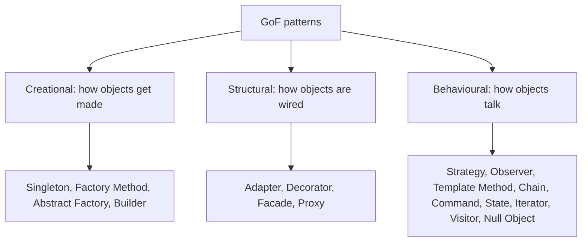
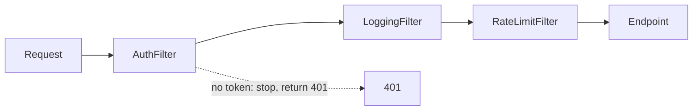
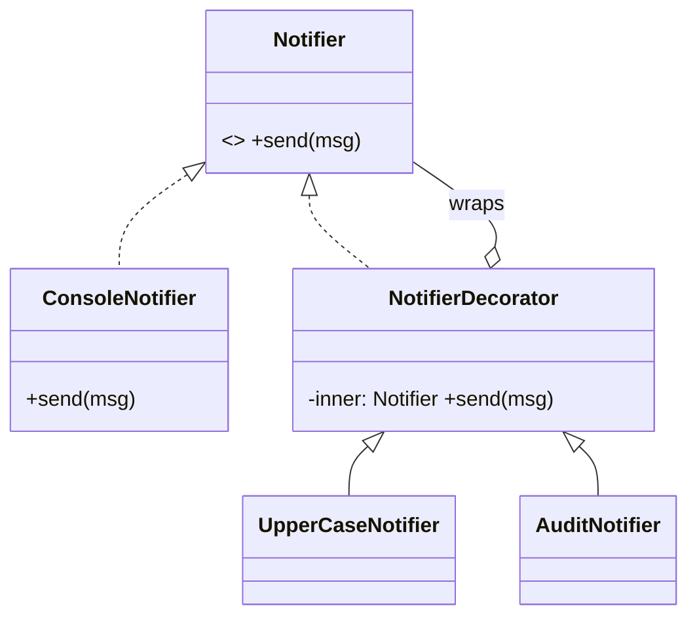
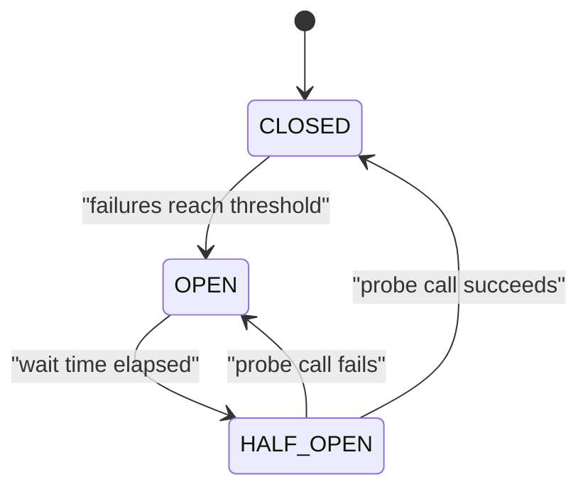

# Design Patterns That Actually Get Asked (Modern Java)

> **Level:** SDE-II / SDE-III · **Area:** Java · **Prev:** [SOLID & OOP design](01-solid-and-oop-design.md) · **Next:** [LLD interview problems](03-lld-interview-problems.md)

## TL;DR

- A design pattern is a **named, reusable solution to a recurring problem**, mostly a vocabulary for talking about structure. Interviewers want (1) the **problem**, (2) the **minimal implementation**, (3) the **trade-off / when not to use it**, (4) **where it lives in the JDK/Spring**.
- In modern Java many patterns *shrink*: **Strategy / Command / Observer callbacks = lambdas**, **Visitor = sealed + `switch`**, **Singleton = enum or one DI bean**, **Value/Builder = records**.
- The patterns you must be able to code on a whiteboard: **Singleton, Factory, Builder, Strategy, Observer, Decorator, Proxy, Template Method, Chain of Responsibility, State, Command**. Resilience patterns (**Retry, Circuit Breaker**) are asked at SDE-III because they sit between design and production.
- **Spring's "singleton" ≠ GoF Singleton.** Spring's is *one instance per container (per bean definition)*; GoF's is *one instance per class loader/JVM, enforced by the class itself*.
- Every pattern has a failure mode: **over-use** (a factory for `new ArrayList`), **hidden control flow** (observers, proxies, chains), **indirection tax**. State the cost, not just the benefit.

## The analogy: a city's building codes

Patterns are like **standard building solutions** — "load-bearing arch", "fire door", "service lift". Every architect knows the *name*, so "put a fire door here" ends a long meeting. But nobody puts a fire door on a garden shed; using the solution without the problem is just expensive construction.



---

# Part A — Creational

## 1. Singleton

| | |
|---|---|
| **Problem** | Exactly one instance must exist (config, registry, connection manager) and be reachable globally. |
| **Analogy** | A country has **one** president at a time; everyone asks the same office. |
| **Don't use when** | You just want *convenience* of global access — it's hidden global state that makes tests order-dependent. Prefer **one instance created at the composition root and injected**. |
| **JDK / Spring** | `Runtime.getRuntime()`, `Desktop.getDesktop()`; enum constants. Spring: default bean scope `singleton` (**per `ApplicationContext`**, not per JVM). |

Four ways, from worst to best:

```java
// Run: SingletonDemo.java
import java.lang.reflect.Constructor;
import java.util.*;
import java.util.concurrent.*;

public class SingletonDemo {
    // (1) Classic eager singleton: thread-safe (class init is atomic) but breakable by reflection
    static class Classic {
        private static final Classic INSTANCE = new Classic();
        private Classic() {}
        static Classic get() { return INSTANCE; }
    }

    // (2) Initialization-on-demand holder: lazy AND thread-safe with NO locks (JLS guarantees class init happens once)
    static class HolderSingleton {
        private HolderSingleton() { System.out.println("  HolderSingleton constructed"); }
        private static class Holder { static final HolderSingleton INSTANCE = new HolderSingleton(); }
        static HolderSingleton getInstance() { return Holder.INSTANCE; }
    }

    // (3) Double-checked locking: needs `volatile`, otherwise another thread may see a non-null reference to a
    //     half-constructed object (the write of the reference can be reordered before the constructor's field writes)
    static class DclSingleton {
        private static volatile DclSingleton instance;
        private DclSingleton() {}
        static DclSingleton getInstance() {
            DclSingleton local = instance;                   // one volatile read on the fast path
            if (local == null) {
                synchronized (DclSingleton.class) {
                    local = instance;
                    if (local == null) instance = local = new DclSingleton();
                }
            }
            return local;
        }
    }

    // (4) Enum singleton (Effective Java Item 3): serialization-safe, reflection-safe, 1 line
    enum Registry { INSTANCE; private int hits; int hit() { return ++hits; } }

    public static void main(String[] args) throws Exception {
        System.out.println("holder not constructed yet (lazy)");
        System.out.println("same holder instance: " + (HolderSingleton.getInstance() == HolderSingleton.getInstance()));

        // 8 threads race to get the DCL singleton
        Set<Integer> identities = ConcurrentHashMap.newKeySet();
        ExecutorService pool = Executors.newFixedThreadPool(8);
        CountDownLatch go = new CountDownLatch(1);
        List<Future<Void>> futures = new ArrayList<>();
        for (int i = 0; i < 8; i++) {
            futures.add(pool.submit(() -> { go.await(); identities.add(System.identityHashCode(DclSingleton.getInstance())); return null; }));
        }
        go.countDown();
        for (Future<Void> f : futures) f.get();
        pool.shutdown();
        System.out.println("distinct DCL instances seen by 8 threads: " + identities.size());

        // Reflection breaks the classic singleton...
        Constructor<Classic> c = Classic.class.getDeclaredConstructor();
        c.setAccessible(true);
        System.out.println("classic broken by reflection: " + (c.newInstance() != Classic.get()));

        // ...but not the enum
        try {
            Constructor<Registry> ec = Registry.class.getDeclaredConstructor(String.class, int.class);
            ec.setAccessible(true);
            ec.newInstance("COPY", 1);
        } catch (Exception e) {
            System.out.println("enum: " + e.getClass().getSimpleName() + ": " + e.getMessage());
        }
        System.out.println("enum hits: " + Registry.INSTANCE.hit() + ", " + Registry.INSTANCE.hit());
    }
}
```

```text
holder not constructed yet (lazy)
  HolderSingleton constructed
same holder instance: true
distinct DCL instances seen by 8 threads: 1
classic broken by reflection: true
enum: IllegalArgumentException: Cannot reflectively create enum objects
enum hits: 1, 2
```

- **Why `volatile` in DCL?** `instance = new X()` is three steps: allocate, run constructor (write fields), publish the reference. Without `volatile`, the JIT/CPU may publish the reference **before** the fields are written, and a second thread's *unsynchronised first check* sees a non-null but **partially constructed** object. `volatile` adds a happens-before edge between the write and any later read. See [locks, volatile & deadlocks](../03-concurrency/04-locks-volatile-deadlock.md).
- **Holder idiom** gets laziness from *class initialisation* semantics (the JVM locks class init), which is why it needs neither `synchronized` nor `volatile`. Prefer it over DCL; prefer the **enum** over both when you don't need laziness or inheritance.
- **Spring singleton ≠ GoF singleton:**

| | GoF Singleton | Spring `singleton` scope |
|---|---|---|
| Enforced by | the class itself (private constructor) | the container (one per bean *definition* per `ApplicationContext`) |
| Count | one per class loader | can be many instances of the *same class* (two `@Bean` methods, two contexts) |
| Testability | poor (global static) | good (injected, replaceable) |
| Thread-safety | you must ensure | **not** automatic: a singleton bean with mutable fields is shared by every request thread. Keep beans **stateless** or immutable. |

## 2. Factory Method · Abstract Factory · static factory

| | |
|---|---|
| **Problem** | Callers shouldn't hard-code *which concrete class* to instantiate, or construction needs a name, caching or validation. |
| **Analogy** | You order "a coffee" at the counter; the **shop** decides whether that means a machine espresso or a pour-over. |
| **Don't use when** | There's one implementation and no foreseeable second; a plain constructor is clearer. |
| **JDK / Spring** | *Static factory:* `List.of`, `Optional.of`, `Integer.valueOf` (caches -128..127), `LocalDate.of`, `Executors.newFixedThreadPool`. *Factory Method:* `Collection.iterator()`, `Calendar.getInstance()`, `URL.openConnection()`. *Abstract Factory:* `DocumentBuilderFactory`, `javax.xml.*Factory`, JDBC `DriverManager`/`Connection` creating `Statement`s. Spring: `BeanFactory`, `FactoryBean<T>`, `@Bean` methods. |

Three flavours; interviewers mix the names, so know the difference:

- **Static factory method** — a `static` method returning an instance (name tells intent, may cache, may return a subtype). Not a GoF pattern but the most common one in Java.
- **Factory Method** — a *superclass* defers "which product" to a **subclass** (`createParser()` below).
- **Abstract Factory** — a factory of **families** of related objects that must be used together.

```java
// Run: FactoryDemo.java
import java.util.*;
import java.util.function.Supplier;

public class FactoryDemo {
    // (1) Static factory: named constructor + validation/normalisation in one place
    record Money(long minor, String currency) {
        static Money of(double amount, String currency) { return new Money(Math.round(amount * 100), currency); }
        static Money zero(String currency)              { return new Money(0, currency); }
        @Override public String toString() { return String.format("%d.%02d %s", minor / 100, minor % 100, currency); }
    }

    // (2) Factory Method: the base class owns the algorithm, the subclass chooses the product
    interface Parser { List<String> parse(String text); }
    static abstract class Importer {
        protected abstract Parser createParser();                       // <- the factory method
        final int importData(String text) {
            List<String> rows = createParser().parse(text);
            System.out.println("  parsed " + rows);
            return rows.size();
        }
    }
    static class CsvImporter  extends Importer { protected Parser createParser() { return t -> List.of(t.split(",")); } }
    static class LineImporter extends Importer { protected Parser createParser() { return t -> List.of(t.split("\n")); } }

    // (3) Abstract Factory: a FAMILY of products that must match (light button never mixes with dark checkbox)
    interface Button   { String render(); }
    interface Checkbox { String render(); }
    interface UiFactory { Button button(); Checkbox checkbox(); }
    static class LightUi implements UiFactory {
        public Button button()     { return () -> "[ Light Button ]"; }
        public Checkbox checkbox() { return () -> "[ ] Light Checkbox"; }
    }
    static class DarkUi implements UiFactory {
        public Button button()     { return () -> "[# Dark Button #]"; }
        public Checkbox checkbox() { return () -> "[#] Dark Checkbox"; }
    }
    static void renderScreen(UiFactory f) { System.out.println("  " + f.button().render() + "  " + f.checkbox().render()); }

    // (4) Modern: a registry of Suppliers replaces a big switch-based factory (Open/Closed friendly)
    static final Map<String, Supplier<Parser>> PARSERS = Map.of(
        "csv",   () -> t -> List.of(t.split(",")),
        "words", () -> t -> List.of(t.split("\\s+")));

    public static void main(String[] args) {
        System.out.println(Money.of(12.5, "INR") + " | " + Money.zero("USD"));
        System.out.println("factory method:");
        System.out.println("  rows=" + new CsvImporter().importData("a,b,c"));
        System.out.println("  rows=" + new LineImporter().importData("x\ny"));
        System.out.println("abstract factory:");
        renderScreen(new LightUi());
        renderScreen(new DarkUi());
        System.out.println("registry: " + PARSERS.get("words").get().parse("to be or not"));
    }
}
```

```text
12.50 INR | 0.00 USD
factory method:
  parsed [a, b, c]
  rows=3
  parsed [x, y]
  rows=2
abstract factory:
  [ Light Button ]  [ ] Light Checkbox
  [# Dark Button #]  [#] Dark Checkbox
registry: [to, be, or, not]
```

## 3. Builder

| | |
|---|---|
| **Problem** | Many parameters (several optional) → telescoping constructors or half-initialised mutable objects. |
| **Analogy** | Ordering a **sandwich at a counter**: choose bread, add fillings one by one, say "done" — you get a finished sandwich, never a half-built one. |
| **Don't use when** | ≤ 3-4 fields, all required → a **record** or a constructor. Builders add a second class and allow *missing required fields* unless you validate in `build()`. |
| **JDK / Spring** | `StringBuilder`, `HttpRequest.newBuilder()`, `HttpClient.newBuilder()`, `Stream.Builder`, `Locale.Builder`; Spring `UriComponentsBuilder`, `BeanDefinitionBuilder`, `RestClient.builder()`, Spring Security's `http.authorizeHttpRequests(...)` DSL. Lombok: `@Builder`. |

```java
// Run: BuilderDemo.java
import java.util.*;

public class BuilderDemo {
    /** Immutable product; the only way to create it is through the validated Builder. */
    static final class HttpCall {
        private final String url, method, body;
        private final int timeoutMs;
        private final Map<String, String> headers;

        private HttpCall(Builder b) {
            this.url = b.url; this.method = b.method; this.body = b.body; this.timeoutMs = b.timeoutMs;
            this.headers = Collections.unmodifiableMap(new LinkedHashMap<>(b.headers));   // defensive copy
        }
        static Builder builder(String url) { return new Builder(url); }
        @Override public String toString() { return method + " " + url + " timeout=" + timeoutMs + "ms headers=" + headers + (body == null ? "" : " body=" + body); }

        static final class Builder {
            private final String url;                      // REQUIRED -> constructor argument
            private String method = "GET", body;           // optional with defaults
            private int timeoutMs = 1000;
            private final Map<String, String> headers = new LinkedHashMap<>();

            private Builder(String url) { this.url = url; }
            Builder method(String m)            { this.method = m; return this; }
            Builder timeoutMs(int t)            { this.timeoutMs = t; return this; }
            Builder header(String k, String v)  { this.headers.put(k, v); return this; }
            Builder body(String b)              { this.body = b; return this; }
            HttpCall build() {                             // cross-field validation happens ONCE, here
                if (url == null || url.isBlank()) throw new IllegalArgumentException("url required");
                if (body != null && method.equals("GET")) throw new IllegalStateException("GET cannot have a body");
                return new HttpCall(this);
            }
        }
    }

    /** For small value types a record + "withers" is the modern builder. */
    record RetryPolicy(int maxAttempts, long backoffMs, boolean jitter) {
        static final RetryPolicy DEFAULT = new RetryPolicy(3, 100, true);
        RetryPolicy withMaxAttempts(int n) { return new RetryPolicy(n, backoffMs, jitter); }
        RetryPolicy withBackoffMs(long ms) { return new RetryPolicy(maxAttempts, ms, jitter); }
        RetryPolicy withoutJitter()        { return new RetryPolicy(maxAttempts, backoffMs, false); }
    }

    public static void main(String[] args) {
        HttpCall call = HttpCall.builder("https://api.example.com/orders")
            .method("POST").header("Content-Type", "application/json").timeoutMs(2500).body("{\"id\":1}").build();
        System.out.println(call);

        try { HttpCall.builder("https://x").method("GET").body("oops").build(); }
        catch (IllegalStateException e) { System.out.println("rejected at build(): " + e.getMessage()); }

        System.out.println(RetryPolicy.DEFAULT + "\n" + RetryPolicy.DEFAULT.withMaxAttempts(5).withBackoffMs(250).withoutJitter());
    }
}
```

```text
POST https://api.example.com/orders timeout=2500ms headers={Content-Type=application/json} body={"id":1}
rejected at build(): GET cannot have a body
RetryPolicy[maxAttempts=3, backoffMs=100, jitter=true]
RetryPolicy[maxAttempts=5, backoffMs=250, jitter=false]
```

```java
// display-only: Lombok generates the same builder from an annotation (needs lombok on the classpath)
@Builder @Value                         // @Value => all fields private final, no setters
class HttpCall { String url; @Builder.Default String method = "GET"; int timeoutMs; }
// HttpCall.builder().url("...").timeoutMs(500).build();   // note: Lombok will NOT make a missing `url` a compile error
```

> [!TIP]
> Make required fields constructor arguments of the builder (as above) or use a **staged/step builder** so the compiler forces them. Records + Lombok `@Builder` on the record's constructor is a common combo for DTOs with many optional fields.

---

# Part B — Behavioural

## 4. Strategy

| | |
|---|---|
| **Problem** | An algorithm (pricing, sorting, retry delay, shipping cost) varies, and you don't want `if/else` chains choosing it. |
| **Analogy** | A **GPS app**: same "get me to X" request; you pick *fastest / shortest / avoid tolls* and the route algorithm is swapped, nothing else changes. |
| **Don't use when** | Only one algorithm exists or the variants are two trivial branches. |
| **JDK / Spring** | **`Comparator`** passed to `sort`/`TreeMap` is the textbook example; `ThreadPoolExecutor`'s `RejectedExecutionHandler`; `Collectors`; Spring's `ResourceLoader`, `PasswordEncoder`, `AuthenticationProvider`, `HandlerMethodArgumentResolver`, `@Qualifier`-selected beans. |

```java
// Run: StrategyDemo.java
import java.util.*;

public class StrategyDemo {
    @FunctionalInterface interface ShippingStrategy { double cost(double weightKg); }

    // A named, stateful strategy is still best as a class/enum
    enum Carrier implements ShippingStrategy {
        STANDARD { public double cost(double w) { return 40 + 10 * w; } },
        EXPRESS  { public double cost(double w) { return 90 + 25 * w; } };
    }

    static class Checkout {                                       // the "context"
        private ShippingStrategy strategy;
        Checkout(ShippingStrategy s) { this.strategy = s; }
        void use(ShippingStrategy s) { this.strategy = s; }       // swap at run time
        double total(double items, double weight) { return items + strategy.cost(weight); }
    }

    public static void main(String[] args) {
        Checkout c = new Checkout(Carrier.STANDARD);
        System.out.println("standard        : " + c.total(1000, 2));
        c.use(Carrier.EXPRESS);
        System.out.println("express         : " + c.total(1000, 2));
        c.use(w -> 0);                                            // a lambda IS a strategy
        System.out.println("free (lambda)   : " + c.total(1000, 2));
        c.use(w -> w > 5 ? 0 : 60);
        System.out.println("free over 5kg   : " + c.total(1000, 2) + " / " + c.total(1000, 7));

        // The JDK's own Strategy: Comparator
        List<String> names = new ArrayList<>(List.of("kiran", "al", "meera", "bo", "ravi"));
        names.sort(Comparator.comparingInt(String::length).thenComparing(Comparator.naturalOrder()));
        System.out.println("by length, then A-Z : " + names);
        names.sort(Comparator.comparing(String::length).reversed().thenComparing(Comparator.reverseOrder()));
        System.out.println("longest first, Z-A  : " + names);
    }
}
```

```text
standard        : 1060.0
express         : 1140.0
free (lambda)   : 1000.0
free over 5kg   : 1060.0 / 1000.0
by length, then A-Z : [al, bo, ravi, kiran, meera]
longest first, Z-A  : [meera, kiran, ravi, bo, al]
```

Strategy vs State: both swap a delegate. **Strategy** is chosen by the *client* and strategies don't know each other; **State** is switched by the *object itself* as it transitions, and states know their successors.

## 5. Observer

| | |
|---|---|
| **Problem** | One object changes and an *unknown, changing* set of others must react, without the source knowing them. |
| **Analogy** | **YouTube subscriptions**: the channel doesn't know who you are; it just publishes, and subscribers get notified. You can unsubscribe anytime. |
| **Don't use when** | Order and completion matter (use a direct call or workflow), or you need guaranteed delivery (use a message broker). Observers make control flow **invisible**: debugging "who changed this?" gets hard. |
| **JDK / Spring** | `java.beans.PropertyChangeListener`/`PropertyChangeSupport`, Swing listeners, `Flow.Subscriber` (reactive streams), `Observable` (deprecated since 9). Spring: `ApplicationEventPublisher` + `@EventListener` / `@TransactionalEventListener`. |

```java
// Run: ObserverDemo.java
import java.beans.PropertyChangeListener;
import java.beans.PropertyChangeSupport;
import java.util.*;
import java.util.concurrent.CopyOnWriteArrayList;
import java.util.function.Consumer;

public class ObserverDemo {
    // (1) JDK's built-in: PropertyChangeSupport
    static class Thermostat {
        private final PropertyChangeSupport pcs = new PropertyChangeSupport(this);
        private int temp = 20;
        void addListener(PropertyChangeListener l)    { pcs.addPropertyChangeListener(l); }
        void removeListener(PropertyChangeListener l) { pcs.removePropertyChangeListener(l); }
        void setTemp(int t) { int old = temp; temp = t; pcs.firePropertyChange("temp", old, t); }   // no event when old equals new
    }

    // (2) A tiny typed event bus: subscribe returns an "unsubscribe" handle, a failing listener can't block others
    static class EventBus {
        private final Map<Class<?>, List<Consumer<Object>>> listeners = new HashMap<>();
        <T> Runnable subscribe(Class<T> type, Consumer<T> l) {
            Consumer<Object> wrapper = o -> l.accept(type.cast(o));
            listeners.computeIfAbsent(type, k -> new CopyOnWriteArrayList<>()).add(wrapper);   // COW: safe to unsubscribe during dispatch
            return () -> listeners.get(type).remove(wrapper);
        }
        void publish(Object event) {
            for (Consumer<Object> l : listeners.getOrDefault(event.getClass(), List.of())) {
                try { l.accept(event); }
                catch (RuntimeException e) { System.out.println("  (listener failed: " + e.getMessage() + " - others still run)"); }
            }
        }
    }
    record OrderPlaced(String id) {}

    public static void main(String[] args) {
        Thermostat t = new Thermostat();
        PropertyChangeListener display = e -> System.out.println("  display: " + e.getPropertyName() + " " + e.getOldValue() + " -> " + e.getNewValue());
        t.addListener(display);
        t.setTemp(22);
        t.setTemp(22);                         // unchanged -> nothing printed
        t.removeListener(display);             // ALWAYS unregister long-lived subscriptions (lapsed-listener leak)
        t.setTemp(25);                         // nobody listening
        System.out.println("thermostat done");

        EventBus bus = new EventBus();
        Runnable unsubEmail = bus.subscribe(OrderPlaced.class, e -> System.out.println("  email  for " + e.id()));
        bus.subscribe(OrderPlaced.class, e -> { throw new IllegalStateException("analytics down"); });
        bus.subscribe(OrderPlaced.class, e -> System.out.println("  stock  for " + e.id()));
        System.out.println("publish #1");
        bus.publish(new OrderPlaced("A1"));
        unsubEmail.run();
        System.out.println("publish #2 (email unsubscribed)");
        bus.publish(new OrderPlaced("A2"));
    }
}
```

```text
  display: temp 20 -> 22
thermostat done
publish #1
  email  for A1
  (listener failed: analytics down - others still run)
  stock  for A1
publish #2 (email unsubscribed)
  (listener failed: analytics down - others still run)
  stock  for A2
```

```java
// display-only: Spring's version (events are synchronous by default, in the publisher's thread and transaction!)
record OrderPlacedEvent(String id) {}
@Service class OrderService {
    private final ApplicationEventPublisher publisher;
    OrderService(ApplicationEventPublisher p) { this.publisher = p; }
    @Transactional public void place(String id) { /* save */ publisher.publishEvent(new OrderPlacedEvent(id)); }
}
@Component class EmailListener {
    @TransactionalEventListener            // runs AFTER the transaction commits (default phase AFTER_COMMIT)
    void on(OrderPlacedEvent e) { /* send email */ }
}
```

> [!WARNING]
> Observer pitfalls: **memory leaks** (a long-lived subject keeps strong references to short-lived listeners — unsubscribe or use weak refs), **exceptions in one listener aborting the rest** (isolate them as above), **re-entrancy** (a listener that triggers another event), **ordering assumptions**, and **threading** (listeners run on the *publisher's* thread unless you hand off to an executor).

## 6. Template Method

| | |
|---|---|
| **Problem** | Several flows share the same skeleton (open → process → close) but differ in one or two steps. |
| **Analogy** | A **recipe card** with fixed steps ("preheat, mix, bake, cool") where each dish fills in "mix" and "bake". |
| **Don't use when** | The variation is small enough for a lambda parameter, or the hierarchy would be only one level deep for one subclass. Inheritance-based, so subject to the fragile-base-class issue ([note 1, section 7](01-solid-and-oop-design.md)). |
| **JDK / Spring** | `AbstractList`/`AbstractMap` (you implement `get`/`size`), `HttpServlet.service()` → `doGet/doPost`, `InputStream.read(byte[])` built on abstract `read()`. Spring: `JdbcTemplate`/`RestTemplate`/`TransactionTemplate` (the **callback** flavour), `AbstractApplicationContext.refresh()`, `OncePerRequestFilter`. |

```java
// Run: TemplateMethodDemo.java
import java.util.function.Supplier;

public class TemplateMethodDemo {
    // (1) Classic: inheritance. The skeleton is `final`; subclasses fill in the steps.
    static abstract class ReportJob {
        final void run() {                                   // the template method: order is fixed
            open();
            try { process(); }
            finally { close(); }                             // cleanup can't be forgotten by subclasses
        }
        protected void open()  { System.out.println("  [" + name() + "] open resources"); }
        protected abstract void process();                   // mandatory step
        protected void close() { System.out.println("  [" + name() + "] close resources"); }
        protected String name() { return getClass().getSimpleName(); }
    }
    static class SalesReport extends ReportJob { protected void process() { System.out.println("  summing sales"); } }
    static class FailingReport extends ReportJob { protected void process() { throw new IllegalStateException("bad data"); } }

    // (2) Modern: the "template" is a method taking a callback (this is how JdbcTemplate/TransactionTemplate work)
    static <T> T timed(String label, Supplier<T> body) {
        System.out.println("  begin " + label);
        try { return body.get(); }
        finally { System.out.println("  end   " + label); }
    }

    public static void main(String[] args) {
        System.out.println("inheritance flavour:");
        new SalesReport().run();
        try { new FailingReport().run(); } catch (IllegalStateException e) { System.out.println("  caught: " + e.getMessage()); }

        System.out.println("callback flavour:");
        int result = timed("compute", () -> 6 * 7);
        System.out.println("  result = " + result);
    }
}
```

```text
inheritance flavour:
  [SalesReport] open resources
  summing sales
  [SalesReport] close resources
  [FailingReport] open resources
  [FailingReport] close resources
  caught: bad data
callback flavour:
  begin compute
  end   compute
  result = 42
```

## 7. Chain of Responsibility

| | |
|---|---|
| **Problem** | A request must pass through an ordered set of handlers; each may handle it, modify it, or stop it — and you want to add/remove/reorder handlers without touching the others. |
| **Analogy** | **Airport security**: ID check → baggage scan → body scan; any stage can stop you, otherwise you move on. |
| **Don't use when** | Exactly one handler is always right (use a lookup), or the order is a hard business workflow (use an explicit pipeline/orchestrator). Failure mode: a request silently *falls off the end* with no handler. |
| **JDK / Spring** | **Servlet `Filter`/`FilterChain`**, **Spring Security `SecurityFilterChain`**, Spring MVC `HandlerInterceptor`, `java.util.logging` handler/logger hierarchy, exception `catch` blocks. |



```java
// Run: ChainDemo.java
import java.util.*;
import java.util.function.Consumer;

public class ChainDemo {
    record Request(String path, String token) {}

    interface Filter { void apply(Request req, Chain chain); }
    /** Like javax.servlet.FilterChain: a filter calls chain.proceed(req) to pass control on, or doesn't to stop. */
    static class Chain {
        private final List<Filter> filters; private final Consumer<Request> endpoint; private int index = 0;
        Chain(List<Filter> filters, Consumer<Request> endpoint) { this.filters = filters; this.endpoint = endpoint; }
        void proceed(Request req) {
            if (index < filters.size()) filters.get(index++).apply(req, this);
            else endpoint.accept(req);
        }
    }

    static final Filter AUTH = (req, chain) -> {
        if (req.token() == null) { System.out.println("  auth    : 401 (chain stopped)"); return; }   // short-circuit
        System.out.println("  auth    : ok");
        chain.proceed(req);
    };
    static final Filter LOGGING = (req, chain) -> {                  // "around" behaviour: before AND after
        System.out.println("  logging : -> " + req.path());
        chain.proceed(req);
        System.out.println("  logging : <- " + req.path());
    };
    static final Filter ADMIN_ONLY = (req, chain) -> {
        if (req.path().startsWith("/admin") && !"root".equals(req.token())) { System.out.println("  admin   : 403 (chain stopped)"); return; }
        chain.proceed(req);
    };

    static void handle(Request r) {
        System.out.println(r);
        new Chain(List.of(LOGGING, AUTH, ADMIN_ONLY), req -> System.out.println("  endpoint: serving " + req.path())).proceed(r);
    }

    public static void main(String[] args) {
        handle(new Request("/orders", "user-token"));
        handle(new Request("/orders", null));
        handle(new Request("/admin/users", "user-token"));
    }
}
```

```text
Request[path=/orders, token=user-token]
  logging : -> /orders
  auth    : ok
  endpoint: serving /orders
  logging : <- /orders
Request[path=/orders, token=null]
  logging : -> /orders
  auth    : 401 (chain stopped)
  logging : <- /orders
Request[path=/admin/users, token=user-token]
  logging : -> /admin/users
  auth    : ok
  admin   : 403 (chain stopped)
  logging : <- /admin/users
```

> Order matters: a security chain with authentication *after* the endpoint-logging filter leaks unauthenticated requests into logs. In Spring Security, the filter order is part of the contract (`SecurityFilterChain`), and debugging a 403 usually means reading the filter list in the startup log.

## 8. Command

| | |
|---|---|
| **Problem** | Treat an *action* as an object so it can be queued, logged, retried, scheduled, or **undone**. |
| **Analogy** | A **restaurant order slip**: the waiter writes it down (create), hands it to the kitchen later (deferred execution), and it can be cancelled or re-sent. |
| **Don't use when** | You only need to call a method now. Without undo/queue/audit needs, a lambda is enough. |
| **JDK / Spring** | `Runnable`/`Callable` handed to an `ExecutorService` (the executor is the *invoker*), `javax.swing.Action`, `Supplier`; Spring Batch `Tasklet`, `CommandLineRunner`, CQRS "command" objects, the `@Scheduled` task. |

```java
// Run: CommandDemo.java
import java.util.*;

public class CommandDemo {
    interface Command { void execute(); void undo(); }

    static class Document { final StringBuilder text = new StringBuilder(); }   // the "receiver"

    record Append(Document doc, String s) implements Command {
        public void execute() { doc.text.append(s); }
        public void undo()    { doc.text.setLength(doc.text.length() - s.length()); }
    }
    static class DeleteLast implements Command {
        private final Document doc; private final int n; private String removed = "";
        DeleteLast(Document doc, int n) { this.doc = doc; this.n = n; }
        public void execute() { int start = Math.max(0, doc.text.length() - n); removed = doc.text.substring(start); doc.text.setLength(start); }
        public void undo()    { doc.text.append(removed); }                 // the command remembers what it needs to reverse itself
    }

    /** The invoker: runs commands and keeps history for undo. */
    static class Editor {
        private final Deque<Command> history = new ArrayDeque<>();
        void run(Command c)   { c.execute(); history.push(c); }
        void undo()           { if (!history.isEmpty()) history.pop().undo(); }
    }

    public static void main(String[] args) {
        Document doc = new Document();
        Editor editor = new Editor();
        editor.run(new Append(doc, "Hello"));
        editor.run(new Append(doc, ", world"));
        System.out.println("after 2 appends : '" + doc.text + "'");
        editor.run(new DeleteLast(doc, 3));
        System.out.println("after delete(3) : '" + doc.text + "'");
        editor.undo();
        System.out.println("undo            : '" + doc.text + "'");
        editor.undo();
        System.out.println("undo            : '" + doc.text + "'");

        // A queue of Runnables is the same pattern without undo: the Executor is the invoker
        Queue<Runnable> queue = new ArrayDeque<>();
        queue.add(() -> System.out.println("job 1"));
        queue.add(() -> System.out.println("job 2"));
        queue.forEach(Runnable::run);
    }
}
```

```text
after 2 appends : 'Hello, world'
after delete(3) : 'Hello, wo'
undo            : 'Hello, world'
undo            : 'Hello'
job 1
job 2
```

## 9. State

| | |
|---|---|
| **Problem** | An object's behaviour depends on its state, and the code is full of `if (state == X) … else if (state == Y)` in every method. |
| **Analogy** | A **traffic light / turnstile**: the *same input* ("push") means different things in *locked* vs *unlocked*. |
| **Don't use when** | 2-3 states with trivial behaviour (a boolean/enum field and one `switch` is clearer). Many states with complex rules → consider a table-driven machine or a library (Spring Statemachine). |
| **JDK / Spring** | `Thread.State` (a model, not the pattern), `java.nio` buffer modes, TCP connection handling, JDBC `Connection` (open/closed/in-tx). Spring Statemachine, Camunda, order workflows. |

The full vending-machine implementation is in the [LLD problems](03-lld-interview-problems.md). Minimal enum form (each constant defines **only the transitions it allows**; everything else is illegal by default):

```java
// Run: StateDemo.java
public class StateDemo {
    enum OrderState {
        NEW       { @Override OrderState pay()    { return PAID; }
                    @Override OrderState cancel() { return CANCELLED; } },
        PAID      { @Override OrderState ship()   { return SHIPPED; }
                    @Override OrderState cancel() { return CANCELLED; } },     // refund path
        SHIPPED   { },                                                         // terminal: nothing allowed
        CANCELLED { };                                                         // terminal

        OrderState pay()    { throw illegal("pay"); }
        OrderState ship()   { throw illegal("ship"); }
        OrderState cancel() { throw illegal("cancel"); }
        IllegalStateException illegal(String action) { return new IllegalStateException("cannot " + action + " when " + this); }
    }

    static class Order {
        private OrderState state = OrderState.NEW;
        void pay()    { state = state.pay(); }
        void ship()   { state = state.ship(); }
        void cancel() { state = state.cancel(); }
        OrderState state() { return state; }
    }

    public static void main(String[] args) {
        Order o = new Order();
        System.out.println(o.state());
        o.pay();  System.out.println(o.state());
        o.ship(); System.out.println(o.state());
        try { o.cancel(); } catch (IllegalStateException e) { System.out.println("rejected: " + e.getMessage()); }

        Order o2 = new Order();
        try { o2.ship(); } catch (IllegalStateException e) { System.out.println("rejected: " + e.getMessage()); }
        o2.cancel();
        System.out.println(o2.state());
    }
}
```

```text
NEW
PAID
SHIPPED
rejected: cannot cancel when SHIPPED
rejected: cannot ship when NEW
CANCELLED
```

## 10. Iterator

| | |
|---|---|
| **Problem** | Traverse a collection without exposing its internal structure, and support several independent traversals. |
| **Analogy** | A **bookmark**: it knows where you are in the book; you can have two bookmarks in the same book. |
| **Don't use when** | You have a list and need random access/indices; a `for` loop or a `Stream` is clearer. |
| **JDK / Spring** | `Iterable`/`Iterator` (enhanced `for` desugars to it), `ListIterator`, `Spliterator`, `ResultSet`, `Scanner`; `Stream` is a different, one-shot lazy pipeline. |

```java
// Run: IteratorDemo.java
import java.util.*;

public class IteratorDemo {
    /** Any Iterable works in a for-each loop. This one generates values lazily: no backing list. */
    static class Range implements Iterable<Integer> {
        private final int from, to;
        Range(int from, int to) { this.from = from; this.to = to; }
        @Override public Iterator<Integer> iterator() {
            return new Iterator<>() {
                private int next = from;                                    // each iterator has its OWN cursor
                public boolean hasNext() { return next < to; }
                public Integer next() { if (!hasNext()) throw new NoSuchElementException(); return next++; }
            };
        }
    }

    public static void main(String[] args) {
        StringBuilder sb = new StringBuilder();
        for (int i : new Range(1, 5)) sb.append(i).append(' ');
        System.out.println("for-each over Range: " + sb);

        Range r = new Range(0, 3);
        Iterator<Integer> a = r.iterator(), b = r.iterator();
        System.out.println("two independent cursors: " + a.next() + a.next() + " / " + b.next());

        // Fail-fast: structural modification during for-each
        List<Integer> nums = new ArrayList<>(List.of(1, 2, 3, 4));
        try { for (Integer n : nums) if (n == 2) nums.remove(n); }
        catch (ConcurrentModificationException e) { System.out.println("remove inside for-each -> " + e.getClass().getSimpleName()); }

        nums = new ArrayList<>(List.of(1, 2, 3, 4));
        for (Iterator<Integer> it = nums.iterator(); it.hasNext();) if (it.next() % 2 == 0) it.remove();   // Iterator.remove is safe
        System.out.println("iterator.remove  -> " + nums);
        nums = new ArrayList<>(List.of(1, 2, 3, 4));
        nums.removeIf(n -> n % 2 == 0);                                                                    // modern: removeIf
        System.out.println("removeIf         -> " + nums);
    }
}
```

```text
for-each over Range: 1 2 3 4 
two independent cursors: 01 / 0
remove inside for-each -> ConcurrentModificationException
iterator.remove  -> [1, 3]
removeIf         -> [1, 3]
```

## 11. Visitor — and why sealed + pattern `switch` often replaces it

| | |
|---|---|
| **Problem** | Add **new operations** over a **fixed set of types** (an AST, a file-system tree) without editing each type. |
| **Analogy** | A **tax inspector** visiting each kind of business: shop, factory, restaurant — each "accepts" the inspector and the inspector knows what to check for each. |
| **Don't use when** | The type set changes often (every new type forces a change in *every* visitor), or you're on Java 21 where a sealed hierarchy + `switch` does the same with far less ceremony. |
| **JDK / Spring** | `java.nio.file.FileVisitor` (`Files.walkFileTree`), `javax.lang.model.element.ElementVisitor`, ASM/ANTLR visitors, Spring's `BeanDefinitionVisitor`, `BeanFactoryPostProcessor`s. |

```java
// Run: VisitorDemo.java
public class VisitorDemo {
    // ================= Classic Visitor: double dispatch via accept() =================
    interface Expr { <R> R accept(Visitor<R> v); }
    interface Visitor<R> { R visitNum(Num n); R visitAdd(Add a); R visitMul(Mul m); }
    record Num(int v)        implements Expr { public <R> R accept(Visitor<R> vis) { return vis.visitNum(this); } }
    record Add(Expr l, Expr r) implements Expr { public <R> R accept(Visitor<R> vis) { return vis.visitAdd(this); } }
    record Mul(Expr l, Expr r) implements Expr { public <R> R accept(Visitor<R> vis) { return vis.visitMul(this); } }

    static class EvalVisitor implements Visitor<Integer> {
        public Integer visitNum(Num n) { return n.v(); }
        public Integer visitAdd(Add a) { return a.l().accept(this) + a.r().accept(this); }
        public Integer visitMul(Mul m) { return m.l().accept(this) * m.r().accept(this); }
    }
    static class PrintVisitor implements Visitor<String> {
        public String visitNum(Num n) { return String.valueOf(n.v()); }
        public String visitAdd(Add a) { return "(" + a.l().accept(this) + " + " + a.r().accept(this) + ")"; }
        public String visitMul(Mul m) { return a(m.l()) + " * " + a(m.r()); }
        private String a(Expr e) { return e.accept(this); }
    }

    // ================= Modern: sealed + records + pattern-matching switch =================
    sealed interface Node permits Lit, Plus, Times {}
    record Lit(int v) implements Node {}
    record Plus(Node l, Node r) implements Node {}
    record Times(Node l, Node r) implements Node {}

    static int eval(Node n) {
        return switch (n) {                                       // exhaustive: remove a case and it won't compile
            case Lit(int v)           -> v;                       // record deconstruction pattern (Java 21)
            case Plus(Node l, Node r) -> eval(l) + eval(r);
            case Times(Node l, Node r)-> eval(l) * eval(r);
        };
    }
    static String show(Node n) {                                  // a NEW operation = one new method; no type is touched
        return switch (n) {
            case Lit l   -> String.valueOf(l.v());
            case Plus p  -> "(" + show(p.l()) + " + " + show(p.r()) + ")";
            case Times t -> show(t.l()) + " * " + show(t.r());
        };
    }

    public static void main(String[] args) {
        Expr classic = new Mul(new Add(new Num(1), new Num(2)), new Num(3));
        System.out.println("visitor : " + classic.accept(new PrintVisitor()) + " = " + classic.accept(new EvalVisitor()));

        Node modern = new Times(new Plus(new Lit(1), new Lit(2)), new Lit(3));
        System.out.println("sealed  : " + show(modern) + " = " + eval(modern));
    }
}
```

```text
visitor : (1 + 2) * 3 = 9
sealed  : (1 + 2) * 3 = 9
```

| | Classic Visitor | Sealed + `switch` |
|---|---|---|
| Add a **new operation** | new class, no edits to types ✅ | new method, no edits to types ✅ |
| Add a **new type** | edit the `Visitor` interface and *every* visitor ❌ | add a `permits` entry; compiler flags every non-exhaustive `switch` ✅ |
| Boilerplate | `accept()` in every node, double dispatch | none |
| Open to third-party subtypes | yes | no — **closed by design** |

## 12. Null Object

| | |
|---|---|
| **Problem** | Callers litter code with `if (x != null)` to do a harmless default. |
| **Analogy** | A **dummy "empty" seat belt/placeholder** that behaves like a real one but does nothing: the system never has to ask "is anyone there?". |
| **Don't use when** | "Absent" must be *noticed* and handled differently from "do-nothing" (e.g. a missing payment method must fail, not silently succeed). Then use `Optional` or an exception. |
| **JDK / Spring** | `Collections.emptyList()/emptyMap()`, `Optional.empty()`, `InputStream.nullInputStream()`, `OutputStream.nullOutputStream()`, `Logger` with level OFF; Spring `NoOpCacheManager`, `NullBean`. |

```java
// Run: NullObjectDemo.java
import java.util.*;

public class NullObjectDemo {
    interface AuditLog { void record(String event); }
    static final AuditLog NO_OP = event -> { };                         // does nothing, safely
    static class ConsoleAudit implements AuditLog { public void record(String e) { System.out.println("  audit: " + e); } }

    static class Registry {
        private final Map<String, AuditLog> byTenant = new HashMap<>();
        void register(String tenant, AuditLog log) { byTenant.put(tenant, log); }
        AuditLog forTenant(String tenant) { return byTenant.getOrDefault(tenant, NO_OP); }   // never returns null
    }

    static List<String> findOrders(String user) { return user.equals("asha") ? List.of("o1", "o2") : Collections.emptyList(); }

    public static void main(String[] args) {
        Registry reg = new Registry();
        reg.register("acme", new ConsoleAudit());
        reg.forTenant("acme").record("login");         // real behaviour
        reg.forTenant("unknown").record("login");      // no null check, no NPE, nothing printed
        System.out.println("callers never check for null");

        for (String order : findOrders("nobody")) System.out.println("never printed " + order);   // empty list: loop just doesn't run
        System.out.println("orders(nobody) = " + findOrders("nobody") + ", orders(asha) = " + findOrders("asha"));
    }
}
```

```text
  audit: login
callers never check for null
orders(nobody) = [], orders(asha) = [o1, o2]
```

---

# Part C — Structural

## 13. Decorator

| | |
|---|---|
| **Problem** | Add responsibilities (buffering, logging, caching, compression, metrics) to an object **dynamically** without a subclass explosion. |
| **Analogy** | **Gift wrapping**: the present is the same, you add paper, then a ribbon, then a bow; each layer has the same outer "shape" (it can be handed to whoever expects a present). |
| **Don't use when** | Order of wrapping creates subtle bugs (encrypt-then-compress vs compress-then-encrypt), or you need the *concrete* type back. Deep stacks are hard to debug. |
| **JDK / Spring** | `BufferedReader(new FileReader(...))`, `DataInputStream`, `GZIPInputStream`, `Collections.unmodifiableList`/`synchronizedList`/`checkedList`, `HttpServletRequestWrapper`. Spring: `BeanPostProcessor`, `BeanDefinitionDecorator`, `ServerHttpRequestDecorator`. |



```java
// Run: DecoratorDemo.java
import java.io.*;
import java.util.*;

public class DecoratorDemo {
    interface Notifier { void send(String msg); }
    static class ConsoleNotifier implements Notifier { public void send(String m) { System.out.println("  >> " + m); } }

    static abstract class NotifierDecorator implements Notifier {      // same interface + HAS-A the wrapped one
        protected final Notifier inner;
        NotifierDecorator(Notifier inner) { this.inner = inner; }
    }
    static class UpperCase extends NotifierDecorator {
        UpperCase(Notifier n) { super(n); }
        public void send(String m) { inner.send(m.toUpperCase()); }
    }
    static class Audit extends NotifierDecorator {
        Audit(Notifier n) { super(n); }
        public void send(String m) { System.out.println("  audit: sending " + m.length() + " chars"); inner.send(m); }
    }

    public static void main(String[] args) throws IOException {
        System.out.println("own decorators (outermost runs first):");
        Notifier n = new Audit(new UpperCase(new ConsoleNotifier()));
        n.send("deploy finished");

        System.out.println("JDK decorators:");
        try (BufferedReader br = new BufferedReader(new StringReader("line one\nline two"))) {     // adds readLine() + buffering
            System.out.println("  " + br.readLine() + " | " + br.readLine());
        }

        // unmodifiableList is a DECORATOR that is a live VIEW, not a copy
        List<String> base = new ArrayList<>(List.of("a"));
        List<String> view = Collections.unmodifiableList(base);
        base.add("b");
        System.out.println("  view sees later changes of the base list: " + view);
        try { view.add("c"); } catch (UnsupportedOperationException e) { System.out.println("  view.add -> UnsupportedOperationException"); }
        List<String> copy = List.copyOf(base);                                                   // a real immutable COPY
        base.add("z");
        System.out.println("  copy (snapshot): " + copy + "  base: " + base);
    }
}
```

```text
own decorators (outermost runs first):
  audit: sending 15 chars
  >> DEPLOY FINISHED
JDK decorators:
  line one | line two
  view sees later changes of the base list: [a, b]
  view.add -> UnsupportedOperationException
  copy (snapshot): [a, b]  base: [a, b, z]
```

**Decorator vs Proxy:** same *shape* (wrap an object, same interface). **Decorator** *adds behaviour* and the client usually builds the stack; **Proxy** *controls access* (lazy load, security, remote, caching, transactions) and typically the **client doesn't know** it's there.

## 14. Adapter

| | |
|---|---|
| **Problem** | You have a class with the *wrong interface* (legacy, third-party) and clients expecting another. |
| **Analogy** | A **travel plug adapter**: neither the socket nor the charger changes; the adapter converts between them. |
| **Don't use when** | You own both sides — just change one. Don't let adapters accumulate business logic. |
| **JDK / Spring** | `InputStreamReader` (bytes→chars), `Arrays.asList` (array→`List`), `Collections.enumeration/list`, `Executors.callable(Runnable)`, `OutputStreamWriter`. Spring MVC `HandlerAdapter`, `HttpMessageConverter`, Spring Data repositories adapting JPA. Hexagonal architecture: **"ports and adapters"**. |

```java
// Run: AdapterDemo.java
import java.io.*;
import java.nio.charset.StandardCharsets;
import java.util.*;

public class AdapterDemo {
    // Target interface our application wants
    interface MessageSender { boolean send(String to, String text); }

    // Adaptee: a legacy API with a different shape (int flags, int return code)
    static class LegacySmsApi {
        int sendSms(String number, String text, int flags) {
            System.out.println("  legacy.sendSms(" + number + ", \"" + text + "\", flags=" + flags + ")");
            return number.startsWith("+") ? 0 : 7;                    // 0 = OK, anything else = error code
        }
    }
    // Adapter: translates our contract to theirs, and their result back to ours
    static class LegacySmsAdapter implements MessageSender {
        private final LegacySmsApi legacy;
        LegacySmsAdapter(LegacySmsApi legacy) { this.legacy = legacy; }
        public boolean send(String to, String text) { return legacy.sendSms(to, text, 0) == 0; }
    }

    public static void main(String[] args) throws IOException {
        MessageSender sender = new LegacySmsAdapter(new LegacySmsApi());
        System.out.println("sent=" + sender.send("+911234567890", "hi"));
        System.out.println("sent=" + sender.send("12345", "hi"));

        // JDK adapter 1: bytes -> characters
        byte[] bytes = "héllo".getBytes(StandardCharsets.UTF_8);
        System.out.println("UTF-8 bytes: " + bytes.length);
        try (Reader r = new InputStreamReader(new ByteArrayInputStream(bytes), StandardCharsets.UTF_8)) {
            StringBuilder sb = new StringBuilder(); int ch;
            while ((ch = r.read()) != -1) sb.append((char) ch);
            System.out.println("chars: " + sb.length() + ", code of 2nd char = " + (int) sb.charAt(1) + " (one char, two bytes in UTF-8)");
        }

        // JDK adapter 2: array -> List *view* (writes go through to the array; size is fixed)
        String[] arr = {"a", "b"};
        List<String> view = Arrays.asList(arr);
        view.set(0, "Z");
        System.out.println("array after view.set: " + Arrays.toString(arr));
        try { view.add("c"); } catch (UnsupportedOperationException e) { System.out.println("view.add -> UnsupportedOperationException (adapter can't grow an array)"); }
    }
}
```

```text
  legacy.sendSms(+911234567890, "hi", flags=0)
sent=true
  legacy.sendSms(12345, "hi", flags=0)
sent=false
UTF-8 bytes: 6
chars: 5, code of 2nd char = 233 (one char, two bytes in UTF-8)
array after view.set: [Z, b]
view.add -> UnsupportedOperationException (adapter can't grow an array)
```

## 15. Facade

| | |
|---|---|
| **Problem** | A subsystem has many classes/steps; clients want one simple entry point. |
| **Analogy** | A **hotel concierge**: you say "dinner at 8 and a cab", they call the restaurant, the taxi company and the front desk. |
| **Don't use when** | It becomes a *god class* that knows everything, or it hides capabilities advanced clients need (keep the subsystem accessible too). |
| **JDK / Spring** | `java.net.http.HttpClient` (hides sockets/TLS/HTTP2), `URL.openStream()`, `Files.readAllLines`, `javax.faces.context.FacesContext`; Spring `JdbcTemplate`, `RestClient`, `@Service` application services are facades over repositories and gateways. |

```java
// Run: FacadeDemo.java
public class FacadeDemo {
    // Subsystem: three collaborators with their own protocols
    static class Inventory { boolean reserve(String sku, int qty) { System.out.println("  inventory: reserved " + qty + " x " + sku); return true; }
                             void release(String sku, int qty)   { System.out.println("  inventory: released " + qty + " x " + sku); } }
    static class Payment   { boolean charge(String user, long cents) { System.out.println("  payment  : charged " + user + " " + cents); return cents < 10_000; } }
    static class Shipping  { String schedule(String user) { System.out.println("  shipping : scheduled for " + user); return "TRK-1"; } }

    /** The facade: one method for the use case; callers don't know the order or the compensation logic. */
    static class OrderFacade {
        private final Inventory inventory = new Inventory(); private final Payment payment = new Payment(); private final Shipping shipping = new Shipping();
        String placeOrder(String user, String sku, int qty, long cents) {
            if (!inventory.reserve(sku, qty)) return "OUT_OF_STOCK";
            if (!payment.charge(user, cents)) { inventory.release(sku, qty); return "PAYMENT_DECLINED"; }   // compensation
            return shipping.schedule(user);
        }
    }

    public static void main(String[] args) {
        OrderFacade f = new OrderFacade();
        System.out.println("-> " + f.placeOrder("asha", "SKU-9", 2, 2500));
        System.out.println("-> " + f.placeOrder("ravi", "SKU-9", 1, 99_999));
    }
}
```

```text
  inventory: reserved 2 x SKU-9
  payment  : charged asha 2500
  shipping : scheduled for asha
-> TRK-1
  inventory: reserved 1 x SKU-9
  payment  : charged ravi 99999
  inventory: released 1 x SKU-9
-> PAYMENT_DECLINED
```

## 16. Proxy — with a runnable `java.lang.reflect.Proxy` demo

| | |
|---|---|
| **Problem** | Add cross-cutting behaviour (logging, security, transactions, lazy loading, caching, remote calls) **without changing the target** or its callers. |
| **Analogy** | A **personal assistant** answering your phone: callers think they're talking to you; the assistant may screen calls, take notes, or forward them. |
| **Don't use when** | The logic is business logic (not cross-cutting) — a proxy hides it; or when you can't tolerate the **limits** below. |
| **JDK / Spring** | `java.lang.reflect.Proxy` (interface-based), RMI stubs, `Collections.synchronizedList`; Hibernate lazy-loading proxies; **Spring AOP**: `@Transactional`, `@Cacheable`, `@Async`, `@Retryable` are all proxies — JDK proxies for interfaces, CGLIB (subclass) otherwise. Details: [Spring proxies, AOP, async, cache](../06-spring-boot/02-proxies-transactions-async.md). |

```java
// Run: ProxyDemo.java
import java.io.IOException;
import java.lang.reflect.InvocationHandler;
import java.lang.reflect.InvocationTargetException;
import java.lang.reflect.Proxy;
import java.util.Arrays;

public class ProxyDemo {
    interface Calculator {
        int add(int a, int b);
        int addTwice(int a, int b);                 // calls add() internally
        int risky() throws IOException;
        void undeclared();                          // declares NO checked exception
    }
    static class RealCalculator implements Calculator {
        public int add(int a, int b) { return a + b; }
        public int addTwice(int a, int b) { return add(a, b) + add(a, b); }   // `this.add` - NOT through the proxy
        public int risky() throws IOException { throw new IOException("disk full"); }
        public void undeclared() { }
    }

    static Calculator logging(Calculator target) {
        InvocationHandler handler = (proxy, method, args) -> {
            System.out.println("  -> " + method.getName() + (args == null ? "[]" : Arrays.toString(args)));
            if (method.getName().equals("undeclared")) throw new Exception("checked exception NOT declared by the interface");
            try {
                Object result = method.invoke(target, args);                  // reflective call on the real object
                System.out.println("  <- " + result);
                return result;
            } catch (InvocationTargetException e) {
                System.out.println("  !! " + e.getCause());
                throw e.getCause();                                           // unwrap, or callers see InvocationTargetException
            }
        };
        return (Calculator) Proxy.newProxyInstance(Calculator.class.getClassLoader(), new Class<?>[] { Calculator.class }, handler);
    }

    public static void main(String[] args) {
        Calculator proxy = logging(new RealCalculator());
        System.out.println("is a JDK proxy class: " + Proxy.isProxyClass(proxy.getClass()));
        System.out.println("instanceof RealCalculator: " + (proxy instanceof RealCalculator) + "  (interface-based: the target's class is invisible)");

        System.out.println("1) normal call");
        proxy.add(2, 3);

        System.out.println("2) SELF-INVOCATION: addTwice calls this.add() twice");
        proxy.addTwice(1, 1);                                                 // only addTwice is logged

        System.out.println("3) declared checked exception propagates as-is");
        try { proxy.risky(); } catch (IOException e) { System.out.println("  caller caught IOException: " + e.getMessage()); }

        System.out.println("4) undeclared checked exception gets wrapped");
        try { proxy.undeclared(); } catch (Exception e) { System.out.println("  caller caught " + e.getClass().getSimpleName() + " <- " + e.getCause().getMessage()); }
    }
}
```

```text
is a JDK proxy class: true
instanceof RealCalculator: false  (interface-based: the target's class is invisible)
1) normal call
  -> add[2, 3]
  <- 5
2) SELF-INVOCATION: addTwice calls this.add() twice
  -> addTwice[1, 1]
  <- 4
3) declared checked exception propagates as-is
  -> risky[]
  !! java.io.IOException: disk full
  caller caught IOException: disk full
4) undeclared checked exception gets wrapped
  -> undeclared[]
  caller caught UndeclaredThrowableException <- checked exception NOT declared by the interface
```

What this shows, and what interviewers probe:

- **Self-invocation bypasses the proxy** (case 2): the real object calls `this.add`, not `proxy.add`. This is exactly why a Spring `@Transactional`/`@Cacheable`/`@Async` method **called from another method of the same class does nothing**. Fix: move the method to another bean, inject self, or use AspectJ weaving.
- JDK proxies need an **interface**; Spring falls back to **CGLIB** (a generated *subclass*), which can't proxy `final` classes/methods and needs a (visible) constructor path. Spring Boot defaults to CGLIB (`spring.aop.proxy-target-class=true`).
- A checked exception the interface doesn't declare becomes `UndeclaredThrowableException` (case 4); `method.invoke` wraps the target's exceptions in `InvocationTargetException` — unwrap in the handler (case 3).
- **Virtual proxy** (lazy loading, Hibernate) and **protection proxy** (security checks) are the other classic flavours; **remote proxy** = RMI/gRPC/Feign client stubs.

---

# Part D — Dependency Injection & resilience

## 17. Dependency Injection / Inversion

Already covered with runnable code in [SOLID note, sections 6 and 9](01-solid-and-oop-design.md). One-paragraph interview version: **DIP** says depend on abstractions that the *high-level* module owns; **DI** is passing collaborators in (prefer constructor injection, mark fields `final`); **IoC container** (Spring) builds and wires the object graph so you don't write the composition root by hand. Pattern link: DI makes **Strategy, Decorator, Proxy and Factory** cheap, because swapping implementations is just wiring.

## 18. Retry and Circuit Breaker (resilience patterns)

These are not in the GoF book but are the most-asked *production* patterns. Context and the HTTP gateway version are in [async error handling](../03-concurrency/03-async-error-handling-http.md).

| | Retry | Circuit Breaker |
|---|---|---|
| **Problem** | A failure is *transient* (timeout, 503); trying again probably works. | A dependency is *down*; retrying just piles load on it and burns your threads waiting. |
| **Analogy** | Re-dialling a **busy phone line** after a pause. | The **fuse box**: after too many faults it trips so the house doesn't burn; you flip it back after a while to test. |
| **Don't use when** | The operation isn't **idempotent**; the error is a 4xx/bug; layers already retry (retry storms multiply: 3 × 3 × 3 = 27 calls). | Failures are *your* bug, or a rarely-called dependency where a window of failures can't be measured. |
| **Library** | Resilience4j `@Retry`, Spring Retry `@Retryable` | Resilience4j `@CircuitBreaker` |



The demo injects a **fake clock and a recording sleeper**, so it is deterministic and instant (no `Thread.sleep`) — the same trick recommended in the [Spring testing section](../06-spring-boot/04-rest-errors-security-testing.md#6-testing-with-slices) (a dedicated JUnit/Mockito note is still to be written).

```java
// Run: ResilienceDemo.java
import java.util.*;
import java.util.function.*;

public class ResilienceDemo {
    // ---------------- Retry: bounded attempts, exponential backoff, only for retriable failures ----------------
    static class TransientException extends RuntimeException { TransientException(String m) { super(m); } }
    interface Sleeper { void sleep(long ms); }

    static <T> T retry(int maxAttempts, long baseDelayMs, Sleeper sleeper, Supplier<T> action, Predicate<RuntimeException> retriable) {
        for (int attempt = 1; ; attempt++) {
            try { return action.get(); }
            catch (RuntimeException e) {
                if (!retriable.test(e) || attempt >= maxAttempts) throw e;          // give up: not retriable, or out of attempts
                long delay = baseDelayMs << (attempt - 1);                          // 100, 200, 400 ... (add jitter in production!)
                sleeper.sleep(delay);
            }
        }
    }

    // ---------------- Circuit breaker: CLOSED -> OPEN -> HALF_OPEN -> CLOSED ----------------
    static class CircuitOpenException extends RuntimeException { CircuitOpenException() { super("circuit is OPEN"); } }
    static class CircuitBreaker {
        enum State { CLOSED, OPEN, HALF_OPEN }
        private final int failureThreshold; private final long openForMs; private final LongSupplier clock;
        private State state = State.CLOSED; private int consecutiveFailures; private long openedAt; private boolean probeInFlight;

        CircuitBreaker(int failureThreshold, long openForMs, LongSupplier clock) { this.failureThreshold = failureThreshold; this.openForMs = openForMs; this.clock = clock; }
        synchronized State state() { return state; }

        <T> T call(Supplier<T> action) {
            acquire();                                                  // short critical section ...
            try { T r = action.get(); onSuccess(); return r; }          // ... the actual call runs OUTSIDE the lock
            catch (RuntimeException e) { onFailure(); throw e; }
        }
        private synchronized void acquire() {
            if (state == State.OPEN) {
                if (clock.getAsLong() - openedAt >= openForMs) { state = State.HALF_OPEN; probeInFlight = false; }
                else throw new CircuitOpenException();                  // fail fast: do NOT touch the sick dependency
            }
            if (state == State.HALF_OPEN) {
                if (probeInFlight) throw new CircuitOpenException();    // only ONE probe at a time
                probeInFlight = true;
            }
        }
        private synchronized void onSuccess() { consecutiveFailures = 0; probeInFlight = false; state = State.CLOSED; }
        private synchronized void onFailure() {
            probeInFlight = false;
            if (state == State.HALF_OPEN || ++consecutiveFailures >= failureThreshold) { state = State.OPEN; openedAt = clock.getAsLong(); }
        }
    }

    // ---------------- a flaky dependency we can script ----------------
    static class Service {
        int calls; int failuresLeft;
        String call() { calls++; if (failuresLeft > 0) { failuresLeft--; throw new TransientException("503 #" + calls); } return "OK#" + calls; }
    }

    public static void main(String[] args) {
        // --- Retry ---
        Service svc = new Service(); svc.failuresLeft = 2;
        List<Long> delays = new ArrayList<>();
        String r = retry(4, 100, delays::add, svc::call, e -> e instanceof TransientException);
        System.out.println("retry: result=" + r + ", service calls=" + svc.calls + ", backoff delays=" + delays);

        Service dead = new Service(); dead.failuresLeft = 99; delays.clear();
        try { retry(3, 100, delays::add, dead::call, e -> e instanceof TransientException); }
        catch (TransientException e) { System.out.println("retry exhausted: " + e.getMessage() + ", calls=" + dead.calls + ", delays=" + delays); }

        Service bug = new Service(); delays.clear();
        try { retry(3, 100, delays::add, () -> { bug.calls++; throw new IllegalArgumentException("bad input"); }, e -> e instanceof TransientException); }
        catch (IllegalArgumentException e) { System.out.println("non-retriable: calls=" + bug.calls + " (no retry for programming errors)"); }

        // --- Circuit breaker ---
        long[] now = {0};
        CircuitBreaker cb = new CircuitBreaker(3, 5_000, () -> now[0]);
        Service down = new Service(); down.failuresLeft = 4;
        for (int i = 1; i <= 6; i++) {
            try { System.out.println("call " + i + ": " + cb.call(down::call) + "  state=" + cb.state()); }
            catch (CircuitOpenException e) { System.out.println("call " + i + ": REJECTED (" + e.getMessage() + ")  service calls so far=" + down.calls); }
            catch (TransientException e)  { System.out.println("call " + i + ": failed " + e.getMessage() + "  state=" + cb.state()); }
        }
        now[0] += 5_000;                                                // time passes
        System.out.println("after 5s, state still " + cb.state() + " until the next call probes");
        down.failuresLeft = 1;                                          // the probe will fail once...
        try { cb.call(down::call); } catch (RuntimeException e) { System.out.println("probe 1 failed -> state=" + cb.state()); }
        now[0] += 5_000; down.failuresLeft = 0;                         // ...later the dependency recovered
        System.out.println("probe 2: " + cb.call(down::call) + "  state=" + cb.state());
    }
}
```

```text
retry: result=OK#3, service calls=3, backoff delays=[100, 200]
retry exhausted: 503 #3, calls=3, delays=[100, 200]
non-retriable: calls=1 (no retry for programming errors)
call 1: failed 503 #1  state=CLOSED
call 2: failed 503 #2  state=CLOSED
call 3: failed 503 #3  state=OPEN
call 4: REJECTED (circuit is OPEN)  service calls so far=3
call 5: REJECTED (circuit is OPEN)  service calls so far=3
call 6: REJECTED (circuit is OPEN)  service calls so far=3
after 5s, state still OPEN until the next call probes
probe 1 failed -> state=OPEN
probe 2: OK#5  state=CLOSED
```

Notes for the interview:

- **Compose in the right order:** `Retry( CircuitBreaker( call ) )` — each retry attempt is counted by the breaker, and `CircuitOpenException` should be **non-retriable** (retrying an open circuit just burns the backoff). With Resilience4j the *default* aspect order is `Retry( CircuitBreaker( RateLimiter( TimeLimiter( Bulkhead( fn ) ) ) ) )`.
- Production breakers use a **sliding window** (count- or time-based, failure *rate* + *slow-call rate*) instead of "N consecutive failures", and allow *N* half-open probe calls.
- **Always combine with timeouts**: a breaker only trips on failures it *observes*; a call that hangs forever never fails. Add a **bulkhead** (bounded concurrency) so one slow dependency can't eat every thread.
- **Fallbacks** (cached value, default, queue for later) belong at the edge, and should be explicit about staleness.
- Retries need **jitter** (random delay) to avoid synchronised "thundering herds", and an **overall deadline**.

---

## 19. Pitfalls

> [!WARNING]
> - **Pattern-first design:** starting with "which pattern can I use?" instead of "what hurts?" gives you `AbstractSingletonProxyFactoryBean`. Introduce a pattern after the second time you feel the pain.
> - **Singleton holding mutable state** (including Spring beans with fields): it's a shared mutable global across all threads.
> - **Double-checked locking without `volatile`** is a real publication bug, not a style issue.
> - **Builders that reuse mutable collections** between `build()` calls (see P4) share state across built objects.
> - **Proxy self-invocation** silently skips transactions/caching/async; JDK proxy ⇒ interface only; CGLIB ⇒ no `final`.
> - **Observer leaks/ordering/re-entrancy** and **swallowed listener exceptions**.
> - **Decorator order:** `new GZIPOutputStream(new BufferedOutputStream(new FileOutputStream(f)))` is not the same as buffering on the outside; `BufferedOutputStream` needs `flush()`/`close()` through the chain.
> - **Retry on non-idempotent operations** (double charge!) and **retries at several layers** (storms).
> - **Circuit breaker without timeouts**, or sharing one breaker across unrelated endpoints.

## 20. Cheat sheet: pattern → intent → Java/Spring example

| Pattern | Intent (one line) | JDK / Spring example |
|---|---|---|
| **Singleton** | one instance, global access | `Runtime.getRuntime()`; enum; Spring `singleton` scope (≠ GoF) |
| **Static factory** | named, cached, validated creation | `List.of`, `Integer.valueOf`, `LocalDate.of` |
| **Factory Method** | subclass picks the product | `Collection.iterator()`, `Calendar.getInstance()` |
| **Abstract Factory** | families of related products | `DocumentBuilderFactory`, JDBC `Connection` |
| **Builder** | step-by-step construction of complex immutable objects | `StringBuilder`, `HttpRequest.newBuilder()`, `UriComponentsBuilder` |
| **Strategy** | swap an algorithm | `Comparator`, `RejectedExecutionHandler`, Spring `PasswordEncoder` |
| **Observer** | notify unknown subscribers | `PropertyChangeListener`, `Flow.Subscriber`, `@EventListener` |
| **Decorator** | add behaviour by wrapping (same interface) | `BufferedReader`, `Collections.unmodifiableList` |
| **Adapter** | convert one interface to another | `InputStreamReader`, `Arrays.asList`, Spring `HandlerAdapter` |
| **Facade** | one simple door to a subsystem | `HttpClient`, `JdbcTemplate`, service layer |
| **Proxy** | control access / add cross-cutting behaviour | `java.lang.reflect.Proxy`, `@Transactional`, Hibernate lazy proxy |
| **Template Method** | fixed skeleton, variable steps | `AbstractList`, `HttpServlet`, `JdbcTemplate`, `OncePerRequestFilter` |
| **Chain of Responsibility** | pipeline of handlers that may stop the request | servlet `Filter`, Spring Security filter chain, `HandlerInterceptor` |
| **Command** | action as an object (queue, undo, audit) | `Runnable` + `ExecutorService`, `@Scheduled` task |
| **State** | behaviour changes with internal state | order/vending machine, `Thread.State` (model), Spring Statemachine |
| **Iterator** | traverse without exposing structure | `Iterable`/`Iterator`, `ResultSet` |
| **Visitor** | new operations over a fixed type set | `FileVisitor`; **sealed + `switch`** in Java 21 |
| **Null Object** | harmless default instead of `null` | `Collections.emptyList()`, `Optional.empty()`, `NoOpCacheManager` |
| **Dependency Injection** | receive collaborators, don't build them | Spring IoC container, constructor injection |
| **Retry** | re-attempt transient failures with backoff | Spring Retry, Resilience4j `@Retry` |
| **Circuit Breaker** | stop calling a failing dependency; probe later | Resilience4j `@CircuitBreaker` |

## 21. Interview Q&A

<details>
<summary><b>Q1.</b> Implement a thread-safe Singleton. Why does double-checked locking need <code>volatile</code>?</summary>

Preferred: **enum** (`enum S { INSTANCE }`) or the **holder idiom** (a private static nested class whose static field creates the instance — lazy, thread-safe by class-initialisation). If you must lazily init with a lock: DCL with a `volatile` field. Without `volatile`, `instance = new X()` can be reordered so the reference is published before the constructor's writes are visible; another thread passes the unsynchronised `!= null` check and uses a half-built object. `volatile` establishes happens-before between the publishing write and the later read.
</details>

<details>
<summary><b>Q2.</b> How is Spring's singleton scope different from the Singleton pattern?</summary>

Spring creates **one instance per bean definition per container**, managed externally; the class is an ordinary class with a public constructor and can have many instances (other contexts, other definitions, `new`). GoF Singleton makes the **class** responsible for being unique per class loader. Spring singletons are shared by all request threads, so they must be stateless/thread-safe; they're also injectable and mockable, unlike the static GoF form.
</details>

<details>
<summary><b>Q3.</b> Factory Method vs Abstract Factory vs static factory?</summary>

Static factory: a named static method that returns instances (`List.of`). Factory Method: a base-class method deferred to subclasses to choose the product (inheritance-based). Abstract Factory: an interface that creates a *family* of related products so they're always consistent (light/dark widgets, per-DB JDBC objects). Modern Java often replaces switch-based factories with `Map<String, Supplier<T>>` or DI.
</details>

<details>
<summary><b>Q4.</b> When do you use a Builder, and how does it relate to records?</summary>

When there are many parameters (several optional) or construction needs validation across fields and you want an immutable result. Records cover small value types (use `withX` methods for modifications); builders fit records with many optional components (Lombok `@Builder`, or hand-written). Keep required values as builder-constructor arguments and validate in `build()`; copy mutable collections inside `build()`.
</details>

<details>
<summary><b>Q5.</b> Strategy vs State vs Template Method?</summary>

Strategy: the client injects an interchangeable algorithm (composition); strategies are independent. State: the object swaps its own behaviour object as its state changes; states know about transitions. Template Method: the algorithm skeleton is fixed in a base class and subclasses override steps (inheritance). If you can express the varying step as a lambda parameter, prefer Strategy/callback over Template Method.
</details>

<details>
<summary><b>Q6.</b> Decorator vs Proxy vs Adapter vs Facade?</summary>

Decorator: same interface, **adds** behaviour, stackable, client composes it. Proxy: same interface, **controls access** (lazy, security, remote, cross-cutting), usually transparent to the client. Adapter: **different** interface, converts it to the one the client expects. Facade: a **new, simpler** interface over many classes. Same-interface wrappers (decorator/proxy) differ by intent.
</details>

<details>
<summary><b>Q7.</b> How do JDK dynamic proxies differ from CGLIB proxies, and what's the self-invocation problem?</summary>

JDK proxies (`Proxy.newProxyInstance`) implement the target's **interfaces** and route every call to an `InvocationHandler`; they can't be cast to the target class. CGLIB/ByteBuddy generates a **subclass** (needs a non-final class and non-final methods). Spring picks JDK for interface beans unless `proxyTargetClass=true` (Boot's default is CGLIB). Because the proxy only wraps *external* calls, a method calling another method on `this` bypasses the proxy, so `@Transactional`/`@Cacheable`/`@Async` on the inner method is ignored.
</details>

<details>
<summary><b>Q8.</b> Where does Chain of Responsibility show up in a typical Spring web app?</summary>

The servlet container's `FilterChain`, Spring Security's `SecurityFilterChain` (ordered filters: CORS, CSRF, authentication, authorization…), and MVC `HandlerInterceptor`s. Each element can short-circuit (e.g. return 401) or call `chain.doFilter` — and can act both before and after the downstream chain.
</details>

<details>
<summary><b>Q9.</b> What's wrong with the Visitor pattern in modern Java, and what replaces it?</summary>

It needs `accept()` in every node, double dispatch, and a visitor interface that must change whenever a type is added. With `sealed` interfaces + records + pattern-matching `switch` you write the operation as one exhaustive `switch`; adding a variant breaks compilation in every incomplete `switch`, which is exactly the safety Visitor tried to provide. Classic Visitor remains valid for open hierarchies and pre-Java-17 code.
</details>

<details>
<summary><b>Q10.</b> Explain the Circuit Breaker states and why you also need timeouts and bulkheads.</summary>

CLOSED (calls flow, failures counted) → OPEN after the failure threshold (calls rejected immediately) → HALF_OPEN after a wait (a few probe calls) → CLOSED on success, back to OPEN on failure. A breaker can only react to failures it sees, so **timeouts** turn hangs into failures; a **bulkhead** limits concurrent calls so a slow dependency can't exhaust your thread pool. Pair with a fallback.
</details>

<details>
<summary><b>Q11.</b> Is retrying always safe?</summary>

No. Retry only **idempotent** operations (or non-idempotent ones with an idempotency key) and only **transient** failures (timeouts, connection resets, 429/503). Use bounded attempts, exponential backoff with jitter and an overall deadline; never retry 4xx or programming errors; and don't stack retries across layers or you get a retry storm.
</details>

<details>
<summary><b>Q12.</b> Which patterns does Spring Boot itself rely on most?</summary>

Singleton-scoped IoC/DI (Factory + Dependency Injection), Proxy (AOP: transactions, caching, async, security), Template Method callbacks (`JdbcTemplate`, `RestClient`), Observer (application events), Chain of Responsibility (filters/interceptors), Strategy (pluggable encoders, resolvers, converters), Builder (`HttpSecurity`, `UriComponentsBuilder`), Adapter (`HandlerAdapter`, message converters), Facade (service layer).
</details>

## 22. "Which pattern?" scenario questions

<details>
<summary><b>S1.</b> You must support payment by card, UPI and wallet, and more methods will come. The checkout code is a growing <code>if/else</code>.</summary>

**Strategy** (a `PaymentMethod` interface, one implementation per method, chosen by a registry/`Map` or Spring-injected `Map<String, PaymentMethod>`). Fits OCP: new method = new class/bean.
</details>

<details>
<summary><b>S2.</b> You want every service method to be timed and logged without touching the services.</summary>

**Proxy** (Spring AOP aspect) — cross-cutting concern applied transparently. Mention self-invocation limits. (A **Decorator** if you explicitly wrap a single interface by hand.)
</details>

<details>
<summary><b>S3.</b> A third-party SDK has <code>sendMsg(int code, byte[] payload)</code> but your code expects <code>Notifier.notify(String user, String text)</code>.</summary>

**Adapter**, placed at the boundary (hexagonal "adapter" implementing your port). Keep mapping and error translation there, no business logic.
</details>

<details>
<summary><b>S4.</b> After an order is placed, email, analytics and inventory must react, and teams add new reactions regularly.</summary>

**Observer** — in-process: Spring `ApplicationEvent` (`@TransactionalEventListener(AFTER_COMMIT)`); across services or if delivery must be reliable: a **message broker** (outbox pattern). Mention failure isolation and ordering.
</details>

<details>
<summary><b>S5.</b> A document editor needs undo/redo and macro recording.</summary>

**Command** (each action is an object with `execute`/`undo`, history stack for undo, a second stack for redo; a macro is a composite command).
</details>

<details>
<summary><b>S6.</b> Requests must pass authentication, rate limiting, input sanitising, then the handler; any step can reject.</summary>

**Chain of Responsibility** (servlet filters / Spring Security chain). Order is part of the design; each handler either short-circuits or delegates.
</details>

<details>
<summary><b>S7.</b> An <code>Order</code> object has <code>if (status == ...)</code> in every method and the allowed transitions are scattered.</summary>

**State** (enum with per-constant transitions, or state classes). Illegal transitions become impossible by construction and are reported in one place.
</details>

<details>
<summary><b>S8.</b> A downstream pricing service times out under load and your threads pile up.</summary>

**Timeout + Circuit Breaker + Bulkhead (+ bounded Retry with jitter, and a fallback)** — resilience patterns, in that layering; plus check idempotency before retrying.
</details>

<details>
<summary><b>S9.</b> You need to evaluate, pretty-print and optimise a small expression tree; the node types are fixed.</summary>

**Visitor** in the abstract; in Java 21: `sealed interface Node` + records + exhaustive pattern `switch`, one method per operation.
</details>

## 23. Predict the output / Spot the bug

<details>
<summary><b>P1.</b> What does this print?</summary>

```java
List<String> base = new ArrayList<>(List.of("a"));
List<String> ro   = Collections.unmodifiableList(base);
base.add("b");
System.out.println(ro.size());
List<String> copy = List.copyOf(base);
base.add("c");
System.out.println(copy.size());
```

```text
2
2
```
`unmodifiableList` is a decorator/**view** — it reflects later changes of the backing list (size 2), while `List.copyOf` is an immutable **snapshot** (stays 2 after `c` is added to `base`).
</details>

<details>
<summary><b>P2.</b> What does this print?</summary>

```java
var pcs = new PropertyChangeSupport(new Object());
pcs.addPropertyChangeListener(e -> System.out.println("fired " + e.getOldValue() + "->" + e.getNewValue()));
pcs.firePropertyChange("x", 1, 1);
pcs.firePropertyChange("x", 1, 2);
pcs.firePropertyChange("x", (Object) null, (Object) null);
```

```text
fired 1->2
fired null->null
```
Equal non-null old/new values are **not** fired (an observer-side optimisation), but if both are `null` the support treats it as "unknown change" and fires.
</details>

<details>
<summary><b>P3.</b> How many lines does the handler print?</summary>

```java
interface Greeter { String greet(String n); }
Greeter real = n -> "hi " + n;
Greeter proxy = (Greeter) Proxy.newProxyInstance(Greeter.class.getClassLoader(), new Class<?>[]{Greeter.class},
    (p, m, a) -> { System.out.println("call " + m.getName()); return m.invoke(real, a); });
proxy.greet("x");
proxy.toString();
proxy.hashCode();
```

```text
call greet
call toString
call hashCode
```
`toString`, `hashCode` and `equals` are **also routed to the handler** (these three `Object` methods are dispatched to it; `getClass`, `wait`, `notify` are final and are not). Forgetting that is a classic source of surprising logs/NPEs in hand-written handlers (here `m.invoke(real, ...)` works because the lambda object has those methods too).
</details>

<details>
<summary><b>P4.</b> Spot the bug in this builder.</summary>

```java
static class PizzaBuilder {
    private final List<String> toppings = new ArrayList<>();
    PizzaBuilder topping(String t) { toppings.add(t); return this; }
    Pizza build() { return new Pizza(toppings); }          // Pizza stores the list as given
}
record Pizza(List<String> toppings) {}
var b = new PizzaBuilder().topping("cheese");
Pizza first = b.build();
Pizza second = b.topping("olives").build();
System.out.println(first.toppings() + " " + second.toppings());
```

```text
[cheese, olives] [cheese, olives]
```
The built `Pizza` shares the builder's mutable list, so building again **mutates the first product**. Fix: copy in `build()` (`new Pizza(List.copyOf(toppings))`) or in the record's compact constructor.
</details>

<details>
<summary><b>P5.</b> Spot the bug (lazy singleton)</summary>

```java
class Config {
    private static Config instance;
    static Config get() {
        if (instance == null) instance = new Config();
        return instance;
    }
}
```

Not thread-safe: two threads can both see `null` and create two instances; and without synchronisation a thread may see a stale/partially constructed object. Fix: holder idiom (`private static class Holder { static final Config I = new Config(); }`), an enum, or `synchronized get()`; if using double-checked locking, the field must be `volatile`. (Reasoned, not run: the race is non-deterministic.)
</details>

---
[↑ Back to Design Patterns & LLD index](README.md)
