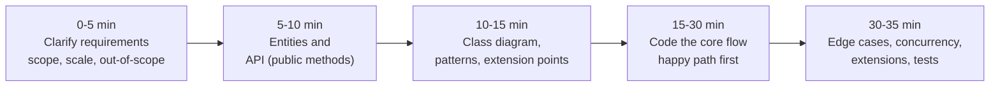
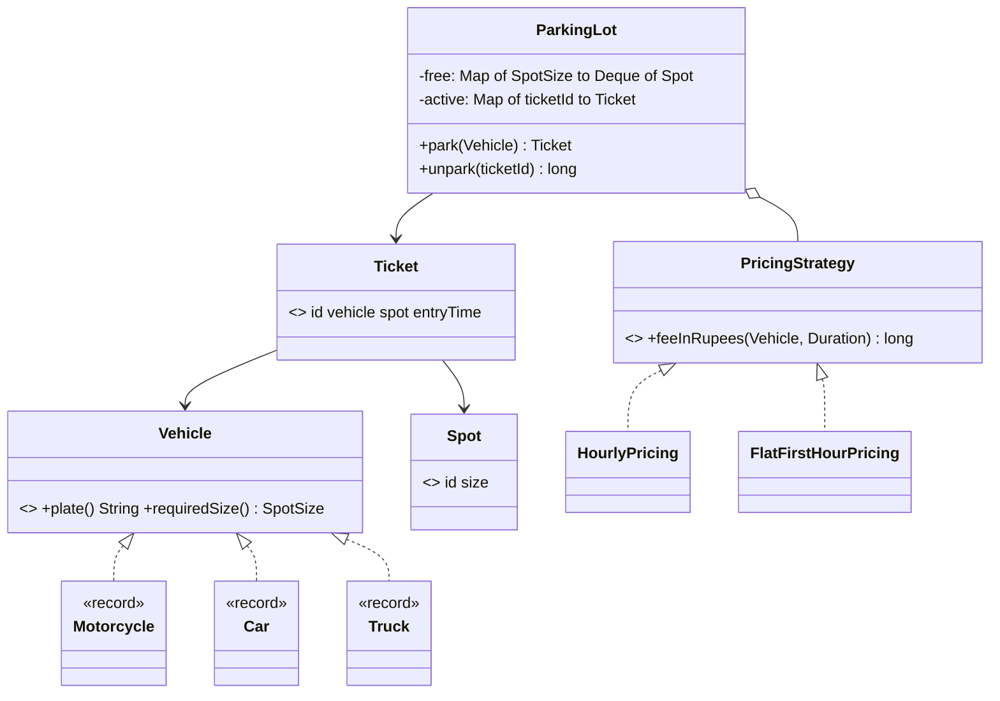
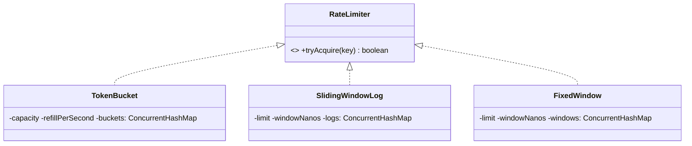
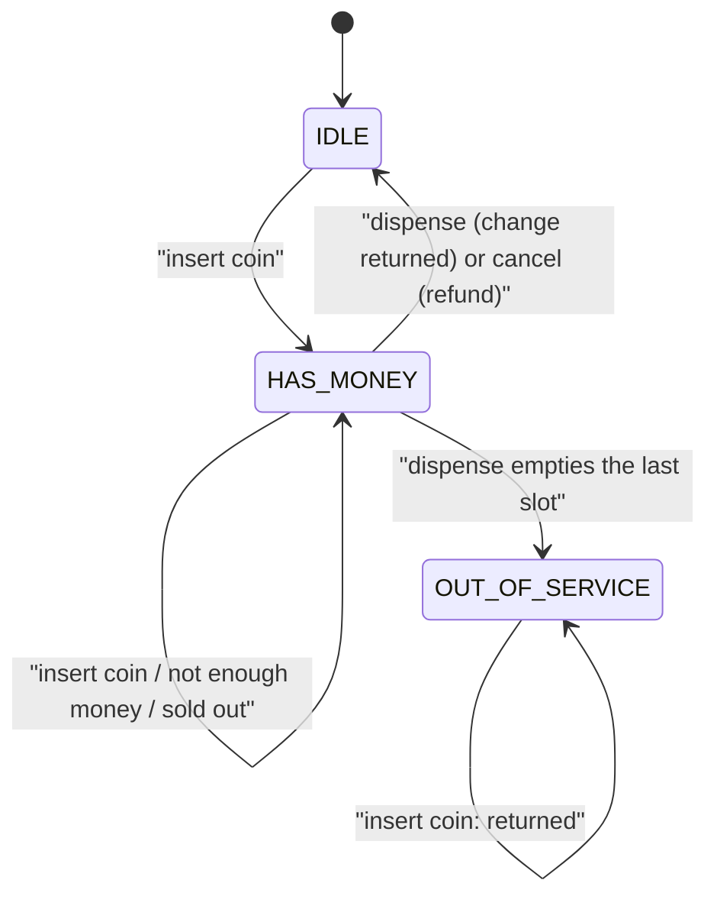
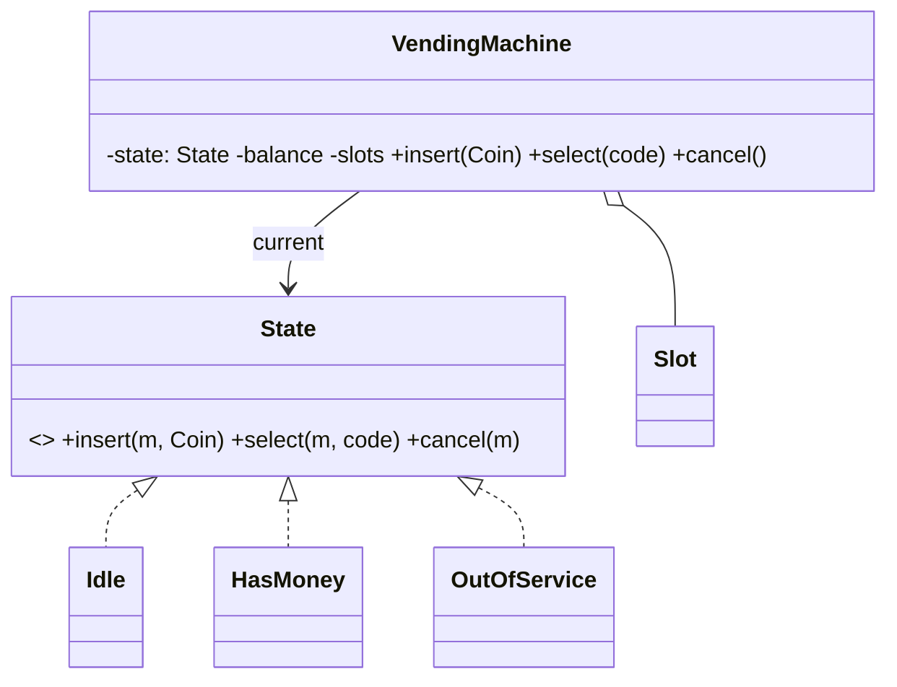
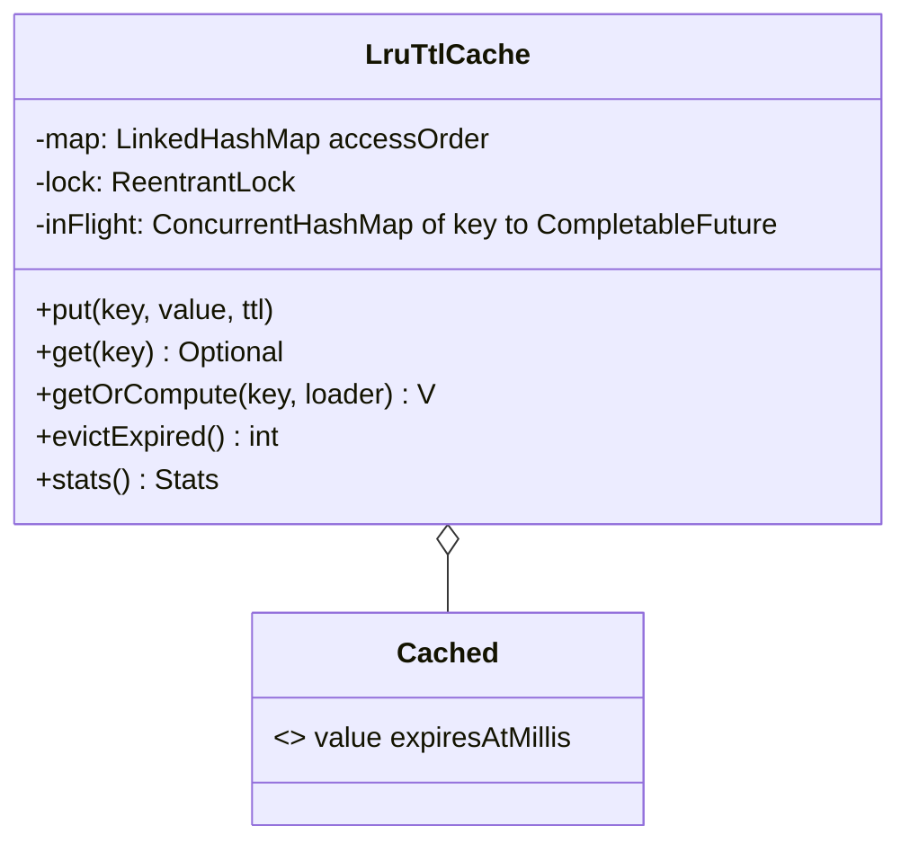

# Low-Level Design (LLD) Interview Problems, Done Properly

> **Level:** SDE-II / SDE-III · **Area:** Java · **Prev:** [Design patterns](02-design-patterns.md) · **Next:** the 8 LLD practice problems in [04-low-level-design](../../../04-low-level-design/README.md)

## TL;DR

- An LLD round tests whether you can turn a vague sentence ("design a parking lot") into **clean classes, clear responsibilities and a working core flow** in ~35-45 minutes, and then **defend and extend** it. It is *not* a pattern-recital contest.
- The reliable routine: **requirements → entities → relationships/diagram → interfaces & extension points → code the happy path → edge cases, concurrency, extensions**. Say the trade-offs out loud.
- Four problems, each with runnable code and real output: **Parking Lot** (Strategy + sealed types), **Rate Limiter** (token bucket vs sliding window vs fixed window, thread-safe), **Vending Machine** (State pattern), **thread-safe LRU + TTL cache** (single-flight loading).
- Cross-cutting tricks that make every solution testable and impressive: **inject a `Clock`/time source** (no `Thread.sleep`, deterministic demos), **constructor injection**, **immutable records** for data, **sealed types/enums** for closed sets, **one lock with a clear invariant** before anything fancier.

## The analogy: building with a floor plan, not bricks

A good LLD is an **architect's floor plan**: rooms (classes) with one purpose each, doors (interfaces) where you expect to knock a wall through later (new pricing, new vehicle), and a note on which rooms can hold only one person at a time (locks). The interviewer isn't grading wallpaper; they check you thought about *where the walls go*.

## 0. How to approach an LLD round in 35 minutes



**Checklist (say each step out loud):**

1. **Clarify.** Functional ("what operations?"), non-functional ("single JVM? concurrent callers? how many?"), **scope cut** ("no payments UI, no persistence — OK?"). Write 4-6 numbered requirements on the board.
2. **Nouns → classes, verbs → methods.** Separate *entities with identity* (Ticket, Spot) from *value objects* (Money, Duration → records) and *services* (ParkingLot, RateLimiter).
3. **Define the public API first** (3-6 methods) — it fixes what you must build and what you can skip.
4. **Choose the seams** (where change is likely): pricing rule, allocation rule, eviction policy, state. Put an **interface** exactly there (Strategy/State); everything else stays concrete.
5. **Draw** a small class diagram; name the relationships (has-a, uses, implements).
6. **Code the happy path end-to-end first** (compilable, with `main`); handle edge cases afterwards. Half of a working system beats all of a perfect diagram.
7. **Model data as immutable records / enums / sealed types**; keep mutable state in *one* place behind *one* lock.
8. **Concurrency:** state the shared state, the invariant, and the lock that protects it. Start with a single coarse lock; mention finer-grained options and their cost.
9. **Extensions:** name 2-3 you'd do next (persistence, distributed version, metrics) and what part of the design absorbs them.
10. **Test strategy:** inject time/IDs/random so the core is deterministic; show one scenario in `main`.

> [!TIP]
> Typical interviewer follow-ups: *"add a new vehicle type / pricing rule"* (OCP), *"make it thread-safe"*, *"how would you test it?"*, *"what changes if it's distributed / persistent?"*, *"what if 1 million keys?"*. Prepare a 20-second answer for each *before* you code.

Common mistakes: coding before clarifying; an `if/else` on type instead of polymorphism where change is obvious; god class `ParkingLotManager`; `public` mutable fields; ignoring `null`/invalid input; "thread-safe" with `Collections.synchronizedMap` plus compound check-then-act races; over-engineering (abstract factory for a 2-class domain).

---

## 1. Parking Lot (Strategy + sealed types)

### Requirements (what I would write on the board)

1. Lot has fixed **spots of sizes** SMALL / MEDIUM / LARGE; vehicles are **motorcycle (needs SMALL), car (MEDIUM), truck (LARGE)**; a vehicle may use a **bigger** spot if its own size is full.
2. `park(vehicle)` returns a **ticket** (or fails if the lot is full / vehicle already inside).
3. `unpark(ticket)` frees the spot and returns the **fee**.
4. **Pricing is pluggable** (hourly per vehicle type today; flat-then-hourly tomorrow).
5. Concurrent gates — two cars must never get the same spot.
6. Out of scope: payments, persistence, multi-level navigation, EV charging (mention as extensions).

### Entities and diagram



Design decisions worth saying out loud:

- **Sealed `Vehicle`** + pattern `switch`: the compiler tells us every place to update when a new vehicle type appears (closed set, many operations). **Pricing is a Strategy** because that's the part that actually changes per business rule.
- **Best-fit allocation**: try the smallest sufficient spot first, so trucks aren't blocked by cars squatting in LARGE spots.
- **One lock** (`synchronized` on the lot) protects `free` + `active` + `plates`: the check-then-act "find free spot → remove it → record ticket" must be atomic.
- **`Clock` is injected**, so duration-based pricing is testable.

```java
// Run: ParkingLotDemo.java
import java.time.*;
import java.util.*;
import java.util.concurrent.*;
import java.util.concurrent.atomic.AtomicInteger;

public class ParkingLotDemo {
    enum SpotSize { SMALL, MEDIUM, LARGE }

    sealed interface Vehicle permits Motorcycle, Car, Truck {
        String plate();
        default SpotSize requiredSize() {
            return switch (this) {
                case Motorcycle m -> SpotSize.SMALL;
                case Car c        -> SpotSize.MEDIUM;
                case Truck t      -> SpotSize.LARGE;
            };
        }
    }
    record Motorcycle(String plate) implements Vehicle {}
    record Car(String plate)        implements Vehicle {}
    record Truck(String plate)      implements Vehicle {}

    record Spot(String id, SpotSize size) {}
    record Ticket(String id, Vehicle vehicle, Spot spot, Instant entryTime) {}

    // ---- Strategy: pricing -------------------------------------------------------------------------------------
    interface PricingStrategy { long feeInRupees(Vehicle v, Duration parked); }

    static long billableHours(Duration d) { return Math.max(1, (d.toSeconds() + 3599) / 3600); }   // ceil, minimum 1 hour

    static class HourlyPricing implements PricingStrategy {
        public long feeInRupees(Vehicle v, Duration d) {
            long rate = switch (v) { case Motorcycle m -> 10; case Car c -> 20; case Truck t -> 50; };
            return billableHours(d) * rate;
        }
    }
    static class FlatFirstHourPricing implements PricingStrategy {            // 30 for the first hour, 15 per extra hour
        public long feeInRupees(Vehicle v, Duration d) { return 30 + (billableHours(d) - 1) * 15; }
    }

    static class LotFullException extends RuntimeException { LotFullException(String m) { super(m); } }

    // ---- The lot: all mutable state guarded by `this` ----------------------------------------------------------
    static class ParkingLot {
        private final Map<SpotSize, Deque<Spot>> free = new EnumMap<>(SpotSize.class);
        private final Map<String, Ticket> active = new HashMap<>();
        private final Set<String> plates = new HashSet<>();
        private final Clock clock; private final PricingStrategy pricing; private int seq = 0;

        ParkingLot(List<Spot> spots, Clock clock, PricingStrategy pricing) {
            for (SpotSize s : SpotSize.values()) free.put(s, new ArrayDeque<>());
            spots.forEach(sp -> free.get(sp.size()).addLast(sp));
            this.clock = clock; this.pricing = pricing;
        }

        synchronized Ticket park(Vehicle v) {
            if (!plates.add(v.plate())) throw new IllegalStateException("already parked: " + v.plate());
            for (SpotSize size : SpotSize.values()) {                        // SMALL -> MEDIUM -> LARGE = best fit first
                if (size.compareTo(v.requiredSize()) < 0) continue;          // too small for this vehicle
                Spot spot = free.get(size).pollFirst();
                if (spot != null) {
                    Ticket t = new Ticket("T" + (++seq), v, spot, clock.instant());
                    active.put(t.id(), t);
                    return t;
                }
            }
            plates.remove(v.plate());                                        // roll back the plate reservation
            throw new LotFullException("no spot for " + v);
        }

        synchronized long unpark(String ticketId) {
            Ticket t = active.remove(ticketId);
            if (t == null) throw new IllegalArgumentException("unknown ticket " + ticketId);
            free.get(t.spot().size()).addFirst(t.spot());
            plates.remove(t.vehicle().plate());
            return pricing.feeInRupees(t.vehicle(), Duration.between(t.entryTime(), clock.instant()));
        }

        synchronized int freeSpots() { return free.values().stream().mapToInt(Deque::size).sum(); }
    }

    /** A clock we can move by hand: deterministic tests, no sleeping. */
    static class MutableClock extends Clock {
        private volatile Instant now = Instant.parse("2026-01-01T10:00:00Z");
        void advance(Duration d) { now = now.plus(d); }
        @Override public ZoneId getZone() { return ZoneOffset.UTC; }
        @Override public Clock withZone(ZoneId zone) { return this; }
        @Override public Instant instant() { return now; }
    }

    public static void main(String[] args) throws Exception {
        MutableClock clock = new MutableClock();
        ParkingLot lot = new ParkingLot(List.of(new Spot("S1", SpotSize.SMALL), new Spot("M1", SpotSize.MEDIUM),
                                                new Spot("M2", SpotSize.MEDIUM), new Spot("L1", SpotSize.LARGE)),
                                        clock, new HourlyPricing());

        Map<String, Ticket> tickets = new LinkedHashMap<>();
        for (Vehicle v : List.of(new Motorcycle("KA01"), new Motorcycle("KA02"), new Car("KA03"), new Car("KA04"))) {
            Ticket t = lot.park(v);
            tickets.put(v.plate(), t);
            System.out.println("parked " + v.plate() + " (" + v.getClass().getSimpleName() + ") -> " + t.spot().id() + ", ticket " + t.id());
        }
        try { lot.park(new Car("KA05")); } catch (LotFullException e) { System.out.println("full: " + e.getMessage()); }
        try { lot.park(new Car("KA03")); } catch (IllegalStateException e) { System.out.println("rejected: " + e.getMessage()); }

        clock.advance(Duration.ofMinutes(130));                              // 2h10m -> billed as 3 hours
        System.out.println("KA03 car        pays " + lot.unpark(tickets.get("KA03").id()) + "  (3h x 20)");
        System.out.println("KA01 motorcycle pays " + lot.unpark(tickets.get("KA01").id()) + "  (3h x 10)");
        System.out.println("free spots now: " + lot.freeSpots());
        System.out.println("same 2h10m under FlatFirstHourPricing: " + new FlatFirstHourPricing().feeInRupees(new Car("X"), Duration.ofMinutes(130)));

        // Concurrency check: 100 cars race for 10 spots; exactly 10 must win
        List<Spot> ten = new ArrayList<>();
        for (int i = 0; i < 10; i++) ten.add(new Spot("M" + i, SpotSize.MEDIUM));
        ParkingLot busy = new ParkingLot(ten, clock, new HourlyPricing());
        ExecutorService pool = Executors.newFixedThreadPool(16);
        AtomicInteger parked = new AtomicInteger(), rejected = new AtomicInteger();
        List<Callable<Void>> jobs = new ArrayList<>();
        for (int i = 0; i < 100; i++) {
            final String plate = "CAR" + i;
            jobs.add(() -> { try { busy.park(new Car(plate)); parked.incrementAndGet(); } catch (LotFullException e) { rejected.incrementAndGet(); } return null; });
        }
        pool.invokeAll(jobs);
        pool.shutdown();
        System.out.println("100 concurrent cars, 10 spots -> parked=" + parked + " rejected=" + rejected + " free=" + busy.freeSpots());
    }
}
```

```text
parked KA01 (Motorcycle) -> S1, ticket T1
parked KA02 (Motorcycle) -> M1, ticket T2
parked KA03 (Car) -> M2, ticket T3
parked KA04 (Car) -> L1, ticket T4
full: no spot for Car[plate=KA05]
rejected: already parked: KA03
KA03 car        pays 60  (3h x 20)
KA01 motorcycle pays 30  (3h x 10)
free spots now: 2
same 2h10m under FlatFirstHourPricing: 60
100 concurrent cars, 10 spots -> parked=10 rejected=90 free=0
```

**Extension discussion**

| Follow-up | How the design absorbs it |
|---|---|
| New vehicle (EV, bus) | Add a `permits` entry + record; the compiler flags the `switch`es in `requiredSize` and pricing. |
| New pricing (peak hours, weekend, membership) | New `PricingStrategy`; maybe a `Decorator` (`PeakSurcharge(inner)`). |
| Multiple floors / nearest-to-entrance | `Floor` objects each with their own free-lists; an `AllocationStrategy` interface replaces the loop in `park`. |
| Persistence / multiple gates on different machines | Tickets in a DB; allocation via row lock / `SELECT ... FOR UPDATE SKIP LOCKED` or an atomic counter per size in Redis. |
| Reservations, EV charging | New spot attributes + filter in `AllocationStrategy`. |

**Thread-safety notes:** the coarse lock makes `park`/`unpark` linearizable and trivially correct; throughput is limited by the lock, but the critical section is a few hash/deque operations (microseconds). If profiling showed contention, use **one lock (or a `ConcurrentLinkedDeque`) per size** — but then "try SMALL then MEDIUM" must handle races and the plate set becomes a `ConcurrentHashMap.newKeySet()` (`add` is the atomic check). Don't start there.

---

## 2. Rate Limiter (token bucket, sliding window, fixed window)

### Requirements

1. `tryAcquire(key)` → `true` if the request is allowed, `false` if throttled; limits are **per key** (user/API-key/IP).
2. Algorithms: **token bucket** (allows bursts, steady average rate), **sliding window log** (exact, "N requests in any window"), **fixed window counter** (cheapest, but boundary bursts) — and a way to pick one (Strategy).
3. **Thread-safe**, in a single JVM (distributed version: discussion).
4. Time is **injected** (a `LongSupplier` of nanoseconds, i.e. `System::nanoTime` in production).



Key implementation ideas:

- **Token bucket** doesn't need a background refill thread: store `(tokens, lastRefillTime)` per key and **refill lazily** on each call (`tokens = min(capacity, tokens + elapsed × rate)`). The demo keeps tokens as **integer nano-tokens** (`1 token = 1_000_000_000`) so there's no floating-point drift at exact boundaries.
- **Per-key state** lives in a `ConcurrentHashMap`; the *compound* read-modify-write for one key runs inside `synchronized(bucket)`. Different keys never contend (lock striping for free).
- **Sliding window log** keeps a deque of accepted timestamps per key; each call evicts timestamps older than the window, then checks `size < limit`.

```java
// Run: RateLimiterDemo.java
import java.util.*;
import java.util.concurrent.*;
import java.util.concurrent.atomic.AtomicInteger;
import java.util.concurrent.atomic.AtomicLong;
import java.util.function.LongSupplier;

public class RateLimiterDemo {
    interface RateLimiter { boolean tryAcquire(String key); }

    static final long NANOS = 1_000_000_000L;

    // ---------------- Token bucket: bursts up to `capacity`, then `refillPerSecond` steady ----------------
    static class TokenBucket implements RateLimiter {
        private static final class Bucket { long nanoTokens; long lastNanos; }
        private final long capacityNano, refillPerSecond; private final LongSupplier nanos;
        private final ConcurrentHashMap<String, Bucket> buckets = new ConcurrentHashMap<>();

        TokenBucket(long capacity, long refillPerSecond, LongSupplier nanos) {
            this.capacityNano = capacity * NANOS; this.refillPerSecond = refillPerSecond; this.nanos = nanos;
        }
        @Override public boolean tryAcquire(String key) {
            Bucket b = buckets.computeIfAbsent(key, k -> { Bucket nb = new Bucket(); nb.nanoTokens = capacityNano; nb.lastNanos = nanos.getAsLong(); return nb; });
            synchronized (b) {                                              // per-key critical section
                long now = nanos.getAsLong();
                long elapsed = Math.max(0, now - b.lastNanos);
                elapsed = Math.min(elapsed, capacityNano / refillPerSecond + 1);   // cap: avoids overflow after long idle
                b.nanoTokens = Math.min(capacityNano, b.nanoTokens + elapsed * refillPerSecond);   // lazy refill
                b.lastNanos = now;
                if (b.nanoTokens >= NANOS) { b.nanoTokens -= NANOS; return true; }
                return false;
            }
        }
    }

    // ---------------- Sliding window log: exact, O(limit) memory per key ----------------
    static class SlidingWindowLog implements RateLimiter {
        private final int limit; private final long windowNanos; private final LongSupplier nanos;
        private final ConcurrentHashMap<String, ArrayDeque<Long>> logs = new ConcurrentHashMap<>();
        SlidingWindowLog(int limit, long windowMillis, LongSupplier nanos) { this.limit = limit; this.windowNanos = windowMillis * 1_000_000L; this.nanos = nanos; }
        @Override public boolean tryAcquire(String key) {
            ArrayDeque<Long> log = logs.computeIfAbsent(key, k -> new ArrayDeque<>());
            synchronized (log) {
                long now = nanos.getAsLong();
                while (!log.isEmpty() && now - log.peekFirst() >= windowNanos) log.pollFirst();   // drop expired entries
                if (log.size() < limit) { log.addLast(now); return true; }
                return false;
            }
        }
    }

    // ---------------- Fixed window counter: O(1) memory, but a burst of 2x limit at the boundary ----------------
    static class FixedWindow implements RateLimiter {
        private static final class W { long index = -1; int count; }
        private final int limit; private final long windowNanos; private final LongSupplier nanos;
        private final ConcurrentHashMap<String, W> windows = new ConcurrentHashMap<>();
        FixedWindow(int limit, long windowMillis, LongSupplier nanos) { this.limit = limit; this.windowNanos = windowMillis * 1_000_000L; this.nanos = nanos; }
        @Override public boolean tryAcquire(String key) {
            W w = windows.computeIfAbsent(key, k -> new W());
            synchronized (w) {
                long idx = nanos.getAsLong() / windowNanos;
                if (idx != w.index) { w.index = idx; w.count = 0; }            // a new window starts: counter resets
                if (w.count < limit) { w.count++; return true; }
                return false;
            }
        }
    }

    // ---------------- helpers for the demo ----------------
    static String burst(RateLimiter rl, String key, int n) {
        StringBuilder sb = new StringBuilder();
        for (int i = 0; i < n; i++) sb.append(rl.tryAcquire(key) ? 'T' : 'F');
        return sb.toString();
    }
    static long countAllowedConcurrently(RateLimiter rl, int threads, int perThread) throws Exception {
        ExecutorService pool = Executors.newFixedThreadPool(threads);
        AtomicInteger allowed = new AtomicInteger();
        List<Callable<Void>> jobs = new ArrayList<>();
        for (int t = 0; t < threads; t++) jobs.add(() -> { for (int i = 0; i < perThread; i++) if (rl.tryAcquire("shared")) allowed.incrementAndGet(); return null; });
        pool.invokeAll(jobs);
        pool.shutdown();
        return allowed.get();
    }

    public static void main(String[] args) throws Exception {
        AtomicLong clock = new AtomicLong();                       // fake time in nanoseconds
        LongSupplier time = clock::get;

        System.out.println("TOKEN BUCKET (capacity 5, refill 1/s)   T = allowed, F = throttled");
        TokenBucket tb = new TokenBucket(5, 1, time);
        System.out.println("  t=0s   7 requests : " + burst(tb, "alice", 7));
        clock.addAndGet(2 * NANOS);
        System.out.println("  t=2s   3 requests : " + burst(tb, "alice", 3) + "   (2 tokens refilled)");
        clock.addAndGet(100 * NANOS);
        System.out.println("  t=102s 7 requests : " + burst(tb, "alice", 7) + "   (long idle does NOT bank > capacity)");
        System.out.println("  other key 'bob'   : " + burst(tb, "bob", 6) + "   (independent bucket)");

        System.out.println("BOUNDARY BURST (limit 3 per 1000 ms): 3 requests at t=900ms, 3 more at t=1100ms");
        for (String name : List.of("fixed", "sliding", "token")) {
            clock.set(0);
            RateLimiter rl = switch (name) {
                case "fixed"   -> new FixedWindow(3, 1000, time);
                case "sliding" -> new SlidingWindowLog(3, 1000, time);
                default        -> new TokenBucket(3, 3, time);
            };
            clock.set(900_000_000L);  String first = burst(rl, "u", 3);
            clock.set(1_100_000_000L); String second = burst(rl, "u", 3);
            System.out.printf("  %-8s %s then %s%n", name, first, second);
        }

        System.out.println("CONCURRENCY (frozen clock, 16 threads x 50 requests = 800 attempts, limit 100):");
        clock.set(0); System.out.println("  token bucket   allowed = " + countAllowedConcurrently(new TokenBucket(100, 1, time), 16, 50));
        clock.set(0); System.out.println("  sliding window allowed = " + countAllowedConcurrently(new SlidingWindowLog(100, 1000, time), 16, 50));
        clock.set(0); System.out.println("  fixed window   allowed = " + countAllowedConcurrently(new FixedWindow(100, 1000, time), 16, 50));
    }
}
```

```text
TOKEN BUCKET (capacity 5, refill 1/s)   T = allowed, F = throttled
  t=0s   7 requests : TTTTTFF
  t=2s   3 requests : TTF   (2 tokens refilled)
  t=102s 7 requests : TTTTTFF   (long idle does NOT bank > capacity)
  other key 'bob'   : TTTTTF   (independent bucket)
BOUNDARY BURST (limit 3 per 1000 ms): 3 requests at t=900ms, 3 more at t=1100ms
  fixed    TTT then TTT
  sliding  TTT then FFF
  token    TTT then FFF
CONCURRENCY (frozen clock, 16 threads x 50 requests = 800 attempts, limit 100):
  token bucket   allowed = 100
  sliding window allowed = 100
  fixed window   allowed = 100
```

**Comparison**

| | Token bucket | Sliding window log | Fixed window counter | (Sliding window counter) |
|---|---|---|---|---|
| Memory per key | O(1) (2 numbers) | **O(limit)** timestamps | O(1) | O(1) (2 counters) |
| Burst behaviour | allows burst up to `capacity`, then steady rate | exact: never more than `limit` in *any* window | up to **2× limit** across a boundary | approximates sliding (weights previous window) |
| Accuracy | good for "average rate + burst" | exact | coarse | very close to exact |
| Typical use | API gateways, `Guava RateLimiter` (smooth bursty), Bucket4j | strict quotas, low limits | cheap coarse limits, Redis `INCR`+`EXPIRE` | large-scale gateways |

**Extensions & discussion**

- **Distributed limit** (many app instances): state must be shared — **Redis** with an atomic Lua script (token bucket) or `INCR` + `EXPIRE` (fixed window) / sorted set (sliding log). Trade-off: a network hop per request vs. local approximate limits (each node gets `limit / N`). See [system design](../../../01-system-design/README.md) for the full treatment.
- **What to return:** a result object with `allowed`, `remaining`, `retryAfter` (HTTP 429 + `Retry-After`, `X-RateLimit-*` headers), not just a boolean.
- **Memory growth** for unbounded keys: evict idle keys (a `ConcurrentHashMap` that never shrinks is a leak) — e.g. a TTL cache from section 4, or Caffeine.
- **Time source:** use `System.nanoTime()` (monotonic), never `currentTimeMillis` (wall clock can jump backwards).
- **Thread-safety notes:** the map operation (`computeIfAbsent`) is atomic, but the **read-refill-decrement** is a compound action: it must be inside the per-key lock (or CAS on an immutable `(tokens, ts)` state object). `AtomicInteger` alone for a counter fails when you also need to reset the window atomically with the increment.

---

## 3. Vending Machine (State pattern)

### Requirements

1. Products in slots with a code, name, price and quantity. Coins accepted: 5, 10, 25, 100 (cents).
2. Operations: `insert(coin)`, `select(code)`, `cancel()` (refund).
3. Behaviour depends on state: **IDLE** (no money), **HAS_MONEY**, **OUT_OF_SERVICE** (nothing left to sell).
4. Dispense when `balance >= price`, return **change**; reject sold-out/invalid codes without losing the customer's money.
5. Single user at a time; guard with a lock (mention concurrency).





The machine **delegates every action to its current `State` object**; each state class contains *only* what's legal there, and *transitions by assigning the next state*. No `if (state == …)` chains.

```java
// Run: VendingMachineDemo.java
import java.util.*;

public class VendingMachineDemo {
    enum Coin {
        NICKEL(5), DIME(10), QUARTER(25), DOLLAR(100);
        final int cents; Coin(int c) { cents = c; }
    }
    record Product(String name, int priceCents) {}
    static class Slot { final Product product; int qty; Slot(Product p, int q) { product = p; qty = q; } }

    /** Greedy change-making: correct for canonical coin systems like this one (5/10/25/100). */
    static Map<Coin, Integer> makeChange(int cents) {
        Map<Coin, Integer> change = new EnumMap<>(Coin.class);
        Coin[] byValueDesc = Coin.values().clone();
        Arrays.sort(byValueDesc, Comparator.comparingInt((Coin c) -> c.cents).reversed());
        for (Coin c : byValueDesc) { int n = cents / c.cents; if (n > 0) { change.put(c, n); cents -= n * c.cents; } }
        if (cents != 0) throw new IllegalStateException("cannot make exact change, remainder " + cents);
        return change;
    }

    // ---------------- State pattern ----------------
    interface State {
        String name();
        void insert(VendingMachine m, Coin c);
        void select(VendingMachine m, String code);
        void cancel(VendingMachine m);
    }

    static class Idle implements State {
        public String name() { return "IDLE"; }
        public void insert(VendingMachine m, Coin c) { m.balance += c.cents; m.state = new HasMoney(); m.say("inserted " + c + " (balance " + m.balance + ")"); }
        public void select(VendingMachine m, String code) { m.say("insert money first"); }
        public void cancel(VendingMachine m) { m.say("nothing to refund"); }
    }

    static class HasMoney implements State {
        public String name() { return "HAS_MONEY"; }
        public void insert(VendingMachine m, Coin c) { m.balance += c.cents; m.say("inserted " + c + " (balance " + m.balance + ")"); }
        public void select(VendingMachine m, String code) {
            Slot s = m.slots.get(code);
            if (s == null)                         { m.say("invalid code " + code); return; }
            if (s.qty == 0)                        { m.say(s.product.name() + " is sold out (money kept in machine, press cancel to refund)"); return; }
            if (m.balance < s.product.priceCents()) { m.say("need " + (s.product.priceCents() - m.balance) + " more cents for " + s.product.name()); return; }
            s.qty--;                                                         // DISPENSING happens atomically inside this call
            int changeCents = m.balance - s.product.priceCents();
            m.balance = 0;
            m.say("dispensed " + s.product.name() + (changeCents > 0 ? ", change " + makeChange(changeCents) : ", exact amount"));
            m.state = m.slots.values().stream().allMatch(x -> x.qty == 0) ? new OutOfService() : new Idle();
        }
        public void cancel(VendingMachine m) { m.say("refunded " + makeChange(m.balance)); m.balance = 0; m.state = new Idle(); }
    }

    static class OutOfService implements State {
        public String name() { return "OUT_OF_SERVICE"; }
        public void insert(VendingMachine m, Coin c) { m.say("out of service, returned " + c); }
        public void select(VendingMachine m, String code) { m.say("out of service"); }
        public void cancel(VendingMachine m) { m.say("nothing to refund"); }
    }

    // ---------------- Context ----------------
    static class VendingMachine {
        State state = new Idle(); int balance; final Map<String, Slot> slots = new LinkedHashMap<>();
        void add(String code, Product p, int qty) { slots.put(code, new Slot(p, qty)); }
        // public API: synchronized => one user action at a time; each delegates to the current state
        synchronized void insert(Coin c)       { System.out.print("[" + state.name() + "] insert " + c + ": "); state.insert(this, c); }
        synchronized void select(String code)  { System.out.print("[" + state.name() + "] select " + code + ": "); state.select(this, code); }
        synchronized void cancel()             { System.out.print("[" + state.name() + "] cancel: "); state.cancel(this); }
        void say(String s) { System.out.println(s); }
    }

    public static void main(String[] args) {
        VendingMachine vm = new VendingMachine();
        vm.add("A1", new Product("Cola", 125), 1);
        vm.add("B1", new Product("Chips", 60), 2);

        vm.select("A1");                       // no money yet
        vm.insert(Coin.DOLLAR);
        vm.select("A1");                       // 100 < 125
        vm.insert(Coin.QUARTER);
        vm.select("A1");                       // exact amount
        vm.insert(Coin.DOLLAR); vm.insert(Coin.DOLLAR);
        vm.select("B1");                       // 200 - 60 = 140 change
        vm.insert(Coin.DOLLAR);
        vm.select("A1");                       // cola sold out
        vm.select("Z9");                       // invalid code
        vm.cancel();                           // refund
        vm.insert(Coin.DOLLAR);
        vm.select("B1");                       // last item sold -> OUT_OF_SERVICE
        vm.insert(Coin.QUARTER);
    }
}
```

```text
[IDLE] select A1: insert money first
[IDLE] insert DOLLAR: inserted DOLLAR (balance 100)
[HAS_MONEY] select A1: need 25 more cents for Cola
[HAS_MONEY] insert QUARTER: inserted QUARTER (balance 125)
[HAS_MONEY] select A1: dispensed Cola, exact amount
[IDLE] insert DOLLAR: inserted DOLLAR (balance 100)
[HAS_MONEY] insert DOLLAR: inserted DOLLAR (balance 200)
[HAS_MONEY] select B1: dispensed Chips, change {NICKEL=1, DIME=1, QUARTER=1, DOLLAR=1}
[IDLE] insert DOLLAR: inserted DOLLAR (balance 100)
[HAS_MONEY] select A1: Cola is sold out (money kept in machine, press cancel to refund)
[HAS_MONEY] select Z9: invalid code Z9
[HAS_MONEY] cancel: refunded {DOLLAR=1}
[IDLE] insert DOLLAR: inserted DOLLAR (balance 100)
[HAS_MONEY] select B1: dispensed Chips, change {NICKEL=1, DIME=1, QUARTER=1}
[OUT_OF_SERVICE] insert QUARTER: out of service, returned QUARTER
```

**Extension discussion**

| Follow-up | Answer |
|---|---|
| **Machine runs out of coins for change** | Track coin inventory; `makeChange` becomes a bounded problem (DP/backtracking for non-canonical systems); add an `EXACT_CHANGE_ONLY` state or refuse sales that can't be settled. |
| New state (maintenance, card payment) | Add a `State` class and the transitions into it — existing states barely change (OCP). |
| Many machines / remote restock | `VendingMachine` stays single-machine; inventory service + events; each machine is an actor with its own lock/queue. |
| Alternatives to the State classes | Enum with constant-specific behaviour (as in [patterns §9](02-design-patterns.md)) for small machines; a transition table `Map<State, Map<Event, State>>` for big/declarative ones. |
| Money as `int` cents | Never `double` for money (rounding). Use `long` minor units or `BigDecimal` with a currency (`Money` record). |

**Thread-safety notes:** the machine is a single physical device with one user, so `synchronized` on the context is enough. *States themselves are stateless*, so they could be shared singletons (here they're allocated per transition for readability). Keep **balance and state changes in the same critical section**, or a refund could race with a dispense.

---

## 4. Thread-safe LRU + TTL cache

Builds on [`LinkedHashMap` access-order LRU](../02-collections/04-ordered-maps-lru.md). That note's 10-line LRU is **not thread-safe**: even `get` mutates the order list, so concurrent reads corrupt it. Here we make it production-shaped.

### Requirements

1. `put(key, value)` / `put(key, value, ttl)`, `get(key)` → `Optional<V>`.
2. **Bounded:** at most `capacity` entries; evict the **least-recently used**.
3. **Expiry:** entries older than their TTL are treated as absent (lazy removal + an explicit `evictExpired()` sweep).
4. **Thread-safe**; `getOrCompute(key, loader)` must **load once** even if 100 threads miss simultaneously (**single-flight**, prevents cache stampede).
5. **Stats:** hits, misses, evictions. **Time injected** for tests.



Design decisions:

- **A plain `ReentrantLock` (or `synchronized`) around a `LinkedHashMap(accessOrder=true)`.** A `ReadWriteLock` doesn't help: access-order `get` is a *write* to the linked list. (Caffeine/Guava avoid this with striped buffers and asynchronous maintenance — mention it, don't rebuild it.)
- **Never run the user's `loader` while holding the lock** — a slow DB call would block every other thread. Hence `getOrCompute` coordinates through an `inFlight` map of `CompletableFuture`s: the first thread for a key loads, the others `join()` its future.
- **Lazy expiry** keeps `get` O(1); the downside is dead entries occupy capacity until touched or swept — so `evictExpired()` exists (call it from a scheduled task) and LRU eviction still bounds memory.
- **Time = `LongSupplier` of millis** (`System::currentTimeMillis` or `nanoTime`-based). Prefer a monotonic source in production.

```java
// Run: LruTtlCacheDemo.java
import java.util.*;
import java.util.concurrent.*;
import java.util.concurrent.atomic.AtomicInteger;
import java.util.concurrent.atomic.AtomicLong;
import java.util.concurrent.atomic.LongAdder;
import java.util.concurrent.locks.ReentrantLock;
import java.util.function.Function;
import java.util.function.LongSupplier;

public class LruTtlCacheDemo {

    static class LruTtlCache<K, V> {
        private record Cached<V>(V value, long expiresAtMillis) {}
        record Stats(long hits, long misses, long evictions) {}

        private final int capacity; private final long defaultTtlMillis; private final LongSupplier clockMillis;
        private final ReentrantLock lock = new ReentrantLock();
        private final LongAdder hits = new LongAdder(), misses = new LongAdder(), evictions = new LongAdder();
        private final ConcurrentHashMap<K, CompletableFuture<V>> inFlight = new ConcurrentHashMap<>();
        private final LinkedHashMap<K, Cached<V>> map;

        LruTtlCache(int capacity, long defaultTtlMillis, LongSupplier clockMillis) {
            this.capacity = capacity; this.defaultTtlMillis = defaultTtlMillis; this.clockMillis = clockMillis;
            this.map = new LinkedHashMap<>(16, 0.75f, true) {                 // access-order => LRU
                @Override protected boolean removeEldestEntry(Map.Entry<K, Cached<V>> eldest) {
                    boolean evict = size() > LruTtlCache.this.capacity;
                    if (evict) evictions.increment();
                    return evict;
                }
            };
        }

        void put(K key, V value) { put(key, value, defaultTtlMillis); }
        void put(K key, V value, long ttlMillis) {
            lock.lock();
            try { map.put(key, new Cached<>(value, clockMillis.getAsLong() + ttlMillis)); }
            finally { lock.unlock(); }
        }

        Optional<V> get(K key) {
            lock.lock();
            try {
                Cached<V> e = map.get(key);                                    // also marks the entry most-recently-used
                if (e == null) { misses.increment(); return Optional.empty(); }
                if (clockMillis.getAsLong() >= e.expiresAtMillis()) {         // expired: remove lazily, count as a miss
                    map.remove(key); misses.increment(); return Optional.empty();
                }
                hits.increment();
                return Optional.of(e.value());
            } finally { lock.unlock(); }
        }

        /** Single-flight loading: concurrent misses for the same key trigger ONE call to the loader. */
        V getOrCompute(K key, Function<K, V> loader) {
            Optional<V> cached = get(key);
            if (cached.isPresent()) return cached.get();

            CompletableFuture<V> mine = new CompletableFuture<>();
            CompletableFuture<V> existing = inFlight.putIfAbsent(key, mine);
            if (existing != null) return existing.join();                     // someone else is loading: wait for their result

            try {
                Optional<V> again = peek(key);                                // re-check: a loader may have just finished
                V value = again.isPresent() ? again.get() : loader.apply(key);   // loader runs OUTSIDE the lock
                if (again.isEmpty()) put(key, value);
                mine.complete(value);
                return value;
            } catch (RuntimeException ex) {
                mine.completeExceptionally(ex);                               // waiters fail too; nothing is cached
                throw ex;
            } finally {
                inFlight.remove(key, mine);
            }
        }
        private Optional<V> peek(K key) {                                     // lookup without touching stats/order
            lock.lock();
            try { Cached<V> e = map.get(key); return (e != null && clockMillis.getAsLong() < e.expiresAtMillis()) ? Optional.of(e.value()) : Optional.empty(); }
            finally { lock.unlock(); }
        }

        int evictExpired() {                                                  // O(n) sweep; run from a scheduled task
            lock.lock();
            try {
                long now = clockMillis.getAsLong(); int before = map.size();
                map.values().removeIf(e -> now >= e.expiresAtMillis());
                return before - map.size();
            } finally { lock.unlock(); }
        }
        int size() { lock.lock(); try { return map.size(); } finally { lock.unlock(); } }
        Set<K> keysLruToMru() { lock.lock(); try { return new LinkedHashSet<>(map.keySet()); } finally { lock.unlock(); } }
        Stats stats() { return new Stats(hits.sum(), misses.sum(), evictions.sum()); }
    }

    public static void main(String[] args) throws Exception {
        AtomicLong now = new AtomicLong();                                   // fake clock in ms
        LruTtlCache<String, Integer> cache = new LruTtlCache<>(3, 10_000, now::get);

        cache.put("a", 1); cache.put("b", 2); cache.put("c", 3);
        System.out.println("order LRU->MRU        : " + cache.keysLruToMru());
        cache.get("a");                                                      // a becomes most recently used
        System.out.println("after get(a)          : " + cache.keysLruToMru());
        cache.put("d", 4);                                                   // over capacity: evict LRU = b
        System.out.println("after put(d)          : " + cache.keysLruToMru() + "  get(b)=" + cache.get("b"));
        now.addAndGet(11_000);                                               // 11 s later: everything is past its 10 s TTL
        System.out.println("get(a) after 11s TTL  : " + cache.get("a") + "  (expired entries still stored: size=" + cache.size() + ")");
        System.out.println("evictExpired() swept  : " + cache.evictExpired() + ", size now " + cache.size());
        System.out.println("stats                 : " + cache.stats());

        // single-flight: 16 threads miss the same key together; the loader must run exactly once
        LruTtlCache<String, String> shared = new LruTtlCache<>(10, 60_000, now::get);
        AtomicInteger loaderCalls = new AtomicInteger();
        ExecutorService pool = Executors.newFixedThreadPool(16);
        List<Callable<String>> jobs = new ArrayList<>();
        for (int i = 0; i < 16; i++) jobs.add(() -> shared.getOrCompute("user:42", k -> { loaderCalls.incrementAndGet(); sleep(100); return "profile-of-" + k; }));
        Set<String> results = new TreeSet<>();
        for (Future<String> f : pool.invokeAll(jobs)) results.add(f.get());
        System.out.println("16 concurrent misses  : loader calls=" + loaderCalls + ", distinct results=" + results);

        // a loader failure is propagated to everyone and not cached
        try { shared.getOrCompute("bad", k -> { throw new IllegalStateException("db down"); }); }
        catch (IllegalStateException e) { System.out.println("loader failure        : " + e.getMessage() + ", cached? " + shared.get("bad").isPresent()); }

        // stress: invariants hold under heavy mixed load
        LruTtlCache<Integer, Integer> hot = new LruTtlCache<>(50, 1_000_000, now::get);
        int threads = 8, opsPerThread = 20_000;
        AtomicLong gets = new AtomicLong();
        List<Callable<Void>> stress = new ArrayList<>();
        for (int t = 0; t < threads; t++) {
            final long seed = t;
            stress.add(() -> {
                Random r = new Random(seed);
                for (int i = 0; i < opsPerThread; i++) {
                    int key = r.nextInt(100);
                    if (r.nextBoolean()) hot.put(key, key * 2); else { gets.incrementAndGet(); hot.get(key).ifPresent(v -> { if (v != key * 2) throw new AssertionError("corrupt"); }); }
                }
                return null;
            });
        }
        for (Future<Void> f : pool.invokeAll(stress)) f.get();               // get() rethrows any AssertionError
        pool.shutdown();
        LruTtlCache.Stats s = hot.stats();
        System.out.println("stress                : size<=50 is " + (hot.size() <= 50) + ", hits+misses==gets is " + (s.hits() + s.misses() == gets.get()));
    }

    static void sleep(long ms) { try { Thread.sleep(ms); } catch (InterruptedException e) { Thread.currentThread().interrupt(); } }
}
```

```text
order LRU->MRU        : [a, b, c]
after get(a)          : [b, c, a]
after put(d)          : [c, a, d]  get(b)=Optional.empty
get(a) after 11s TTL  : Optional.empty  (expired entries still stored: size=2)
evictExpired() swept  : 2, size now 0
stats                 : Stats[hits=1, misses=2, evictions=1]
16 concurrent misses  : loader calls=1, distinct results=[profile-of-user:42]
loader failure        : db down, cached? false
stress                : size<=50 is true, hits+misses==gets is true
```

**Extension discussion**

| Follow-up | Answer |
|---|---|
| **Higher concurrency** | Lock striping (N segments by `hash(key) % N`, each its own LRU; approximate global LRU) — that's how `ConcurrentLinkedHashMap`/older Guava worked; modern **Caffeine** uses a lock-free read buffer + async maintenance and the **W-TinyLFU** policy for better hit rates. In production: use Caffeine, not your own. |
| **Eviction policy** | `EvictionPolicy` interface (LRU / LFU / FIFO) invoked on access/insert; Strategy pattern. LFU needs counters + (frequency → LinkedHashSet) buckets for O(1). |
| **Active expiry** | `ScheduledExecutorService` calling `evictExpired()`, or a `DelayQueue`/timing wheel to expire precisely. |
| **Write-through / write-behind, persistence** | A `CacheLoader`/`CacheWriter` interface; mind consistency and failure handling. |
| **Weak/soft references** | Memory-sensitive caches (`SoftReference`) — GC-dependent, unpredictable; prefer explicit size/weight bounds. |
| **Distributed cache** | Redis/Memcached; consistent hashing; invalidation, thundering herd, stale reads — see [system design](../../../01-system-design/README.md). |
| **Cache stampede** | single-flight (done), plus TTL jitter and "refresh-ahead" so keys don't all expire together. |

**Thread-safety notes (what to say aloud):** the shared state is the `LinkedHashMap`; invariant = *size ≤ capacity and the linked-list order matches recency*; protected by one lock held only for O(1) work. `get` needs the lock because access-order reads mutate the list. The user-supplied loader runs **outside** the lock to avoid blocking the world. Statistics use `LongAdder` (contention-friendly) and may lag the map by an instant — acceptable for metrics. `Collections.synchronizedMap(LinkedHashMap)` gives per-call atomicity only: a `get`-then-`put` sequence is still a race.

---

## Pitfalls

> [!WARNING]
> - **Check-then-act without a lock** (`if (!full) add`) is the #1 LLD concurrency bug: wrap the whole decision + mutation in one critical section, or use an atomic primitive that *is* the decision (`Set.add`, `putIfAbsent`, `compareAndSet`).
> - **`Collections.synchronizedXxx` ≠ thread-safe design:** individual calls are atomic, compound operations are not.
> - **Calling user callbacks/loaders while holding a lock** (deadlock and latency risk). Compute outside, publish inside.
> - **Using wall-clock time for intervals** (`currentTimeMillis` can jump); use `nanoTime`, or an injected `Clock` for testability.
> - **Money as `double`.** Use integer minor units or `BigDecimal`.
> - **Leaking mutable internals** (returning the internal map/deque). Return copies or unmodifiable views.
> - **Unbounded per-key state** (rate limiter buckets, caches without capacity): memory leak with attacker-controlled keys.
> - **Gold-plating:** don't add Redis, event buses and 6 patterns to a 35-minute design. Get the core flow running and *name* the extensions.

## Interview Q&A

<details>
<summary><b>Q1.</b> How would you structure your first five minutes of an LLD interview?</summary>

Repeat the problem, ask about functional scope, scale/concurrency, and what's out of scope; write 4-6 numbered requirements; identify entities (nouns) and the public API (verbs); name the one or two axes of change you'll design for (pricing, eviction, states); only then draw the diagram. Showing the requirements list is itself a graded signal.
</details>

<details>
<summary><b>Q2.</b> In the parking lot, why is pricing a Strategy but vehicle type a sealed hierarchy?</summary>

Vehicle types are a **closed set** with many *operations* over them (size, rate, display): a sealed interface plus exhaustive `switch` makes the compiler enumerate what to update when one is added. Pricing is an **open-ended policy** that changes independently of vehicles and may be swapped at run time/per tenant, so it belongs behind an interface (Strategy), possibly composed with Decorators for surcharges.
</details>

<details>
<summary><b>Q3.</b> Token bucket vs sliding window vs fixed window: pick one for an API gateway.</summary>

Token bucket: O(1) memory, permits controlled bursts and a steady average — usual gateway choice. Sliding window log: exact but stores a timestamp per accepted request (O(limit)), good for small strict quotas. Fixed window: cheapest but allows 2× limit across a window boundary. The sliding-window *counter* approximation gives near-exact behaviour with O(1) memory when scale matters.
</details>

<details>
<summary><b>Q4.</b> How do you make a rate limiter thread-safe without a global lock?</summary>

Keep per-key state in a `ConcurrentHashMap` and guard each key's read-refill-decrement with its own lock (or CAS on an immutable state record). Keys don't contend with each other. The map's `computeIfAbsent` handles creation atomically. A single `AtomicInteger` isn't enough because the window reset and increment must be atomic together.
</details>

<details>
<summary><b>Q5.</b> How would you make the rate limiter distributed?</summary>

Centralise state in Redis: token bucket via a Lua script (atomic read-refill-decrement), fixed window via `INCR` + `EXPIRE`, sliding log via a sorted set (`ZADD`/`ZREMRANGEBYSCORE`). Alternatives: local limiters with a quota split (`limit/N`) and periodic reconciliation, trading accuracy for latency/availability. Decide what happens when Redis is down (fail open vs closed).
</details>

<details>
<summary><b>Q6.</b> Why State pattern for the vending machine instead of an enum and <code>switch</code>?</summary>

Each action (`insert`, `select`, `cancel`) otherwise needs a `switch` on state, and every new state edits all of them. With State objects, a new state is a new class; illegal actions are handled locally; transitions are explicit assignments. For a handful of simple states an enum with constant-specific methods is just as good — choose by complexity.
</details>

<details>
<summary><b>Q7.</b> Why can't a <code>ReadWriteLock</code> speed up an LRU cache?</summary>

Because in an access-ordered LRU even `get` mutates the recency list, so every read is a write. Real caches record accesses in a concurrent buffer and apply the reordering asynchronously (Caffeine), or shard the cache into independently locked segments.
</details>

<details>
<summary><b>Q8.</b> What is a cache stampede and how does your cache prevent it?</summary>

When a hot key expires or is missing, many threads miss simultaneously and all hit the backing store. `getOrCompute` is **single-flight**: the first thread registers a `CompletableFuture` in an in-flight map and loads; others `join` it. Failures propagate and aren't cached. Add TTL jitter and refresh-ahead to avoid synchronized expiry.
</details>

<details>
<summary><b>Q9.</b> How do you test time-dependent code like TTL and rate limiting?</summary>

Inject the time source (`Clock`, `LongSupplier`) and use a controllable fake: advance it by hand and assert. No `Thread.sleep`, no flakiness, runs in microseconds. This is demonstrated by every demo above (see also the [Spring testing section](../06-spring-boot/04-rest-errors-security-testing.md#6-testing-with-slices)).
</details>

<details>
<summary><b>Q10.</b> Your design uses one coarse lock. When is that acceptable, and what's the next step?</summary>

When the critical section is tiny (hash/deque operations), contention is low, and correctness matters more than the last 20% of throughput. Measure first; if the lock is hot, shard by key (striping) or per-resource locks — accepting more complex invariants — or adopt a proven library (Caffeine, Bucket4j) instead of custom lock-free code.
</details>

## Predict the output / Spot the bug

<details>
<summary><b>P1.</b> What does this print?</summary>

```java
var lru = new LinkedHashMap<String,Integer>(16, 0.75f, true) {
    protected boolean removeEldestEntry(Map.Entry<String,Integer> e) { return size() > 2; }
};
lru.put("a", 1); lru.put("b", 2);
lru.get("a");
lru.put("c", 3);
System.out.println(lru.keySet());
```

```text
[a, c]
```
`get("a")` moved `a` to most-recent, so inserting `c` evicts the eldest entry `b`.
</details>

<details>
<summary><b>P2.</b> Spot the bug in this "thread-safe" counter-based limiter.</summary>

```java
class Limiter {
    private final AtomicInteger count = new AtomicInteger();
    private volatile long windowStart = System.currentTimeMillis();
    boolean allow() {
        long now = System.currentTimeMillis();
        if (now - windowStart > 1000) { windowStart = now; count.set(0); }
        return count.incrementAndGet() <= 100;
    }
}
```

Each field is individually thread-safe, but the **window reset and the increment are separate steps**: two threads can both pass the `if`, one resets after the other already incremented (lost counts → over-admission), or a thread increments between `windowStart = now` and `count.set(0)`. Fix: one lock around the whole method, or a single immutable state object `(windowStart, count)` swapped with CAS. Also uses wall-clock time (can jump). (Reasoned, not run: the race is non-deterministic.)
</details>

<details>
<summary><b>P3.</b> Spot the bug in this parking allocation.</summary>

```java
Spot park(Vehicle v) {
    if (freeSpots.isEmpty()) throw new LotFullException();   // freeSpots: ConcurrentLinkedQueue<Spot>
    Spot s = freeSpots.poll();
    return s;
}
```

Check-then-act: another thread can take the last spot between `isEmpty()` and `poll()`, so `poll()` returns `null` (NPE downstream) — *or* the `isEmpty` check is redundant. Use the return value of the atomic operation: `Spot s = freeSpots.poll(); if (s == null) throw new LotFullException();`.
</details>

---
[↑ Back to Design Patterns & LLD index](README.md)
