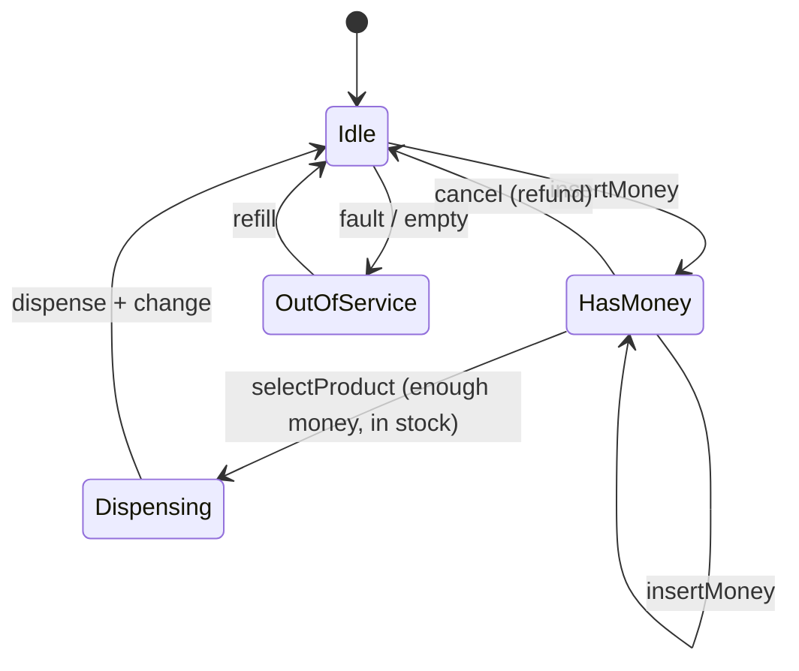

# LLD 3 — Vending Machine

[← Back to LLD](../README.md) · Status: ☐ not started

## Requirements
- Select a product, insert coins/notes, dispense the product, return change; cancel and refund.
- Handle out-of-stock, insufficient money, exact-change-only, and a maintenance/refill mode.

## States (State pattern)
`Idle` → `HasMoney` → `Dispensing` → back to `Idle`; plus `OutOfService`. Each state implements the same operations (`insertMoney`, `selectProduct`, `dispense`, `cancel`) and **rejects invalid ones** with a clear error.

## Entities
`VendingMachine` (context), `State` interface + concrete states, `Product`, `Slot(product, qty)`, `Coin`/`Note` enums, `ChangeCalculator`.

## Key decisions to discuss
- State pattern vs a big `switch` — extensibility and testability.
- **Change-making:** greedy works for standard denominations; fails for odd ones (dynamic programming); what if the machine can't make exact change?
- Thread-safety if two users touch it (it is physically one user; say so).
- Links: a [worked reference solution](../../02-languages/java/07-design-patterns-and-lld/03-lld-interview-problems.md#3-vending-machine-state-pattern) already exists (write your own first, then compare); the [State pattern](../../02-languages/java/07-design-patterns-and-lld/02-design-patterns.md); sealed types for states: [Modern Java](../../02-languages/java/01-java-basics/08-modern-java.md).

## Extension questions
Card payments, product price changes, inventory reporting, remote monitoring.

## Test checklist
- [ ] Happy path with exact money and with change
- [ ] Insufficient money, out-of-stock, cancel mid-transaction
- [ ] Invalid operation in each state is rejected

## Solution
_(add `src/` and links here)_
