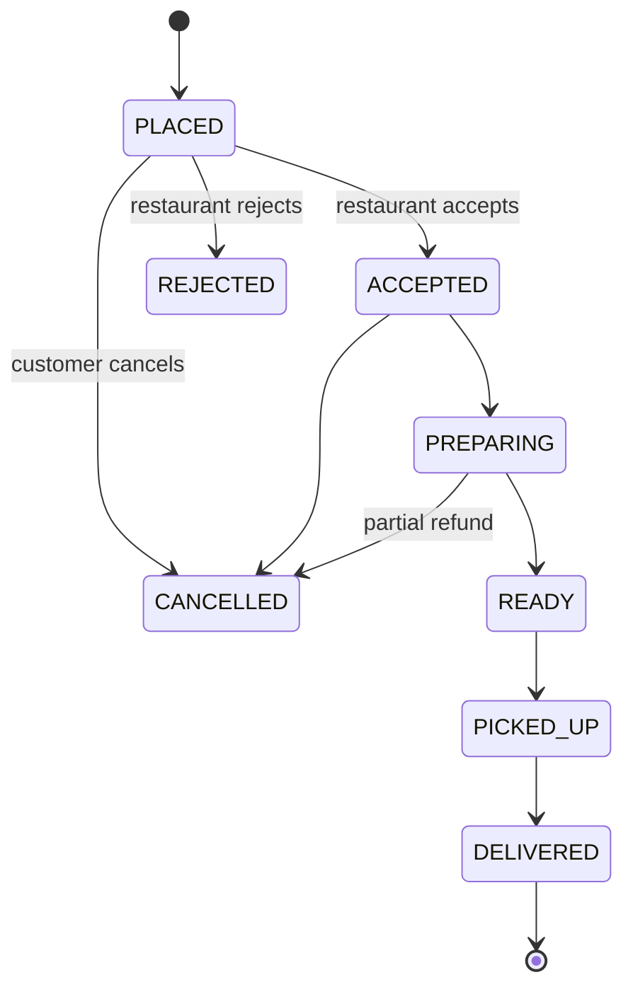

# LLD 5 — Food Delivery Order State Machine

[← Back to LLD](../README.md) · Status: ☐ not started · Priority: ⭐

## Requirements
- An order moves through strict states; **illegal transitions are rejected**.
- Cancellation rules depend on the current state (free before the restaurant accepts, partial refund after preparation starts, not allowed after pick-up).
- **Event hooks** on transitions: notify the customer, assign a delivery partner, trigger refunds, update analytics.
- Keep a full **history** of transitions (who, when, why).

## States and transitions (starting point)
`PLACED → ACCEPTED → PREPARING → READY → PICKED_UP → DELIVERED`, with `CANCELLED` and `REJECTED` reachable from the early states.

## Patterns to apply
- **State** (behaviour per state) or an explicit **transition table** `Map<State, Set<State>>` (simpler, data-driven); **Observer**/domain events for hooks; **Command** for actions with undo/audit.

## Key decisions to discuss
- Transition table vs State classes; where guards (cancellation rules) live.
- **Idempotency:** applying the same event twice must not double-refund; use event ids.
- **Concurrency:** two actors changing the same order at once (customer cancels while the restaurant accepts) → optimistic locking on a version column; see [JPA locking](../../02-languages/java/06-spring-boot/03-jpa-hibernate.md#7-locking-and-concurrency).
- Reliable events after commit: [transactional outbox / `AFTER_COMMIT`](../../02-languages/java/06-spring-boot/02-proxies-transactions-async.md#44-other-attributes-and-rules).

## Extension questions
Delayed delivery, reassigning a delivery partner, partial order items cancelled, SLA timers per state.

## Test checklist
- [ ] Every legal transition succeeds; every illegal one throws
- [ ] Cancellation rule per state (including refund amount)
- [ ] Duplicate event ignored; concurrent conflicting events resolve deterministically

## Solution
_(add `src/` and links here)_
