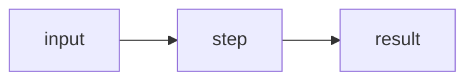

# Problem Name

> **LeetCode:** # · **Difficulty:** Easy / Medium / Hard · **Pattern:** two pointers / heap / DP / … · **Time-box:** 25 min · **Status:** ☐

## Problem
One-paragraph restatement in your own words, with input/output constraints.

## Examples
| Input | Output | Why |
|---|---|---|
|       |        |     |

## Approach
1. Brute force (and why it is too slow).
2. Key insight.
3. Final algorithm in plain steps.



## Complexity
- **Time:** O(?) · **Space:** O(?)

## Edge cases
- Empty / single element / duplicates / negatives / overflow

## Solution (Java 21)
```java
// Run: ProblemName.java
public class ProblemName {
    static int solve(int[] input) {
        return 0;
    }
    public static void main(String[] args) {
        System.out.println(solve(new int[] {}));   // expected: ...
    }
}
```

## What I missed / follow-ups
- 

---
[↑ Back to pattern folder](README.md)
