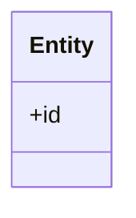

# LLD — Problem Name

[← Back to LLD](../README.md) · Status: ☐ · Time-box: 35 min

## Requirements
- Functional:
- Non-functional (concurrency, scale, extensibility):
- Out of scope:

## Entities & relationships


## Public API
```java
interface Service {
    // the methods a caller sees
}
```

## Patterns used (and why)
| Pattern | Where | Alternative considered |
|---|---|---|

## Concurrency / consistency strategy
- 

## Code
Link to `src/` and the runnable `Main` demo.

## Tests
- [ ] happy path
- [ ] edge cases
- [ ] concurrency test

## Extensions discussed
- 
