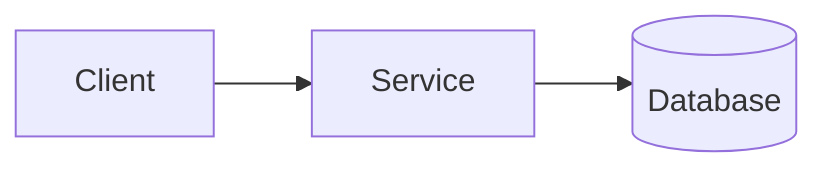

# Topic Title

> **Level:** SDE-II / SDE-III · **Area:** <System Design | Java | Python | Node | DSA> · **Last revised:** YYYY-MM-DD

## TL;DR

Two or three sentences you could say out loud in an interview.

## Concept

Explain the idea from first principles.



## Why it matters

When does this come up? What problem does it solve? What breaks without it?

## Example

```text
Minimal, runnable example or worked scenario.
```

## Trade-offs

| Option | Pros | Cons | Use when |
|--------|------|------|----------|
|        |      |      |          |

## Pitfalls

> [!WARNING]
> Common mistakes and gotchas.

## Interview Q&A

<details>
<summary><b>Q1.</b> Question goes here?</summary>

Answer goes here.

</details>

<details>
<summary><b>Q2.</b> Another question?</summary>

Answer goes here.

</details>

## Further reading

- [Title](https://example.com)

---
[↑ Back to section index](README.md)
